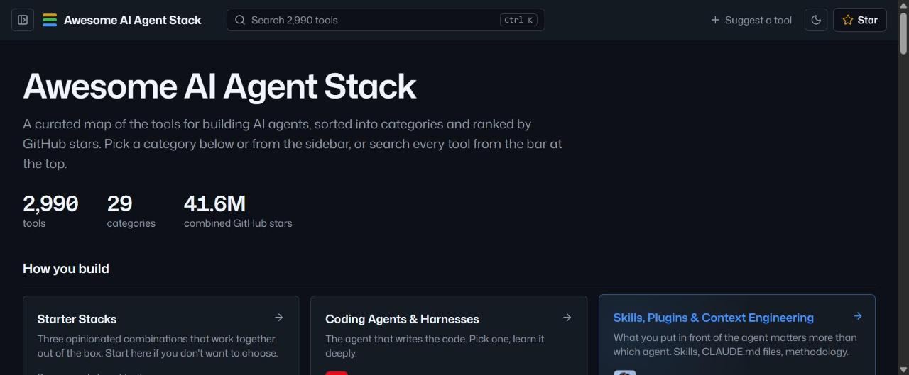

<h1 align="center">Awesome AI Agent Stack</h1>

<p align="center">
  <a href="https://awesome.re"></a>
  <a href="https://tayyabimam1.github.io/awesome-ai-agent-stack/"></a>
  <a href="https://github.com/tayyabimam1/awesome-ai-agent-stack/stargazers"></a>
  <a href="https://github.com/tayyabimam1/awesome-ai-agent-stack/commits/main"></a>
</p>

<p align="center"><em>A curated, layer-by-layer map of the tools I actually use to build AI agents — from the coding agent in your terminal down to the model serving the tokens.</em></p>

<p align="center">
  <a href="https://tayyabimam1.github.io/awesome-ai-agent-stack/"><strong>Browse the website</strong></a> ·
  <a href="https://github.com/tayyabimam1/awesome-ai-agent-stack/edit/main/README.md">Suggest a tool</a>
</p>

<p align="center">
  <a href="https://tayyabimam1.github.io/awesome-ai-agent-stack/"></a>
</p>

**6,000+ tools across 29 categories, ranked by GitHub stars.** Each section is split into sub-groups by what the tools do. Every entry passes a mechanical bar: real, public, not archived, and actively maintained (pushed in the last 12 months); new additions also need 1,000+ stars. Every link is re-checked against the GitHub API, and projects under 10,000 stars that stop being maintained are pruned. Organized as a **stack** so you can find the right tool for each layer of an agent system.

**On the website** you can search every tool, sort any category by stars, and see the most-starred projects in each layer. It rebuilds from this README on every change.

> If this list saves you time, **[give it a star](https://github.com/tayyabimam1/awesome-ai-agent-stack/stargazers)** — it helps other builders find it.

**Weekly maintenance:** Star this repository to follow weekly audits, new AI-agent tools, and removals of dead or stale projects. **[Suggest a tool](https://github.com/tayyabimam1/awesome-ai-agent-stack/discussions/categories/ideas)** or **[report a stale link](https://github.com/tayyabimam1/awesome-ai-agent-stack/discussions/categories/q-a)** in Discussions.

```
┌──────────────────────────────────────────────────────────────┐
│  Coding Agents & Harnesses  →  Skills & Context Engineering  │  ← how you build
├──────────────────────────────────────────────────────────────┤
│  Agent Frameworks  →  Memory  →  RAG  →  MCP / Tools         │  ← what you build with
├──────────────────────────────────────────────────────────────┤
│  Sandboxes & Browsers  →  Document Ingestion  →  Workflows   │  ← what agents act on
├──────────────────────────────────────────────────────────────┤
│  Gateways & Routing  →  Free LLM APIs  →  Local Inference    │  ← where tokens come from
├──────────────────────────────────────────────────────────────┤
│  Evaluation, Observability & Review  →  Reference Systems    │  ← how you ship
└──────────────────────────────────────────────────────────────┘
```

## Contents

- [Coding Agents & Harnesses](#coding-agents--harnesses)
- [Skills, Plugins & Context Engineering](#skills-plugins--context-engineering)
- [Agent Frameworks & Orchestration](#agent-frameworks--orchestration)
- [Memory & Persistent Context](#memory--persistent-context)
- [RAG & Retrieval](#rag--retrieval)
- [MCP Servers & Tool Integration](#mcp-servers--tool-integration)
- [Sandboxes, Browsers & Computer Use](#sandboxes-browsers--computer-use)
- [Document Processing & Data Ingestion](#document-processing--data-ingestion)
- [Workflow Automation](#workflow-automation)
- [Model Gateways & Routing](#model-gateways--routing)
- [Free LLM APIs & Free Tiers](#free-llm-apis--free-tiers)
- [Local Models, Inference & Hardware](#local-models-inference--hardware)
- [Evaluation, Observability & Code Review](#evaluation-observability--code-review)
- [Production Architectures & Reference Systems](#production-architectures--reference-systems)
- [UI & Application Layer](#ui--application-layer)
- [Learning Path](#learning-path)
- [Voice, Speech & Audio](#voice-speech--audio)
- [Vision & Multimodal](#vision--multimodal)
- [Image, Video & Creative Generation](#image-video--creative-generation)
- [Computer Use & GUI Agents](#computer-use--gui-agents)
- [Structured Output, Guardrails & Safety](#structured-output-guardrails--safety)
- [Chat UIs & Application Layer](#chat-uis--application-layer)
- [Deployment, Serving & MLOps](#deployment-serving--mlops)
- [Data, Datasets & Synthetic Data](#data-datasets--synthetic-data)
- [Domain Agents: Finance, Healthcare, Research & More](#domain-agents-finance-healthcare-research--more)
- [Assistants, Copilots & Personal Agents](#assistants-copilots--personal-agents)
- [Interpretability, Alignment & Research](#interpretability-alignment--research)
- [Developer Tools & Utilities](#developer-tools--utilities)
- [Other Awesome Lists](#other-awesome-lists)

## Coding Agents & Harnesses

*The agent that writes the code. Pick one, learn it deeply.*

**Terminal coding agents**

- [anthropics/claude-code](https://github.com/anthropics/claude-code) - Anthropic's terminal coding agent; the reference harness most of this list is built around.
- [openai/codex](https://github.com/openai/codex) - OpenAI's lightweight terminal coding agent.
- [google-gemini/gemini-cli](https://github.com/google-gemini/gemini-cli) - Gemini in the terminal with a generous free tier.
- [anomalyco/opencode](https://github.com/anomalyco/opencode) - Open-source, provider-agnostic coding agent with a polished TUI.
- [Aider-AI/aider](https://github.com/Aider-AI/aider) - Pair-programming in the terminal with git-native edits; the original open coding agent.
- [QwenLM/qwen-code](https://github.com/QwenLM/qwen-code) - Alibaba's open-source terminal coding agent with MCP support.
- [Twigpine/openclaude](https://github.com/Twigpine/openclaude) - Open Claude Code-compatible harness that runs on any provider.
- [deepseek-ai/deepseek-harness](https://github.com/deepseek-ai/deepseek-harness) - Plugin-first agent harness from DeepSeek.
- [earendil-works/pi](https://github.com/earendil-works/pi) - AI agent toolkit: unified LLM API, agent loop, TUI, coding agent CLI.
- [shareAI-lab/learn-claude-code](https://github.com/shareAI-lab/learn-claude-code) - Bash is all you need - A nano claude code–like 「agent harness」, built from 0 to 1.
- [1jehuang/jcode](https://github.com/1jehuang/jcode) - Memory-efficient terminal coding agent for repo work.
- [aws/amazon-q-developer-cli](https://github.com/aws/amazon-q-developer-cli) - AWS terminal coding agent with AWS service integration.
- [can1357/oh-my-pi](https://github.com/can1357/oh-my-pi) - Terminal coding agent with anchored edits and subagents.
- [CodebuffAI/freebuff](https://github.com/CodebuffAI/freebuff) - Free AI coding agent for the terminal.
- [CommandCodeAI/command-code](https://github.com/CommandCodeAI/command-code) - Terminal coding agent supporting multiple model providers.
- [dhanji/g3](https://github.com/dhanji/g3) - Minimal terminal coding agent with multi-model support.
- [gi-dellav/zerostack](https://github.com/gi-dellav/zerostack) - Lightweight Rust coding agent with Git worktrees and ACP.
- [github/copilot-cli](https://github.com/github/copilot-cli) - GitHub's terminal coding agent for repo tasks and commands.
- [codewhale-hq/Codewhale](https://github.com/codewhale-hq/Codewhale) - Rust terminal coding agent with MCP, worktrees, and subagents.
- [gptme/gptme](https://github.com/gptme/gptme) - Terminal agent that codes, browses, and runs autonomously.
- [Kuberwastaken/claurst](https://github.com/Kuberwastaken/claurst) - Agentic coding assistant for builders who ship.
- [letta-ai/letta-code](https://github.com/letta-ai/letta-code) - Stateful terminal coding agent with persistent memory.
- [MayDay-wpf/snow-cli](https://github.com/MayDay-wpf/snow-cli) - Terminal coding agent for OpenAI, Gemini, Claude workflows.
- [MoonshotAI/kimi-code](https://github.com/MoonshotAI/kimi-code) - Moonshot's terminal coding agent with MCP support.
- [mistralai/mistral-vibe](https://github.com/mistralai/mistral-vibe) - Mistral's terminal coding agent with planning and delegation.
- [Nano-Collective/nanocoder](https://github.com/Nano-Collective/nanocoder) - Local-first terminal coding agent with bring-your-own-model.
- [neovateai/neovate-code](https://github.com/neovateai/neovate-code) - Terminal coding agent for codegen, fixes, and headless runs.
- [solvyxtech/molt](https://github.com/solvyxtech/molt) - Coding agent refusing unproven done claims with receipts.
- [superagent-ai/grok-cli](https://github.com/superagent-ai/grok-cli) - Open-source terminal coding agent for the Grok API.
- [SWE-agent/mini-swe-agent](https://github.com/SWE-agent/mini-swe-agent) - Minimalist terminal coding agent for SWE tasks.
- [tailcallhq/forgecode](https://github.com/tailcallhq/forgecode) - Terminal pair programmer with multi-provider model support.
- [truffle-ai/dexto](https://github.com/truffle-ai/dexto) - Terminal coding agent with local-first tool execution.
- [vinhnx/VTCode](https://github.com/vinhnx/VTCode) - Rust terminal coding agent with native sandboxing.
- [vercel-labs/fx](https://github.com/vercel-labs/fx) - Small embeddable Zig coding agent with a Unix-like CLI.
- [XiaomiMiMo/MiMo-Code](https://github.com/XiaomiMiMo/MiMo-Code) - Xiaomi's terminal coding agent with skills and worktrees.
- [xai-org/grok-build](https://github.com/xai-org/grok-build) - xAI terminal coding agent with full-screen interface.
- [vstorm-co/pydantic-deepagents](https://github.com/vstorm-co/pydantic-deepagents) - Self-hosted terminal coding assistant and Python framework for deep agents.
- [charmbracelet/crush](https://github.com/charmbracelet/crush) - Glamourous agentic coding for all.
- [stakpak/agent](https://github.com/stakpak/agent) - Terminal AI coding agent for agentic software engineering.
- [Tura-AI/tura](https://github.com/Tura-AI/tura) - Coding agent harness with terminal and editor integrations.
- [vybestack/llxprt-code](https://github.com/vybestack/llxprt-code) - Multi-provider AI coding assistant CLI for terminal workflows.
- [fuxicodex/Fuxi](https://github.com/fuxicodex/Fuxi) - FuXi is a fast, self-contained AI coding agent that lives in your terminal — edit code, run commands, and drive tools, with cost-aware routi.
- [codewhale-hq/Codewhale](https://github.com/codewhale-hq/Codewhale) - Open-source Rust agent engine and terminal client for Codewhale, with provider choice, tools, approvals and receipts.
- [claude-code-best/claude-code](https://github.com/claude-code-best/claude-code) - Runnable and debuggable build of the Claude Code terminal agent.
- [zai-org/ZCode](https://github.com/zai-org/ZCode) - Extensible coding agent harness from Z.ai.
- [anus-dev/ANUS](https://github.com/anus-dev/ANUS) - Terminal coding agent that runs on whichever free model is currently available.
- [shareAI-lab/Kode-CLI](https://github.com/shareAI-lab/Kode-CLI) - Terminal AI agent aimed at general human and computer tasks.
- [iflow-ai/iflow-cli](https://github.com/iflow-ai/iflow-cli) - Terminal-based coding agent for repository analysis and task automation.
- [DSH-APP/DSHA](https://github.com/DSH-APP/DSHA) - Run DeepSeek harness and Ubuntu environment on Android without root.
- [huggingface/tau](https://github.com/huggingface/tau) - Python port of Pi's minimalist coding agent.
- [google-antigravity/antigravity-cli](https://github.com/google-antigravity/antigravity-cli) - Terminal CLI that brings the Antigravity agent harness to the command line.
- [1rgs/nanocode](https://github.com/1rgs/nanocode) - Minimalist terminal-based coding agent harness.
- [itayinbarr/little-coder](https://github.com/itayinbarr/little-coder) - Coding agent harness tuned for smaller local LLMs.
- [tanbiralam/claude-code](https://github.com/tanbiralam/claude-code) - Terminal-based agentic coding tool for codebase navigation and task automation.
- [getkimchi/kimchi](https://github.com/getkimchi/kimchi) - Terminal coding agent with multi-model orchestration.
- [MiniMax-AI/minimax-code](https://github.com/MiniMax-AI/minimax-code) - Open-source terminal coding agent powered by MiniMax.
- [microsoft/intelligent-terminal](https://github.com/microsoft/intelligent-terminal) - Fork of Windows Terminal with native agent integration through the Agent Client Protocol.
- [lessweb/deepcode-cli](https://github.com/lessweb/deepcode-cli) - Terminal coding assistant optimized for DeepSeek V4 with reasoning-effort control and Agent Skills.
- [AntigmaLabs/ante](https://github.com/AntigmaLabs/ante) - Self-contained Rust terminal agent harness, similar to Claude Code or Codex but model-agnostic.
- [Doorman11991/smallcode](https://github.com/Doorman11991/smallcode) - AI coding agent optimized for small LLMs, scoring 87% on a benchmark with a 4B-active model.
- [Dicklesworthstone/pi_agent_rust](https://github.com/Dicklesworthstone/pi_agent_rust) - High-performance AI coding agent CLI written in Rust with zero unsafe code.
- [StartupHakk/OpenMonoAgent.ai](https://github.com/StartupHakk/OpenMonoAgent.ai) - Terminal-native coding agent powered by local LLMs, free and open source.
- [Twigpine/zero](https://github.com/Twigpine/zero) - Terminal coding agent you control, working with your choice of model on your machine.
- [lorryjovens-hub/claude-code-rust](https://github.com/lorryjovens-hub/claude-code-rust) - High-performance Rust implementation of Claude Code.
- [proxysoul/Empryo](https://github.com/proxysoul/Empryo) - AI coding harness for desktop, terminal and CI that edits code by symbol via AST and LSP.
- [dirac-run/dirac](https://github.com/dirac-run/dirac) - Coding agent focused on efficiency and context curation, using hash-anchored edits.
- [yusufcanb/tlm](https://github.com/yusufcanb/tlm) - A local CLI copilot powered by Ollama.
- [tontinton/maki](https://github.com/tontinton/maki) - Efficient AI coding agent extendable by neovim-like Lua plugins.
- [laude-institute/headlong](https://github.com/laude-institute/headlong) - A bash-based agent microharness with persistent agency and recursive LLMs.
- [soongenwong/claudecode](https://github.com/soongenwong/claudecode) - Open-source terminal coding agent replicating Claude Code functionality in Rust.
- [dulikaifazr/Cougar-CLI](https://github.com/dulikaifazr/Cougar-CLI) - An AI programming agent for the command line.
- [LiuMengxuan04/MiniCode](https://github.com/LiuMengxuan04/MiniCode) - A lightweight terminal coding assistant with Claude Code-like workflow, tool loop, and TUI architecture.
- [momozi1996/momo-code](https://github.com/momozi1996/momo-code) - AI coding agent that evolves with you.
- [walter-grace/mac-code](https://github.com/walter-grace/mac-code) - A free local AI coding agent running on Apple Silicon as a Claude Code alternative.
- [ConardLi/easy-agent](https://github.com/ConardLi/easy-agent) - Terminal coding agent with sandboxing, MCP, and multiple model support.
- [Harvil1/codeAgent](https://github.com/Harvil1/codeAgent) - Terminal-based coding agent that plans, edits, runs tests, and iterates until tasks complete.
- [pulseaiclub/phi](https://github.com/pulseaiclub/phi) - Fast terminal-based coding agent with RPC plugins, sub-agents, and MCP support.
- [OleksandrChekhovskyi/hax](https://github.com/OleksandrChekhovskyi/hax) - A minimalist, terminal-native coding agent written in C.

**IDE, editor & desktop agents**

- [cline/cline](https://github.com/cline/cline) - Autonomous coding agent inside VS Code with human-in-the-loop approvals.
- [continuedev/continue](https://github.com/continuedev/continue) - Open-source coding agent.
- [Kilo-Org/kilocode](https://github.com/Kilo-Org/kilocode) - Open-source agentic coding platform for VS Code and JetBrains; the Roo Code successor.
- [intitni/CopilotForXcode](https://github.com/intitni/CopilotForXcode) - The first GitHub Copilot, Codeium and ChatGPT Xcode Source Editor Extension.
- [TabbyML/tabby](https://github.com/TabbyML/tabby) - Self-hosted AI coding assistant with autocomplete, chat, and RAG.
- [avante-corp/avante.nvim](https://github.com/avante-corp/avante.nvim) - Cursor-style AI coding features for Neovim.
- [baiyuscc13724-max/deepseek-harness-desktop](https://github.com/baiyuscc13724-max/deepseek-harness-desktop) - Desktop client for the DeepSeek Harness coding workbench.
- [coder/claudecode.nvim](https://github.com/coder/claudecode.nvim) - Neovim bridge making it a first-class Claude Code IDE.
- [olimorris/codecompanion.nvim](https://github.com/olimorris/codecompanion.nvim) - ACP-based AI chat and coding assistant for Neovim.
- [PawanOsman/OpenCursor](https://github.com/PawanOsman/OpenCursor) - VS Code coding agent with agentic chat and semantic search.
- [stagewise-io/stagewise](https://github.com/stagewise-io/stagewise) - Agentic IDE with code editing and app previews.
- [warpdotdev/warp](https://github.com/warpdotdev/warp) - Agentic terminal combining a modern shell with coding agents.
- [trypear/pearai-master](https://github.com/trypear/pearai-master) - Open-source AI-native code editor (PearAI).
- [winfunc/opcode](https://github.com/winfunc/opcode) - Desktop GUI for Claude Code: custom agents and sessions.
- [zed-industries/zed](https://github.com/zed-industries/zed) - High-performance editor with built-in agentic coding.
- [editor-code-assistant/eca](https://github.com/editor-code-assistant/eca) - Editor-agnostic AI pair programming server and protocol.
- [github/CopilotForXcode](https://github.com/github/CopilotForXcode) - GitHub's official Copilot coding assistant for Xcode.
- [NanmiCoder/cc-haha](https://github.com/NanmiCoder/cc-haha) - Local-first cross-platform desktop workspace for Claude Code / agents: multi-agent, Git worktrees, code diffs, skill marketplace, multi-mode.
- [zhukunpenglinyutong/desktop-cc-gui](https://github.com/zhukunpenglinyutong/desktop-cc-gui) - Multi-engine AI coding desktop client (Tauri). Claude Code, Codex, Gemini, OpenCode, DeepSeek Harness and more in one GUI.
- [CoderLuii/HolyClaude](https://github.com/CoderLuii/HolyClaude) - AI coding workstation: Claude Code + web UI + 8 AI CLIs + headless browser + 50+ tools.
- [different-ai/openwork](https://github.com/different-ai/openwork) - Open source alternative to Claude Cowork, powered by opencode.
- [YishenTu/claudian](https://github.com/YishenTu/claudian) - Obsidian plugin that embeds Claude Code, Codex and other agents as a collaborator in your vault.
- [github/copilot.vim](https://github.com/github/copilot.vim) - Neovim plugin for GitHub Copilot.
- [conwnet/github1s](https://github.com/conwnet/github1s) - One second to read GitHub code with VS Code.
- [crynta/terax-ai](https://github.com/crynta/terax-ai) - Lightweight terminal-first AI-native development environment built with Tauri.
- [vastsa/PI-Desktop](https://github.com/vastsa/PI-Desktop) - Local-first AI coding agent desktop app built on Electron, a Rust core and the pi agent harness.
- [zhukunpenglinyutong/jetbrains-cc-gui](https://github.com/zhukunpenglinyutong/jetbrains-cc-gui) - JetBrains IDE plugin that provides a GUI for Claude Code and Codex.
- [op7418/CodePilot](https://github.com/op7418/CodePilot) - Electron desktop client for AI agents with any provider, MCP, skills and phone control.
- [get-bb/bb](https://github.com/get-bb/bb) - Agent IDE for working with coding agents such as Claude Code and Codex.
- [omnirush-ai/omnirush-gui](https://github.com/omnirush-ai/omnirush-gui) - Desktop coding agent with free access to frontier models.
- [ThePrimeagen/99](https://github.com/ThePrimeagen/99) - AI agent plugin for Neovim.
- [phodal/auto-dev](https://github.com/phodal/auto-dev) - Multi-agent coding development platform built on Kotlin Multiplatform with IntelliJ integration.
- [kirodotdev/Kiro](https://github.com/kirodotdev/Kiro) - Agentic IDE that works alongside the developer from prototype to production.
- [zgsm-ai/costrict](https://github.com/zgsm-ai/costrict) - Enterprise AI coding assistant with agent, code review and code completion for IDEs.
- [zbirenbaum/copilot.lua](https://github.com/zbirenbaum/copilot.lua) - Neovim plugin for GitHub Copilot providing complete API and auto-completion integration.
- [nickjvandyke/opencode.nvim](https://github.com/nickjvandyke/opencode.nvim) - Neovim plugin to integrate OpenCode LLMs directly into the developer workflow.
- [twinnydotdev/twinny](https://github.com/twinnydotdev/twinny) - VS Code AI coding assistant with agent mode, completion, chat and edits on local or hosted models.
- [opensumi/core](https://github.com/opensumi/core) - Framework for building AI-native IDE products, with an MCP client for tool use.
- [CopilotC-Nvim/CopilotChat.nvim](https://github.com/CopilotC-Nvim/CopilotChat.nvim) - Neovim plugin for chatting with GitHub Copilot.
- [dsh-tauri/deepseek-harness-desktop](https://github.com/dsh-tauri/deepseek-harness-desktop) - Tauri desktop app for DeepSeek Harness with preset plugins and no environment setup.
- [athasdev/athas](https://github.com/athasdev/athas) - Lightweight Tauri code editor with Git support, AI agents and vim keybindings.
- [folke/sidekick.nvim](https://github.com/folke/sidekick.nvim) - Neovim plugin providing AI sidekick integration with Claude Code, Copilot, and Gemini CLI.
- [RAIT-09/obsidian-agent-client](https://github.com/RAIT-09/obsidian-agent-client) - Obsidian plugin that brings ACP agents such as Claude Code, Codex and Gemini CLI into Obsidian.
- [ggml-org/llama.vim](https://github.com/ggml-org/llama.vim) - Vim plugin for LLM-assisted code and text completion.
- [Zoo-Code-Org/Zoo-Code](https://github.com/Zoo-Code-Org/Zoo-Code) - Team of AI coding agents inside your code editor.
- [greggh/claude-code.nvim](https://github.com/greggh/claude-code.nvim) - Neovim plugin for integrating Claude Code AI assistant.
- [xenodium/agent-shell](https://github.com/xenodium/agent-shell) - Brings AI agents to Emacs with native buffers and key bindings via the Agent Client Protocol.
- [px0-ai/px0](https://github.com/px0-ai/px0) - Browser-based IDE for reviewing and editing AI-generated code with Git integration.
- [carlrobertoh/ProxyAI](https://github.com/carlrobertoh/ProxyAI) - An open-source AI copilot plugin for JetBrains IDEs.
- [hanshuaikang/nezha](https://github.com/hanshuaikang/nezha) - Code editor for the AI agents era with multi-agent support.
- [egoist/waku](https://github.com/egoist/waku) - Native app for working with all your coding agents.
- [Rice-dog/code-codex](https://github.com/Rice-dog/code-codex) - Local project file tree and preview companion for Codex Desktop.
- [ggml-org/llama.vscode](https://github.com/ggml-org/llama.vscode) - VS Code extension for LLM-assisted code and text completion.
- [dvdsgl/claude-canvas](https://github.com/dvdsgl/claude-canvas) - Give Claude Code an external monitor for enhanced visualization.
- [chmod777john/swarm-ide](https://github.com/chmod777john/swarm-ide) - IDE built for agent swarms supporting multiple LLMs.
- [milanglacier/minuet-ai.nvim](https://github.com/milanglacier/minuet-ai.nvim) - Neovim plugin for as-you-type code completion from OpenAI, Gemini, Claude, Ollama and more.
- [elirantutia/vibeyard](https://github.com/elirantutia/vibeyard) - The IDE built for AI coding agents.
- [huggingface/llm-vscode](https://github.com/huggingface/llm-vscode) - LLM powered development extension for VSCode.
- [ai-genie/chatgpt-vscode](https://github.com/ai-genie/chatgpt-vscode) - VS Code extension providing AI pair programming.
- [aicodeking/pandacode](https://github.com/aicodeking/pandacode) - Desktop workspace for coding agents.
- [Oleafly/Oleafly](https://github.com/Oleafly/Oleafly) - LaTeX and Typst editor with live collaboration and AI agents.
- [Kc1t/alethe-agents](https://github.com/Kc1t/alethe-agents) - Desktop workspace for managing multiple coding agents and shells.
- [huggingface/llm.nvim](https://github.com/huggingface/llm.nvim) - LLM-powered development plugin for Neovim.
- [madox2/vim-ai](https://github.com/madox2/vim-ai) - AI-powered code assistant for Vim and Neovim.
- [DeepMyst/Mysti](https://github.com/DeepMyst/Mysti) - AI coding agent team for VS Code where Claude Code and OpenAI Codex collaborate on solutions.
- [paean-ai/deeptide](https://github.com/paean-ai/deeptide) - Swift-native macOS coding agent built by DeepSeek.
- [alishobeiri/thread-notebook](https://github.com/alishobeiri/thread-notebook) - AI-powered Jupyter Notebook for generating code and chatting with data.
- [alchaincyf/fanbox](https://github.com/alchaincyf/fanbox) - A cockpit for vibe coding with file browsing, command agents, and change tracking.

**Autonomous software engineers**

- [OpenHands/OpenHands](https://github.com/OpenHands/OpenHands) - Autonomous software-development agent platform with sandboxed execution.
- [aaif-goose/goose](https://github.com/aaif-goose/goose) - Extensible open-source agent that installs, runs and tests code with any LLM.
- [Significant-Gravitas/AutoGPT](https://github.com/Significant-Gravitas/AutoGPT) - The project that started the autonomous-agent wave; now a platform for building agents.
- [ai-christianson/RA.Aid](https://github.com/ai-christianson/RA.Aid) - Autonomous dev agent that plans, edits, and validates.
- [AndyMik90/Aperant](https://github.com/AndyMik90/Aperant) - Autonomous multi-session AI coding with verification.
- [aws-samples/remote-swe-agents](https://github.com/aws-samples/remote-swe-agents) - AWS samples for running SWE agents remotely.
- [bytedance/trae-agent](https://github.com/bytedance/trae-agent) - ByteDance's software engineering agent for repo tasks.
- [open-inspect/background-agents](https://github.com/open-inspect/background-agents) - Self-hosted background coding system for repo tasks.
- [HKUDS/DeepCode](https://github.com/HKUDS/DeepCode) - Agentic coding system turning specs into code and sites.
- [imbue-ai/sculptor](https://github.com/imbue-ai/sculptor) - Imbue's coding agent with verification harnesses.
- [langchain-ai/open-swe](https://github.com/langchain-ai/open-swe) - Async coding agent working tasks in isolated environments.
- [PrimeIntellect-ai/prime-agent](https://github.com/PrimeIntellect-ai/prime-agent) - Self-improving coding agent for long-running tasks.
- [Pythagora-io/gpt-pilot](https://github.com/Pythagora-io/gpt-pilot) - AI developer that plans, writes, and debugs whole apps.
- [SWE-agent/SWE-agent](https://github.com/SWE-agent/SWE-agent) - Autonomous agent that resolves real GitHub issues.
- [chaitin/MonkeyCode](https://github.com/chaitin/MonkeyCode) - AI coding platform for teams.
- [algorithmicsuperintelligence/openevolve](https://github.com/algorithmicsuperintelligence/openevolve) - Open-source implementation of AlphaEvolve, an evolutionary coding agent for program discovery.
- [kuafuai/DevOpsGPT](https://github.com/kuafuai/DevOpsGPT) - Multi-agent system that turns natural-language requirements into working software.
- [AutoCodeRoverSG/auto-code-rover](https://github.com/AutoCodeRoverSG/auto-code-rover) - Autonomous software engineer that improves codebases using project structure awareness.
- [yologdev/yoyo-evolve](https://github.com/yologdev/yoyo-evolve) - Coding agent that evolves its own source code with every commit agent-written and test-gated.
- [magiksoft/aider-desk](https://github.com/magiksoft/aider-desk) - Platform for AI-powered software engineers.
- [ntegrals/10x](https://github.com/ntegrals/10x) - Open-source agent that speeds AI coding with smart model routing.
- [strongdm/attractor](https://github.com/strongdm/attractor) - A non-interactive coding agent for use in a software factory.
- [EuniAI/Prometheus](https://github.com/EuniAI/Prometheus) - Knowledge-graph-driven agent that maps, understands, and repairs codebases.
- [Agent-Field/SWE-AF](https://github.com/Agent-Field/SWE-AF) - Autonomous fleet of AI agents that plan, code, test, and ship production-grade pull requests.
- [asklokesh/loki-mode](https://github.com/asklokesh/loki-mode) - Autonomous software factory that generates pull requests from GitHub issues or tasks.
- [marcus/nightshift](https://github.com/marcus/nightshift) - Uses leftover LLM budget to autonomously generate useful pull requests.
- [TransformerOptimus/SuperCoder](https://github.com/TransformerOptimus/SuperCoder) - Open-source autonomous software development system that plans and writes code.

**General-purpose agent harnesses**

- [NousResearch/hermes-agent](https://github.com/NousResearch/hermes-agent) - Self-improving general-purpose agent with a large skills ecosystem.
- [openclaw/openclaw](https://github.com/openclaw/openclaw) - Cross-platform agent that operates the OS, not just the editor.
- [agentlas-ai/Agentlas-OS](https://github.com/agentlas-ai/Agentlas-OS) - Local-first OS staffing specialist agent teams per task.
- [truefoundry/trueforge](https://github.com/truefoundry/trueforge) - Open-source agent harness that turns an LLM into a working agent runtime.
- [autonomous-ai/openharness](https://github.com/autonomous-ai/openharness) - Harness to run all your coding agents across all your machines.
- [androoAGI/starnet](https://github.com/androoAGI/starnet) - Local-first desktop agent harness where agents work in a pixel-art station.
- [InsForge/InsForge](https://github.com/InsForge/InsForge) - The all-in-one, open-source backend platform for agentic coding. InsForge gives your coding agent database, auth, storage, compute, hosting,.
- [XiaoDuoYa/codex-with-chatgpt](https://github.com/XiaoDuoYa/codex-with-chatgpt) - ChatGPT thinks. Codex works. Use ChatGPT as the planning brain while keeping the Codex harness.
- [teaql/teaql-agent-kit](https://github.com/teaql/teaql-agent-kit) - A model-mediated harness for reliable agentic software development.
- [earendil-works/pi](https://github.com/earendil-works/pi) - AI agent toolkit: unified LLM API, agent loop, TUI, coding agent CLI.
- [OpenHands/OpenHands](https://github.com/OpenHands/OpenHands) - 🙌 OpenHands: AI-Driven Development.
- [dohooo/helmor](https://github.com/dohooo/helmor) - Open-source local workbench for multi-agent software development.
- [HKUDS/OpenHarness](https://github.com/HKUDS/OpenHarness) - Open agent harness with a built-in personal agent called Ohmo.
- [yc-software/qm](https://github.com/yc-software/qm) - Multiplayer agent harness for work.
- [mindfold-ai/Trellis](https://github.com/mindfold-ai/Trellis) - Agent harness for agentic coding workflows with Claude Code and Codex.
- [OpenBMB/XAgent](https://github.com/OpenBMB/XAgent) - Autonomous LLM agent for solving complex tasks.
- [thirdlayerinc/autoagent](https://github.com/thirdlayerinc/autoagent) - Autonomous harness for engineering tasks.
- [onecli/onecli](https://github.com/onecli/onecli) - Open-source sandboxed agent harness that gives each employee a secured personal agent.
- [Prism-Shadow/penguin-harness](https://github.com/Prism-Shadow/penguin-harness) - Agent harness platform aimed at recursive self-improvement.
- [yb2460/harness-anything](https://github.com/yb2460/harness-anything) - An AI agent control hub for office software and CLI commands.
- [ShenSeanChen/waku-agent](https://github.com/ShenSeanChen/waku-agent) - Local-first Python agent harness with an agent loop, memory and evals in readable code.
- [zhnt/loushang](https://github.com/zhnt/loushang) - AI-native agent harness for coding workflows with multi-model orchestration.
- [AgnesAI-Labs/agnes-harness](https://github.com/AgnesAI-Labs/agnes-harness) - Pluggable agent harness for Forward Deployed Engineering.
- [AMAP-ML/LongHorizon-Harness](https://github.com/AMAP-ML/LongHorizon-Harness) - Harness for long-running computer-use agents with fresh-context runs, durable state and auditing.
- [exoharness/exo](https://github.com/exoharness/exo) - Recursive agent and harness architecture that can safely edit all aspects of itself at runtime.
- [razzant/ouroboros](https://github.com/razzant/ouroboros) - Self-creating autonomous AI agent for general-purpose and coding tasks.
- [openonion/connectonion](https://github.com/openonion/connectonion) - Agent CLI harness for building and running agents from the command line.
- [valkor-ai/loom](https://github.com/valkor-ai/loom) - Loop engineering framework for agentic software delivery.
- [ishaan1013/shadow](https://github.com/ishaan1013/shadow) - Background coding agent and real-time web interface.
- [limecloud/lime](https://github.com/limecloud/lime) - Full-stack AI agent for coding, files, terminals, research and multi-agent workflows.
- [hesamsheikh/octogent](https://github.com/hesamsheikh/octogent) - An orchestration dashboard for managing Claude Code context and automation.
- [huiliyi37/Tianshu-harness](https://github.com/huiliyi37/Tianshu-harness) - A terminal coding agent harness that externalizes goals and state to ensure stable delivery.
- [SaladDay/pi-from-scratch](https://github.com/SaladDay/pi-from-scratch) - 600-line TypeScript implementation of a minimalist AI agent framework.
- [hoangnb24/repository-harness](https://github.com/hoangnb24/repository-harness) - Turns any repo into an agent-ready workspace for coding agents.
- [rasbt/mini-coding-agent](https://github.com/rasbt/mini-coding-agent) - A minimal Python implementation explaining the core components of coding agents.
- [Chorus-AIDLC/Chorus](https://github.com/Chorus-AIDLC/Chorus) - Agent harness for AI-human collaboration and task management.
- [cuga-project/cuga-agent](https://github.com/cuga-project/cuga-agent) - An open-source generalist agent harness for the enterprise supporting complex tasks.
- [withkynam/vibecode-pro-max-kit](https://github.com/withkynam/vibecode-pro-max-kit) - Spec-driven coding harness with multiple agents and skills for autonomous feature development.
- [Onelevenvy/flock](https://github.com/Onelevenvy/flock) - Desktop multi-agent harness in Rust and React, powered by langgraph-rust.
- [pat-jj/harness-1](https://github.com/pat-jj/harness-1) - Recipe for training long-horizon search agents with a stateful harness.
- [wk42worldworld/cybercode](https://github.com/wk42worldworld/cybercode) - An AI agent combining Claude Code coding capabilities with Hermes Agent self-evolution.
- [qiz029/dscode](https://github.com/qiz029/dscode) - A DeepSeek coding agent harness with persistent shell and Chrome MCP integration.

**Multi-agent orchestration on top of coding agents**

- [stablyai/orca](https://github.com/stablyai/orca) - Agentic Development Environment for running fleets of parallel coding agents.
- [Yeachan-Heo/oh-my-claudecode](https://github.com/Yeachan-Heo/oh-my-claudecode) - Teams-first multi-agent orchestration layer for Claude Code.
- [code-yeongyu/oh-my-openagent](https://github.com/code-yeongyu/oh-my-openagent) - Graph-based multi-agent workflows triggered from a single prompt.
- [openai/codex-plugin-cc](https://github.com/openai/codex-plugin-cc) - Delegate review or tasks from Claude Code to Codex.
- [asheshgoplani/agent-deck](https://github.com/asheshgoplani/agent-deck) - Kanban-style TUI for running parallel coding agents.
- [AutoMaker-Org/automaker](https://github.com/AutoMaker-Org/automaker) - Autonomous coding agent orchestrator for multi-agent builds.
- [awslabs/cli-agent-orchestrator](https://github.com/awslabs/cli-agent-orchestrator) - AWS Labs harness for orchestrating CLI coding agents.
- [Charlie85270/Dorothy](https://github.com/Charlie85270/Dorothy) - TUI dashboard for parallel Claude Code sessions.
- [coder/xum](https://github.com/coder/xum) - A desktop app for isolated, parallel agentic development.
- [Dicklesworthstone/ntm](https://github.com/Dicklesworthstone/ntm) - Named tmux manager coordinating AI coding agents.
- [dagger/container-use](https://github.com/dagger/container-use) - Isolated dev environments for parallel coding agents.
- [gastownhall/gastown](https://github.com/gastownhall/gastown) - Terminal multi-agent coding orchestrator.
- [generalaction/emdash](https://github.com/generalaction/emdash) - Open-source agentic development environment for running coding agents in parallel.
- [getpaseo/paseo](https://github.com/getpaseo/paseo) - Parallel coding agent orchestrator for Claude and Codex.
- [herdrdev/herdr](https://github.com/herdrdev/herdr) - Agent-aware multiplexer for building agentic coding systems.
- [johannesjo/parallel-code](https://github.com/johannesjo/parallel-code) - Run multiple coding agents in parallel workspaces.
- [launchapp-dev/animus-cli](https://github.com/launchapp-dev/animus-cli) - Orchestrator running multi-model dev teams from YAML.
- [looptroop-ai/LoopTroop](https://github.com/looptroop-ai/LoopTroop) - Local AI coding orchestration for repo-scale work.
- [madarco/agentbox](https://github.com/madarco/agentbox) - Run coding agents in parallel sandboxed VMs.
- [mixpeek/amux](https://github.com/mixpeek/amux) - Control plane running dozens of parallel coding agents.
- [nimbalyst/nimbalyst](https://github.com/nimbalyst/nimbalyst) - Open-source visual workspace for Claude Code, Codex, and OpenCode.
- [nwiizo/ccswarm](https://github.com/nwiizo/ccswarm) - Swarm manager orchestrating Claude Code sessions in worktrees.
- [Orkas-AI/Orkas](https://github.com/Orkas-AI/Orkas) - Local-first desktop AI workforce coordinating coding agents.
- [penso/arbor](https://github.com/penso/arbor) - Multi-agent coding orchestration in the terminal.
- [proliferate-ai/proliferate](https://github.com/proliferate-ai/proliferate) - Agent IDE for Claude Code, Codex, and Gemini in parallel.
- [pungme/superagent-desktop](https://github.com/pungme/superagent-desktop) - macOS desktop giving coding agents a browser and simulator.
- [raysonmeng/agent-bridge](https://github.com/raysonmeng/agent-bridge) - Local bridge for Claude Code and Codex collaboration.
- [sahithvibudhi/vibe-tree](https://github.com/sahithvibudhi/vibe-tree) - Execute Claude Code tasks in parallel git worktrees.
- [simion/termic](https://github.com/simion/termic) - Terminal multiplexer for agent coding sessions.
- [smtg-ai/claude-squad](https://github.com/smtg-ai/claude-squad) - Manage multiple Claude Code agents from one unified TUI.
- [standardagents/dmux](https://github.com/standardagents/dmux) - tmux-based multiplexer for parallel agent sessions.
- [stravu/crystal](https://github.com/stravu/crystal) - Desktop app running parallel Claude Code sessions.
- [subsy/ralph-tui](https://github.com/subsy/ralph-tui) - TUI runner for Ralph-style autonomous coding loops.
- [tempestai-dev/tempest](https://github.com/tempestai-dev/tempest) - Tauri desktop running CLI coding agents in parallel.
- [wainmann/agent-manager](https://github.com/wainmann/agent-manager) - Go TUI running coding agents side by side in tmux.
- [iOfficeAI/AionUi](https://github.com/iOfficeAI/AionUi) - Desktop cowork app that runs Claude Code, Codex, OpenCode and other agents.
- [manaflow-ai/cmux](https://github.com/manaflow-ai/cmux) - Ghostty-based macOS terminal with vertical tabs and notifications for coding agents.
- [openchamber/openchamber](https://github.com/openchamber/openchamber) - Agentic development environment built on the OpenCode agent.
- [alvinunreal/oh-my-opencode-slim](https://github.com/alvinunreal/oh-my-opencode-slim) - Lean multi-agent suite for OpenCode with model mixing and auto delegation.
- [darrenhinde/OpenAgentsControl](https://github.com/darrenhinde/OpenAgentsControl) - Plan-first agent framework with approval-gated execution for coding workflows.
- [codeaholicguy/ai-devkit](https://github.com/codeaholicguy/ai-devkit) - Control plane for managing and standardizing AI coding agents.
- [BloopAI/vibe-kanban](https://github.com/BloopAI/vibe-kanban) - Get 10X more out of Claude Code, Codex or any coding agent.
- [HarnessMD/munder-difflin](https://github.com/HarnessMD/munder-difflin) - Local multi-agent harness driving your Claude Code and Codex subscriptions.
- [coleam00/Archon](https://github.com/coleam00/Archon) - Open-source harness builder for AI coding agents.
- [mattpocock/sandcastle](https://github.com/mattpocock/sandcastle) - Orchestrate sandboxed coding agents in TypeScript.
- [omnigent-ai/omnigent](https://github.com/omnigent-ai/omnigent) - Meta-harness orchestrating Claude Code, Codex, Cursor, and custom agents.
- [openai/symphony](https://github.com/openai/symphony) - Turns project work into isolated, autonomous implementation runs.
- [OrchestratorInc/agent-orchestrator](https://github.com/OrchestratorInc/agent-orchestrator) - Run and supervise teams of coding agents from planning to merge.
- [max-sixty/worktrunk](https://github.com/max-sixty/worktrunk) - Git worktree CLI built for running AI coding agents in parallel.
- [mvschwarz/openrig](https://github.com/mvschwarz/openrig) - Persistent teams of Claude Code, Codex and Pi agents with roles and shared context.
- [Gaurav-Gosain/tuios](https://github.com/Gaurav-Gosain/tuios) - Terminal window manager that tracks what your agents are doing.
- [zeronsh/zeron](https://github.com/zeronsh/zeron) - Native control plane for Claude Code, Codex, Cursor and other coding agents.
- [SeemSeam/claude_codex_bridge](https://github.com/SeemSeam/claude_codex_bridge) - Visible multi-agent CLI workspace for mixing Codex, Claude, Gemini, Kimi, Qwen, Cursor, Copilot, Pi, OpenCode, and other AI coding agents.
- [agent-of-empires/agent-of-empires](https://github.com/agent-of-empires/agent-of-empires) - Manage multiple Claude Code, OpenCode agents from either TUI or Web for easy access on mobile. Also supports Mistral Vibe, Codex CLI, Gemini.
- [HarnessMD/munder-difflin](https://github.com/HarnessMD/munder-difflin) - an open-source alternative to the dots, bots and muses of the world, run an office of claude code/codex like agents on your laptop, sandboxe.
- [kungfu-systems/kungfu](https://github.com/kungfu-systems/kungfu) - Your agents don’t hand off the work. Kungfu keeps the same Work moving across Codex, Claude, OpenCode, and your own execution surface.
- [the-open-engine/zeroshot](https://github.com/the-open-engine/zeroshot) - Runs coding agents as a graph: one agent implements, independent agents review, failures go to repair, and nothing ships until the checks pa.
- [Yeachan-Heo/oh-my-codex](https://github.com/Yeachan-Heo/oh-my-codex) - Layer for Codex CLI that adds hooks, agent teams and HUDs.
- [Gentleman-Programming/gentle-shell](https://github.com/Gentleman-Programming/gentle-shell) - Pi-native workspace for AI-assisted development with parallel coding agents, live tasks, Git diffs, memory and permission controls.
- [spacering-net/codeg](https://github.com/spacering-net/codeg) - Collaborative multi-agent coding workspace aggregating sessions from various coding agents.
- [hardbeat920/monocode](https://github.com/hardbeat920/monocode) - Graphical interface for working with coding agents.
- [code-yeongyu/lazycodex](https://github.com/code-yeongyu/lazycodex) - Agent harness inside Codex that adds project memory, planning, execution and verification.
- [NanmiCoder/dsh-agent-teams](https://github.com/NanmiCoder/dsh-agent-teams) - DeepSeek Harness plugin for multi-agent teams with task assignment and messaging.
- [moazbuilds/CodeMachine-CLI](https://github.com/moazbuilds/CodeMachine-CLI) - Orchestrate AI coding agents into repeatable, long-running workflows from the CLI.
- [supabitapp/supacode](https://github.com/supabitapp/supacode) - Command center for running coding agents in git worktrees.
- [vercel-labs/coding-agent-template](https://github.com/vercel-labs/coding-agent-template) - Multi-agent AI coding platform built on Vercel Sandbox and AI Gateway.
- [reason-machines/reason-network](https://github.com/reason-machines/reason-network) - Engine for multi-agent communication and coordination between coding agents.
- [Dicklesworthstone/agentic_coding_flywheel_setup](https://github.com/Dicklesworthstone/agentic_coding_flywheel_setup) - Bootstraps an Ubuntu VPS into a multi-agent AI coding environment in about 30 minutes.
- [fujibee/agmsg](https://github.com/fujibee/agmsg) - Cross-vendor messaging for CLI coding agents, built with Bash and SQLite.
- [ShawnPana/smux](https://github.com/ShawnPana/smux) - tmux configuration with terminal automation and agent-to-agent communication.
- [cline/kanban](https://github.com/cline/kanban) - Local web app that runs CLI agents in parallel.

**Remote control & session monitoring**

- [amantus-ai/vibetunnel](https://github.com/amantus-ai/vibetunnel) - Share terminal agent sessions over the web.
- [Dimillian/CodexMonitor](https://github.com/Dimillian/CodexMonitor) - macOS menu-bar monitor for Codex CLI sessions.
- [kbwo/ccmanager](https://github.com/kbwo/ccmanager) - Session manager for Claude Code with usage tracking.
- [omnara-ai/omnara](https://github.com/omnara-ai/omnara) - Remote monitoring and control for coding agents.
- [rustykuntz/clideck](https://github.com/rustykuntz/clideck) - Phone-friendly dashboard for CLI coding agents.
- [slopus/happy](https://github.com/slopus/happy) - Mobile client for monitoring Claude Code sessions.
- [soul-sol/agent-watch](https://github.com/soul-sol/agent-watch) - Stall detection for background Claude Code and Codex jobs.
- [tryatlas/atlas](https://github.com/tryatlas/atlas) - Source control for agents that tracks and queries changes from multiple coding agents.
- [tiann/hapi](https://github.com/tiann/hapi) - App for driving Codex, Claude Code and OpenCode sessions from anywhere.
- [backnotprop/plannotator](https://github.com/backnotprop/plannotator) - Visually annotate and review coding agent plans and diffs, and share them.
- [siteboon/claudecodeui](https://github.com/siteboon/claudecodeui) - Use Claude Code on mobile and web via CloudCLI.
- [stefanprodan/cctop](https://github.com/stefanprodan/cctop) - Live top-style monitor for Claude Code sessions.
- [tomasz-tomczyk/crit](https://github.com/tomasz-tomczyk/crit) - A feedback loop between you and your agent: review plans and diffs fast.
- [ewsun22/codex-manager](https://github.com/ewsun22/codex-manager) - Desktop control center for OpenAI Codex sessions.
- [pingdotgg/t3code](https://github.com/pingdotgg/t3code) - Mobile, web and desktop control surface for the coding agents on your machine.
- [Louis-CFM/coucou](https://github.com/Louis-CFM/coucou) - Notch companion that watches your coding agents and alerts you.
- [chenhg5/cc-connect](https://github.com/chenhg5/cc-connect) - Bridge local AI coding agents (Claude Code, Cursor, Gemini CLI, Codex) to messaging platforms (Feishu/Lark, DingTalk, Slack, Telegram, Disco.
- [eneskirca/nodeterm](https://github.com/eneskirca/nodeterm) - Node-based terminal manager for AI coding agents — tmux-backed terminals and parallel agent sessions as draggable nodes on an infinite pan/z.
- [happier-dev/happier](https://github.com/happier-dev/happier) - Web, Desktop & Mobile client and orchestrator for Codex, Claude Code, OpenCode, Pi, Cursor, Grok, Antigravity, Kimi, Augment Code, Qwen, ful.
- [AltanS/collie](https://github.com/AltanS/collie) - Herdr mobile client for iPhone and Android. A self-hosted PWA to drive Claude Code, Pi, Codex and OpenCode in Herdr, tmux or zellij from you.
- [Ataraxy-Labs/opensessions](https://github.com/Ataraxy-Labs/opensessions) - tmux sidebar for coding agents — Amp, Claude Code, Codex, OpenCode. Per-thread markers, local HTTP API, live session state.
- [nesquena/hermes-webui](https://github.com/nesquena/hermes-webui) - Web interface for using Hermes Agent from a browser or a phone.
- [its-maestro-baby/maestro](https://github.com/its-maestro-baby/maestro) - Desktop app that runs up to 6 AI coding sessions in parallel, each in its own isolated git worktree.
- [agegr/pi-web](https://github.com/agegr/pi-web) - Web UI for the pi coding agent.
- [rullerzhou-afk/clawd-on-desk](https://github.com/rullerzhou-afk/clawd-on-desk) - Pixel desktop pet that reflects the activity of Claude Code, Codex, Cursor and other coding agents.
- [graykode/abtop](https://github.com/graykode/abtop) - htop-style terminal monitor for Claude Code and Codex CLI sessions, tokens and rate limits.
- [Emanuele-web04/remodex](https://github.com/Emanuele-web04/remodex) - Remote control app for Codex sessions.
- [zarazhangrui/lark-coding-agent-bridge](https://github.com/zarazhangrui/lark-coding-agent-bridge) - Bridge connecting Feishu and Lark messaging with local Claude Code or Codex CLI sessions.
- [overwirehq/claude-code-telegram](https://github.com/overwirehq/claude-code-telegram) - Telegram bot enabling remote access to Claude Code with session persistence and full AI assistance.
- [wxtsky/CodeIsland](https://github.com/wxtsky/CodeIsland) - Notch panel for MacBooks showing live status and approvals for 30+ AI coding tools.
- [Nexting-ai/nexting](https://github.com/Nexting-ai/nexting) - Remote control for Claude Code, Codex, Grok and Cursor sessions from a phone or wearable.
- [devswha/ovis](https://github.com/devswha/ovis) - Browser and phone client for herdr: chat and live terminals for Claude Code, Codex and more.
- [Octane0411/open-vibe-island](https://github.com/Octane0411/open-vibe-island) - Native macOS control center to monitor AI coding agent sessions and approve actions.
- [deepcoldy/botmux](https://github.com/deepcoldy/botmux) - Bridges Feishu/Lark to AI coding CLIs, giving each chat its own live-streaming session.
- [davidondrej/cloudroom](https://github.com/davidondrej/cloudroom) - Cloud-based agent harness for running coding agents in isolated environments.
- [jamro/tiny-engineer](https://github.com/jamro/tiny-engineer) - Desktop robot that visualizes coding-agent activity such as reading, thinking, and writing code.
- [eliasstravik/shepherdr](https://github.com/eliasstravik/shepherdr) - Plugin for running and monitoring many coding agents across machines from a phone, tablet, or desktop.
- [K9i-0/ccpocket](https://github.com/K9i-0/ccpocket) - Mobile client to control Codex and Claude coding agents via WebSocket bridge.
- [marcus/sidecar](https://github.com/marcus/sidecar) - A TUI tool for CLI agents providing diffs, file trees, and task management.

**Account, session & proxy managers**

- [farion1231/cc-switch](https://github.com/farion1231/cc-switch) - Desktop switcher for Claude Code, Codex, OpenCode and friends.
- [musistudio/claude-code-router](https://github.com/musistudio/claude-code-router) - Route Claude Code requests across models and providers.
- [heyhuynhgiabuu/proxypal](https://github.com/heyhuynhgiabuu/proxypal) - Expose your chat subscriptions as local OpenAI-compatible endpoints.
- [badrisnarayanan/antigravity-claude-proxy](https://github.com/badrisnarayanan/antigravity-claude-proxy) - Proxy Antigravity-provided Claude/Gemini models to any client.
- [starbaser/ccproxy](https://github.com/starbaser/ccproxy) - Hook any Claude Code request, modify responses, route custom models.
- [lbjlaq/Antigravity-Manager](https://github.com/lbjlaq/Antigravity-Manager) - Account manager and one-click switcher for Antigravity.
- [jlcodes99/cockpit-tools](https://github.com/jlcodes99/cockpit-tools) - Multi-account manager for AI IDEs such as Cursor, Windsurf and Codex, with quota monitoring.
- [SaladDay/cc-switch-cli](https://github.com/SaladDay/cc-switch-cli) - Cross-platform CLI helper for Claude Code, Codex and Gemini CLI.
- [router-for-me/EasyCLIProxyAPI](https://github.com/router-for-me/EasyCLIProxyAPI) - Desktop GUI for CLIProxyAPI that also auto-configures popular AI agents.
- [farouqaldori/vibe-notch](https://github.com/farouqaldori/vibe-notch) - Minimal macOS session manager for Claude Code notifications without context switching.
- [Draculabo/AntigravityManager](https://github.com/Draculabo/AntigravityManager) - Desktop application to manage accounts and quotas for AI coding tools through a local gateway.
- [numman-ali/cc-mirror](https://github.com/numman-ali/cc-mirror) - Creates isolated Claude Code variants on custom providers such as Z.ai, OpenRouter and LiteLLM.
- [yigitkonur/cli-continues](https://github.com/yigitkonur/cli-continues) - Resumes an AI coding session in another tool such as Claude Code, Codex or Cursor.

**CI & GitHub Actions**

- [anthropics/claude-code-action](https://github.com/anthropics/claude-code-action) - Official Claude Code GitHub Action for CI automation.
- [github/gh-aw](https://github.com/github/gh-aw) - GitHub Agentic Workflows for running agents in CI.
- [google-github-actions/run-gemini-cli](https://github.com/google-github-actions/run-gemini-cli) - GitHub Action running Gemini CLI in workflows.
- [openai/codex-action](https://github.com/openai/codex-action) - Official Codex GitHub Action for automated coding tasks.

**App builders**

- [dyad-sh/dyad](https://github.com/dyad-sh/dyad) - Local desktop AI app builder that iterates on full-stack code.
- [onlook-dev/onlook](https://github.com/onlook-dev/onlook) - Open-source visual editor with AI app generation.
- [Nutlope/llamacoder](https://github.com/Nutlope/llamacoder) - Open-source Claude Artifacts clone generating apps with Llama.
- [abi/screenshot-to-code](https://github.com/abi/screenshot-to-code) - Turn a screenshot into clean HTML/Tailwind/React.
- [wandb/openui](https://github.com/wandb/openui) - Lets you describe a UI in plain text and see it rendered live.
- [cloudflare/vibesdk](https://github.com/cloudflare/vibesdk) - Open-source vibe coding platform for building your own, built on the Cloudflare stack.
- [convex/chef](https://github.com/convex/chef) - AI app builder that generates a full-stack backend and frontend from natural language.
- [anymorph-ai/Claudable](https://github.com/anymorph-ai/Claudable) - Open-source web builder that leverages local CLI coding agents to build and deploy apps.

**Protocols & standards**

- [agentsmd/agents.md](https://github.com/agentsmd/agents.md) - Open standard for AGENTS.md agent instructions.
- [agentclientprotocol/agent-client-protocol](https://github.com/agentclientprotocol/agent-client-protocol) - Protocol connecting editors to coding agents.
- [unstablebuild/rune](https://github.com/unstablebuild/rune) - the development environment for pros.
- [wangmiaozero/pi-harness](https://github.com/wangmiaozero/pi-harness) - Superset of the Pi coding agent with a visual workspace, run controls and agent teams.
- [michael-denyer/pstack-claude](https://github.com/michael-denyer/pstack-claude) - Multi-agent workflow configs ported across Claude Code, Codex, Copilot, OpenCode and more.
- [davila7/claude-code-templates](https://github.com/davila7/claude-code-templates) - CLI tool and template collection for configuring and monitoring Claude Code.
- [maddada/Ghostex](https://github.com/maddada/Ghostex) - Native agents workspace built in Rust with 20+ agents and mobile apps.
- [peteromallet/desloppify](https://github.com/peteromallet/desloppify) - Agent harness to make slop code well-engineered and beautiful.
- [amosblomqvist/learnharness](https://github.com/amosblomqvist/learnharness) - Agent harness for learning difficult things.
- [JetBrains/thinkrail](https://github.com/JetBrains/thinkrail) - Vibe code with pi in a lightweight, real IDE that customises itself around you.
- [storytold/craft-anything](https://github.com/storytold/craft-anything) - See how any website, app or game works, then have AI build your own version: an open-source, clean-room engine in pure Rust.
- [rlaope/oh-my-hermes](https://github.com/rlaope/oh-my-hermes) - The coding harness with Hermes Agent wired into the IDE.
- [open-gsd/gsd-core](https://github.com/open-gsd/gsd-core) - Git. Ship. Done: a spec-driven development core for coding agents.
- [kirodotdev/KiroCrew](https://github.com/kirodotdev/KiroCrew) - A persistent workspace for development work that self-improves and continues beyond one session.
- [ccch1mneyyy/dsh-Go](https://github.com/ccch1mneyyy/dsh-Go) - DeepSeek Harness in your pocket: run dsh on your phone locally, or remote-control your computer.
- [osaurus-ai/osaurus](https://github.com/osaurus-ai/osaurus) - The native macOS harness for AI agents: any model, persistent memory, autonomous operation.
- [egoist/kero](https://github.com/egoist/kero) - A cross-platform native terminal app optimized for agents.
- [liguobao/ds-harness-remote](https://github.com/liguobao/ds-harness-remote) - Remote access to local DSH, Codex, Cursor, and Claude Code workspaces over a low-latency, end-to-end encrypted P2P network.
- [KKKKhazix/agent-autoloop](https://github.com/KKKKhazix/agent-autoloop) - Lets your CLI agent pick up work in the background and follow it through on its own, only pinging you when a decision is needed.
- [snarktank/ralph](https://github.com/snarktank/ralph) - An autonomous AI agent loop that runs repeatedly until all PRD items are complete.
- [kingcharleslzy-ai/dsh-purge](https://github.com/kingcharleslzy-ai/dsh-purge) - Community-maintained DeepSeek Harness companion: host compatibility, status diagnostics, prompt management, updates and local backup/rollback.
- [ultraworkers/claw-code](https://github.com/ultraworkers/claw-code) - An agent-managed museum exhibit, built in Rust with Gajae-Code / LazyCodex, developed and maintained with no human intervention.
- [yynxxxxx/Codex-X](https://github.com/yynxxxxx/Codex-X) - Visual manager for OpenAI Codex desktop/CLI: provider/API switching, session sync, prompt injection, Skills/MCP management, visual TOML config.
- [agentclientprotocol/claude-agent-acp](https://github.com/agentclientprotocol/claude-agent-acp) - Adapter that lets any ACP client use the Claude Agent SDK.

## Skills, Plugins & Context Engineering

*What you put in front of the agent matters more than which agent. Skills, CLAUDE.md files, methodology.*

**Skill frameworks & methodology**

- [obra/superpowers](https://github.com/obra/superpowers) - Agentic skills framework and development methodology (brainstorm → plan → TDD → review).
- [addyosmani/agent-skills](https://github.com/addyosmani/agent-skills) - Production-grade engineering skills from Addy Osmani.
- [garrytan/gstack](https://github.com/garrytan/gstack) - Garry Tan's opinionated Claude Code toolset.
- [affaan-m/ECC](https://github.com/affaan-m/ECC) - Harness performance-optimization system: skills, instincts, evals.
- [eyaltoledano/claude-task-master](https://github.com/eyaltoledano/claude-task-master) - AI task-management system that drops into Cursor, Claude Code or Lovable.
- [OthmanAdi/planning-with-files](https://github.com/OthmanAdi/planning-with-files) - File-based persistent planning for long-running agent tasks.
- [HKUDS/AgentPilot](https://github.com/HKUDS/AgentPilot) - Skill-management layer for agents.
- [bmad-code-org/BMAD-METHOD](https://github.com/bmad-code-org/BMAD-METHOD) - Breakthrough Method for Agile Ai Driven Development.
- [danielmiessler/Fabric](https://github.com/danielmiessler/Fabric) - Fabric is an open-source framework for augmenting humans using AI. It provides a modular system.
- [SuperClaude-Org/SuperClaude_Framework](https://github.com/SuperClaude-Org/SuperClaude_Framework) - Framework enhancing Claude Code with commands, personas, and token-efficient modes.
- [EveryInc/compound-engineering-plugin](https://github.com/EveryInc/compound-engineering-plugin) - Official Compound Engineering plugin for Claude Code, Codex, Cursor, and more.
- [revfactory/harness](https://github.com/revfactory/harness) - Meta-skill that designs agent teams and generates the skills they use.
- [tony/claude-code-riper-5](https://github.com/tony/claude-code-riper-5) - RIPER-5 autonomous coding mode for Claude Code.
- [imbue-ai/blueprint](https://github.com/imbue-ai/blueprint) - Planning copilot for coding agents.
- [NeoLabHQ/context-engineering-kit](https://github.com/NeoLabHQ/context-engineering-kit) - Hand-crafted skills for domain-driven architecture and subagent-driven development.
- [automazeio/ccpm](https://github.com/automazeio/ccpm) - Project management skill system using GitHub Issues and worktrees.
- [TexasBedouin/vibe-check](https://github.com/TexasBedouin/vibe-check) - Turns a vague idea into a buildable plan, then guides the build.
- [google-labs-code/design.md](https://github.com/google-labs-code/design.md) - A format specification for describing a visual identity to coding agents. DESIGN.md gives agents a persistent, structured understanding of a.
- [jnMetaCode/superpowers-zh](https://github.com/jnMetaCode/superpowers-zh) - AI coding superpowers, Chinese enhanced edition: full Chinese localization of the superpowers skills framework (250k+ stars) plus 4 original skills, covering 26 AI coding tools including Claude Code, Copilot CLI, Hermes Agent, Cursor, Windsurf, Kiro and Gemini CLI.
- [freestylefly/awesome-gpt-image-2](https://github.com/freestylefly/awesome-gpt-image-2) - Prompt-as-code repository with 530+ image generation examples and reusable skills.
- [diet103/claude-code-infrastructure-showcase](https://github.com/diet103/claude-code-infrastructure-showcase) - Example Claude Code setup showing skill auto-activation, hooks and agents.
- [tw93/Waza](https://github.com/tw93/Waza) - Engineering habits packaged as skills that Claude Code, Codex and Cursor can run.
- [therealXiaomanChu/ex-skill](https://github.com/therealXiaomanChu/ex-skill) - Framework to distill personality traits into AI skills for conversational agents.
- [backnotprop/pstack](https://github.com/backnotprop/pstack) - Skills and principles for rigorous AI-assisted engineering.
- [rebelytics/one-skill-to-rule-them-all](https://github.com/rebelytics/one-skill-to-rule-them-all) - Meta-skill that watches work sessions and turns patterns and corrections into skill improvements.
- [HughYau/qiushi-skill](https://github.com/HughYau/qiushi-skill) - Methodology skills that make agents investigate first, prioritize and validate in practice.
- [foryourhealth111-pixel/Vibe-Skills](https://github.com/foryourhealth111-pixel/Vibe-Skills) - Skill routing and workflow orchestration layer for AI agents, benchmarked on SkillsBench.
- [chaseai-yt/claudex-loop](https://github.com/chaseai-yt/claudex-loop) - Claude Code skill for four-phase plan hardening with Codex review and cross-model build.
- [rpamis/comet](https://github.com/rpamis/comet) - Agent skill harness that turns ideas into evaluated, phase-guarded workflows.
- [mitsuhiko/agent-stuff](https://github.com/mitsuhiko/agent-stuff) - Collection of commands and utilities for use with AI agents.
- [Tiger3807861189/J-Space-Cognition-Suite](https://github.com/Tiger3807861189/J-Space-Cognition-Suite) - A model-agnostic inference-time control suite for deep reasoning and long-horizon work.
- [AMAP-ML/SkillClaw](https://github.com/AMAP-ML/SkillClaw) - Framework for collective skill evolution in agentic systems.
- [yaojingang/yao-meta-skill](https://github.com/yaojingang/yao-meta-skill) - A framework for engineering, evaluating, and governing reusable agent skills with cross-platform portability.
- [UnderleveledBuilder/awesome-short-drama-skills](https://github.com/UnderleveledBuilder/awesome-short-drama-skills) - Curated agent skills for AI short drama creation.
- [RinDig/icm-architect](https://github.com/RinDig/icm-architect) - Agent skill that designs a process as an ICM workspace, using folders as agent architecture.
- [Sahir619/fable-method](https://github.com/Sahir619/fable-method) - Skills distilling a think, act, prove workflow for any model, with an eval to check it.
- [nateherkai/AIS-OS](https://github.com/nateherkai/AIS-OS) - Starter kit of five skills for Claude Code and Codex, built around the Three Ms framework.
- [GBSOSS/skill-from-masters](https://github.com/GBSOSS/skill-from-masters) - Build AI skills using proven domain expert methodologies.
- [michaelshimeles/rstack](https://github.com/michaelshimeles/rstack) - Agent skills and an AGENTS.md workflow template using worktrees, evidence and review loops.
- [LilMGenius/paperthin](https://github.com/LilMGenius/paperthin) - A skillbook on recursive self-improvement for AI coding agents, distilled from harness engineering.
- [skillsgate/skillsgate](https://github.com/skillsgate/skillsgate) - A skills management platform for AI tools.
- [CloudAI-X/claude-workflow-v2](https://github.com/CloudAI-X/claude-workflow-v2) - Claude Code workflow plugin bundling agents, skills, hooks and commands.
- [kerpopule/hermes-jev-skills](https://github.com/kerpopule/hermes-jev-skills) - Jev-powered model routing, memory, compaction, skill selection, computer and browser use for Hermes agents.
- [udecode/dotai](https://github.com/udecode/dotai) - Skills for agents compatible with Claude Code, Codex, and Cursor.
- [MoizIbnYousaf/ai-agent-skills](https://github.com/MoizIbnYousaf/ai-agent-skills) - Universal skill installer and package manager for AI coding agents.
- [easyeda/easyeda-api-skill](https://github.com/easyeda/easyeda-api-skill) - Provides EasyEDA Pro API interface and WebSocket bridging for AI programming tools.
- [Jane-xiaoer/claude-skill-web-clone](https://github.com/Jane-xiaoer/claude-skill-web-clone) - Methodology for faithfully cloning any website without hallucinated code.
- [titanwings/ex-skill](https://github.com/titanwings/ex-skill) - Skill generator for persona-based AI agent interactions.
- [NVIDIA-NeMo/Skills](https://github.com/NVIDIA-NeMo/Skills) - Framework for improving and managing skills of large language models.
- [bitjaru/styleseed](https://github.com/bitjaru/styleseed) - Design-method engine for AI coding agents with 22 workflows for design judgment and UI generation.

**Autonomous loops (Ralph)**

- [ClaytonFarr/ralph-playbook](https://github.com/ClaytonFarr/ralph-playbook) - Comprehensive guide to running autonomous AI coding loops with Ralph.
- [frankbria/ralph-claude-code](https://github.com/frankbria/ralph-claude-code) - Autonomous AI development loop for Claude Code with exit detection.
- [mikeyobrien/ralph-orchestrator](https://github.com/mikeyobrien/ralph-orchestrator) - Improved Ralph Wiggum implementation for autonomous agent orchestration.
- [uditgoenka/autoresearch](https://github.com/uditgoenka/autoresearch) - Claude Code skill that repeats modify, verify, keep or discard cycles toward a goal.
- [Forward-Future/loopy](https://github.com/Forward-Future/loopy) - Library of agent loops and an installable skill for designing repeatable agent workflows.
- [leo-lilinxiao/codex-autoresearch](https://github.com/leo-lilinxiao/codex-autoresearch) - Codex skill that loops modify, verify and keep-or-discard cycles, inspired by autoresearch.
- [michaelshimeles/ralphy](https://github.com/michaelshimeles/ralphy) - An autonomous bash script loop running Claude Code and other tools until a PRD is completed.
- [umputun/ralphex](https://github.com/umputun/ralphex) - Extended Ralph loop for autonomous plan execution with coding agents.

**Behavior-shaping skills (single-file, high leverage)**

- [multica-ai/andrej-karpathy-skills](https://github.com/multica-ai/andrej-karpathy-skills) - A single `CLAUDE.md` distilled from Karpathy's guidance.
- [DietrichGebert/ponytail](https://github.com/DietrichGebert/ponytail) - Makes the agent think like the laziest senior dev: YAGNI, stdlib first, shortest diff.
- [JuliusBrussee/caveman](https://github.com/JuliusBrussee/caveman) - Cut ~65% of output tokens by making the agent talk terse.
- [ayghri/i-have-adhd](https://github.com/ayghri/i-have-adhd) - Stops the agent burying the answer; answer-first output.
- [Leonxlnx/taste-skill](https://github.com/Leonxlnx/taste-skill) - Gives your AI good taste; stops boring, generic output.
- [conorbronsdon/avoid-ai-writing](https://github.com/conorbronsdon/avoid-ai-writing) - Audits and rewrites content to remove AI writing patterns.
- [hardikpandya/stop-slop](https://github.com/hardikpandya/stop-slop) - Removes AI tells from prose before it reaches the reader.
- [op7418/Humanizer-zh](https://github.com/op7418/Humanizer-zh) - Removes AI-generated stylistic traces from text (Chinese edition).
- [tjboudreaux/cc-thinking-skills](https://github.com/tjboudreaux/cc-thinking-skills) - 28 eval-informed mental models and critical-thinking skills for agents.
- [human-avatar/skills-for-humanity](https://github.com/human-avatar/skills-for-humanity) - Structured reasoning methods from history's rigorous thinkers, as skills.
- [pbakaus/impeccable](https://github.com/pbakaus/impeccable) - Design language that makes coding agents better at frontend design.
- [danyuchn/asd-ste100-skill](https://github.com/danyuchn/asd-ste100-skill) - Simplified Technical English rules as a skill for clearer agent-facing writing.
- [Spielewoy/autoprompt-skill](https://github.com/Spielewoy/autoprompt-skill) - Autoprompt is a coding-agent skill that cuts failures by 45% on agentic coding tasks.
- [tanweai/pua](https://github.com/tanweai/pua) - High-agency skill that prompts an agent to act like a P8 engineer on a performance improvement plan.
- [QingYunA/answer-me-with-html](https://github.com/QingYunA/answer-me-with-html) - Agent skill that answers hard questions with a readable one-page HTML.
- [Jakubantalik/transitions.dev](https://github.com/Jakubantalik/transitions.dev) - A library of UI motion transitions designed as a skill for design workflows.
- [drona23/claude-token-efficient](https://github.com/drona23/claude-token-efficient) - Single CLAUDE.md file that keeps Claude responses terse and cuts output verbosity.
- [KKKKhazix/human-writing](https://github.com/KKKKhazix/human-writing) - Writing skill to make AI-generated Chinese text sound natural and human-like.
- [Arekejoker/qwen21-nsfw-pose-skill](https://github.com/Arekejoker/qwen21-nsfw-pose-skill) - Skill package for image generation control using prompts and LoRA.
- [Leonxlnx/unlazy](https://github.com/Leonxlnx/unlazy) - Agent skill implementing the Depth Tree method to prevent model laziness and underthinking.
- [larashero3-dotcom/writing-dna-skill](https://github.com/larashero3-dotcom/writing-dna-skill) - Tool to distill and recreate writing styles as agent skills.
- [DrCatHicks/learning-opportunities](https://github.com/DrCatHicks/learning-opportunities) - Claude and Codex skill for deliberate skill development during AI-assisted coding.
- [DreambigOu/ELI5](https://github.com/DreambigOu/ELI5) - A Claude Code skill that explains complex topics to any audience.
- [yetone/native-feel-skill](https://github.com/yetone/native-feel-skill) - Agent skill for designing cross-platform desktop applications.
- [hexiecs/talk-normal](https://github.com/hexiecs/talk-normal) - System prompt to make LLMs respond in a more natural, human-like way.
- [RobMitt/grill-me-skill](https://github.com/RobMitt/grill-me-skill) - Claude Code skill that interviews the user until shared understanding is reached.
- [alexgreensh/attention-span](https://github.com/alexgreensh/attention-span) - ADHD-friendly output styles that make Claude Code and Codex replies easier to read.
- [snflkd/fluent-korean](https://github.com/snflkd/fluent-korean) - Claude Code output-style plugin that makes responses clear, fluent Korean.
- [yetone/kill-ai-slop](https://github.com/yetone/kill-ai-slop) - A field guide to AI-generated product copy and a skill that scans and removes them.
- [chen0416ccc-cpu/codex-windows-fast-patch-skill](https://github.com/chen0416ccc-cpu/codex-windows-fast-patch-skill) - Skill that restores Codex Desktop patches and feature toggles after Windows upgrades.
- [juliobsz/skills](https://github.com/juliobsz/skills) - An agent skill that builds award-caliber websites from one line.
- [voidful/hung-yi-lee-skill](https://github.com/voidful/hung-yi-lee-skill) - Distills skills from Hung-Yi Lee's teachings, combining with Karpathy's LLM, Fable 5 and GPT6.
- [kharmanskyi/open-steps](https://github.com/kharmanskyi/open-steps) - Plain-language agent skills for Claude Code, Codex, Cursor and Gemini CLI.
- [CharlesWiltgen/Axiom](https://github.com/CharlesWiltgen/Axiom) - Skills for modern xOS development.
- [mohi-devhub/antivibe](https://github.com/mohi-devhub/antivibe) - A skill that turns AI-generated code into educational deep dives.
- [joeseesun/opus-video-prompts](https://github.com/joeseesun/opus-video-prompts) - Collection of 54 copy-ready prompts for generating videos with Claude Opus 5.5 code rendering.
- [theclaymethod/unslop](https://github.com/theclaymethod/unslop) - Agent skill to remove AI-generated slop from writing.
- [karanb192/awesome-claude-code-mods](https://github.com/karanb192/awesome-claude-code-mods) - A collection of 8,000+ Claude Code mods with usage hints.

**Official skill collections**

- [anthropics/skills](https://github.com/anthropics/skills) - Anthropic's official Agent Skills repo; the reference implementation of the Agent Skills standard.
- [vercel-labs/agent-skills](https://github.com/vercel-labs/agent-skills) - Vercel's official collection of agent skills.
- [anthropics/knowledge-work-plugins](https://github.com/anthropics/knowledge-work-plugins) - Official plugins for non-coding knowledge work.
- [anthropics/claude-plugins-official](https://github.com/anthropics/claude-plugins-official) - Official, Anthropic-managed directory of high-quality Claude Code plugins.
- [google/skills](https://github.com/google/skills) - Agent skills for Google products and technologies.
- [hashicorp/agent-skills](https://github.com/hashicorp/agent-skills) - Official skills and plugins for HashiCorp products.
- [qdrant/skills](https://github.com/qdrant/skills) - Agent skills for Qdrant vector search: scaling, quality, and monitoring.
- [anthropics/financial-services](https://github.com/anthropics/financial-services) - Anthropic's reference agents, skills and data connectors for financial services.
- [cursor/plugins](https://github.com/cursor/plugins) - Cursor's plugin specification and official plugins.
- [openai/plugins](https://github.com/openai/plugins) - OpenAI's official plugin collection.
- [greensock/gsap-skills](https://github.com/greensock/gsap-skills) - Official AI skills for GSAP. These skills teach AI coding agents how to correctly use GSAP (GreenSock Animation Platform), including best pr.
- [google-labs-code/stitch-skills](https://github.com/google-labs-code/stitch-skills) - A library of Agent Skills designed to work with the Stitch MCP server. Each skill follows the Agent Skills open standard, for compatibility.
- [slavingia/skills](https://github.com/slavingia/skills) - Claude Code skills based on The Minimalist Entrepreneur by Sahil Lavingia.
- [openai/skills](https://github.com/openai/skills) - Catalog of reusable agent skills for Codex.
- [huggingface/skills](https://github.com/huggingface/skills) - Agent skills that connect agents to the Hugging Face ecosystem.
- [remotion-dev/skills](https://github.com/remotion-dev/skills) - Agent skills for working with Remotion.
- [BuilderIO/skills](https://github.com/BuilderIO/skills) - Collection of agent skills from Builder.io.
- [davidondrej/skills](https://github.com/davidondrej/skills) - Collection of personal agent skills and behavior-shaping tools.
- [Jakeschincariol/founder-skill](https://github.com/Jakeschincariol/founder-skill) - Eleven free Claude skills that test a business before you launch it.
- [browserbase/skills](https://github.com/browserbase/skills) - Browserbase's official agent skills for accessing the web.
- [google-deepmind/science-skills](https://github.com/google-deepmind/science-skills) - Agent skills that bring AlphaGenome, AFDB, UniProt and 30+ other science databases into workflows.
- [cloudflare/skills](https://github.com/cloudflare/skills) - Skills that teach coding agents how to build on Cloudflare.
- [microsoft/skills](https://github.com/microsoft/skills) - Skills, MCP servers, custom agents and AGENTS.md files that ground coding agents in Microsoft SDKs.
- [typesafe-ai/skills](https://github.com/typesafe-ai/skills) - Agent skills for building with TypeSafe's System One API.
- [badlogic/pi-skills](https://github.com/badlogic/pi-skills) - Skills for the pi coding agent, also usable with Claude Code and Codex CLI.
- [LearnPrompt/awesome-seedance](https://github.com/LearnPrompt/awesome-seedance) - Collection of AI video prompts and installable agent skills.
- [yawiii/ComfyUI-Prompt-Assistant](https://github.com/yawiii/ComfyUI-Prompt-Assistant) - ComfyUI plugin that provides one-click prompt translation, expansion, image captioning, and preset insertion.
- [apify/agent-skills](https://github.com/apify/agent-skills) - Collection of agent skills for working with the Apify platform and Actors.
- [WordPress/agent-skills](https://github.com/WordPress/agent-skills) - Agent skills giving AI coding assistants WordPress knowledge on blocks, themes and plugins.
- [glittercowboy/taches-cc-resources](https://github.com/glittercowboy/taches-cc-resources) - Collection of custom Claude Code resources and commands.
- [YouMind-OpenLab/nano-banana-pro-prompts-recommend-skill](https://github.com/YouMind-OpenLab/nano-banana-pro-prompts-recommend-skill) - AI skill for OpenClaw & Claude Code recommending Nano Banana Pro image prompts.
- [NiazMorshed2007/reanimate](https://github.com/NiazMorshed2007/reanimate) - A Claude Code skill for reverse-engineering animation frames.
- [microsoft/hve-core](https://github.com/microsoft/hve-core) - Microsoft collection of instructions, prompts, agents and skills for GitHub Copilot projects.
- [bevibing/tutor-skills](https://github.com/bevibing/tutor-skills) - Claude Code skill that turns PDFs and codebases into Obsidian study vaults.
- [qdhenry/Claude-Command-Suite](https://github.com/qdhenry/Claude-Command-Suite) - Professional slash commands for Claude Code to streamline software development workflows.
- [viettranx/3dviz-pro-max](https://github.com/viettranx/3dviz-pro-max) - Agent skill that turns ideas into Three.js/Blender 3D scenes.
- [langchain-ai/langchain-skills](https://github.com/langchain-ai/langchain-skills) - A collection of skills for LangChain agents.
- [minsight-ai-info/AI-Search-Hub](https://github.com/minsight-ai-info/AI-Search-Hub) - Aggregates native AI search skills from multiple platforms into a unified agent workflow.
- [Illyism/seo-skills](https://github.com/Illyism/seo-skills) - 30 SEO skills for AI agents like Claude Code, Cursor, and Codex.
- [doggy8088/github-copilot-configs](https://github.com/doggy8088/github-copilot-configs) - Curated GitHub Copilot configurations.
- [BankrBot/skills](https://github.com/BankrBot/skills) - Plug-and-play tools for building powerful agents.
- [getsentry/skills](https://github.com/getsentry/skills) - Agent skills used by the Sentry team for development.
- [forcedotcom/sf-skills](https://github.com/forcedotcom/sf-skills) - Salesforce's curated collection of agent skills for building applications.
- [openclaw/agent-skills](https://github.com/openclaw/agent-skills) - Useful skills for agents and claws.
- [zhnnky329/MathModeling-skills](https://github.com/zhnnky329/MathModeling-skills) - Claude Code skills for math modeling competitions with staged process and Python, MATLAB support.
- [data-goblin/power-bi-agentic-development](https://github.com/data-goblin/power-bi-agentic-development) - Marketplace of Power BI skills and agents for Claude Code and Copilot.
- [google-gemma/gemma-skills](https://github.com/google-gemma/gemma-skills) - Skills for Gemma models to enable agent interactions.
- [new-silvermoon/awesome-android-agent-skills](https://github.com/new-silvermoon/awesome-android-agent-skills) - A collection of standardized agent skills for Android development in tools like Copilot and Cursor.

**Security skills**

- [agamm/claude-code-owasp](https://github.com/agamm/claude-code-owasp) - OWASP Top 10:2025 and ASVS 5.0 secure-coding skill.
- [BehiSecc/VibeSec-Skill](https://github.com/BehiSecc/VibeSec-Skill) - Helps Claude write secure code and prevent common vulnerabilities.
- [gadievron/raptor](https://github.com/gadievron/raptor) - Turns Claude Code into an offensive and defensive security agent.
- [trailofbits/skills](https://github.com/trailofbits/skills) - Trail of Bits skills for security research, vulnerability detection, and audits.
- [anthropics/claude-code-security-review](https://github.com/anthropics/claude-code-security-review) - AI-powered security review GitHub Action that analyzes code changes for vulnerabilities.
- [NVIDIA/SkillSpector](https://github.com/NVIDIA/SkillSpector) - Security scanner for AI agent skills: detects vulnerabilities and prompt injection.
- [cso1z/claude-ip-guard](https://github.com/cso1z/claude-ip-guard) - Hook plugin for IP-based access control and account protection.
- [cloudflare/security-audit-skill](https://github.com/cloudflare/security-audit-skill) - Coding-agent skill for multi-phase security audits with verified findings.
- [SnailSploit/Claude-Red](https://github.com/SnailSploit/Claude-Red) - Library of offensive-security skills for Claude.
- [zhaoxuya520/reverse-skill](https://github.com/zhaoxuya520/reverse-skill) - Skill router pack for reverse engineering and authorized pentesting that installs tools on demand.
- [mukul975/Anthropic-Cybersecurity-Skills](https://github.com/mukul975/Anthropic-Cybersecurity-Skills) - 817 cybersecurity skills for AI agents mapped to MITRE ATT&CK, NIST and other frameworks.
- [anthropics/defending-code-reference-harness](https://github.com/anthropics/defending-code-reference-harness) - Skills for threat modeling, scanning, triage and patching, plus a customizable scanning harness.
- [ljagiello/ctf-skills](https://github.com/ljagiello/ctf-skills) - Agent skills for solving CTF challenges across web, pwn, crypto, reverse engineering and forensics.
- [cisco-ai-defense/skill-scanner](https://github.com/cisco-ai-defense/skill-scanner) - Security scanner for agent skills.
- [yaklang/hack-skills](https://github.com/yaklang/hack-skills) - Security skills and prompts that teach AI agents practical penetration testing.
- [P4nda0s/reverse-skills](https://github.com/P4nda0s/reverse-skills) - Reverse engineering skills plugin for Claude Code.
- [DUNHKpcc/Claude-Guardian](https://github.com/DUNHKpcc/Claude-Guardian) - Claude Guardian is an all-in-one Claude account safety and risk prevention skill.
- [tanweai/wooyun-legacy](https://github.com/tanweai/wooyun-legacy) - A security analysis skill for Claude Code based on historical Wooyun vulnerability data.
- [utkusen/sast-skills](https://github.com/utkusen/sast-skills) - Collection of agent skills for static application security testing to find vulnerabilities.
- [pashov/skills](https://github.com/pashov/skills) - Security-focused agent skills for Claude Code and AI security research.
- [prompt-security/clawsec](https://github.com/prompt-security/clawsec) - Security skill suite for OpenClaw and Hermes agents with drift detection and audits.

**Domain & workflow skills**

- [K-Dense-AI/scientific-agent-skills](https://github.com/K-Dense-AI/scientific-agent-skills) - Turn any AI agent into an AI Scientist. The #1 Agent Skills library for science, used by.
- [antonbabenko/terraform-skill](https://github.com/antonbabenko/terraform-skill) - Terraform and OpenTofu skill: modules, CI/CD, and production patterns.
- [bradautomates/claude-video](https://github.com/bradautomates/claude-video) - Lets Claude watch any video: downloads, extracts frames, transcribes.
- [coreyhaines31/marketingskills](https://github.com/coreyhaines31/marketingskills) - Marketing skills: CRO, copywriting, SEO, analytics, and growth.
- [gooseworks-ai/goose-skills](https://github.com/gooseworks-ai/goose-skills) - Growth and GTM skills plus data APIs for Claude Code, Codex, and Cursor.
- [Jeffallan/claude-skills](https://github.com/Jeffallan/claude-skills) - 67 specialized skills turning Claude Code into an expert full-stack pair programmer.
- [jnMetaCode/agency-agents-zh](https://github.com/jnMetaCode/agency-agents-zh) - 277 plug-and-play AI expert roles for 20+ tools across 20 departments.
- [Li-Evan/BloomTutor](https://github.com/Li-Evan/BloomTutor) - Socratic AI tutor skill grounded in Bloom's 2-sigma research.
- [mhattingpete/claude-skills-marketplace](https://github.com/mhattingpete/claude-skills-marketplace) - Skills for software engineering: Git automation, testing, and code review.
- [muratcankoylan/Agent-Skills-for-Context-Engineering](https://github.com/muratcankoylan/Agent-Skills-for-Context-Engineering) - Collection of skills for context engineering and multi-agent architectures.
- [mvanhorn/last30days-skill](https://github.com/mvanhorn/last30days-skill) - Researches any topic across Reddit, X, YouTube, and HN from the last 30 days.
- [Orchestra-Research/AI-Research-SKILLs](https://github.com/Orchestra-Research/AI-Research-SKILLs) - Open-source library of AI research and engineering skills for any model.
- [pasky/chrome-cdp-skill](https://github.com/pasky/chrome-cdp-skill) - Hooks your agent into your live Chrome session over CDP.
- [rampstackco/claude-skills](https://github.com/rampstackco/claude-skills) - Stack-agnostic skills covering the website lifecycle: brand, SEO, dev, ops, growth.
- [sanjay3290/ai-skills](https://github.com/sanjay3290/ai-skills) - 24 cross-platform skills for Claude Code, Cursor, Codex, and Gemini CLI.
- [SerhiiKorniienko/bullshit-detector](https://github.com/SerhiiKorniienko/bullshit-detector) - Fact-checks the internet claim-by-claim with a 0-10 BS score.
- [skills-directory/skill-codex](https://github.com/skills-directory/skill-codex) - Skill that delegates prompts to Codex from Claude Code.
- [wrsmith108/linear-claude-skill](https://github.com/wrsmith108/linear-claude-skill) - Skill for managing Linear issues, projects, and teams via MCP and SDK.
- [zarazhangrui/codebase-to-course](https://github.com/zarazhangrui/codebase-to-course) - Skill turning any codebase into an interactive HTML course.
- [zxkane/aws-skills](https://github.com/zxkane/aws-skills) - Plugins and skills for AWS development: IaC, serverless, cost ops, AgentCore.
- [obsidianmd/obsidian-skills](https://github.com/obsidianmd/obsidian-skills) - Agent skills that teach agents to use Obsidian CLI and open file formats.
- [phuryn/pm-skills](https://github.com/phuryn/pm-skills) - Marketplace of 100+ product management skills, commands and plugins for agents.
- [czlonkowski/n8n-skills](https://github.com/czlonkowski/n8n-skills) - Claude Code skill set for building reliable n8n workflows.
- [Weizhena/Deep-Research-skills](https://github.com/Weizhena/Deep-Research-skills) - Structured deep research skill for Claude Code, OpenCode and Codex.
- [Donchitos/Claude-Code-Game-Studios](https://github.com/Donchitos/Claude-Code-Game-Studios) - Turns Claude Code into a game dev studio with 49 agents and 72 skills.
- [VoltAgent/awesome-claude-code-subagents](https://github.com/VoltAgent/awesome-claude-code-subagents) - Collection of 100+ specialized Claude Code subagents.
- [mattpocock/skills](https://github.com/mattpocock/skills) - Matt Pocock's engineering skills from his own agents directory.
- [msitarzewski/agency-agents](https://github.com/msitarzewski/agency-agents) - Specialized agent personas covering engineering, design, marketing and more.
- [nextlevelbuilder/ui-ux-pro-max-skill](https://github.com/nextlevelbuilder/ui-ux-pro-max-skill) - Agent skill with design intelligence for building UI/UX across platforms.
- [VoltAgent/awesome-design-md](https://github.com/VoltAgent/awesome-design-md) - DESIGN.md files from popular design systems for coding agents to follow.
- [tt-a1i/archify](https://github.com/tt-a1i/archify) - Agent skill that turns ideas, plans or codebases into interactive diagrams.
- [earthtojake/text-to-cad](https://github.com/earthtojake/text-to-cad) - Gives coding agents CAD modeling abilities.
- [neilsonnn/image-blaster](https://github.com/neilsonnn/image-blaster) - Image-to-world skill set for Claude.
- [humanlayer/skills](https://github.com/humanlayer/skills) - HumanLayer's Claude Code skills for diagrams, visual PRs and more.
- [WorldFlowAI/everything-claude-code](https://github.com/WorldFlowAI/everything-claude-code) - Claude Code toolkit of agents, commands, skills, rules and hooks.
- [rehan-remade/universal-modder](https://github.com/rehan-remade/universal-modder) - Skills and tools that let Claude Code mod almost any PC game.
- [Yuan1z0825/nature-skills](https://github.com/Yuan1z0825/nature-skills) - Skills for writing in Nature-paper academic style and producing scientific figures.
- [op7418/guizang-ppt-skill](https://github.com/op7418/guizang-ppt-skill) - Agent skill that generates HTML slide decks in editorial magazine and Swiss layouts.
- [JimLiu/baoyu-skills](https://github.com/JimLiu/baoyu-skills) - Collection of agent skills for Claude Code, Codex and OpenClaw.
- [KKKKhazix/khazix-skills](https://github.com/KKKKhazix/khazix-skills) - Agent skills for goal setting, analysis and writing, for Claude Code, Codex and 40+ agents.
- [latent-spaces/brag](https://github.com/latent-spaces/brag) - Agent skill that turns your project into a short, shareable launch video with one command.
- [wanshuiyin/Auto-claude-code-research-in-sleep](https://github.com/wanshuiyin/Auto-claude-code-research-in-sleep) - Markdown-only skills for autonomous ML research: cross-model review loops and experiment automation.
- [AgriciDaniel/claude-obsidian](https://github.com/AgriciDaniel/claude-obsidian) - Claude Code plugin that files sources into a linked Markdown knowledge base in Obsidian.
- [Imbad0202/academic-research-skills-codex](https://github.com/Imbad0202/academic-research-skills-codex) - Codex skills suite for human-in-the-loop academic research workflows.
- [ConardLi/garden-skills](https://github.com/ConardLi/garden-skills) - Open-source skills collection covering web design, knowledge retrieval and image generation.
- [helloianneo/ian-xiaohei-illustrations](https://github.com/helloianneo/ian-xiaohei-illustrations) - Codex skill that generates 16:9 hand-drawn illustrations on white with a few colored annotations.
- [tw93/Kami](https://github.com/tw93/Kami) - Layout rules and templates that let AI agents export PDF, PNG and editable PowerPoint.
- [yizhiyanhua-ai/fireworks-tech-graph](https://github.com/yizhiyanhua-ai/fireworks-tech-graph) - Generates SVG and PNG technical diagrams from natural language, with 7 styles and UML support.
- [WhiteTowerAI/ohmygame](https://github.com/WhiteTowerAI/ohmygame) - The open-source studio for making games with AI. Your own one-person game studio. Everything you need to make games with AI, in one app.
- [alchaincyf/nuwa-skill](https://github.com/alchaincyf/nuwa-skill) - Agent skill that distills anyone's thinking style, decision heuristics and expression DNA.
- [guillaumemeyer/watermarks-remover](https://github.com/guillaumemeyer/watermarks-remover) - Privacy-first tool to remove AI-generated watermarks from digital content.
- [HKUSTDial/Supervisor-Skills](https://github.com/HKUSTDial/Supervisor-Skills) - AI skills that encode a PhD advisor's research experience, from idea to paper submission.
- [zubair-trabzada/geo-seo-claude](https://github.com/zubair-trabzada/geo-seo-claude) - A GEO-first SEO skill for Claude Code.
- [nicobailon/visual-explainer](https://github.com/nicobailon/visual-explainer) - Agent skill that generates HTML pages or slide decks for diagrams, diff reviews and plan audits.
- [AgriciDaniel/claude-ads](https://github.com/AgriciDaniel/claude-ads) - Claude Code skill for paid-media audits and account changes across 12 ad platforms.
- [Agents365-ai/drawio-skill](https://github.com/Agents365-ai/drawio-skill) - Agent skill that turns text, code, Terraform, SQL and API specs into editable draw.io diagrams.
- [alchaincyf/zhangxuefeng-skill](https://github.com/alchaincyf/zhangxuefeng-skill) - Career planning skill for college entrance and graduate exam guidance.
- [eze-is/web-access](https://github.com/eze-is/web-access) - Skill giving local agents web access through tiered channels, browser CDP and parallel subtasks.
- [SimoneAvogadro/android-reverse-engineering-skill](https://github.com/SimoneAvogadro/android-reverse-engineering-skill) - Claude Code skill that supports reverse engineering of Android apps.
- [zenstory-ai/oh-story-claudecode](https://github.com/zenstory-ai/oh-story-claudecode) - Fourteen agent skills for writing Chinese web novels in Claude Code, Codex and OpenCode.
- [Master-cai/Research-Paper-Writing-Skills](https://github.com/Master-cai/Research-Paper-Writing-Skills) - Skill package for writing ML, CV and NLP papers, for Codex, Claude Code and Gemini.
- [op7418/guizang-social-card-skill](https://github.com/op7418/guizang-social-card-skill) - Claude Code and Codex skill that generates Xiaohongshu carousels and WeChat cover pairs.
- [deanpeters/Product-Manager-Skills](https://github.com/deanpeters/Product-Manager-Skills) - Product management skills framework for Claude Code, Codex and other AI agents.
- [lingfengQAQ/webnovel-writer](https://github.com/lingfengQAQ/webnovel-writer) - Claude Code-based system for long-form web novels that limits AI forgetting and hallucination.
- [irinabuht12-oss/marketing-skills](https://github.com/irinabuht12-oss/marketing-skills) - 49 marketing skills for Claude Code and claude.ai: Google Ads, Meta Ads, SEO and AI visibility.
- [ningzimu/codex-ppt-skill](https://github.com/ningzimu/codex-ppt-skill) - Skill that generates image-based PowerPoint decks with GPT-Image-2 for Codex and other agents.
- [MengTo/Skills](https://github.com/MengTo/Skills) - Agent skills for designers and builders using Codex, Claude, Cursor and other coding agents.
- [Cocoon-AI/architecture-diagram-generator](https://github.com/Cocoon-AI/architecture-diagram-generator) - Claude skill that generates dark-themed system architecture diagrams as standalone HTML/SVG files.
- [htdt/godogen](https://github.com/htdt/godogen) - Claude Code and Codex skills for autonomous Godot game development.
- [internet-court/internet-court-skill](https://github.com/internet-court/internet-court-skill) - Agent skill for agent-to-agent commerce with payments, escrow and dispute resolution.
- [kaankiziltug/logo-design-skill](https://github.com/kaankiziltug/logo-design-skill) - Logo-design skill for AI agents with SVG craft, testing tools and a 1,400+ logo reference library.
- [alchaincyf/huashu-art-motion](https://github.com/alchaincyf/huashu-art-motion) - Provides art animation skills and styles for AI agents.
- [anysearch-ai/anysearch-skill](https://github.com/anysearch-ai/anysearch-skill) - Agent skill for real-time web search, vertical search, batch search and page content extraction.
- [larashero3-dotcom/lieflat-charts](https://github.com/larashero3-dotcom/lieflat-charts) - Agent skill that turns data into interactive HTML charts.
- [SawyerHood/dev-browser](https://github.com/SawyerHood/dev-browser) - Claude skill that lets an agent use a web browser.
- [eternityspring/shuohao-skills](https://github.com/eternityspring/shuohao-skills) - Agent skills for AI short drama production: characters, outlines, scene art, scripts and storyboards.
- [epoko77-ai/im-not-ai](https://github.com/epoko77-ai/im-not-ai) - Claude skill that rewrites AI-generated Korean text to read like human writing.
- [s1dashu/ip-as-logo-skill](https://github.com/s1dashu/ip-as-logo-skill) - Agent skill for simplified, rounded IP mascot logos in a subtle neo-skeuomorphic style.
- [twostraws/SwiftUI-Agent-Skill](https://github.com/twostraws/SwiftUI-Agent-Skill) - SwiftUI skill for Claude Code, Codex and other AI coding tools.
- [joeseesun/qiaomu-anything-to-notebooklm](https://github.com/joeseesun/qiaomu-anything-to-notebooklm) - Claude skill that feeds web pages, videos and PDFs to NotebookLM for podcasts, slides and quizzes.
- [VoltAgent/awesome-codex-subagents](https://github.com/VoltAgent/awesome-codex-subagents) - Collection of 130+ specialized Codex subagents for a range of development tasks.
- [Adkid-Zephyr/anti-defensive-writing-Skill](https://github.com/Adkid-Zephyr/anti-defensive-writing-Skill) - Agent skill and prompt pack for eliminating defensive writing in academic papers.
- [Hisn00w/ASu-skills](https://github.com/Hisn00w/ASu-skills) - Collection of practical AI skills for job search and development.
- [WUBING2023/PaperSpine](https://github.com/WUBING2023/PaperSpine) - Research agent skill for literature review, analysis, figure generation, and paper drafting.
- [wuyoscar/GPT-Image2-Skill](https://github.com/wuyoscar/GPT-Image2-Skill) - Prompt gallery, agent skill and CLI for OpenAI GPT Image 2 generation and editing.
- [Jakeschincariol/youtube-agent-skill](https://github.com/Jakeschincariol/youtube-agent-skill) - Eleven Claude skills to automate script writing, editing decisions, and optimization for YouTube.
- [antfu/skills](https://github.com/antfu/skills) - Anthony Fu's curated collection of agent skills.
- [zLanqing/codex-claude-academic-skills](https://github.com/zLanqing/codex-claude-academic-skills) - Academic research skills for Claude Code and Codex: paper reading, writing and scientific computing.
- [Dammyjay93/interface-design](https://github.com/Dammyjay93/interface-design) - Design engineering context rules and UI enforcement skills for Claude Code.
- [sergebulaev/linkedin-skills](https://github.com/sergebulaev/linkedin-skills) - Twelve Claude Code and Codex skills for LinkedIn posts, comments and publishing cadence.
- [geeklee/srt-whiteboard-animation](https://github.com/geeklee/srt-whiteboard-animation) - Tool to convert SRT subtitles into hand-drawn whiteboard animation videos.
- [AIScientists-Dev/academic-humanizer](https://github.com/AIScientists-Dev/academic-humanizer) - Skill that strips AI-writing tells from papers and grant proposals while keeping scholarly voice.
- [coleam00/excalidraw-diagram-skill](https://github.com/coleam00/excalidraw-diagram-skill) - Skill to give coding agents the ability to generate Excalidraw diagrams.
- [nateherkai/scroll-craft](https://github.com/nateherkai/scroll-craft) - Agent skill for building immersive scroll-driven websites with coding agents.
- [brycewang-stanford/Auto-Empirical-Research-Skills](https://github.com/brycewang-stanford/Auto-Empirical-Research-Skills) - Large collection of agent skills for empirical research across eight social science fields.
- [zarazhangrui/beautiful-html-templates](https://github.com/zarazhangrui/beautiful-html-templates) - HTML slide templates designed for coding agents to auto-generate presentation decks.
- [liustack/modlens](https://github.com/liustack/modlens) - Vision plugin for text-only coding agents that turns pasted images into structured JSON.
- [UditAkhourii/adhd](https://github.com/UditAkhourii/adhd) - Coding agent skill that runs pruned tree-of-thought brainstorming with parallel divergent thoughts.
- [dexhunter/seedance2-skill](https://github.com/dexhunter/seedance2-skill) - Skill for writing effective prompts for Seedance 2.0 video generation.
- [nykooi1/vibe-wise](https://github.com/nykooi1/vibe-wise) - Claude Code plugin that explains architectural concepts while AI writes code.
- [isjiamu/gzh-design-skill](https://github.com/isjiamu/gzh-design-skill) - An AI-agent skill that turns Markdown into paste-ready WeChat article HTML.
- [zenstory-ai/drama-skills](https://github.com/zenstory-ai/drama-skills) - Skills for Claude Code and Codex covering short-drama scripts, storyboards and video prompts.
- [aicodeking/leanrea](https://github.com/aicodeking/leanrea) - Lightweight reverse engineering skill for AI coding agents.
- [nowork-studio/notfair-plugin](https://github.com/nowork-studio/notfair-plugin) - Collection of SEO and marketing skills for AI agents.
- [plannotator/effective-html](https://github.com/plannotator/effective-html) - Agent skills for producing HTML artifacts, wireframes, prototypes, plans and diagrams.
- [muxuuu/serenity-skill](https://github.com/muxuuu/serenity-skill) - Agent skill for researching supply-chain bottlenecks and stock investments.
- [GordenSun/GordenPPTSkill](https://github.com/GordenSun/GordenPPTSkill) - Build polished Chinese PPTX files from templates with text-only editing via python-pptx.
- [jangviktor-web/nihaixia](https://github.com/jangviktor-web/nihaixia) - A collection of agent skills for traditional Chinese medicine diagnosis and theory.
- [aldegad/sprite-gen](https://github.com/aldegad/sprite-gen) - Codex and Claude skill that generates 2D game sprites and animation atlases.
- [Dimillian/Skills](https://github.com/Dimillian/Skills) - Collection of custom skills and context files for Codex AI coding agent.
- [jakubkrehel/make-interfaces-feel-better](https://github.com/jakubkrehel/make-interfaces-feel-better) - Agent skill that helps agents build interfaces that feel more polished.
- [AvdLee/SwiftUI-Agent-Skill](https://github.com/AvdLee/SwiftUI-Agent-Skill) - Agent skill with SwiftUI best-practice guidance for AI coding tools.
- [Nanako0129/sepia](https://github.com/Nanako0129/sepia) - De-AI writing skill covering fiction and professional prose for Agent Skills-compatible agents.
- [ericosiu/ai-marketing-skills](https://github.com/ericosiu/ai-marketing-skills) - Agent skills for growth experiments, sales pipeline, content, outbound, SEO and finance.
- [geekjourneyx/md2wechat-skill](https://github.com/geekjourneyx/md2wechat-skill) - Agent-facing CLI and skill for writing, formatting and publishing WeChat Official Account articles.
- [axtonliu/axton-obsidian-visual-skills](https://github.com/axtonliu/axton-obsidian-visual-skills) - Skills that generate Obsidian Canvas, Excalidraw and Mermaid diagrams from text in Claude Code.
- [bergside/awesome-design-skills](https://github.com/bergside/awesome-design-skills) - 67 DESIGN.md and SKILL.md design skill files for Claude, Codex, Cursor and other agents.
- [yanliudesign/mono-color-skill](https://github.com/yanliudesign/mono-color-skill) - Skill for one-ink editorial print imagery with halftone photos, negative space and restrained type.
- [Jakeschincariol/linkedin-agent-skill](https://github.com/Jakeschincariol/linkedin-agent-skill) - Collection of Claude skills for managing LinkedIn accounts and content.
- [white0dew/XiaohongshuSkills](https://github.com/white0dew/XiaohongshuSkills) - Skills for automating Xiaohongshu publishing, commenting, and retrieval.
- [himself65/finance-skills](https://github.com/himself65/finance-skills) - Collection of agent skills for AI-assisted financial analysis.
- [agenticnotetaking/arscontexta](https://github.com/agenticnotetaking/arscontexta) - Claude Code plugin that generates individualized knowledge systems from conversation.
- [dickwu/apple-design-skill](https://github.com/dickwu/apple-design-skill) - Skill that reviews UI and UX against Apple's Human Interface Guidelines across frameworks.
- [oil-oil/oil-ui](https://github.com/oil-oil/oil-ui) - UI design skill that explores directions, compares them and refines against screenshots.
- [markdown-viewer/skills](https://github.com/markdown-viewer/skills) - Skills that let coding agents create diagrams and visualizations directly in Markdown.
- [ningzimu/image-to-editable-ppt-skill](https://github.com/ningzimu/image-to-editable-ppt-skill) - Codex skill that turns slide images, PDFs and image-based PPTX files into editable decks.
- [oh-my-mermaid/oh-my-mermaid](https://github.com/oh-my-mermaid/oh-my-mermaid) - Turn complex codebases into clear architecture diagrams with Claude Code.
- [Owl-Listener/designer-skills](https://github.com/Owl-Listener/designer-skills) - Agent skills, commands and plugins for design work from research to UI and delivery.
- [op7418/NanoBanana-PPT-Skills](https://github.com/op7418/NanoBanana-PPT-Skills) - A tool for AI-powered generation of high-quality PPT images and videos.
- [Vincentwei1021/anything2explainer](https://github.com/Vincentwei1021/anything2explainer) - An agent skill that turns topics into motion-graphics explainer videos using code.
- [vuejs-ai/skills](https://github.com/vuejs-ai/skills) - Agent skills for Vue 3 development.
- [jherrodthomas/automotive-skills-suite](https://github.com/jherrodthomas/automotive-skills-suite) - 100+ installable Claude skills for automotive safety, cybersecurity and quality standards.
- [nanaism/yomiyasu](https://github.com/nanaism/yomiyasu) - An agent skill for refining AI-generated Japanese text into natural-sounding prose.
- [NarratorAI-Studio/narrator-ai-cli-skill](https://github.com/NarratorAI-Studio/narrator-ai-cli-skill) - Agent skill that wraps narrator-ai-cli for AI film commentary in Claude, Codex and similar tools.
- [lackeyjb/playwright-skill](https://github.com/lackeyjb/playwright-skill) - Agent skill for general-purpose Playwright browser automation in coding agents.
- [Agentchengfeng/chengfeng-videocut-skills](https://github.com/Agentchengfeng/chengfeng-videocut-skills) - Video editing agent built from Claude Code skills.
- [Paramchoudhary/ResumeSkills](https://github.com/Paramchoudhary/ResumeSkills) - Agent skills for resume optimization, ATS checks, interview prep and job search.
- [LottieFiles/motion-design-skill](https://github.com/LottieFiles/motion-design-skill) - Agent skill with motion design principles for timing, easing and UI animation.
- [QwenLM/Qwen-MM-Plugins](https://github.com/QwenLM/Qwen-MM-Plugins) - Plugins that add multimodal abilities to any agent harness.
- [aaron-he-zhu/aaron-marketing-skills](https://github.com/aaron-he-zhu/aaron-marketing-skills) - 120 marketing skills covering SEO, social, email, paid, influencer and launch work.
- [RKiding/Awesome-finance-skills](https://github.com/RKiding/Awesome-finance-skills) - Curated collection of finance-focused agent skills for financial analysis workflows.
- [FreedomIntelligence/OpenClaw-Medical-Skills](https://github.com/FreedomIntelligence/OpenClaw-Medical-Skills) - Open-source library of medical AI skills for OpenClaw.
- [addyosmani/web-quality-skills](https://github.com/addyosmani/web-quality-skills) - Agent skills for improving web quality using Lighthouse and Core Web Vitals.
- [supabase/agent-skills](https://github.com/supabase/agent-skills) - Agent skills to help developers using AI agents with Supabase.
- [aiwithremy/claude-skills-llm-council](https://github.com/aiwithremy/claude-skills-llm-council) - Claude Code skill that evaluates decisions using multiple AI advisors.
- [AlphaGBM/skills](https://github.com/AlphaGBM/skills) - Financial market data and research skills for Claude Code and Cursor.
- [elementalsouls/Claude-OSINT](https://github.com/elementalsouls/Claude-OSINT) - Collection of skills for Claude to perform OSINT and red-team recon tasks.
- [cclank/lanshu-create-ai-presenter-video](https://github.com/cclank/lanshu-create-ai-presenter-video) - Skill for producing AI presenter videos from scripts and images.
- [oil-oil/oil-motion](https://github.com/oil-oil/oil-motion) - Web animation skill for Claude Code and Codex to generate scroll and mouse-driven effects.
- [zubair-trabzada/ai-marketing-claude](https://github.com/zubair-trabzada/ai-marketing-claude) - Marketing skill collection for Claude Code.
- [op7418/Claude-to-IM-skill](https://github.com/op7418/Claude-to-IM-skill) - Bridge Claude Code to messaging platforms to chat with coding agents remotely.
- [Alisa0808/vox-director](https://github.com/Alisa0808/vox-director) - Agent skill that turns a topic into a Vox-style paper-collage explainer video.
- [liangdabiao/Seedance2-Storyboard-Generator](https://github.com/liangdabiao/Seedance2-Storyboard-Generator) - A story script and storyboard generator skill that converts novels and stories into video prompts.
- [dominikmartn/nothing-design-skill](https://github.com/dominikmartn/nothing-design-skill) - Claude Code skill for generating UI in the Nothing design language.
- [chengyi-ai/native-subtitle-quote-image](https://github.com/chengyi-ai/native-subtitle-quote-image) - Agent skill that extracts video subtitles and generates social-media long images.
- [nateherkai/herk-edit-kit](https://github.com/nateherkai/herk-edit-kit) - 15 skills for editing videos and Shorts with Codex or Claude Code, with motion-graphics cards.
- [Haojae/scipilot-figure-skill](https://github.com/Haojae/scipilot-figure-skill) - Scientific figure generation skill for Claude Code.
- [majidmanzarpour/threejs-game-skills](https://github.com/majidmanzarpour/threejs-game-skills) - Agent skills for building Three.js browser games with AI-generated assets.
- [AgriciDaniel/claude-blog](https://github.com/AgriciDaniel/claude-blog) - Claude Code skill suite for blog posts optimized for search ranking and AI citations.
- [Astro-Han/karpathy-llm-wiki](https://github.com/Astro-Han/karpathy-llm-wiki) - Agent skill that builds a Karpathy-style LLM wiki with citations and linting.
- [threerocks/hand-drawn-styles](https://github.com/threerocks/hand-drawn-styles) - Claude Code skill that turns content into image prompts in five hand-drawn styles.
- [wondelai/skills](https://github.com/wondelai/skills) - 50 agent skills and 12 guided journeys from business, marketing, UX and coding books.
- [nolangz/pixel2motion](https://github.com/nolangz/pixel2motion) - Skill that animates raster logos into SVG and HTML animations with GIF or video previews.
- [MrGeDiao/shuorenhua](https://github.com/MrGeDiao/shuorenhua) - Chinese-first rewrite skill that removes AI tone from text while preserving facts.
- [romainsimon/paperasse](https://github.com/romainsimon/paperasse) - Skills for AI agents handling French bureaucracy, such as accounting and notary work.
- [sdyckjq-lab/llm-wiki-skill](https://github.com/sdyckjq-lab/llm-wiki-skill) - Skill for building a personal knowledge base with Karpathy's llm-wiki method across platforms.
- [K-Dense-AI/claude-scientific-writer](https://github.com/K-Dense-AI/claude-scientific-writer) - General-purpose scientific writing assistant built on Claude skills and tools.
- [gnipbao/story-to-handdrawn-video](https://github.com/gnipbao/story-to-handdrawn-video) - Agent skill that turns Chinese story text or ordered images into a hand-drawn comic animation.
- [deusyu/translate-book](https://github.com/deusyu/translate-book) - Agent skill for Codex, Claude Code and OpenClaw that translates whole books into any language.
- [tourmind-com/Tourmind-Booking-Skills](https://github.com/tourmind-com/Tourmind-Booking-Skills) - Agent skills for hotel and flight search, booking and reservation management via the TourMind API.
- [maxrave-dev/kotlin-footguns](https://github.com/maxrave-dev/kotlin-footguns) - Agent skills covering Kotlin, Compose Multiplatform and desktop JVM pitfalls.
- [Vincentwei1021/video-talkcraft](https://github.com/Vincentwei1021/video-talkcraft) - Skill that makes Claude Code or Codex a motion-design studio for voiceover-driven explainer videos.
- [achimala/dream-loop](https://github.com/achimala/dream-loop) - Agent skill for 3D visuals using Blender, image generation and a subagent critic.
- [appeeky/aso-skills](https://github.com/appeeky/aso-skills) - Agent skills for App Store Optimization covering keyword research, metadata and competitor analysis.
- [asuojun/claude-vision-skill](https://github.com/asuojun/claude-vision-skill) - Claude vision skill for AI assistants.
- [awesome-skills/code-review-skill](https://github.com/awesome-skills/code-review-skill) - Claude Code skill for code review covering React 19, Vue 3, Rust, TypeScript and TanStack Query.
- [GordenSun/GordenSuperPPTSkills](https://github.com/GordenSun/GordenSuperPPTSkills) - Skill that generates slide images with GPT and converts them into editable PPTX files.
- [JuneYaooo/nihaisha-nishi-tcm](https://github.com/JuneYaooo/nihaisha-nishi-tcm) - An agent skill for traditional Chinese medicine studies with note lookup and pattern reference.
- [bergside/typeui](https://github.com/bergside/typeui) - CLI and agent skills for generating consistent UI design systems with AI coding assistants.
- [can4hou6joeng4/boss-agent-cli](https://github.com/can4hou6joeng4/boss-agent-cli) - A CLI tool for AI agents to search and filter job listings.
- [Motionsites-AI/claude-skill](https://github.com/Motionsites-AI/claude-skill) - Free Claude skill: make Claude build award-level, cinematic landing pages. By MotionSites.
- [zanwei/design-dna](https://github.com/zanwei/design-dna) - Skill that turns reference UIs into Design DNA JSON, then generates matching UI.
- [Jesseovo/last30days-skill-cn](https://github.com/Jesseovo/last30days-skill-cn) - Skill that searches 8 Chinese platforms for 30-day discussions and writes sourced reports.
- [Kiterlin/anti-defensive-writing](https://github.com/Kiterlin/anti-defensive-writing) - Codex skill that removes defensive writing and strengthens prose.
- [lixiaoxiao9888-create/manju-laoli-skill](https://github.com/lixiaoxiao9888-create/manju-laoli-skill) - AIGC short-drama creation skill set covering scriptwriting, assets, and storyboarding.
- [coji/natural-japanese](https://github.com/coji/natural-japanese) - Agent skill for writing and fixing business Japanese to be more readable and understandable.
- [aipoch/medical-research-skills](https://github.com/aipoch/medical-research-skills) - Agent skills for medical research, including protocol design, data analysis and academic writing.
- [Trystan-SA/claude-design-system-prompt](https://github.com/Trystan-SA/claude-design-system-prompt) - Reverse-engineered system prompt and skill library for an accessibility-aware design collaborator.
- [cth9191/animate](https://github.com/cth9191/animate) - Procedural animation in any style for Claude Code, creating short single-file canvas videos.
- [EpicGames/unreal-engine-skills-for-claude-code-plugin](https://github.com/EpicGames/unreal-engine-skills-for-claude-code-plugin) - Unreal Engine skills plugin for Claude Code.
- [oil-oil/beautify-github-readme](https://github.com/oil-oil/beautify-github-readme) - README design skill for Claude Code and Codex.
- [Besty0728/Unity-Skills](https://github.com/Besty0728/Unity-Skills) - AI automation skills specifically designed for Unity development workflows.
- [pyang5166/gbro-collage-broll](https://github.com/pyang5166/gbro-collage-broll) - Skill that generates halftone paper-collage B-roll video with three approval gates.
- [XiaoMaColtAI/math-modeling-skill](https://github.com/XiaoMaColtAI/math-modeling-skill) - Skill pack for math modeling competitions with algorithms, templates, and agent prompts.
- [ReScienceLab/opc-skills](https://github.com/ReScienceLab/opc-skills) - Agent skills tailored for solopreneurs.
- [SpaceZephyr/creator-buddy](https://github.com/SpaceZephyr/creator-buddy) - Agent skills for cross-platform content search, creator analysis and viral trend research.
- [crazyykhllc-bit/CyberPPT](https://github.com/crazyykhllc-bit/CyberPPT) - A Codex skill for generating high-density, editable, consulting-style PowerPoint presentations.
- [simonlin1212/global-stock-data](https://github.com/simonlin1212/global-stock-data) - Zero-auth US and global market data toolkit for AI coding assistants, from official sources.
- [Jakeschincariol/trader-skill](https://github.com/Jakeschincariol/trader-skill) - Claude skills that copy trusted investors, monitor news, and assist with trading.
- [daveebbelaar/bama](https://github.com/daveebbelaar/bama) - Agent skills to build native macOS apps with Swift and SwiftUI.
- [Klotzkette/claude-fuer-deutsches-recht](https://github.com/Klotzkette/claude-fuer-deutsches-recht) - Experimental Claude skills for German law, including labor, corporate and data protection.
- [adamlyttleapps/claude-skill-aso-appstore-screenshots](https://github.com/adamlyttleapps/claude-skill-aso-appstore-screenshots) - Claude skill for App Store screenshot optimization.
- [morganlinton/BeautifulRust](https://github.com/morganlinton/BeautifulRust) - Agent skills that teach coding agents to write, review, and port idiomatic Rust.
- [nicobailon/pi-web-access](https://github.com/nicobailon/pi-web-access) - Web search and content extraction extension for the Pi coding agent.
- [ai-evals-course/evals-skills](https://github.com/ai-evals-course/evals-skills) - Skills that guide AI coding agents in building product-specific AI evals.
- [boyang-hu/website-rebuild-skill](https://github.com/boyang-hu/website-rebuild-skill) - Agent skill that mirrors a site, rebuilds it from minified code and verifies it with diffs.
- [Pluviobyte/rnskill](https://github.com/Pluviobyte/rnskill) - Personal collection of AI agent skills.
- [DozenTwelve/Papermorph](https://github.com/DozenTwelve/Papermorph) - Turns books into animated, narrated, interactive web experiences.
- [AvdLee/Swift-Concurrency-Agent-Skill](https://github.com/AvdLee/Swift-Concurrency-Agent-Skill) - Agent skill for Swift Concurrency: safe concurrency, performance and Swift 6 migration.
- [callstackincubator/agent-skills](https://github.com/callstackincubator/agent-skills) - Agent-optimized React Native skills for AI coding assistants.
- [liangdabiao/ecom-details-image](https://github.com/liangdabiao/ecom-details-image) - Skill that generates e-commerce product, detail-page and social images with GPT-Image-2.
- [elvisun/newsjack](https://github.com/elvisun/newsjack) - Open-source skills that turn your agent into a full PR team.
- [next-1688/1688-shopkeeper](https://github.com/next-1688/1688-shopkeeper) - AI skill for automating 1688 store operations.
- [vibe-motion/skills](https://github.com/vibe-motion/skills) - Agent skills for the vibe-motion coding agent.
- [aklofas/kicad-happy](https://github.com/aklofas/kicad-happy) - Agent skills for KiCad schematic analysis, PCB layout review and fabrication prep.
- [mrpaidsocial/arcads-claude-code-mrpaidsocial](https://github.com/mrpaidsocial/arcads-claude-code-mrpaidsocial) - Collection of agent skills, prompts, and workspace configs for Cursor and Claude Code.
- [feiskyer/claude-code-settings](https://github.com/feiskyer/claude-code-settings) - Curated Claude Code skills, sub-agents and config templates for research, image gen and GitHub.
- [iart-ai/motion-skills](https://github.com/iart-ai/motion-skills) - 56 installable skills teaching AI coding agents to create motion graphics, animations, and video content.
- [jsmastery-pro/skills](https://github.com/jsmastery-pro/skills) - Agentic development skills for the JS Mastery workflow.
- [Tejashmakwana/motionmaxxing](https://github.com/Tejashmakwana/motionmaxxing) - Enhances AI-generated videos with motion graphics techniques.
- [FANzR-arch/Numerologist_skills](https://github.com/FANzR-arch/Numerologist_skills) - Agent skills for Qimen Dunjia and Ziwei Doushu astrology with fixed charting steps.
- [carnot-tech/jinba-consulting-pptx-skill](https://github.com/carnot-tech/jinba-consulting-pptx-skill) - Claude Code and Codex skill that gets AI to produce well-formed consulting-style PPTX decks.
- [Gabberflast/academic-pptx-skill](https://github.com/Gabberflast/academic-pptx-skill) - Claude skill for building academic presentations with action titles and citation standards.
- [vibeforge1111/keep-codex-fast](https://github.com/vibeforge1111/keep-codex-fast) - Backup-first Codex skill that keeps local Codex state fast, clean and recoverable.
- [hamen/material-3-skill](https://github.com/hamen/material-3-skill) - Claude Code skill for Material Design 3 components, tokens, theming and compliance audits.
- [imxv/Pretty-mermaid-skills](https://github.com/imxv/Pretty-mermaid-skills) - Agent skill that renders Mermaid diagrams as SVG or terminal ASCII with 15 themes.
- [mikehasa/golive-skill](https://github.com/mikehasa/golive-skill) - Take your agent-built product live on your own accounts using an open-source skill.
- [cookiy-ai/user-research-skill](https://github.com/cookiy-ai/user-research-skill) - Skill for AI agents that runs user research with AI interviews, synthetic users and surveys.
- [mohitagw15856/pm-claude-skills](https://github.com/mohitagw15856/pm-claude-skills) - Collection of 1,300+ plain-markdown agent skills for product management and other work.
- [ziguishian/xhs-visual-director-skill](https://github.com/ziguishian/xhs-visual-director-skill) - Agent skill that plans Xiaohongshu posts with page visuals, image prompts and publish copy.
- [PrathamLearnsToCode/paper2code](https://github.com/PrathamLearnsToCode/paper2code) - Agent skill to turn any arxiv paper into a working implementation.
- [daymade/claude-code-skills](https://github.com/daymade/claude-code-skills) - Marketplace of Claude Code skills for development workflows.
- [bbylw/ui-ux-pro-max-skill-cn](https://github.com/bbylw/ui-ux-pro-max-skill-cn) - Chinese localization of the UI/UX Pro Max AI design skill.
- [huangserva/skill-prompt-generator](https://github.com/huangserva/skill-prompt-generator) - A Claude skill-based AI portrait prompt generation system.
- [helloianneo/ian-handdrawn-ppt](https://github.com/helloianneo/ian-handdrawn-ppt) - Skill that generates hand-drawn Chinese technical slide images as PNG.
- [Jakeschincariol/arena-skill](https://github.com/Jakeschincariol/arena-skill) - A skill for Claude Code that runs a strategy bracket tournament to select the best response.
- [jordanrendric/claude-video-vision](https://github.com/jordanrendric/claude-video-vision) - Claude Code plugin that lets Claude watch videos via frame extraction and audio analysis.
- [Shanyin-ai/shanyin-screenwriting-master](https://github.com/Shanyin-ai/shanyin-screenwriting-master) - A screenwriting skill for AI agents covering full-format scripts from shorts to feature films.
- [lishix520/academic-paper-skills](https://github.com/lishix520/academic-paper-skills) - Systematic framework for writing academic papers using Claude Code.
- [zsyggg/paper-craft-skills](https://github.com/zsyggg/paper-craft-skills) - Claude Code skills for academic papers: deep analysis, comic generation and quick summaries.
- [MaryCache/imozuru](https://github.com/MaryCache/imozuru) - A Claude Code skill for exploring unknown topics step-by-step down to original sources.
- [RefoundAI/lenny-skills](https://github.com/RefoundAI/lenny-skills) - 86 product management skills from Lenny's Podcast for Claude Code and other AI agents.
- [nagisanzenin/engram](https://github.com/nagisanzenin/engram) - Claude Code plugin for learning with curricula, free-recall checks and spaced-repetition scheduling.
- [JuneYaooo/gpt-image2-ppt-skills](https://github.com/JuneYaooo/gpt-image2-ppt-skills) - Skill that clones a .pptx template into your own deck with gpt-image-2, with 10 bundled styles.
- [nucliweb/webperf-snippets](https://github.com/nucliweb/webperf-snippets) - JavaScript snippets for measuring and debugging web performance, runnable by AI agents.
- [woniuniuniu/dsh-media-desk](https://github.com/woniuniuniu/dsh-media-desk) - A DeepSeek Harness plugin that creates self-media scripts, covers, images, and storyboards.
- [brycewang-stanford/Awesome-Journal-Skills](https://github.com/brycewang-stanford/Awesome-Journal-Skills) - Skill packs for Claude Code covering academic journal workflows.
- [WhiteNightShadow/hello_js_reverse_skill](https://github.com/WhiteNightShadow/hello_js_reverse_skill) - AI-powered JavaScript reverse engineering skill for Claude Code and similar tools.
- [truongduy2611/app-store-preflight-skills](https://github.com/truongduy2611/app-store-preflight-skills) - AI agent skill that scans iOS/macOS projects for App Store rejection patterns.
- [huangkiki/dailypaper-skills](https://github.com/huangkiki/dailypaper-skills) - Skills for daily paper discovery, reviews, and research notes.
- [HeyChengC/vibe-knowledge-film](https://github.com/HeyChengC/vibe-knowledge-film) - Creates TikTok-style knowledge videos with AI.
- [MaJerle/c-code-style](https://github.com/MaJerle/c-code-style) - Recommended C code style and coding rules with an AI agent skill for code manipulation.
- [alchaincyf/x-mentor-skill](https://github.com/alchaincyf/x-mentor-skill) - An agent skill distilling content creation and growth methodologies.
- [chubbyguan/chubbyskills](https://github.com/chubbyguan/chubbyskills) - AI skills for ingesting Chinese content into a personal knowledge base.
- [conorluddy/ios-simulator-skill](https://github.com/conorluddy/ios-simulator-skill) - Enables AI agents to build, run, and interact with iOS simulators via Xcode CLI, reducing output noise.
- [yaojingang/yao-open-skills](https://github.com/yaojingang/yao-open-skills) - Collection of reusable agent skills for analysis, research and document generation.
- [adithya-s-k/manim_skill](https://github.com/adithya-s-k/manim_skill) - Agent skills for creating 3Blue1Brown style animations with Manim.
- [matlab/matlab-agentic-toolkit](https://github.com/matlab/matlab-agentic-toolkit) - Brings MATLAB capabilities to AI agents for engineering and scientific workflows.
- [Barty-Bart/motion-graphics](https://github.com/Barty-Bart/motion-graphics) - Motion-graphics skills for Claude Code and Codex.
- [EL4CTEO/blender-skills](https://github.com/EL4CTEO/blender-skills) - Blender 5.3 workflows packaged as agent skills for various LLM agents.
- [ferdinandobons/startup-skill](https://github.com/ferdinandobons/startup-skill) - AI agent skills for startup validation, competitive intelligence and pricing analysis.
- [alibaba-flyai/flyai-skill](https://github.com/alibaba-flyai/flyai-skill) - AI agent skill for Alibaba FlyAI platform.
- [dgreenheck/webgpu-claude-skill](https://github.com/dgreenheck/webgpu-claude-skill) - Claude skill for developing WebGPU applications with Three.js.
- [AvdLee/Xcode-Build-Optimization-Agent-Skill](https://github.com/AvdLee/Xcode-Build-Optimization-Agent-Skill) - Optimizes Xcode incremental and clean builds with benchmarks and build settings.
- [op7418/guizang-material-illustration](https://github.com/op7418/guizang-material-illustration) - Skill for generating explained illustrations, chart beautification, and reference images.
- [Aaronontheweb/dotnet-skills](https://github.com/Aaronontheweb/dotnet-skills) - Claude Code skills and sub-agents for .NET developers.
- [Anionex/agent-vision-toolkit](https://github.com/Anionex/agent-vision-toolkit) - A vision toolkit for text-only LLMs to perform image Q&A and GUI automation.
- [Unity-Technologies/skills](https://github.com/Unity-Technologies/skills) - Reusable skills for AI coding agents in Unity workflows.
- [rohunvora/x-research-skill](https://github.com/rohunvora/x-research-skill) - Twitter research skill for Claude Code and OpenClaw with agentic search and briefings.
- [NyxTides/ppt-image-first](https://github.com/NyxTides/ppt-image-first) - PowerPoint image-first skill for Codex, Claude Code, and OpenCode CLI agents.
- [adamlyttleapps/claude-skill-app-onboarding-questionnaire](https://github.com/adamlyttleapps/claude-skill-app-onboarding-questionnaire) - A Claude Code skill for designing and building app onboarding flows.
- [AgriciDaniel/banana-claude](https://github.com/AgriciDaniel/banana-claude) - AI image generation skill for Claude Code powered by Gemini.
- [199-biotechnologies/claude-deep-research-skill](https://github.com/199-biotechnologies/claude-deep-research-skill) - Deep research skill for Claude Code with an 8-phase pipeline and source credibility scoring.
- [martinrusev/imbox](https://github.com/martinrusev/imbox) - Python IMAP client for agentic email workflows.
- [pengjunchi0/codex-visio-paper-figure-skill](https://github.com/pengjunchi0/codex-visio-paper-figure-skill) - Converts images into editable Visio diagrams for academic papers.
- [ZeroPointRepo/youtube-skills](https://github.com/ZeroPointRepo/youtube-skills) - YouTube Transcript API skills for AI agents.
- [BagelHole/DevOps-Security-Agent-Skills](https://github.com/BagelHole/DevOps-Security-Agent-Skills) - A library of 80+ agent skills for DevOps, security, and compliance tasks.
- [viticci/shortcuts-playground-plugin](https://github.com/viticci/shortcuts-playground-plugin) - A Claude Code and Codex plugin for building and signing macOS/iOS Shortcuts.
- [mattprusak/autoresearch-genealogy](https://github.com/mattprusak/autoresearch-genealogy) - Structured prompts, vault templates, and archive guides for AI-assisted genealogy research.
- [filtalgo/Filtmall-Shopping-Skill](https://github.com/filtalgo/Filtmall-Shopping-Skill) - Agent-native shopping skill for price comparison and order execution.
- [JourniOne-ai/JourniOne-Planning-Skills](https://github.com/JourniOne-ai/JourniOne-Planning-Skills) - Travel planning skills for AI agents.
- [ClawBio/ClawBio](https://github.com/ClawBio/ClawBio) - Bioinformatics-native AI agent skill library.
- [Raymondhou0917/speak-human-tw](https://github.com/Raymondhou0917/speak-human-tw) - Skill that removes AI writing traces and corrects Traditional Chinese phrasing for agent coding tools.
- [taoufik123-collab/claude-watch](https://github.com/taoufik123-collab/claude-watch) - Give Claude the ability to watch videos and generate structured reports.
- [itsmostafa/aws-agent-skills](https://github.com/itsmostafa/aws-agent-skills) - Collection of AWS-focused skills for coding agents like Claude Code and Codex.
- [hang-jin/editaplot](https://github.com/hang-jin/editaplot) - AI-guided editable scientific figures with Codex and local Origin/OriginPro.
- [agenmod/immortal-skill](https://github.com/agenmod/immortal-skill) - A digital immortality framework for distilling chat-based AI personas.
- [iamzifei/show-me-the-money](https://github.com/iamzifei/show-me-the-money) - Claude Code skill suite for building and running an automated business from idea to revenue.
- [liangdabiao/amazon-sorftime-research-MCP-skill](https://github.com/liangdabiao/amazon-sorftime-research-MCP-skill) - Amazon product research MCP skill for listing analysis, keywords, and market research.
- [rorkai/app-store-connect-cli-skills](https://github.com/rorkai/app-store-connect-cli-skills) - Agent skills for automating App Store Connect deployments with the asc CLI.
- [feimacode/open-design-agent-kit](https://github.com/feimacode/open-design-agent-kit) - Design skill kit with 198 design systems for creating posters, slides, and landing pages in coding agents.
- [Kotlin/kotlin-agent-skills](https://github.com/Kotlin/kotlin-agent-skills) - Collection of AI agent skills tailored for Kotlin language projects.
- [jezweb/claude-skills](https://github.com/jezweb/claude-skills) - Claude Code skills for full-stack development with Cloudflare, React, Tailwind, and AI integrations.
- [zenstory-ai/novel-to-game](https://github.com/zenstory-ai/novel-to-game) - AI skill collection for adapting novels into playable games with code and validation.
- [kostja94/marketing-skills](https://github.com/kostja94/marketing-skills) - Collection of over 160 open-source agent skills for marketing and SEO.
- [feichanggege/ecommerce-visual-copywriting-skill](https://github.com/feichanggege/ecommerce-visual-copywriting-skill) - AI skill for e-commerce visual copywriting, main-image design, PDP/A+ content, and compliance checks.
- [shang-zhu/violin](https://github.com/shang-zhu/violin) - Open-source video translation skill.
- [zhoushoujianwork/easyeda-agent](https://github.com/zhoushoujianwork/easyeda-agent) - Open-source AI schematic and PCB automation for EasyEDA Pro via CLI and MCP.
- [Sushegaad/Claude-Skills-Governance-Risk-and-Compliance](https://github.com/Sushegaad/Claude-Skills-Governance-Risk-and-Compliance) - Claude Skills for compliance guidance in governance, risk, and compliance domains.
- [LeoKemp223/embed-ai-tool](https://github.com/LeoKemp223/embed-ai-tool) - Embedded development skills for AI programming assistants.
- [feicaiclub/video-spec-builder](https://github.com/feicaiclub/video-spec-builder) - Generates precise second-by-second video storyboards from natural language for HyperFrames rendering.
- [cookjohn/cnki-skills](https://github.com/cookjohn/cnki-skills) - Skills for searching, browsing journals, and downloading papers from CNKI via Claude Code.
- [Bhanunamikaze/Agentic-SEO-Skill](https://github.com/Bhanunamikaze/Agentic-SEO-Skill) - LLM-first SEO analysis skill with specialized sub-skills and evidence collection scripts.
- [LeoYeAI/openclaw-marketing-skills](https://github.com/LeoYeAI/openclaw-marketing-skills) - 33 battle-tested marketing skills for OpenClaw agents.
- [agiwhitelist/auteur](https://github.com/agiwhitelist/auteur) - Claude Code skill for directing website builds with assets, linting, and anti-slop gates.
- [beshuaxian/higgsfield-seedance2-jineng](https://github.com/beshuaxian/higgsfield-seedance2-jineng) - A collection of Claude prompt skills for AI video generation workflows.
- [cclank/lanshu-animated-architecture-diagram](https://github.com/cclank/lanshu-animated-architecture-diagram) - Premium hand-drawn animated architecture diagram skill for Codex agents.
- [LeonChaoX/qinyan-academic-skills](https://github.com/LeonChaoX/qinyan-academic-skills) - Library of 182 installable AI agent skills for end-to-end academic research.
- [CNWU16/vedic-astro-skills](https://github.com/CNWU16/vedic-astro-skills) - Vedic astrology AI analysis toolkit mountable as a skill on agent platforms.
- [0xpili/simplified-technical-english](https://github.com/0xpili/simplified-technical-english) - An agent skill providing rules and a check tool for writing in Simplified Technical English.
- [Tomsawyerhu/Chinese-WebNovel-Skill](https://github.com/Tomsawyerhu/Chinese-WebNovel-Skill) - Skill for Chinese web novel writing.
- [0xfurai/claude-code-subagents](https://github.com/0xfurai/claude-code-subagents) - A collection of over 100 production-ready development subagents for Claude Code.
- [863401402/she-love-me](https://github.com/863401402/she-love-me) - WeChat chat record relationship analysis agent skill.
- [superdesigndev/superdesign-skill](https://github.com/superdesigndev/superdesign-skill) - Design skill for Claude Code and coding agents that produces shippable frontend UI.
- [leopard627/fire-your-seo-agency](https://github.com/leopard627/fire-your-seo-agency) - Claude Code skill that audits and optimizes SEO for agencies.
- [Vibha-Ramprakash/claude-video-effects](https://github.com/Vibha-Ramprakash/claude-video-effects) - Collection of 51 free video effects skills for Claude Code editing workflows.
- [limingrui679-design/high-stakes-analytics-decision-lab](https://github.com/limingrui679-design/high-stakes-analytics-decision-lab) - A platform-neutral analytical skill for high-stakes decisions.
- [Yu-369/VibeCurb](https://github.com/Yu-369/VibeCurb) - Injects taste into AI workflows to stop agents from generating boring, AI slop.
- [icebird1998/scientific-illustrator](https://github.com/icebird1998/scientific-illustrator) - Create editable scientific figures in PowerPoint and draw.io via Codex and MCP with quality gates.
- [erkamyaman/rust-anything](https://github.com/erkamyaman/rust-anything) - Rewrite your whole app in Rust, one piece at a time, checked against the original's recorded behavior at every step.

**Hooks, status lines & usage tracking**

- [ccusage/ccusage](https://github.com/ccusage/ccusage) - Track Claude Code usage and token spend from the terminal.
- [disler/claude-code-hooks-multi-agent-observability](https://github.com/disler/claude-code-hooks-multi-agent-observability) - Real-time monitoring of agents through hook events.
- [disler/claude-code-hooks-mastery](https://github.com/disler/claude-code-hooks-mastery) - Master Claude Code hooks with patterns and examples.
- [egorfedorov/claude-context-optimizer](https://github.com/egorfedorov/claude-context-optimizer) - Tracks token usage and wasted context, saving 30-50% on API costs.
- [karanb192/claude-code-hooks](https://github.com/karanb192/claude-code-hooks) - Hooks plus an installable marketplace: safety, cost, observability.
- [kenryu42/cc-safety-net](https://github.com/kenryu42/cc-safety-net) - Pre-execution guard blocking destructive git and filesystem commands.
- [leeguooooo/claude-code-usage-bar](https://github.com/leeguooooo/claude-code-usage-bar) - Status line with 5h/7d usage, reset countdowns, model, context window.
- [mag123c/toktrack](https://github.com/mag123c/toktrack) - Ultra-fast token and cost tracker for LLM usage.
- [luoyuctl/agenttrace](https://github.com/luoyuctl/agenttrace) - Local-first TUI auditing agent sessions: cost, latency, failures.
- [Owloops/claude-powerline](https://github.com/Owloops/claude-powerline) - Vim-style powerline status line for Claude Code.
- [shanraisshan/claude-code-hooks](https://github.com/shanraisshan/claude-code-hooks) - Hooks that announce agent activity with voice feedback.
- [jarrodwatts/claude-hud](https://github.com/jarrodwatts/claude-hud) - Claude Code plugin that shows context usage, active tools, running agents and todo progress.
- [sirmalloc/ccstatusline](https://github.com/sirmalloc/ccstatusline) - Customizable status line for the Claude Code CLI with powerline support and themes.
- [nizos/tdd-guard](https://github.com/nizos/tdd-guard) - Claude Code hooks that enforce test-driven development.
- [severity1/claude-code-prompt-improver](https://github.com/severity1/claude-code-prompt-improver) - Claude Code hook that rewrites prompts into more precise instructions.
- [nilbuild/claude-statusline](https://github.com/nilbuild/claude-statusline) - Minimal Claude Code statusline setup I personally use.

**Context compression & management**

- [headroomlabs-ai/headroom](https://github.com/headroomlabs-ai/headroom) - Compress tool outputs, logs, files, and RAG chunks before they reach the LLM. 20% fewer tokens.
- [jia-gao/leanctx](https://github.com/jia-gao/leanctx) - Drop-in prompt compression cutting token bills 40-60%.
- [microsoft/LLMLingua](https://github.com/microsoft/LLMLingua) - Prompt compression up to 20x with minimal information loss.
- [parcadei/Continuous-Claude-v3](https://github.com/parcadei/Continuous-Claude-v3) - Context management via hooks: ledgers, handoffs, no context pollution.
- [yvgude/lean-ctx](https://github.com/yvgude/lean-ctx) - Context intelligence tooling for AI systems.
- [mksglu/context-mode](https://github.com/mksglu/context-mode) - Context window optimizer that sandboxes tool output for AI coding agents.
- [wilpel/caveman-compression](https://github.com/wilpel/caveman-compression) - Caveman Compression: semantic compression for LLM context.
- [ojuschugh1/sqz](https://github.com/ojuschugh1/sqz) - Context compression for AI coding agents, compressing tool output.
- [ooples/token-optimizer-mcp](https://github.com/ooples/token-optimizer-mcp) - Measure token savings per coding agent and optimize context.
- [Context-Engine-AI/Context-Engine](https://github.com/Context-Engine-AI/Context-Engine) - Agentic context compression suite delivered over MCP.
- [Ahren09/SARA](https://github.com/Ahren09/SARA) - [ACL 2026] SARA: selective and adaptive context compression.
- [snchimata/tokenfold](https://github.com/snchimata/tokenfold) - Private, provider-neutral, reversible context compression for LLMs.
- [yzhangchuck/Sentinel](https://github.com/yzhangchuck/Sentinel) - Sentinel: lightweight, interpretable context compression for LLMs.
- [Supercompress/Supercompress](https://github.com/Supercompress/Supercompress) - Query-aware context compression for LLMs, cutting about 65% of tokens.
- [dshakes/distil](https://github.com/dshakes/distil) - Compression with a quality contract: cache-aware and causally pruned.
- [Adityapal67/context-graph-compressor](https://github.com/Adityapal67/context-graph-compressor) - Convert long AI conversations into portable conversation state graphs.
- [toon-format/toon](https://github.com/toon-format/toon) - Compact, human-readable JSON serialization format for LLM prompts, with a TypeScript SDK and CLI.
- [tamaratran/fast-jev-compaction](https://github.com/tamaratran/fast-jev-compaction) - Claude Code plugin that replaces compaction summaries with Jev decisions.
- [alexgreensh/token-optimizer](https://github.com/alexgreensh/token-optimizer) - Claude Code and Codex plugin that finds unused tokens, cuts context costs and prevents quality decay.
- [open-compress/claw-compactor](https://github.com/open-compress/claw-compactor) - 14-stage fusion pipeline for LLM token compression and AST-aware code analysis.
- [ace-agent/ace](https://github.com/ace-agent/ace) - Agentic Context Engineering framework that evolves a language agent's context.
- [m0n0x41d/haft](https://github.com/m0n0x41d/haft) - An engineering decisions engine for maintaining context and parity in coding agents.
- [stephenschoettler/hermes-lcm](https://github.com/stephenschoettler/hermes-lcm) - Lossless context management plugin for Hermes Agent using DAG-based context engine.
- [JayPokale/Chisle](https://github.com/JayPokale/Chisle) - Token-saving skill for coding agents that enforces terse output and compresses tool results.

**Prompt engineering**

- [KhazP/vibe-coding-prompt-template](https://github.com/KhazP/vibe-coding-prompt-template) - Templates for PRDs, tech designs and MVP workflows.
- [f/prompts.chat](https://github.com/f/prompts.chat) - f.k.a. Awesome ChatGPT Prompts. Share, discover, and collect prompts from the community. Free.
- [dair-ai/Prompt-Engineering-Guide](https://github.com/dair-ai/Prompt-Engineering-Guide) - Guides, papers, lessons, notebooks and resources for prompt engineering, context engineering, RAG, and AI Agents.
- [anthropics/prompt-eng-interactive-tutorial](https://github.com/anthropics/prompt-eng-interactive-tutorial) - Anthropic's interactive prompt engineering tutorial.
- [langgptai/LangGPT](https://github.com/langgptai/LangGPT) - Structured prompt framework for becoming a prompt expert.
- [NirDiamant/Prompt_Engineering](https://github.com/NirDiamant/Prompt_Engineering) - 22 prompt engineering techniques with hands-on notebooks.
- [promptslab/Promptify](https://github.com/promptslab/Promptify) - Prompt engineering and versioning toolkit for structured output.
- [promptslab/Awesome-Prompt-Engineering](https://github.com/promptslab/Awesome-Prompt-Engineering) - Hand-curated prompt engineering resources and guides.
- [ianarawjo/ChainForge](https://github.com/ianarawjo/ChainForge) - Visual environment for battle-testing prompts against LLMs.
- [gepa-ai/gepa](https://github.com/gepa-ai/gepa) - AI-powered reflective optimization for prompts and code.
- [nidhinjs/prompt-master](https://github.com/nidhinjs/prompt-master) - Claude skill that writes accurate prompts for any AI tool.
- [rockbenben/ChatGPT-Shortcut](https://github.com/rockbenben/ChatGPT-Shortcut) - Searchable prompt library for ChatGPT, Claude, Gemini, and Cursor with multilingual support.
- [NeoVertex1/SuperPrompt](https://github.com/NeoVertex1/SuperPrompt) - A collection of engineered prompts designed to explore and understand AI agent behavior.
- [langgptai/wonderful-prompts](https://github.com/langgptai/wonderful-prompts) - A collection of curated prompts to improve ChatGPT usability and interaction.
- [langgptai/awesome-claude-prompts](https://github.com/langgptai/awesome-claude-prompts) - A curated collection of prompts for using Claude better.
- [microsoft/poml](https://github.com/microsoft/poml) - Markup language for orchestrating and structuring LLM prompts.
- [serenakeyitan/awesome-notebookLM-prompts](https://github.com/serenakeyitan/awesome-notebookLM-prompts) - A curated collection of NotebookLM slide prompts for AI-assisted presentation creation.
- [JoasASantos/REA-Prompts](https://github.com/JoasASantos/REA-Prompts) - Prompt collection for reverse-engineering programs using the REA technique.
- [Eladlev/AutoPrompt](https://github.com/Eladlev/AutoPrompt) - Framework for prompt tuning using intent-based calibration.
- [songguoxs/seedance-prompt-skill](https://github.com/songguoxs/seedance-prompt-skill) - A prompt skill to generate video prompts for Seedance 2.0.
- [glidea/banana-prompt-quicker](https://github.com/glidea/banana-prompt-quicker) - Collection of prompts and shortcuts for AI image and text tools.
- [LichAmnesia/GPT-Prompt-Hub](https://github.com/LichAmnesia/GPT-Prompt-Hub) - Community collection and sharing platform for custom GPT prompts.
- [victorchen96/deepseek_v4_rolepaly_instruct](https://github.com/victorchen96/deepseek_v4_rolepaly_instruct) - Special control instructions for steering DeepSeek-V4 roleplay behavior.
- [Wirasm/prp](https://github.com/Wirasm/prp) - Prompts and workflows for agentic engineering.
- [kunchenguid/backpass](https://github.com/kunchenguid/backpass) - An agent configuration and behavior optimizer using gradient descent.
- [op7418/guizang-s-prompt](https://github.com/op7418/guizang-s-prompt) - A repository containing various AI model prompts written by Guizang.
- [CodeWebChat/CWC](https://github.com/CodeWebChat/CWC) - Markdown prompt templates for chatbots, APIs, and command-line tools.
- [AI-Prompt-Genius/AI-Prompt-Genius](https://github.com/AI-Prompt-Genius/AI-Prompt-Genius) - Curate a custom library of AI Prompts.
- [deanpeters/product-manager-prompts](https://github.com/deanpeters/product-manager-prompts) - Generative AI prompts for product managers using ChatGPT, Claude, and Gemini.
- [character-ai/prompt-poet](https://github.com/character-ai/prompt-poet) - Low-code tool for designing and simplifying prompts for LLMs.
- [yunwei37/Prompt-Engineering-Guide-zh-CN](https://github.com/yunwei37/Prompt-Engineering-Guide-zh-CN) - Chinese guide to prompt engineering with papers, lectures, notebooks, and resources.

**System prompt collections**

- [x1xhlol/system-prompts-and-models-of-ai-tools](https://github.com/x1xhlol/system-prompts-and-models-of-ai-tools) - Leaked system prompts of Cursor, Devin, Claude Code and others; study how the pros prompt.
- [asgeirtj/system_prompts_leaks](https://github.com/asgeirtj/system_prompts_leaks) - Extracted system prompts from Anthropic, OpenAI and Google products.
- [Piebald-AI/claude-code-system-prompts](https://github.com/Piebald-AI/claude-code-system-prompts) - Complete collection of Claude Code system prompts and tool definitions.
- [LouisShark/chatgpt_system_prompt](https://github.com/LouisShark/chatgpt_system_prompt) - Collection of GPT system prompts and prompt injection security knowledge.
- [unicity-aos/capsule-identity](https://github.com/unicity-aos/capsule-identity) - System prompt builder that assembles agent identity from workspace config.
- [dontriskit/awesome-ai-system-prompts](https://github.com/dontriskit/awesome-ai-system-prompts) - Collection of system prompts from AI tools such as ChatGPT, Claude, Manus, v0 and Windsurf.
- [vinvcn/mattpocock-skills-zh-CN](https://github.com/vinvcn/mattpocock-skills-zh-CN) - Chinese localization of developer system prompts and agent skills for Claude and Codex.
- [0xeb/TheBigPromptLibrary](https://github.com/0xeb/TheBigPromptLibrary) - A collection of prompts, system prompts and LLM instructions.
- [xai-org/grok-prompts](https://github.com/xai-org/grok-prompts) - Prompts for the Grok chat assistant and the @grok bot on X.
- [yaojingang/yao-open-prompts](https://github.com/yaojingang/yao-open-prompts) - A bilingual AI prompt library for prompt engineering across various scenarios.
- [DenisSergeevitch/chatgpt-custom-instructions](https://github.com/DenisSergeevitch/chatgpt-custom-instructions) - Collection of custom instructions and system prompts for ChatGPT.
- [IsHexx/system-prompts-and-models-of-ai-tools-chinese](https://github.com/IsHexx/system-prompts-and-models-of-ai-tools-chinese) - Chinese system prompts collection for AI coding tools.
- [repowise-dev/claude-code-prompts](https://github.com/repowise-dev/claude-code-prompts) - Prompt templates for AI coding agents including system prompts and multi-agent coordination.

**Guides & best practices**

- [coleam00/context-engineering-intro](https://github.com/coleam00/context-engineering-intro) - Practical introduction to context engineering.
- [shanraisshan/claude-code-best-practice](https://github.com/shanraisshan/claude-code-best-practice) - From vibe coding to agentic engineering.
- [danielrosehill/Claude-Code-Projects-Index](https://github.com/danielrosehill/Claude-Code-Projects-Index) - Index of starter templates and projects for Claude Code.
- [jasontang-ai/Context-Engineering](https://github.com/jasontang-ai/Context-Engineering) - Guide to filling the context window with just the right information.
- [kousen/claude-code-training](https://github.com/kousen/claude-code-training) - Slides and demos for a Claude Code training course.
- [OneRedOak/claude-code-workflows](https://github.com/OneRedOak/claude-code-workflows) - Battle-tested workflows from day-one Claude Code use.
- [wesammustafa/Claude-Code-Quest](https://github.com/wesammustafa/Claude-Code-Quest) - Practical guide with mental models and copy-paste examples.
- [ykdojo/claude-code-tips](https://github.com/ykdojo/claude-code-tips) - 45+ tips for getting the most out of Claude Code.
- [VILA-Lab/Dive-into-Claude-Code](https://github.com/VILA-Lab/Dive-into-Claude-Code) - Systematic analysis of Claude Code for designing agent systems.
- [zebbern/claude-code-guide](https://github.com/zebbern/claude-code-guide) - Setup, commands, workflows, agents, skills, and tips from beginner to power user.
- [GoogleChrome/modern-web-guidance](https://github.com/GoogleChrome/modern-web-guidance) - Skills that embed modern web platform expertise and best practices directly into coding agents.
- [GoogleChrome/modern-web-guidance-src](https://github.com/GoogleChrome/modern-web-guidance-src) - Keep your coding agent up to date with the latest web best practices.
- [wquguru/harness-books](https://github.com/wquguru/harness-books) - Books on harness engineering, context governance, and multi-agent verification.
- [humanlayer/advanced-context-engineering-for-coding-agents](https://github.com/humanlayer/advanced-context-engineering-for-coding-agents) - Guide and practices for advanced context engineering for coding agents.
- [centminmod/my-claude-code-setup](https://github.com/centminmod/my-claude-code-setup) - Starter Claude Code setup with a CLAUDE.md memory bank, subagents and hooks.
- [DenisSergeevitch/agents-best-practices](https://github.com/DenisSergeevitch/agents-best-practices) - Provider-neutral agent skill on best practices for agentic harness design.
- [mgechev/skills-best-practices](https://github.com/mgechev/skills-best-practices) - Guide to writing agent skills, validating them with LLMs and keeping the context window lean.
- [trailofbits/claude-code-config](https://github.com/trailofbits/claude-code-config) - Opinionated defaults, docs and workflows for using Claude Code, from Trail of Bits.
- [shanraisshan/codex-cli-best-practice](https://github.com/shanraisshan/codex-cli-best-practice) - Best practices and workflows for agentic engineering with the Codex CLI.

**Plugin & skill directories**

- [hesreallyhim/awesome-claude-code](https://github.com/hesreallyhim/awesome-claude-code) - The canonical Claude Code resource list.
- [ComposioHQ/awesome-claude-skills](https://github.com/ComposioHQ/awesome-claude-skills) - Curated Claude Skills.
- [alirezarezvani/claude-skills](https://github.com/alirezarezvani/claude-skills) - 380+ skills, agents and plugins.
- [heilcheng/awesome-agent-skills](https://github.com/heilcheng/awesome-agent-skills) - Tutorials, guides and skill directories.
- [quemsah/awesome-claude-plugins](https://github.com/quemsah/awesome-claude-plugins) - Plugin adoption metrics across GitHub.
- [awesome-opencode/awesome-opencode](https://github.com/awesome-opencode/awesome-opencode) - Plugins, themes and agents for OpenCode.
- [0xNyk/awesome-hermes-agent](https://github.com/0xNyk/awesome-hermes-agent) - Skills, plugins and memory providers for Hermes.
- [ai-boost/awesome-harness-engineering](https://github.com/ai-boost/awesome-harness-engineering) - Tools, patterns and evals for agent harnesses.
- [sickn33/agentic-awesome-skills](https://github.com/sickn33/agentic-awesome-skills) - Local, agent-first control plane for skill catalogs.
- [jeremylongshore/tons-of-skills-marketplace](https://github.com/jeremylongshore/tons-of-skills-marketplace) - Model-agnostic skills marketplace with a canonical layout.
- [wshobson/agents](https://github.com/wshobson/agents) - Multi-harness plugin and skill marketplace for Claude Code, Codex, Cursor, OpenCode, and Copilot.
- [PatrickJS/awesome-cursorrules](https://github.com/PatrickJS/awesome-cursorrules) - The definitive collection of .cursorrules for every stack.
- [rohitg00/awesome-claude-code-toolkit](https://github.com/rohitg00/awesome-claude-code-toolkit) - 135 agents, 35 skills, 176+ plugins, and 20 hooks for Claude Code.
- [VoltAgent/awesome-openclaw-skills](https://github.com/VoltAgent/awesome-openclaw-skills) - 5,400+ OpenClaw skills, filtered and categorized.
- [standardbeagle/standardbeagle-tools](https://github.com/standardbeagle/standardbeagle-tools) - Claude Code marketplace plugins: browser, code intelligence, tools.
- [dsh-market/dsh-market](https://github.com/dsh-market/dsh-market) - Plugin marketplace for browsing and installing DeepSeek Harness extensions.
- [zhu1090093659/dsh-web](https://github.com/zhu1090093659/dsh-web) - A plugin ecosystem for the DeepSeek Harness web interface.
- [anbeime/skill](https://github.com/anbeime/skill) - Skill store with ready-to-install skill packs and an auto-crawled index of GitHub skill projects.
- [elysia395/dsh-wallpaper-engine](https://github.com/elysia395/dsh-wallpaper-engine) - A plugin to bring Wallpaper Engine wallpapers into the DSH web interface.
- [tech-leads-club/agent-skills](https://github.com/tech-leads-club/agent-skills) - Validated skill registry for AI coding agents such as Claude Code, Cursor, Copilot and Antigravity.
- [nextai-translator/bob-plugin-openai-translator](https://github.com/nextai-translator/bob-plugin-openai-translator) - Bob plugin for LLM-based text translation, polishing, and grammar correction.
- [anthropics/claude-plugins-community](https://github.com/anthropics/claude-plugins-community) - Read-only mirror of the community plugin marketplace for Claude Cowork and Claude Code.
- [AgenticResourceRegistry/AgenticResourceRegistry](https://github.com/AgenticResourceRegistry/AgenticResourceRegistry) - Self-hosted registry to share and discover coding agent resources across a team.
- [davepoon/buildwithclaude](https://github.com/davepoon/buildwithclaude) - Hub for finding Claude skills, agents, commands, hooks, plugins and marketplaces.
- [twostraws/Swift-Agent-Skills](https://github.com/twostraws/Swift-Agent-Skills) - Directory of open-source AI agent skills for Swift and Apple development.
- [ZeframLou/call-me](https://github.com/ZeframLou/call-me) - Plugin that lets Claude Code make phone calls to notify you.
- [alchaincyf/huashu-skills](https://github.com/alchaincyf/huashu-skills) - Catalog of 52 open-source agent skills with an agent install protocol, skills.json and update checks.
- [LeoYeAI/agent-master-skills](https://github.com/LeoYeAI/agent-master-skills) - Curated collection of 2700+ agent skills that works with Claude Code, Codex, Cursor and Gemini CLI.
- [Devin-AXIS/deepseek-design](https://github.com/Devin-AXIS/deepseek-design) - Independent design and video plugins for DeepSeek harness.
- [vinhhien112/img2obj](https://github.com/vinhhien112/img2obj) - Codex plugin that turns attached object images into code-only, animation-ready procedural Three.js models.
- [AdamPlatin123/dsh-plugin-radar](https://github.com/AdamPlatin123/dsh-plugin-radar) - Open-source ecosystem radar for DeepSeek Harness plugins and validation.
- [specstoryai/getspecstory](https://github.com/specstoryai/getspecstory) - Local-first extensions to process chat histories into reusable skills and sync conversations.
- [obra/superpowers-marketplace](https://github.com/obra/superpowers-marketplace) - Curated marketplace for Claude Code plugins.
- [griffinmartin/opencode-claude-auth](https://github.com/griffinmartin/opencode-claude-auth) - OpenCode 2 plugin enabling Claude Code authentication without separate login.
- [wilwaldon/Claude-Code-Frontend-Design-Toolkit](https://github.com/wilwaldon/Claude-Code-Frontend-Design-Toolkit) - Collection of skills, plugins, and MCP servers to improve Claude Code frontend outputs.
- [fivetaku/gptaku_plugins](https://github.com/fivetaku/gptaku_plugins) - Marketplace for Claude Code plugins to enhance AI-native development.
- [mtymek/opencode-obsidian](https://github.com/mtymek/opencode-obsidian) - Obsidian plugin that embeds the OpenCode AI assistant directly in the sidebar.
- [borghei/Claude-Skills](https://github.com/borghei/Claude-Skills) - Collection of 403 AI skills and 76 expert agents installable on multiple coding assistants.
- [abubakarsiddik31/claude-skills-collection](https://github.com/abubakarsiddik31/claude-skills-collection) - Curated collection of official and community-built Claude skills for productivity, creativity, and coding.
- [numman-ali/n-skills](https://github.com/numman-ali/n-skills) - Plugin marketplace for AI agents compatible with Claude Code, Codex, and openskills.
- [am-will/codex-skills](https://github.com/am-will/codex-skills) - Collection of Codex skills for agent workflows.

**Spec-driven development**

- [Fission-AI/OpenSpec](https://github.com/Fission-AI/OpenSpec) - Spec-driven development (SDD) for AI coding assistants.
- [github/spec-kit](https://github.com/github/spec-kit) - Toolkit to help you get started with Spec-Driven Development.
- [buildermethods/agent-os](https://github.com/buildermethods/agent-os) - Spec-driven development system with codebase standards.
- [sandeco/reversa](https://github.com/sandeco/reversa) - Turn legacy systems into executable specifications for AI coding agents.
- [gemini-cli-extensions/conductor](https://github.com/gemini-cli-extensions/conductor) - Plugin for Claude Code and Antigravity that adds spec-driven specify, plan and implement steps.
- [gotalab/cc-sdd](https://github.com/gotalab/cc-sdd) - Spec-driven development harness with skills for Claude Code, Codex, Cursor, Copilot and more.
- [open-gsd/gsd-pi](https://github.com/open-gsd/gsd-pi) - Meta-prompting, context engineering and spec-driven development system for autonomous agents.
- [lee-to/ai-factory](https://github.com/lee-to/ai-factory) - Tool that sets up context, prompts, and workflows for AI-assisted coding.
- [JuliusBrussee/cavekit](https://github.com/JuliusBrussee/cavekit) - A spec-driven development plugin for Claude Code.

**Codebase context & packing**

- [yamadashy/repomix](https://github.com/yamadashy/repomix) - Packs an entire repository into one AI-friendly file for LLM context.
- [coderamp-labs/gitingest](https://github.com/coderamp-labs/gitingest) - Turn any GitHub URL into a prompt-friendly codebase extract.
- [prooflinedev/yek](https://github.com/prooflinedev/yek) - Fast Rust tool serializing repo files for LLM consumption.
- [mufeedvh/code2prompt](https://github.com/mufeedvh/code2prompt) - CLI converting a codebase into one prompt with tree, templates, token count.
- [repoprompt/repoprompt-ce](https://github.com/repoprompt/repoprompt-ce) - Native macOS context-engineering app for AI coding agents.
- [zilliztech/claude-context](https://github.com/zilliztech/claude-context) - Code search MCP that makes an entire codebase context for coding agents.
- [oraios/serena](https://github.com/oraios/serena) - Coding agent toolkit with semantic code understanding.
- [cyberchitta/llm-context.py](https://github.com/cyberchitta/llm-context.py) - Share code with LLMs via MCP or clipboard, with rule-based customization.
- [vercel-labs/opensrc](https://github.com/vercel-labs/opensrc) - Fetch source code for npm packages to give AI coding agents deeper context.
- [langchain-ai/openwiki](https://github.com/langchain-ai/openwiki) - CLI that writes and maintains agent documentation for your codebase.
- [giancarloerra/SocratiCode](https://github.com/giancarloerra/SocratiCode) - Codebase search plugin and MCP server with dependency graphs and impact analysis.
- [sopaco/deepwiki-rs](https://github.com/sopaco/deepwiki-rs) - Rust tool that generates technical docs and AI-ready context from code, for people and agents.
- [lopopolo/harness-engineering](https://github.com/lopopolo/harness-engineering) - Anthology and context bundle for harness engineering and agent development.
- [CodeBoarding/CodeBoarding](https://github.com/CodeBoarding/CodeBoarding) - Generates interactive architecture diagrams of codebases using static analysis and LLM agents.
- [redhat-et/ripwire](https://github.com/redhat-et/ripwire) - C++ CLI and MCP server that gives coding agents compact code context, blast radius and tests to run.
- [davis7dotsh/better-context](https://github.com/davis7dotsh/better-context) - Tool that provides up-to-date context about libraries and technologies in projects.

**Skill tooling & rules sync**

- [activeloopai/hivemind](https://github.com/activeloopai/hivemind) - Turns coding-agent session traces into reusable skills across agents.
- [agent-sh/agnix](https://github.com/agent-sh/agnix) - Linter for agent configs: validates SKILL.md, CLAUDE.md, hooks, and MCP definitions.
- [hqhq1025/skill-optimizer](https://github.com/hqhq1025/skill-optimizer) - Lifecycle toolkit: mine workflows, audit skills, and personalize from session data.
- [sentient-agi/EvoSkill](https://github.com/sentient-agi/EvoSkill) - Automatically discovers and synthesizes reusable skills from failed trajectories.
- [tigerless-labs/autoharness](https://github.com/tigerless-labs/autoharness) - Self-learning skill layer for Claude Code that distills sessions into skills.
- [iflytek/skillhub](https://github.com/iflytek/skillhub) - Self-hosted agent skill registry for publishing and versioning skill packages.
- [greyhaven-ai/autocontext](https://github.com/greyhaven-ai/autocontext) - Recursive self-improving harness for agent success.
- [dyoshikawa/rulesync](https://github.com/dyoshikawa/rulesync) - Utility CLI syncing agent rules across coding tools.
- [Gentleman-Programming/gentle-ai](https://github.com/Gentleman-Programming/gentle-ai) - Configures the coding agents you already use, including Claude Code and Cursor.
- [Piebald-AI/tweakcc](https://github.com/Piebald-AI/tweakcc) - Customize Claude Code's system prompts, toolsets, and themes.
- [pchalasani/claude-code-tools](https://github.com/pchalasani/claude-code-tools) - Productivity tools for Claude Code, Codex-CLI, and similar agents.
- [xingkongliang/skills-manager](https://github.com/xingkongliang/skills-manager) - Desktop app to manage and sync agent skills across 50+ coding tools.
- [virgiliojr94/book-to-skill](https://github.com/virgiliojr94/book-to-skill) - Turn any technical book PDF into a Claude Code skill — ready to study, reference, and use while you work.
- [titanwings/distilly](https://github.com/titanwings/distilly) - Distilly — Distill how they think into reusable Skills for any Agent or Bot. Formerly Colleague Skill.
- [ciembor/agent-rules-books](https://github.com/ciembor/agent-rules-books) - AGENTS.md rules / skills for AI coding agents: Codex, Cursor & Claude Code. Inspired by Clean Code, Refactoring, DDD, Clean Architecture and.
- [Spark-To-Paper-Skills/paperjury](https://github.com/Spark-To-Paper-Skills/paperjury) - Pre-submission AI review stress-test for research papers. A Claude Code skill: review, verdict, revise, verify.
- [ranxianglei/billion-context](https://github.com/ranxianglei/billion-context) - A context-compression plugin for small context windows (a 100K context is enough), token savings (5x fewer tokens), and month-long single se.
- [JCodesMore/ai-website-cloner-template](https://github.com/JCodesMore/ai-website-cloner-template) - Clone any website with one command using AI coding agents.
- [first-fluke/oh-my-agent](https://github.com/first-fluke/oh-my-agent) - A specialist team for the coding agent you already use: 12 roles, 21 workflows and 33 skills that plan, build in parallel, review and debug.
- [Appllama/appllama-skills](https://github.com/Appllama/appllama-skills) - Agent skills for building mobile apps, checked in simulators.
- [soumatheusgomes/vibe-coding-toolkit](https://github.com/soumatheusgomes/vibe-coding-toolkit) - Docs, prompts and templates for coding with Claude Code and Codex subagents.
- [ruc-datalab/EvoOntology](https://github.com/ruc-datalab/EvoOntology) - Self-evolving ontology layer for data agents: builds and refines domain semantics from data, exposed as MCP tools and Claude Code/Codex plugins.
- [android/skills](https://github.com/android/skills) - Google's official skills collection for Android development with AI agents.
- [cathrynlavery/diagram-design](https://github.com/cathrynlavery/diagram-design) - Editorial diagram design skill for Claude Code, Codex, Copilot, Cursor and other coding agents.
- [ScrapeCreators/social-media-research-skills](https://github.com/ScrapeCreators/social-media-research-skills) - AI agent skills for social media research: outlier posts, comment mining and competitor teardowns.
- [AgriciDaniel/claude-seo](https://github.com/AgriciDaniel/claude-seo) - Universal SEO skill for Claude Code: 26 sub-skills and 19 sub-agents.
- [samber/cc-skills-golang](https://github.com/samber/cc-skills-golang) - Collection of Golang agentic skills.
- [wheresryan22/anatomy](https://github.com/wheresryan22/anatomy) - Agent skill for creating detailed, interactive isometric illustrations of real-world machines.
- [bowenliang123/dsh-context](https://github.com/bowenliang123/dsh-context) - DeepSeek Harness plugin for context insight and management, with a context dashboard.
- [vercel-labs/skills](https://github.com/vercel-labs/skills) - Vercel's open agent skills tool: npx skills.
- [Nutlope/hallmark](https://github.com/Nutlope/hallmark) - Anti-AI-slop design skill for Claude Code, Cursor and Codex.
- [Jakeschincariol/replica-skill](https://github.com/Jakeschincariol/replica-skill) - Agent skill for replicating interfaces and designs.
- [zarazhangrui/frontend-slides](https://github.com/zarazhangrui/frontend-slides) - Agent skill for building frontend slide decks.
- [kajisho5/ffmpeg-skill](https://github.com/kajisho5/ffmpeg-skill) - Local video editor for coding agents: 42 FFmpeg tools with a machine-readable contract and an MCP server, for Claude Code, Cursor and Codex.
- [dzhng/skills](https://github.com/dzhng/skills) - Reusable AI agent skills for software factories: explore ideas, write specs, implement, review, and run autonomous research.
- [Vincentwei1021/video-shotcraft](https://github.com/Vincentwei1021/video-shotcraft) - AI video skill for Claude Code and Codex: cinematic product videos.
- [plugin87/ux-ui-agent-skills](https://github.com/plugin87/ux-ui-agent-skills) - Agent skills that turn Claude into a senior design architect: design tokens and components.
- [Shpigford/chops](https://github.com/Shpigford/chops) - macOS app to browse, edit and manage your AI agent skills.
- [agentskills/agentskills](https://github.com/agentskills/agentskills) - Specification and documentation for Agent Skills.
- [OpenSenseNova/SenseNova-Skills](https://github.com/OpenSenseNova/SenseNova-Skills) - Modular SenseNova skills for building AI-powered office assistants.
- [microsoft/skill-recorder](https://github.com/microsoft/skill-recorder) - Desktop app that records your on-screen work session and turns it into GitHub Copilot agent skills.
- [Jakeschincariol/day-trader-skill](https://github.com/Jakeschincariol/day-trader-skill) - 11 Claude skills for day trading: scan thousands of charts and track breaking news.
- [nicobailon/pi-subagents](https://github.com/nicobailon/pi-subagents) - Pi extension for async subagent delegation with truncation, artifacts, and session sharing.
- [unclebob/ub-mode](https://github.com/unclebob/ub-mode) - An agent skill that enforces disciplined software engineering principles when writing or changing code.
- [higgsfield-ai/skills](https://github.com/higgsfield-ai/skills) - AI agent skills for image/video generation and complete visual brand systems via Higgsfield AI. Works with Claude Code, Cursor, Codex,...
- [enesozturk/dimensional-drawing](https://github.com/enesozturk/dimensional-drawing) - Give it a UI component, get back a one-page technical drawing of it. An agent skill for measured, labeled spec sheets of UI components.
- [dotnet/skills](https://github.com/dotnet/skills) - Repository for skills to assist AI coding agents with .NET and C#.
- [microsoft/azure-skills](https://github.com/microsoft/azure-skills) - Official agent plugin providing skills and MCP server configurations for Azure scenarios.
- [softaworks/agent-toolkit](https://github.com/softaworks/agent-toolkit) - A curated collection of skills for AI coding agents. Skills are packaged instructions and scripts that extend agent capabilities.
- [google/elephant-goldfish-model](https://github.com/google/elephant-goldfish-model) - Open-source skills for designing and reviewing software with AI agents, created at Google for spec-driven development with LLMs.
- [alchaincyf/huashu-design](https://github.com/alchaincyf/huashu-design) - HTML-native design skill for agents: turn one prompt into deliverable web designs, app prototypes, editable PPTX, animations and infographics.
- [chuspeeism/dashi-ppt-skill](https://github.com/chuspeeism/dashi-ppt-skill) - An AI-agent skill that generates browser-editable presentations from multiple visual themes, exportable to HTML, PDF and PPTX.
- [t3dotgg/tstack](https://github.com/t3dotgg/tstack) - The agent skills I use every day. Works with Claude Code and Codex.
- [jakubkrehel/skills](https://github.com/jakubkrehel/skills) - A collection of agent skills that help you build great interfaces.
- [expo/skills](https://github.com/expo/skills) - A collection of AI agent skills for working with Expo projects and Expo Application Services.
- [Oldcircle/geo-sleuth](https://github.com/Oldcircle/geo-sleuth) - An agent skill that finds where a photo was taken, using OpenStreetMap geometry, elevation skylines, satellite imagery and street view, and shows its work.
- [blader/humanizer](https://github.com/blader/humanizer) - Agent skill that removes signs of AI-generated writing from text.
- [microsoft/power-platform-skills](https://github.com/microsoft/power-platform-skills) - A plugin marketplace for GitHub Copilot and other AI agents that provides Power Platform development plugins, reusable skills and agents.
- [heydamir/unslop](https://github.com/heydamir/unslop) - A Claude skill that turns vibecoded, AI-looking UI into a designed interface.
- [0x0funky/agent-sprite-forge](https://github.com/0x0funky/agent-sprite-forge) - Agent skill for generating 2D sprite sheets and maps, transparent PNG frames and animated GIFs from prompts.
- [patch-gg/pixelfx](https://github.com/patch-gg/pixelfx) - Hundreds of pixel art effects, every one a small piece of code, plus a Claude Code skill to make your own.
- [miqdadbadjuber/anti-slop](https://github.com/miqdadbadjuber/anti-slop) - Rules for an AI coding agent to filter out generic AI-generated UI designs, text and code.
- [PenglongHuang/chinese-novelist-skill](https://github.com/PenglongHuang/chinese-novelist-skill) - AI novel-writing skill that generates complete 10-50 chapter Chinese novels with layered Q&A, creative memory, suspense hooks and automatic checks, for mainstream coding agents.
- [scenario-labs/skills](https://github.com/scenario-labs/skills) - Get production-ready images, video, audio and 3D from any AI agent: skills that pick the right model and price before spending.
- [microsoft/SkillOpt](https://github.com/microsoft/SkillOpt) - Text-space optimizer that trains reusable natural-language skills for frozen LLM agents.
- [yusufkaraaslan/Skill_Seekers](https://github.com/yusufkaraaslan/Skill_Seekers) - Converts documentation sites, GitHub repos and PDFs into Claude skills with conflict detection.
- [kangarooking/cangjie-skill](https://github.com/kangarooking/cangjie-skill) - Distills books, long videos and podcasts into executable Agent Skills.
- [spotify/portal-ai-plugins](https://github.com/spotify/portal-ai-plugins) - Plugins bringing Spotify Portal into Claude Code, Codex, Cursor, and pi: catalog search, service briefings, diagnostics, and Portal actions.
- [caru-ini/stack-diagram](https://github.com/caru-ini/stack-diagram) - Agent skill: describe your stack in a sentence, get an architecture diagram with official logos.
- [elvarofficial/teardown](https://github.com/elvarofficial/teardown) - A Claude Code skill that turns any machine into a 3D simulator you can take apart.
- [AminBlg/SimpleEnglish](https://github.com/AminBlg/SimpleEnglish) - Agent skill: make LLMs write docs in ASD-STE100 Simplified Technical English.
- [benjitaylor/skills](https://github.com/benjitaylor/skills) - Skills for AI coding agents.
- [mromidev/claude-animated-shorts](https://github.com/mromidev/claude-animated-shorts) - Claude skill for viral animated story shorts (2D characters in a 3D world) with three.js + Remotion.
- [shadcn/improve](https://github.com/shadcn/improve) - An agent skill that audits any codebase and writes implementation plans for other agents to execute.
- [google/agents-cli](https://github.com/google/agents-cli) - The CLI and skills that turn any coding assistant into an expert at creating, evaluating, and deploying AI agents.
- [handsomestWei/patent-disclosure-skill](https://github.com/handsomestWei/patent-disclosure-skill) - Agent skill for Chinese patent work: patent-point mining, disclosure drafting (invention/utility/design), plain-language patent explainers and examination replies.
- [binance/binance-skills-hub](https://github.com/binance/binance-skills-hub) - Open skills marketplace that gives AI agents native access to Binance crypto markets and data.
- [google-gemini/gemini-skills](https://github.com/google-gemini/gemini-skills) - Skills for the Gemini API, SDK and model/agent interactions.
- [larashero3-dotcom/lieflat-less-ai-tone](https://github.com/larashero3-dotcom/lieflat-less-ai-tone) - Skill that strips AI tone from writing, grounded in a 5.2-million-character corpus study.
- [bangtutorial/bang-motion](https://github.com/bangtutorial/bang-motion) - Agent skill for browser motion graphics: openers, promos, bumpers, kinetic typography and explainer styles.
- [janestreet/agent_skills](https://github.com/janestreet/agent_skills) - Agent skills from Jane Street.
- [Ebony-Vinyl/EAC-Desktop](https://github.com/Ebony-Vinyl/EAC-Desktop) - Desktop home for the DSH plugin ecosystem: hundreds of DeepSeek Harness plugins in one app.
- [tradermonty/claude-trading-skills](https://github.com/tradermonty/claude-trading-skills) - Claude Code skills for equity investors and traders: market analysis, technical charting, economic calendars, screeners, and trading strategy development.
- [Jakeschincariol/instagram-agent-skill](https://github.com/Jakeschincariol/instagram-agent-skill) - Thirteen Claude skills that run an Instagram account: Reels off 26 scored hook formulas, a viral research skill, a caption linter, and a humanizer.
- [elementalsouls/Claude-BugHunter](https://github.com/elementalsouls/Claude-BugHunter) - A Claude Code skill bundle for bug hunting and external red-team work: 82 skills, 15 slash commands, 681 disclosed-report patterns across 24 core vulnerability classes.
- [NVIDIA/skills](https://github.com/NVIDIA/skills) - Agent Skills for NVIDIA products: install into Claude Code, Codex, and other coding agents to run Physical AI, robotics, simulation, CUDA, and RAG workflows end to end.
- [runkids/skillshare](https://github.com/runkids/skillshare) - Sync skills, agents, MCP, plugins to all AI CLI tools with one command and simplify team sharing.
- [arjun988/blender-skills](https://github.com/arjun988/blender-skills) - 94 specialist Blender skills for Cursor, Claude Code, Kiro and Codex: MCP-powered production pipeline from blockout to engine export.
- [JuneYaooo/rea-video](https://github.com/JuneYaooo/rea-video) - Reverse-engineer any video shot by shot, filmed, AI-generated or coded, and how to remake it, in the open VIDEO.md format.
- [numman-ali/openskills](https://github.com/numman-ali/openskills) - Universal skills loader for AI coding agents.
- [refly-ai/refly](https://github.com/refly-ai/refly) - Open-source agent skills builder that defines skills as workflows for Claude Code, Cursor and Codex.
- [midudev/autoskills](https://github.com/midudev/autoskills) - CLI tool to install complete AI skill stacks with a single command.
- [alchaincyf/darwin-skill](https://github.com/alchaincyf/darwin-skill) - Claude Code skill that evaluates, improves, tests and keeps or reverts other skills automatically.
- [NousResearch/hermes-agent-self-evolution](https://github.com/NousResearch/hermes-agent-self-evolution) - Evolves Hermes Agent skills, prompts and code using DSPy and GEPA.
- [Jia-Ethan/codex-keysmith](https://github.com/Jia-Ethan/codex-keysmith) - Deploys versioned Codex instructions with preview, ownership manifests, hook isolation and recovery.
- [JetBrains/go-modern-guidelines](https://github.com/JetBrains/go-modern-guidelines) - Guidelines to help AI coding agents write modern Go code.
- [bergside/design-md-chrome](https://github.com/bergside/design-md-chrome) - Chrome extension that extracts a site's styles into DESIGN.md files and design skills for AI.
- [intellectronica/ruler](https://github.com/intellectronica/ruler) - Apply and synchronize uniform rule files across multiple AI coding agents.
- [FrancyJGLisboa/agent-skills-platform](https://github.com/FrancyJGLisboa/agent-skills-platform) - Builds tested agent skills and manages their lifecycle through a user-defined marketplace.
- [codejunkie99/agentic-stack](https://github.com/codejunkie99/agentic-stack) - Portable .agent folder of memory, skills and protocols that works across coding agent harnesses.
- [xu-xiang/everything-claude-code-zh](https://github.com/xu-xiang/everything-claude-code-zh) - Chinese translation of the complete Claude Code configurations, skills, and MCP rules.
- [rmyndharis/antigravity-skills](https://github.com/rmyndharis/antigravity-skills) - A curated collection of Agent Skills for Google Antigravity.
- [BayramAnnakov/claude-reflect](https://github.com/BayramAnnakov/claude-reflect) - A self-learning system for Claude Code that syncs feedback to CLAUDE.md and AGENTS.md.
- [qufei1993/skills-hub](https://github.com/qufei1993/skills-hub) - Desktop app that manages Agent Skills in one place and syncs them to AI coding tools.
- [ZiChuanLan/agent-purge](https://github.com/ZiChuanLan/agent-purge) - Local web console for injecting or replacing system prompts across multiple coding agents.
- [legeling/PromptHub](https://github.com/legeling/PromptHub) - Manager for prompts, skills and agent assets with one-click skill distribution and cloud sync.
- [rohitg00/skillkit](https://github.com/rohitg00/skillkit) - CLI to install, translate and share agent skills across Claude Code, Cursor, Codex and more.
- [LakshmanTurlapati/Review-Gate](https://github.com/LakshmanTurlapati/Review-Gate) - A rule for the Cursor IDE that helps get more value from requests.
- [zjunlp/SkillNet](https://github.com/zjunlp/SkillNet) - Toolkit and platform to create, evaluate and connect AI agent skills.
- [Dimillian/CodexSkillManager](https://github.com/Dimillian/CodexSkillManager) - A macOS application to manage Codex skills.
- [caliber-ai-org/ai-setup](https://github.com/caliber-ai-org/ai-setup) - Sync AI setups with one command.
- [fcakyon/claude-codex-settings](https://github.com/fcakyon/claude-codex-settings) - Provides configs, plugins, hooks, and agents for Claude Code, Codex, and Cursor.
- [wasabeef/claude-code-cookbook](https://github.com/wasabeef/claude-code-cookbook) - Collection of settings and configurations to enhance Claude Code.
- [jiweiyeah/Skills-Manager](https://github.com/jiweiyeah/Skills-Manager) - Desktop app to write once and sync AI agent skills to 32 coding tools via symlinks.
- [YangYuHou/github-skill-forge](https://github.com/YangYuHou/github-skill-forge) - Tool that automates converting any GitHub repository into standardized AI agent skills.
- [guanyang/open-agent-hub](https://github.com/guanyang/open-agent-hub) - CLI tool to manage and activate skills for AI coding assistants like Claude Code and Cursor.

## Agent Frameworks & Orchestration

*Build your own agents and multi-agent systems.*

**Core frameworks**

- [langchain-ai/langgraph](https://github.com/langchain-ai/langgraph) - Graph-based stateful agent orchestration; the default for production Python agents.
- [langchain-ai/langchain](https://github.com/langchain-ai/langchain) - The original LLM application framework and integration ecosystem.
- [pydantic/pydantic-ai](https://github.com/pydantic/pydantic-ai) - Type-safe agent framework from the Pydantic team; great for structured outputs.
- [openai/openai-agents-python](https://github.com/openai/openai-agents-python) - OpenAI's lightweight multi-agent SDK with handoffs and guardrails.
- [google/adk-python](https://github.com/google/adk-python) - Google's Agent Development Kit for Gemini and beyond.
- [anthropics/anthropic-sdk-python](https://github.com/anthropics/anthropic-sdk-python) - Official Claude SDK; tool use, streaming and the Agent SDK.
- [crewAIInc/crewAI](https://github.com/crewAIInc/crewAI) - Role-playing multi-agent crews with tasks and processes.
- [microsoft/autogen](https://github.com/microsoft/autogen) - Conversational multi-agent framework from Microsoft Research.
- [huggingface/smolagents](https://github.com/huggingface/smolagents) - Minimal agents that write code as actions.
- [run-llama/llama_index](https://github.com/run-llama/llama_index) - Data framework for connecting LLMs to your data; strong agentic RAG.
- [deepset-ai/haystack](https://github.com/deepset-ai/haystack) - Production-oriented pipelines for RAG and agents.
- [stanfordnlp/dspy](https://github.com/stanfordnlp/dspy) - Program, don't prompt: optimize prompts and weights declaratively.
- [agno-agi/agno](https://github.com/agno-agi/agno) - Build, run, and manage agent platforms.
- [langchain-ai/deepagents](https://github.com/langchain-ai/deepagents) - The batteries-included agent harness.
- [microsoft/agent-framework](https://github.com/microsoft/agent-framework) - Microsoft's framework for building, orchestrating and deploying agents.
- [agentscope-ai/agentscope](https://github.com/agentscope-ai/agentscope) - Build agents you can see, understand and trust.
- [microsoft/semantic-kernel](https://github.com/microsoft/semantic-kernel) - Microsoft's SDK for building LLM agents into .NET, Python, and Java apps.
- [strands-agents/harness-sdk](https://github.com/strands-agents/harness-sdk) - AWS's official open-source agent SDK for Python and TypeScript, any model or cloud.
- [ag2ai/ag2](https://github.com/ag2ai/ag2) - AG2 (formerly AutoGen): the open-source AgentOS for multi-agent applications.
- [anthropics/claude-agent-sdk-python](https://github.com/anthropics/claude-agent-sdk-python) - Official Python SDK for building Claude-powered agents.
- [i-am-bee/beeai-framework](https://github.com/i-am-bee/beeai-framework) - Build production-ready AI agents in Python and TypeScript.
- [Upsonic/Upsonic](https://github.com/Upsonic/Upsonic) - Build autonomous AI agents in Python.
- [Eigenwise/atomic-agents](https://github.com/Eigenwise/atomic-agents) - Build AI agents atomically with modular, composable components.
- [Forethought-Technologies/AutoChain](https://github.com/Forethought-Technologies/AutoChain) - Build lightweight, extensible, and testable LLM agents.
- [jackmpcollins/magentic](https://github.com/jackmpcollins/magentic) - Seamlessly integrate LLMs as plain Python functions.
- [Mirascope/mirascope](https://github.com/Mirascope/mirascope) - The LLM anti-framework: minimal abstractions over provider APIs.
- [langroid/langroid](https://github.com/langroid/langroid) - Harness LLMs with multi-agent programming in Python.
- [SylphAI-Inc/AdalFlow](https://github.com/SylphAI-Inc/AdalFlow) - Library to build and auto-optimize LLM applications.
- [The-Pocket/PocketFlow](https://github.com/The-Pocket/PocketFlow) - 100-line LLM framework where agents can build agents.
- [TencentCloudADP/youtu-agent](https://github.com/TencentCloudADP/youtu-agent) - Simple agent framework built to work well with open-source models.
- [evalstate/fast-agent](https://github.com/evalstate/fast-agent) - Build and evaluate agents with MCP, skills, ACP and A2A support.
- [QwenLM/Qwen-Agent](https://github.com/QwenLM/Qwen-Agent) - Agent framework on Qwen with function calling, MCP, and code execution.
- [microsoft/Agents-for-python](https://github.com/microsoft/Agents-for-python) - Microsoft 365 Agents SDK for Python.
- [andrewyng/openworker](https://github.com/andrewyng/openworker) - Andrew Ng's open agentic-worker framework.
- [lastmile-ai/mcp-agent](https://github.com/lastmile-ai/mcp-agent) - Build effective agents with Model Context Protocol and simple workflows.
- [emcie-co/parlant](https://github.com/emcie-co/parlant) - Interaction control harness for building reliable customer-facing agents.
- [RasaHQ/rasa](https://github.com/RasaHQ/rasa) - Open-source machine learning framework for text and voice assistants.
- [aurelio-labs/semantic-router](https://github.com/aurelio-labs/semantic-router) - Superfast semantic decision-making for routing between agents and tools.
- [humanlayer/humanlayer](https://github.com/humanlayer/humanlayer) - Human-in-the-loop layer so coding agents solve hard problems safely.
- [griptape-ai/griptape](https://github.com/griptape-ai/griptape) - Modular Python framework for AI agents and workflows with chain-of-thought reasoning, tools, and memory.
- [PrefectHQ/marvin](https://github.com/PrefectHQ/marvin) - Ambient intelligence library for agentic data workflows.
- [modelscope/ms-agent](https://github.com/modelscope/ms-agent) - MS-Agent: a lightweight framework to empower agentic execution of complex tasks.
- [microsoft/agent-lightning](https://github.com/microsoft/agent-lightning) - The absolute trainer to light up AI agents.
- [google/ax](https://github.com/google/ax) - Google's open agentic orchestration runtime.
- [cobusgreyling/loop-engineering](https://github.com/cobusgreyling/loop-engineering) - Practical patterns, starters & CLI tools for loop engineering with AI coding agents. Design systems that prompt and orchestrate agents (insp.
- [superplanehq/superplane](https://github.com/superplanehq/superplane) - Open source factory for one-shot engineering.
- [Q00/ouroboros](https://github.com/Q00/ouroboros) - Agent OS: the agent gets smarter on its own. We just hold the line: Interview-gated, staged evaluation, budgeted evolution loop. MCP server,.
- [ageerle/ruoyi-ai](https://github.com/ageerle/ruoyi-ai) - Enterprise-grade AI agent framework with multi-provider LLM management, secure knowledge bases and high-precision RAG, visual workflow orche.
- [ApodexAI/FrontierAgent](https://github.com/ApodexAI/FrontierAgent) - 🧩 FrontierAgent, our agent framework, open-sourced alongside it — native command-line TUI, ReAct and Agent Team modes, one command on macOS.
- [Intelligent-Internet/ii-agent](https://github.com/Intelligent-Internet/ii-agent) - II-Agent: a new open-source framework to build and deploy intelligent agents.
- [yomorun/yomo](https://github.com/yomorun/yomo) - 🦖 Serverless AI Agent Framework with Geo-distributed Edge AI Infra.
- [iii-hq/iii](https://github.com/iii-hq/iii) - Effortlessly compose, extend, observe, discover, and react to every service in real-time.
- [xszyou/Fay](https://github.com/xszyou/Fay) - An agent framework connecting digital humans and LLMs to business systems.
- [unicity-aos/aos-ce](https://github.com/unicity-aos/aos-ce) - Open agent operating system community edition for building and running agents.
- [xerrors/Yuxi](https://github.com/xerrors/Yuxi) - Self-hosted knowledge agent platform for RAG, knowledge graphs and multi-agent workflows.
- [agiresearch/AIOS](https://github.com/agiresearch/AIOS) - Operating system for AI agents.
- [Fractal-Compute-Orchestrations/FractalCore](https://github.com/Fractal-Compute-Orchestrations/FractalCore) - Backend orchestrator for multi-tenant task scheduling and federated weight aggregation.
- [xlang-ai/OpenAgents](https://github.com/xlang-ai/OpenAgents) - An open platform for building, analyzing, and hosting language agents in the wild.
- [BehaviorTree/BehaviorTree.CPP](https://github.com/BehaviorTree/BehaviorTree.CPP) - C++ library for implementing behavior trees in robotics and AI systems.
- [dataelement/Clawith](https://github.com/dataelement/Clawith) - Framework for building and deploying AI agent companies.
- [dora-rs/dora](https://github.com/dora-rs/dora) - Dataflow-oriented robotic architecture for AI-based robotic applications.
- [LazyAGI/LazyLLM](https://github.com/LazyAGI/LazyLLM) - Framework for building multi-agent LLM applications, covering RAG, agents and fine-tuning.
- [jjyaoao/HelloAgents](https://github.com/jjyaoao/HelloAgents) - Agent framework built alongside the hello-agents tutorial.
- [neomjs/neo](https://github.com/neomjs/neo) - A self-evolving software engineering framework for building AI-native applications.
- [Josh-XT/AGiXT](https://github.com/Josh-XT/AGiXT) - Agent automation platform that runs tasks across AI providers with memory and a plugin system.
- [cheshire-cat-ai/core](https://github.com/cheshire-cat-ai/core) - Microservice framework for building AI agents with plugins and vector memory.
- [PhyAgentOS/PhyAgentOS-core](https://github.com/PhyAgentOS/PhyAgentOS-core) - A recursive self-improving operating system for embodied agents.
- [muellerberndt/mini-agi](https://github.com/muellerberndt/mini-agi) - Simple general-purpose AI agent based on the OpenAI API.
- [NVIDIA/NeMo-Agent-Toolkit](https://github.com/NVIDIA/NeMo-Agent-Toolkit) - Library for connecting and optimizing teams of AI agents.
- [Agent-Field/agentfield](https://github.com/Agent-Field/agentfield) - Platform for building, running and scaling AI agents as API-style microservices.
- [apache/burr](https://github.com/apache/burr) - State-machine framework for building, tracing and persisting agents and decision-making apps.
- [YeQing17-2026/OmniAgent](https://github.com/YeQing17-2026/OmniAgent) - Agent capable of self-evolving and dynamically hardening security.
- [lealone/Lealone](https://github.com/lealone/Lealone) - A full-stack self-evolving general agent for enterprise applications.
- [NVIDIA-NeMo/labs-OO-Agents](https://github.com/NVIDIA-NeMo/labs-OO-Agents) - Object-oriented Python library for building AI agents.
- [InternLM/lagent](https://github.com/InternLM/lagent) - Lightweight Python framework for building LLM-based agents.
- [antoinezambelli/forge](https://github.com/antoinezambelli/forge) - Python framework for self-hosted LLM tool-calling and multi-step agentic workflows.
- [datapizza-labs/datapizza-ai](https://github.com/datapizza-labs/datapizza-ai) - Python framework for building reliable generative AI agents and applications.
- [ModelEngine-Group/fit-framework](https://github.com/ModelEngine-Group/fit-framework) - An enterprise-grade AI development framework with multi-language support and orchestration.
- [RuoJi6/ARTEX](https://github.com/RuoJi6/ARTEX) - Internationalized open-source version of ARTEX agent framework.
- [mudler/LocalAGI](https://github.com/mudler/LocalAGI) - Self-hostable local AI agent platform and drop-in replacement for OpenAI's Responses API.
- [team9ai/team9](https://github.com/team9ai/team9) - Collaborative workspace for AI agents built on OpenClaw.
- [generative-computing/mellea](https://github.com/generative-computing/mellea) - Library for writing generative programs with LLMs.
- [AgentEra/Agently](https://github.com/AgentEra/Agently) - Python framework for GenAI apps with chained-call syntax and the event-driven TriggerFlow.
- [amd/gaia](https://github.com/amd/gaia) - AMD framework for building AI agents that run locally on a PC.
- [modelscope/AgentEvolver](https://github.com/modelscope/AgentEvolver) - AgentEvolver: Towards Efficient Self-Evolving Agent System.
- [google/adk-docs](https://github.com/google/adk-docs) - Documentation for Google's Agent Development Kit, a code-first toolkit for AI agents.
- [octotools/octotools](https://github.com/octotools/octotools) - Agentic framework with extensible tools for complex reasoning.
- [GreenSheep01201/claw-empire](https://github.com/GreenSheep01201/claw-empire) - Orchestrates CLI, OAuth, and API-connected agents as a virtual autonomous company.
- [LangChat/langchat](https://github.com/LangChat/langchat) - Open-source AI Agent application platform with multi-model, RAG, Skills, and MCP support.
- [rinadelph/Agent-MCP](https://github.com/rinadelph/Agent-MCP) - Framework for creating multi-agent systems using the Model Context Protocol.
- [CommandCodeAI/BaseAI](https://github.com/CommandCodeAI/BaseAI) - Web AI framework for building serverless autonomous AI agents with memory.
- [aiming-lab/Agent0](https://github.com/aiming-lab/Agent0) - Self-evolving agents trained from zero data.
- [mozilla-ai/any-agent](https://github.com/mozilla-ai/any-agent) - A single interface to use and evaluate different agent frameworks.
- [wanxingai/LightAgent](https://github.com/wanxingai/LightAgent) - Lightweight Python framework for OpenAI-compatible agents.
- [inclusionAI/AWorld](https://github.com/inclusionAI/AWorld) - Framework for agents to search, understand, and improve ideas in a simulated world.
- [context-labs/HALO](https://github.com/context-labs/HALO) - Hierarchical agent loop optimizer for managing agentic workflows.
- [clacky-ai/openclacky](https://github.com/clacky-ai/openclacky) - Lightweight AI agent framework focused on token efficiency.
- [cognizant-ai-lab/neuro-san-studio](https://github.com/cognizant-ai-lab/neuro-san-studio) - Playground for neuro-san.
- [Roboparty/RP1](https://github.com/Roboparty/RP1) - An open-source full-stack platform for building agentic humanoids.
- [strands-labs/strands-decider](https://github.com/strands-labs/strands-decider) - A fast decision model for agentic workflows.
- [polyuiislab/infiAgent](https://github.com/polyuiislab/infiAgent) - A configurable agent framework designed for building and running long-horizon autonomous workflows.
- [Ido-Levi/Hephaestus](https://github.com/Ido-Levi/Hephaestus) - Semi-Structured Agentic Framework for autonomous workflows.
- [KroMiose/nekro-agent](https://github.com/KroMiose/nekro-agent) - Cross-platform agent framework for multi-user chatbots with sandboxed code execution.
- [RUC-NLPIR/DeepAgent](https://github.com/RUC-NLPIR/DeepAgent) - General reasoning agent framework with scalable toolsets.
- [Sollimann/bonsai](https://github.com/Sollimann/bonsai) - Behavior trees for deterministic AI.
- [dynamiq-ai/dynamiq](https://github.com/dynamiq-ai/dynamiq) - An orchestration framework for agentic AI and LLM applications.
- [kreneskyp/ix](https://github.com/kreneskyp/ix) - Autonomous GPT-4 agent platform for building and running AI agents.
- [vastxie/99AI](https://github.com/vastxie/99AI) - Open-source web agent foundation with multi-user sandboxes and skill support.
- [wangziqi06/724-office](https://github.com/wangziqi06/724-office) - Self-evolving AI agent system with modular architecture and MCP plugins.

**TypeScript & JavaScript frameworks**

- [mastra-ai/mastra](https://github.com/mastra-ai/mastra) - Mastra is the modern TypeScript framework for AI-powered applications and agents.
- [genkit-ai/genkit](https://github.com/genkit-ai/genkit) - Google's open-source framework for agentic apps in JS, Go, Python, and Dart.
- [elizaOS/eliza](https://github.com/elizaOS/eliza) - TypeScript framework for autonomous agents across chat, social, and on-chain integrations.
- [anthropics/anthropic-sdk-typescript](https://github.com/anthropics/anthropic-sdk-typescript) - Official TypeScript SDK for Anthropic APIs and agent tooling.
- [anthropics/claude-agent-sdk-typescript](https://github.com/anthropics/claude-agent-sdk-typescript) - Official TypeScript SDK for building Claude-powered agents.
- [google/adk-js](https://github.com/google/adk-js) - Google's open-source, code-first TypeScript toolkit for building agents.
- [kaiban-ai/KaibanJS](https://github.com/kaiban-ai/KaibanJS) - JavaScript-native framework for building multi-agent teams.
- [langchain-ai/langchainjs](https://github.com/langchain-ai/langchainjs) - The agent engineering platform for JavaScript and TypeScript.
- [openai/openai-agents-js](https://github.com/openai/openai-agents-js) - Lightweight framework for multi-agent workflows and voice agents.
- [VoltAgent/voltagent](https://github.com/VoltAgent/voltagent) - AI agent engineering platform on open-source TypeScript.
- [vercel/eve](https://github.com/vercel/eve) - The open framework for building agents.
- [withastro/flue](https://github.com/withastro/flue) - The sandbox agent framework.
- [open-multi-agent/open-multi-agent](https://github.com/open-multi-agent/open-multi-agent) - Self-hosted TypeScript agent runtime with durable approvals and run records.
- [cloudflare/agents](https://github.com/cloudflare/agents) - Build and deploy AI agents on Cloudflare's edge network.
- [daydreamsai/daydreams](https://github.com/daydreamsai/daydreams) - TypeScript toolkit for building commerce-focused AI agents.
- [ax-llm/ax](https://github.com/ax-llm/ax) - TypeScript port of DSPy for building and optimizing modular language-model programs.
- [codeany-ai/open-agent-sdk-typescript](https://github.com/codeany-ai/open-agent-sdk-typescript) - Open-source TypeScript agent SDK without CLI dependencies, alternative to Claude Agent SDK.
- [photon-hq/spectrum-ts](https://github.com/photon-hq/spectrum-ts) - Bring agents to any interfaces.
- [sendaifun/solana-agent-kit](https://github.com/sendaifun/solana-agent-kit) - TypeScript kit that connects AI agents to Solana blockchain protocols and tools.
- [microsoft/Agents](https://github.com/microsoft/Agents) - SDK for building multichannel Microsoft 365, Teams, and Copilot Studio agents.

**Go, Java, Rust, Ruby & other languages**

- [0xPlaygrounds/rig](https://github.com/0xPlaygrounds/rig) - Modular Rust library for building scalable LLM-powered applications.
- [agenticenv/agent-sdk-go](https://github.com/agenticenv/agent-sdk-go) - Durable execution framework for AI agents in Go.
- [agentscope-ai/agentscope-java](https://github.com/agentscope-ai/agentscope-java) - Build distributed, production-grade, long-running agents in Java.
- [aixgo-dev/aixgo](https://github.com/aixgo-dev/aixgo) - AI-native agent framework for Go.
- [BoxcarsAI/boxcars](https://github.com/BoxcarsAI/boxcars) - Composable Ruby framework for building applications with LLMs.
- [cloudwego/eino](https://github.com/cloudwego/eino) - ByteDance's Go framework for LLM/AI application development.
- [embabel/embabel-agent](https://github.com/embabel/embabel-agent) - JVM agent framework for predictable, enterprise-grade agents.
- [geminik23/ai-agents](https://github.com/geminik23/ai-agents) - Declarative Rust agent framework: one YAML defines any agent.
- [google/adk-go](https://github.com/google/adk-go) - Google's open-source, code-first Go toolkit for building agents.
- [google/adk-java](https://github.com/google/adk-java) - Google's open-source, code-first Java toolkit for building agents.
- [JetBrains/koog](https://github.com/JetBrains/koog) - JVM framework for predictable, fault-tolerant, enterprise agents.
- [langchain4j/langchain4j](https://github.com/langchain4j/langchain4j) - Idiomatic Java library for building LLM applications.
- [LLPhant/LLPhant](https://github.com/LLPhant/LLPhant) - Comprehensive PHP generative AI framework with agent support.
- [patterns-ai-core/langchainrb](https://github.com/patterns-ai-core/langchainrb) - Build LLM-powered applications in Ruby.
- [prism-php/prism](https://github.com/prism-php/prism) - Unified interface for working with LLMs in Laravel.
- [rhgs/crewai-go](https://github.com/rhgs/crewai-go) - Idiomatic Go port of CrewAI for collaborative autonomous agents.
- [Shopify/roast](https://github.com/Shopify/roast) - Structured AI workflows made easy in Ruby.
- [spring-projects/spring-ai](https://github.com/spring-projects/spring-ai) - Application framework for AI engineering on Spring.
- [tmc/langchaingo](https://github.com/tmc/langchaingo) - LangChain for Go: the easiest way to write LLM programs in Go.
- [crmne/ruby_llm](https://github.com/crmne/ruby_llm) - Ruby-native AI framework for chat, agents, tools and media through one API.
- [agentjido/jido](https://github.com/agentjido/jido) - Autonomous, distributed agent framework for Elixir.
- [trpc-group/trpc-agent-go](https://github.com/trpc-group/trpc-agent-go) - Go framework for production agents with graph workflows, tools and memory.
- [alibaba/spring-ai-alibaba](https://github.com/alibaba/spring-ai-alibaba) - Agentic AI framework for Java developers.
- [11fsociety/encom](https://github.com/11fsociety/encom) - Open-source AI agent framework; single-binary Rust daemon with TypeScript skills.
- [thClaws/thClaws](https://github.com/thClaws/thClaws) - Open-source AI agent harness in native Rust: GUI, CLI, and headless.
- [openBitFun/OpenBitFun](https://github.com/openBitFun/OpenBitFun) - OpenBitFun combines a high-performance agent runtime written in Rust with a polished desktop application. It pairs the depth of a Code Agent.
- [micro/go-micro](https://github.com/micro/go-micro) - Go framework for building agents, tools and services.
- [Atmosphere/atmosphere](https://github.com/Atmosphere/atmosphere) - Portable JVM agent runtime: one annotated agent class runs on Spring AI, LangChain4j and more.
- [SciSharp/BotSharp](https://github.com/SciSharp/BotSharp) - AI multi-agent framework for .NET.
- [langgraph4j/langgraph4j](https://github.com/langgraph4j/langgraph4j) - Java library for building agentic graph workflows, working with LangChain4j and Spring AI.
- [WeaveMindAI/weft](https://github.com/WeaveMindAI/weft) - A programming language designed for AI orchestrations.
- [Abraxas-365/langchain-rust](https://github.com/Abraxas-365/langchain-rust) - LangChain for Rust, the easiest way to write LLM-based programs in Rust.
- [brainlid/langchain](https://github.com/brainlid/langchain) - Elixir implementation of a LangChain-style framework for LLM integration.
- [tryAGI/LangChain](https://github.com/tryAGI/LangChain) - C# implementation of the LangChain agent framework.
- [charmbracelet/fantasy](https://github.com/charmbracelet/fantasy) - Go library for building AI agents with multiple providers.
- [agents-flex/agents-flex](https://github.com/agents-flex/agents-flex) - A lightweight Java AI agent development framework with RAG, MCP, and skills support.
- [w8123/EnterpriseAgentFramework](https://github.com/w8123/EnterpriseAgentFramework) - Java platform for adding agents to existing enterprise systems such as OA, ERP, and CRM.
- [dromara/liteflow](https://github.com/dromara/liteflow) - Lightweight, fast, stable, programmable component-based rule engine — where AI Agents orchestrate just like ordinary components.

**Multi-agent systems**

- [bytedance/deer-flow](https://github.com/bytedance/deer-flow) - An open-source long-horizon SuperAgent harness that researches, codes, and creates. With the.
- [OpenBMB/ChatDev](https://github.com/OpenBMB/ChatDev) - ChatDev 2.0: Dev All through LLM-powered Multi-Agent Collaboration.
- [FoundationAgents/MetaGPT](https://github.com/FoundationAgents/MetaGPT) - The Multi-Agent Framework: First AI Software Company, Towards Natural Language Programming.
- [2FastLabs/agent-squad](https://github.com/2FastLabs/agent-squad) - Flexible framework for managing multiple AI agents and complex conversations.
- [camel-ai/camel](https://github.com/camel-ai/camel) - Pioneering multi-agent framework for role-playing autonomous agents.
- [camel-ai/owl](https://github.com/camel-ai/owl) - Optimized workforce learning for general multi-agent assistance.
- [FoundationAgents/OpenManus](https://github.com/FoundationAgents/OpenManus) - Open-source generalist multi-agent framework.
- [HKUDS/ClawTeam](https://github.com/HKUDS/ClawTeam) - Agent swarm intelligence with one-command full automation.
- [kyegomez/swarms](https://github.com/kyegomez/swarms) - Enterprise-grade multi-agent orchestration framework.
- [openai/swarm](https://github.com/openai/swarm) - Educational framework for ergonomic, lightweight multi-agent orchestration.
- [VRSEN/agency-swarm](https://github.com/VRSEN/agency-swarm) - Reliable multi-agent orchestration framework.
- [openagents-org/openagents](https://github.com/openagents-org/openagents) - The collaboration OS for AI agents.
- [multica-ai/multica](https://github.com/multica-ai/multica) - Make humans and AI agents work as one team; open-source and self-hostable.
- [MervinPraison/PraisonAI](https://github.com/MervinPraison/PraisonAI) - Multi-agent framework for building always-on AI workforces.
- [yyyy231209/ai-company-framework](https://github.com/yyyy231209/ai-company-framework) - Open-source multi-agent orchestration for running an AI company.
- [Zerone-Laboratories/RIGEL](https://github.com/Zerone-Laboratories/RIGEL) - Multi-agentic AI assistant and builder.
- [NeuroLift-Technologies/nlt-otoi](https://github.com/NeuroLift-Technologies/nlt-otoi) - Multi-agent orchestration with user-defined terms of interaction.
- [sipyourdrink-ltd/bernstein](https://github.com/sipyourdrink-ltd/bernstein) - Declarative governance and orchestration framework for AI agents.
- [GammaLabTechnologies/harmonist](https://github.com/GammaLabTechnologies/harmonist) - Portable agent orchestration with mechanical protocol enforcement.
- [block/buzz](https://github.com/block/buzz) - Hive-mind communication platform for coordinating agent swarms.
- [aden-hive/hive](https://github.com/aden-hive/hive) - Multi-agent harness for production AI workloads.
- [ruvnet/ruflo](https://github.com/ruvnet/ruflo) - Agent harness for deploying multi-player swarms and autonomous workflows.
- [cft0808/edict](https://github.com/cft0808/edict) - OpenClaw multi-agent orchestration with nine specialized agents and dashboard.
- [CelestoAI/agentor](https://github.com/CelestoAI/agentor) - Open-source Claude managed-agents platform for building agent teams.
- [compozy/compozy](https://github.com/compozy/compozy) - Operating system for AI agents that plugs into your existing agent CLIs.
- [GoogleCloudPlatform/scion](https://github.com/GoogleCloudPlatform/scion) - Open orchestration platform for teams of AI agents and their people.
- [Runfusion/Fusion](https://github.com/Runfusion/Fusion) - Software factory: multi-node agents building software around the clock.
- [phodal/routa](https://github.com/phodal/routa) - Workspace-first multi-agent coordination with shared specs and Kanban.
- [hfadhlullah/kaizen](https://github.com/hfadhlullah/kaizen) - Agents show the plan first, then a second agent reviews the work.
- [paperclipai/paperclip](https://github.com/paperclipai/paperclip) - The open-source app everyone uses to manage agents at work.
- [zhayujie/CowAgent](https://github.com/zhayujie/CowAgent) - Open-source super AI assistant and self-evolving agent harness.
- [openakita/openakita](https://github.com/openakita/openakita) - Open-source AI assistant framework with skills and agent architecture.
- [TokenRhythm/opensquilla](https://github.com/TokenRhythm/opensquilla) - Token-efficient AI agent with higher intelligence density per budget.
- [OrchestratorInc/agent-orchestrator](https://github.com/OrchestratorInc/agent-orchestrator) - Run and supervise teams of coding agents from planning to merge. Any harness (Claude code, codex, +25 more). Desktop, web, mobile, and cloud.
- [RunMaestro/Maestro](https://github.com/RunMaestro/Maestro) - Agent Orchestration Command Center.
- [stellarlinkco/myclaude](https://github.com/stellarlinkco/myclaude) - Multi-agent orchestration workflow (Claude Code Codex Gemini OpenCode).
- [Kocoro-lab/Shannon](https://github.com/Kocoro-lab/Shannon) - A production-oriented multi-agent orchestration framework.
- [rcortx/kiwiq](https://github.com/rcortx/kiwiq) - Production-grade multi-agent orchestration platform - JSON-defined agents, multi-tier memory, and built-in observability. Battle-tested on 2.
- [Mininglamp-OSS/octo-server](https://github.com/Mininglamp-OSS/octo-server) - 🐙 The Go backend powering OCTO — an open workplace built for humans × AI agents. REST & WebSocket APIs, Lobster (AI agent) orchestration, an.
- [crestalnetwork/intentkit](https://github.com/crestalnetwork/intentkit) - IntentKit is an open-source, self-hosted cloud agent cluster that manages a collaborative team of AI agents for you.
- [nextlevelbuilder/goclaw](https://github.com/nextlevelbuilder/goclaw) - GoClaw - GoClaw is OpenClaw rebuilt in Go — with multi-tenant isolation, 5-layer security, and native concurrency. Deploy AI agent teams at.
- [MaxMiksa/Autonomous-Company](https://github.com/MaxMiksa/Autonomous-Company) - AI company framework for continuous autonomous work: 14 AI agent role definitions that research, decide, and code within human-configured goals.
- [jnMetaCode/agency-orchestrator](https://github.com/jnMetaCode/agency-orchestrator) - 🚀 One sentence → your one-person company of AI experts → complete deliverable in minutes. 276 CN + 184 EN + 5 more languages (ko/ru/pt-BR/id.
- [777genius/agent-teams-ai](https://github.com/777genius/agent-teams-ai) - You're the boss, agents are your team. They handle tasks on their own, message each other, and review each other's work. You just watch the.
- [nrslib/takt](https://github.com/nrslib/takt) - TAKT Agent Koordination Topology - Define how AI agents coordinate, where humans intervene, and what gets recorded — in YAML.
- [microsoft/TinyTroupe](https://github.com/microsoft/TinyTroupe) - LLM-powered multiagent persona simulation for business insights and imagination enhancement.
- [agentscope-ai/AgentTeams](https://github.com/agentscope-ai/AgentTeams) - Multi-agent operating system for human-in-the-loop task coordination through Matrix rooms.
- [ForeactLabs/OpenExecutive](https://github.com/ForeactLabs/OpenExecutive) - AI-powered virtual executive team backed by specialist agents.
- [sentient-agi/ROMA](https://github.com/sentient-agi/ROMA) - Meta-agent framework for building high-performance multi-agent systems.
- [AhmadHassan-BTed/AutoSwarm-Shadow-Adapter](https://github.com/AhmadHassan-BTed/AutoSwarm-Shadow-Adapter) - Human-in-the-loop adapter for agentic DAG runtimes.
- [SolaceProducts/solace-agent-mesh](https://github.com/SolaceProducts/solace-agent-mesh) - Platform for building, deploying, and monitoring AI agents over an event mesh.
- [unclebob/swarm-forge](https://github.com/unclebob/swarm-forge) - Tool for coordinating multiple AI agents.
- [jmiao24/Paper2Agent](https://github.com/jmiao24/Paper2Agent) - A multi-agent system that automatically converts research papers into interactive AI agents.
- [TinyAGI/tinyagi](https://github.com/TinyAGI/tinyagi) - Agent team orchestration framework designed for individual developers.
- [SkyworkAI/DeepResearchAgent](https://github.com/SkyworkAI/DeepResearchAgent) - Hierarchical multi-agent system with a top-level planner for deep research and general tasks.
- [ANative-Lab/EvoAgentX](https://github.com/ANative-Lab/EvoAgentX) - Framework for building self-evolving multi-agent systems with memory, RAG and tools.
- [github/squad](https://github.com/github/squad) - Run collaborative AI agent teams on development projects.
- [allenpeng0705/EnvoyMesh](https://github.com/allenpeng0705/EnvoyMesh) - Decentralized P2P mesh network for autonomous AI agents.
- [nikmcfly/MiroFish-Offline](https://github.com/nikmcfly/MiroFish-Offline) - Offline multi-agent simulation and prediction engine using Neo4j and Ollama.
- [snarktank/antfarm](https://github.com/snarktank/antfarm) - Build and coordinate agent teams in OpenClaw with a single command.
- [jd-opensource/OxyGent](https://github.com/jd-opensource/OxyGent) - Multi-agent framework built on the Oxy abstraction for modular, observable systems.
- [google-deepmind/concordia](https://github.com/google-deepmind/concordia) - Library for generative agent-based social simulation.
- [microsoft/CyberBattleSim](https://github.com/microsoft/CyberBattleSim) - Experimentation platform for automated agents in simulated network environments.
- [lidangzzz/goal-driven](https://github.com/lidangzzz/goal-driven) - A multi-agent system that solves complex coding or math problems over extended periods.
- [101dotxyz/GPTeam](https://github.com/101dotxyz/GPTeam) - Open-source multi-agent simulation in which GPT-based agents interact.
- [langchain-ai/langgraph-swarm-py](https://github.com/langchain-ai/langgraph-swarm-py) - Python library for building swarm-style multi-agent systems with LangGraph.
- [RISE-X-Lab/OpenCollab](https://github.com/RISE-X-Lab/OpenCollab) - High-performance multi-agent collaboration coding framework.
- [agentenv/agentflow](https://github.com/agentenv/agentflow) - Framework to programmatically orchestrate thousands of agents and harnesses as a graph.
- [tsinghua-fib-lab/AgentSociety](https://github.com/tsinghua-fib-lab/AgentSociety) - LLM-native agent simulation platform for social science research.
- [HazyResearch/minions](https://github.com/HazyResearch/minions) - LLMs working together as a multi-agent system.
- [uluckyXH/OpenMOSS](https://github.com/uluckyXH/OpenMOSS) - A self-organizing multi-agent collaboration platform for autonomous task execution.
- [Gen-Verse/LatentMAS](https://github.com/Gen-Verse/LatentMAS) - Latent collaboration in multi-agent systems.
- [massgen/MassGen](https://github.com/massgen/MassGen) - Terminal multi-agent system that orchestrates models and agents to collaborate.
- [AgentWorkforce/relay](https://github.com/AgentWorkforce/relay) - Infrastructure for real-time coding agent orchestration.
- [Pan-Chera/Multi-Agent-CAD](https://github.com/Pan-Chera/Multi-Agent-CAD) - A multi-agent framework for text-to-CAD generation using constrained test-time compute.
- [desplega-ai/agent-swarm](https://github.com/desplega-ai/agent-swarm) - Agentic operating system for coordinating AI agent swarms and workflows.
- [Emiyaaaaa/HiveMind](https://github.com/Emiyaaaaa/HiveMind) - Python runtime layer for multi-agent systems with persistent state and orchestration.
- [xvirobotics/metabot](https://github.com/xvirobotics/metabot) - Infrastructure for supervised, self-improving agent organizations with shared memory and mobile access.
- [Roy3838/Observer](https://github.com/Roy3838/Observer) - The micro-agent orchestrator that monitors anything for you. Running completely locally. Open Source.

**Visual & low-code builders**

- [langgenius/dify](https://github.com/langgenius/dify) - Visual builder for agentic workflows and RAG pipelines with a rich tool ecosystem.
- [langflow-ai/langflow](https://github.com/langflow-ai/langflow) - Drag-and-drop builder for LangChain flows and agents.
- [inkeep/agents](https://github.com/inkeep/agents) - Build agents in a visual builder or TypeScript SDK with two-way sync.
- [botpress/botpress](https://github.com/botpress/botpress) - Open-source hub to build and deploy GPT/LLM agents.
- [i-am-bee/agentstack](https://github.com/i-am-bee/agentstack) - Deploy and share agents on open infrastructure, free from vendor lock-in.
- [paradigmxyz/centaur](https://github.com/paradigmxyz/centaur) - Frontier agentic infrastructure you own; open-source agent cloud.
- [coze-dev/coze-studio](https://github.com/coze-dev/coze-studio) - An AI agent development platform with all-in-one visual tools, simplifying agent creation, debugging, and deployment like never before. Coze.
- [melih-unsal/DemoGPT](https://github.com/melih-unsal/DemoGPT) - 🤖 Create agentic apps in a second with your prompts. Everything you need to create an LLM Agent - tools, prompts, frameworks, and models - a.
- [iflytek/astron-agent](https://github.com/iflytek/astron-agent) - Enterprise agentic workflow platform for building multi-agent apps with low-code and MCP.
- [ModelEngine-Group/nexent](https://github.com/ModelEngine-Group/nexent) - Zero-code platform for generating AI agents with unified tools, skills, memory and orchestration.
- [heshengtao/comfyui_LLM_party](https://github.com/heshengtao/comfyui_LLM_party) - ComfyUI nodes for building LLM agent workflows with MCP, TTS, OCR and local model support.
- [oinone/oinone-pamirs](https://github.com/oinone/oinone-pamirs) - AI-powered low-code framework for building enterprise intelligent applications.
- [dp-archive/archive](https://github.com/dp-archive/archive) - Agent builder and runtime platform for skill-powered agents without workflow graphs or CLI.

**Agent protocols & interoperability**

- [a2aproject/a2a-js](https://github.com/a2aproject/a2a-js) - Official JavaScript SDK for the Agent2Agent (A2A) protocol.
- [a2aproject/a2a-python](https://github.com/a2aproject/a2a-python) - Official Python SDK for the Agent2Agent (A2A) protocol.
- [a2aproject/a2a-go](https://github.com/a2aproject/a2a-go) - Official Go SDK for the Agent2Agent (A2A) interoperability protocol.
- [agent-network-protocol/AgentNetworkProtocol](https://github.com/agent-network-protocol/AgentNetworkProtocol) - Open protocol for agent communication, discovery, and identity.
- [agntcy/dir](https://github.com/agntcy/dir) - Distributed announce and discovery service for multi-agent systems.
- [agntcy/oasf](https://github.com/agntcy/oasf) - Open Agentic Schema Framework for interoperable agent definitions.
- [Coral-Protocol/coral-server](https://github.com/Coral-Protocol/coral-server) - CoralOS: registry, runtime, and payments between your agents and production.
- [fetchai/uAgents](https://github.com/fetchai/uAgents) - Fast, lightweight framework for decentralized autonomous agents.
- [google-agentic-commerce/AP2](https://github.com/google-agentic-commerce/AP2) - Google's open protocol for secure, interoperable agent payments.
- [valory-xyz/open-autonomy](https://github.com/valory-xyz/open-autonomy) - Framework for creating autonomous agent services.
- [a2aproject/A2A](https://github.com/a2aproject/A2A) - Agent2Agent (A2A) is an open protocol enabling communication and interoperability between opaque agentic applications.
- [a2aproject/A2A](https://github.com/a2aproject/A2A) - Agent2Agent (A2A) is an open protocol enabling communication and interoperability between opaque agentic applications.
- [GetBindu/Bindu](https://github.com/GetBindu/Bindu) - Bindu: The identity, communication, and payments layer for AI agents.
- [wang2122/sprix-sage-router](https://github.com/wang2122/sprix-sage-router) - Sprix AI — state-aware SELF/COLLABORATE/HANDOFF routing for A2A agent networks.
- [unicity-sphere/sphere-sdk](https://github.com/unicity-sphere/sphere-sdk) - SDK for building autonomous economic agents with wallet integration and peer-to-peer settlement.
- [phronesis-io/eigenflux](https://github.com/phronesis-io/eigenflux) - Open-source communication and broadcast network for AI agents.
- [a2aproject/a2a-samples](https://github.com/a2aproject/a2a-samples) - Code samples for the Agent2Agent (A2A) protocol.
- [agentic-commerce-protocol/agentic-commerce-protocol](https://github.com/agentic-commerce-protocol/agentic-commerce-protocol) - Open standard connecting buyers, their AI agents and businesses to complete purchases.
- [machinepulse-ai/world2agent](https://github.com/machinepulse-ai/world2agent) - Open protocol standardizing agent perception of the real world.

**Durable execution & background agents**

- [temporalio/temporal](https://github.com/temporalio/temporal) - Durable workflow engine; the right way to run long-lived agents that must survive crashes.
- [inngest/inngest](https://github.com/inngest/inngest) - Event-driven durable functions with first-class AI step support.
- [conductor-oss/conductor](https://github.com/conductor-oss/conductor) - Conductor is an event driven agentic workflow engine providing durable and highly resilient execution engine for applications and AI Agents.
- [julep-ai/julep](https://github.com/julep-ai/julep) - Durable, composable AI agents with crash-and-resume flows.
- [loopx-project/loopx](https://github.com/loopx-project/loopx) - Control plane with durable state kernel for long-horizon agents.
- [restatedev/restate](https://github.com/restatedev/restate) - Resilient applications with durable workflows that tolerate any failure.
- [ThousandBirdsInc/chidori](https://github.com/ThousandBirdsInc/chidori) - Agent framework where every run is durable, replayable and resumable.
- [rivet-dev/agents](https://github.com/rivet-dev/agents) - Runs each agent as a durable process whose memory survives restarts.
- [converge-ai-labs/agent-foundation](https://github.com/converge-ai-labs/agent-foundation) - Platform to build, run, and manage AI agents at scale with durable execution.
- [SmythOS/sre](https://github.com/SmythOS/sre) - Cloud-native runtime environment for building, running and managing intelligent agents.

**Azure AI Foundry**

- [Azure-Samples/get-started-with-ai-agents](https://github.com/Azure-Samples/get-started-with-ai-agents) - Deploy an agent web app with Azure AI Foundry.
- [Azure-Samples/app-service-agentic-langgraph-foundry-python](https://github.com/Azure-Samples/app-service-agentic-langgraph-foundry-python) - LangGraph + Foundry agents on App Service.
- [google-antigravity/antigravity-sdk-python](https://github.com/google-antigravity/antigravity-sdk-python) - A Python library for building AI agents that leverage the full power of Google Antigravity.
- [YGYOOO/WorldX](https://github.com/YGYOOO/WorldX) - One sentence creates an AI-driven world — generate maps, characters, and watch stories emerge on their own.
- [Fei2411/DS-Bot](https://github.com/Fei2411/DS-Bot) - A team of long-lived bots for DeepSeek Harness, with main bots, bot-to-bot messages and group chats.

- [BuilderIO/agent-native](https://github.com/BuilderIO/agent-native) - A framework for building agentic apps.
- [openJiuwen-ai/jiuwenswarm](https://github.com/openJiuwen-ai/jiuwenswarm) - Intelligent AI agent built on openJiuwen; brings LLM capabilities to your fingertips.
- [onestardao/WFGY](https://github.com/onestardao/WFGY) - Open-source framework for AI reasoning, RAG, agents, and real-world workflows.
- [MaxMiksa/Autonomous-Company](https://github.com/MaxMiksa/Autonomous-Company) - An autonomous company working 24/7 on your own PC - Windows/Linux/macOS.
- [wanikua/danghuangshang](https://github.com/wanikua/danghuangshang) - Open-source multi-agent collaboration system inspired by Chinese governance — deploy and coordinate specialized AI agents with OpenClaw.
- [4thfever/cultivation-world-simulator](https://github.com/4thfever/cultivation-world-simulator) - Open-source cultivation world simulator built on an AI agent workflow, recreating an intelligent, open xianxia world.
- [hyperspaceai/agi](https://github.com/hyperspaceai/agi) - The first distributed AGI system. Thousands of autonomous AI agents collaboratively train models, share experiments via P2P gossip, and push.
- [google/agentmesh](https://github.com/google/agentmesh) - Google's open framework for building multi-agent systems with mesh-style orchestration.
- [google-research/harness2](https://github.com/google-research/harness2) - Framework that optimizes the prompts, tools, memory and orchestration around a model.
- [open-gitagent/opengap](https://github.com/open-gitagent/opengap) - Git-native standard for portable AI agent definitions that export to major frameworks.
- [Ryder-Sun/Meldwork](https://github.com/Ryder-Sun/Meldwork) - Local-first desktop app that orchestrates Codex, Claude Code, Gemini CLI and other agents.
- [apache/maka](https://github.com/apache/maka) - Apache Maka (incubating): high-performance agent workspace with a complete record of every interaction.
- [docker/docker-agent](https://github.com/docker/docker-agent) - AI agent builder and runtime by Docker Engineering.
- [Alpha-Dojo/DojoAgents](https://github.com/Alpha-Dojo/DojoAgents) - Framework for training and testing agents.
- [agentuniverse-ai/agentUniverse](https://github.com/agentuniverse-ai/agentUniverse) - agentUniverse is a LLM multi-agent framework that allows developers to easily build multi-agent applications.
- [nightly-labs/openbot](https://github.com/nightly-labs/openbot) - A local-first desktop workspace for persistent AI teammates. Run Codex, Claude, and Grok with dedicated workspaces, task queues, file.
- [AstrBotDevs/AstrBot](https://github.com/AstrBotDevs/AstrBot) - AI agent assistant and development framework integrating many messaging platforms.
- [kdlbs/kandev](https://github.com/kdlbs/kandev) - AI kanban and development environment that orchestrates multiple agents.
- [ParadevAI/Paradev](https://github.com/ParadevAI/Paradev) - Paradev (formerly Superset) is an agentic IDE to orchestrate 100+ coding agents in parallel. Run any agent with your own subscription.
- [maxritter/qualitylayer](https://github.com/maxritter/qualitylayer) - Plan each change visually, then let your agents build and verify it. Work side by side in the App or browser, or use your favourite.
- [dagoSte/squadra](https://github.com/dagoSte/squadra) - Coordinate Claude, Codex and Cursor windows with shared tasks, acknowledgements, prechecks, parallel tests and independent review.
- [sno-ai/sno-station](https://github.com/sno-ai/sno-station) - Sno Station turns the agents you already use into a squad: shared memory, handoffs, and cross-review across Codex, Claude Code, Cursor and...
- [neuron-core/neuron-ai](https://github.com/neuron-core/neuron-ai) - The Agentic Framework of the PHP ecosystem to build production-ready AI driven applications, connecting LLMs, tools, vector DBs and memory.
- [langwatch/better-agents](https://github.com/langwatch/better-agents) - CLI tool and standards for agent building: turns coding assistants into experts in any agent framework, with scenario tests and evals.
- [lioensky/VCPToolBox](https://github.com/lioensky/VCPToolBox) - Industrial-grade infrastructure between AI model APIs and front-end apps, with a unified command protocol, persistent memory, distributed plugins and multi-agent collaboration.
- [HKUDS/AutoSwarm](https://github.com/HKUDS/AutoSwarm) - AutoSwarm: unify your agents and your context across Codex, Claude Code, DeepSeek Harness, Muse, Grok, WorkBuddy, nanobot and more.
- [nearai/ironclaw](https://github.com/nearai/ironclaw) - IronClaw is an Agent OS focused on privacy, security and extensibility.
- [666ghj/MiroFish](https://github.com/666ghj/MiroFish) - A simple and universal swarm intelligence engine, predicting anything.
- [deepseek-ai/dsh-superagent-prototype](https://github.com/deepseek-ai/dsh-superagent-prototype) - Towards a more autonomous agent system: the DeepSeek Harness super-agent prototype.
- [langchain-ai/langgraphjs](https://github.com/langchain-ai/langgraphjs) - Framework to build resilient language agents as graphs.
- [xiaotianfotos/homerail](https://github.com/xiaotianfotos/homerail) - Voice-first local agent orchestration runtime for auditable DAG workflows.
- [agentconnect-md/agentconnect](https://github.com/agentconnect-md/agentconnect) - The open-source, multi-agent alternative to Claude Tag. @ any agent, wherever work happens, they work alongside your team.
- [OpenHands/software-agent-sdk](https://github.com/OpenHands/software-agent-sdk) - A clean, modular SDK for building AI agents with OpenHands V1.
- [DemonDamon/AgenticX](https://github.com/DemonDamon/AgenticX) - Unified multi-agent platform: Python SDK + CLI, Studio server and desktop app with Meta-Agent orchestration, MCP Hub, memory.
- [MiroMindAI/MiroFlow](https://github.com/MiroMindAI/MiroFlow) - Agent framework and Web UI topping 5+ benchmarks; supports MiroThinker, Claude, Kimi and OpenAI models.
- [kortix-ai/CompanyOS](https://github.com/kortix-ai/CompanyOS) - The open-source operating system for your company: multiplayer AI agents, your company as code, sovereign on your infrastructure.
- [kagent-dev/kagent](https://github.com/kagent-dev/kagent) - Cloud-native agentic AI framework for Kubernetes.
- [0sec-labs/0security](https://github.com/0sec-labs/0security) - Open-source AI cybersecurity harness to build & deploy continuous security agents that find, prove, fix and monitor vulnerabilities.
- [LodyAI/Lody](https://github.com/LodyAI/Lody) - Share coding agents with your team on phone and desktop.
- [mdiri-ai/SoduWork](https://github.com/mdiri-ai/SoduWork) - Self-hosted multi-agent orchestration engine with multiple harnesses for teams.

## Memory & Persistent Context

*Agents forget between sessions unless you give them somewhere to remember.*

**Memory layers & frameworks**

- [mem0ai/mem0](https://github.com/mem0ai/mem0) - Drop-in memory layer for agents and apps.
- [letta-ai/letta](https://github.com/letta-ai/letta) - Stateful agents with self-editing memory (formerly MemGPT).
- [getzep/graphiti](https://github.com/getzep/graphiti) - Temporal knowledge graphs for agent memory.
- [topoteretes/cognee](https://github.com/topoteretes/cognee) - Memory built from knowledge graphs plus vector search.
- [supermemoryai/supermemory](https://github.com/supermemoryai/supermemory) - Memory and context engine + app that is extremely fast, scalable, and can be run fully locally. The Memory API for the AI era.
- [MemTensor/MemOS](https://github.com/MemTensor/MemOS) - Self-evolving memory OS for LLM & AI Agents: ultra-persistent memory, hybrid-retrieval, and.
- [volcengine/OpenViking](https://github.com/volcengine/OpenViking) - Self-evolving Context Database for AI Agents. Unify Agent Memory, Knowledge RAG and Skills.
- [TencentCloud/TencentDB-Agent-Memory](https://github.com/TencentCloud/TencentDB-Agent-Memory) - TencentDB Agent Memory is a team-level memory hub for AI Agents — turning conversations, docs.
- [memodb-io/memobase](https://github.com/memodb-io/memobase) - User Profile-Based Long-Term Memory for AI Chatbot Applications.
- [MemPalace/mempalace](https://github.com/MemPalace/mempalace) - The best-benchmarked open-source AI memory system. And it's free.
- [getzep/zep](https://github.com/getzep/zep) - Zep | Examples, Integrations, & More.
- [MemMachine/MemMachine](https://github.com/MemMachine/MemMachine) - Open-source long-term memory layer for AI agents with MCP server support.
- [langchain-ai/langmem](https://github.com/langchain-ai/langmem) - Long-term memory SDK for agents.
- [memvid/memvid](https://github.com/memvid/memvid) - Single-file memory layer for AI agents in Rust with ultra-low-latency recall.
- [vectorize-io/hindsight](https://github.com/vectorize-io/hindsight) - Hindsight: agent memory that learns from outcomes.
- [MemoriLabs/Memori](https://github.com/MemoriLabs/Memori) - Agent-native memory infrastructure: an LLM-agnostic memory layer.
- [NevaMind-AI/memU](https://github.com/NevaMind-AI/memU) - Personal memory across agents.
- [EverMind-AI/EverOS](https://github.com/EverMind-AI/EverOS) - One portable, local-first memory layer for every AI agent.
- [plastic-labs/honcho](https://github.com/plastic-labs/honcho) - Memory library for building stateful agents.
- [aiming-lab/SimpleMem](https://github.com/aiming-lab/SimpleMem) - [ICML'26] SimpleMem: efficient lifelong memory for LLM agents.
- [BAI-LAB/MemoryOS](https://github.com/BAI-LAB/MemoryOS) - [EMNLP 2025] MemoryOS: a memory operating system for personalized AI.
- [kayba-ai/agentic-context-engine](https://github.com/kayba-ai/agentic-context-engine) - Make your agents learn from experience.
- [import-ai/omnibox](https://github.com/import-ai/omnibox) - Anywhere, anything to memory, memory to anything.
- [ClaudioDrews/memory-os](https://github.com/ClaudioDrews/memory-os) - A 7-layer memory operating system for persistent agent memory.
- [kitfunso/hippo-memory](https://github.com/kitfunso/hippo-memory) - Biologically-inspired memory for AI agents with decay and retrieval strength.
- [agiresearch/A-mem](https://github.com/agiresearch/A-mem) - A-MEM: Agentic Memory for LLM Agents.
- [FjgarciaMac/AIrecall](https://github.com/FjgarciaMac/AIrecall) - Drop-in long-term memory layer for AI agents: episodic plus semantic.
- [Siddhant-K-code/distill](https://github.com/Siddhant-K-code/distill) - Context intelligence layer for LLM agents with persistent memory.
- [spectrayan/spector](https://github.com/spectrayan/spector) - Memory backbone for AI agents: four-tier working, episodic, semantic store.
- [Kyros-494/kyros-ai](https://github.com/Kyros-494/kyros-ai) - Kyros: the memory OS for AI agents, secure and self-hosted.
- [zensation-ai/zenbrain](https://github.com/zensation-ai/zenbrain) - Agent memory for LLM agents with 7 neuroscience-inspired layers.
- [dog-last/E-mem](https://github.com/dog-last/E-mem) - [ICML 2026] E-mem: multi-agent episodic context reconstruction.
- [alibaizhanov/mengram](https://github.com/alibaizhanov/mengram) - Human-like memory for AI agents: semantic, episodic, and procedural.
- [memseekai/memseek](https://github.com/memseekai/memseek) - Open source declarative context engine for AI agents.
- [moorcheh-ai/memanto](https://github.com/moorcheh-ai/memanto) - Memory layer for AI agents.
- [Mirix-AI/MIRIX](https://github.com/Mirix-AI/MIRIX) - Multi-agent personal assistant with long-term memory of on-screen activity.
- [FlowElement-xinliuyuansu/m_flow](https://github.com/FlowElement-xinliuyuansu/m_flow) - Bio-inspired cognitive memory engine for graph RAG.
- [neo4j-labs/agent-memory](https://github.com/neo4j-labs/agent-memory) - Graph-native memory system for AI agents backed by Neo4j.
- [tigerless-labs/agent-memory](https://github.com/tigerless-labs/agent-memory) - Long-term agent memory runtime with Markdown as the source of truth.
- [yuzi001a/hippocampus-memory](https://github.com/yuzi001a/hippocampus-memory) - Local-first, source-preserving long-term memory runtime for agents.
- [xzf-thu/VoiceMem](https://github.com/xzf-thu/VoiceMem) - Infrastructure for the next generation of voice agents, designed to provide universal memory. It is divided into a left brain and a right br.
- [SuanmoSuanyangTechnology/MemoryBear](https://github.com/SuanmoSuanyangTechnology/MemoryBear) - Memory system that equips AI agents with human-like memory.
- [unicity-aos/capsule-memory](https://github.com/unicity-aos/capsule-memory) - Cross-session memory that reads and injects local state into prompts.
- [CortexReach/memory-lancedb-pro](https://github.com/CortexReach/memory-lancedb-pro) - LanceDB memory plugin for OpenClaw with hybrid vector and BM25 retrieval and reranking.
- [agentscope-ai/ReMe](https://github.com/agentscope-ai/ReMe) - Memory management kit that lets AI agents remember and refine past experience.
- [mnemosyne-oss/mnemosyne](https://github.com/mnemosyne-oss/mnemosyne) - Zero-cloud, SQLite-backed AI memory with a single pure-Python dependency.
- [VictorTaelin/OptMem](https://github.com/VictorTaelin/OptMem) - Permanent memory for AI agents using a short prompt and a script.
- [dluc/kernel-memory](https://github.com/dluc/kernel-memory) - Memory service for users, teams and applications with indexing, RAG and semantic search.
- [MemTensor/memmy-agent](https://github.com/MemTensor/memmy-agent) - Local memory hub giving Claude Code, Codex, OpenClaw and Hermes Agent one shared persistent memory.
- [lucidrains/titans-pytorch](https://github.com/lucidrains/titans-pytorch) - PyTorch implementation of Titans, a long-term memory architecture for transformers.
- [aakarim/OpenLore](https://github.com/aakarim/OpenLore) - Minimal agent-native knowledge repository that keeps shared context current and inspectable.
- [DrJonaC/Pensieve](https://github.com/DrJonaC/Pensieve) - Interactive system to visualize and manage how LLMs remember a user.
- [mozilla-ai/cq](https://github.com/mozilla-ai/cq) - An open standard for shared agent learning.
- [0xranx/OpenContext](https://github.com/0xranx/OpenContext) - Personal context store that captures, searches and reuses project knowledge across AI agents and repos.
- [chunxiaoxx/nautilus-compass](https://github.com/chunxiaoxx/nautilus-compass) - An open memory and reliability layer for AI agents with independent verification.
- [openairymax/agentrt](https://github.com/openairymax/agentrt) - An AI agent with near-infinite memory capabilities.
- [snap-stanford/memorilla](https://github.com/snap-stanford/memorilla) - Latent semantic memory for large language models.
- [zjunlp/LightMem](https://github.com/zjunlp/LightMem) - Lightweight memory-augmented generation framework for efficient long-term LLM memory.
- [letta-ai/agent-file](https://github.com/letta-ai/agent-file) - Open file format for serializing stateful AI agents with persistent memory.
- [huohua325/Memslides](https://github.com/huohua325/Memslides) - A hierarchical memory framework for personalized presentation agents.
- [WujiangXu/A-mem](https://github.com/WujiangXu/A-mem) - Code for the NeurIPS 2025 paper on agentic memory for LLM agents.
- [omdsh-dev/dsh-mnemon](https://github.com/omdsh-dev/dsh-mnemon) - Composable context and memory layer for DeepSeek Harness.

**Memory for coding agents**

- [lucasrosati/claude-code-memory-setup](https://github.com/lucasrosati/claude-code-memory-setup) - Obsidian plus Graphify persistent memory setup for Claude Code.
- [thedotmack/claude-mem](https://github.com/thedotmack/claude-mem) - Persistent cross-session context for Claude Code and other agents.
- [rohitg00/agentmemory](https://github.com/rohitg00/agentmemory) - Persistent memory for coding agents, benchmarked on real workloads.
- [CaviraOSS/LongMemory](https://github.com/CaviraOSS/LongMemory) - Local persistent memory store for LLM applications including claude desktop, github copilot, codex, antigravity, etc.
- [akitaonrails/ai-memory](https://github.com/akitaonrails/ai-memory) - Long-term memory for agent coding CLIs with cross-vendor handoff.
- [mex-memory/mex](https://github.com/mex-memory/mex) - Team memory for engineers and their AI agents, living in your repo.
- [tickernelz/opencode-mem](https://github.com/tickernelz/opencode-mem) - OpenCode plugin giving coding agents persistent memory locally.
- [0xK3vin/MegaMemory](https://github.com/0xK3vin/MegaMemory) - Persistent project knowledge graph for coding agents via MCP.
- [jaredrhod/ai-memory-vault](https://github.com/jaredrhod/ai-memory-vault) - Give your AI a real, persistent memory.
- [okf-memory/okf-agent-memory](https://github.com/okf-memory/okf-agent-memory) - Git-native persistent memory for AI coding agents.
- [DragonShadows1978/AI-AfterImage](https://github.com/DragonShadows1978/AI-AfterImage) - Episodic memory for AI coding agents: recall of code and decisions.
- [dvquy13/qrec](https://github.com/dvquy13/qrec) - Session recall engine: persistent daemon with BM25 plus vector hybrid.
- [zilliztech/memsearch](https://github.com/zilliztech/memsearch) - Persistent unified memory layer shared across Claude Code, Codex and other agents.
- [vshulcz/deja-vu](https://github.com/vshulcz/deja-vu) - Searchable session history memory for coding agents.
- [cytostack/openwolf](https://github.com/cytostack/openwolf) - Portable project memory across Claude Code, Codex and OpenCode with token accounting.
- [cortexkit/magic-context](https://github.com/cortexkit/magic-context) - Self-managing memory and unbounded context for coding agent sessions.
- [omega-memory/omega-memory](https://github.com/omega-memory/omega-memory) - Persistent memory for AI coding agents.
- [Gentleman-Programming/engram](https://github.com/Gentleman-Programming/engram) - Agent-agnostic persistent memory for coding agents with SQLite and an MCP server.
- [gastownhall/beads](https://github.com/gastownhall/beads) - Beads - A memory upgrade for your coding agent.
- [rohitg00/pro-workflow](https://github.com/rohitg00/pro-workflow) - Claude Code learns from your corrections: self-correcting memory that compounds over 50+ sessions. Context engineering, parallel worktrees,.
- [trailhq/Trail-Code](https://github.com/trailhq/Trail-Code) - A shared memory for coding agents, providing a code graph and past decisions.
- [vanzan01/cursor-memory-bank](https://github.com/vanzan01/cursor-memory-bank) - Persistent context and development workflow framework for Cursor custom modes.
- [supermemoryai/claude-supermemory](https://github.com/supermemoryai/claude-supermemory) - A tool to enable real-time knowledge updates and memory for Claude Code.
- [memorax-ai/memorax-code](https://github.com/memorax-ai/memorax-code) - A memory plugin for AI coding agents to retain repository and engineering knowledge.
- [oceanbase/powercontext](https://github.com/oceanbase/powercontext) - Long-term memory and memory handoff for Claude Code and Codex agents.
- [coleam00/claude-memory-compiler](https://github.com/coleam00/claude-memory-compiler) - Give Claude Code a memory that evolves with your codebase.
- [ctxrs/ctx](https://github.com/ctxrs/ctx) - Search tool that gives coding agents instant recall of local agent session history.

**Memory MCP servers**

- [Dataojitori/nocturne_memory](https://github.com/Dataojitori/nocturne_memory) - Lightweight, rollbackable, visual long-term memory server for MCP.
- [C-Bjorn/MegaMem](https://github.com/C-Bjorn/MegaMem) - Transform your Obsidian vault into a knowledge graph served over MCP.
- [LeandroPG19/Memorys](https://github.com/LeandroPG19/Memorys) - Persistent memory MCP server for AI agents in Rust with 19 tools.
- [PlateerLab/synaptic-memory](https://github.com/PlateerLab/synaptic-memory) - Knowledge graph plus MCP tool server for LLM agents with hybrid retrieval.
- [doobidoo/mcp-memory-service](https://github.com/doobidoo/mcp-memory-service) - Persistent memory for agent pipelines and Claude, served over MCP.
- [Janadasroor/pg-mnemosyne-mcp](https://github.com/Janadasroor/pg-mnemosyne-mcp) - PostgreSQL-backed MCP server for agent memory, task tracking, and coordination.
- [basicmachines-co/basic-memory](https://github.com/basicmachines-co/basic-memory) - Persistent memory for AI conversations stored as local Markdown notes, accessible via MCP.

**Knowledge & code graphs**

- [Graphify-Labs/graphify](https://github.com/Graphify-Labs/graphify) - Turn a codebase plus its docs, schemas and PDFs into a queryable graph.
- [Egonex-AI/Understand-Anything](https://github.com/Egonex-AI/Understand-Anything) - Interactive knowledge graphs from any code.
- [tirth8205/code-review-graph](https://github.com/tirth8205/code-review-graph) - Local-first code-intelligence graph so agents read only what matters.
- [colbymchenry/codegraph](https://github.com/colbymchenry/codegraph) - Pre-indexed code knowledge graph, auto syncs on code changes, for Claude Code, Codex, Gemini.
- [andrewyng/context-hub](https://github.com/andrewyng/context-hub) - Shared context hub for agents.
- [garrytan/gbrain](https://github.com/garrytan/gbrain) - Self-wiring knowledge graph brain for AI agents with hybrid search.
- [2aronS/agent-git](https://github.com/2aronS/agent-git) - Git-based knowledge management system for AI agents.
- [neo4j-labs/meta-knowledge-graph](https://github.com/neo4j-labs/meta-knowledge-graph) - Self-improving, harness-agnostic memory layer for AI agents on Neo4j.
- [memgraph/memgraph](https://github.com/memgraph/memgraph) - Real-time graph database with Cypher.
- [DeusData/codebase-memory-mcp](https://github.com/DeusData/codebase-memory-mcp) - Code intelligence MCP server that indexes codebases into a persistent graph.
- [Ar9av/obsidian-wiki](https://github.com/Ar9av/obsidian-wiki) - Framework for agents to build and maintain an Obsidian wiki as a digital brain.
- [semantica-agi/semantica](https://github.com/semantica-agi/semantica) - Graph-native infrastructure for building context graphs and accountable AI systems.
- [CodeGraphContext/CodeGraphContext](https://github.com/CodeGraphContext/CodeGraphContext) - MCP server and CLI that index local code into a graph database to give AI assistants context.
- [robert-mcdermott/ai-knowledge-graph](https://github.com/robert-mcdermott/ai-knowledge-graph) - Generates knowledge graphs from text with an LLM and visualizes them.
- [vercel-labs/lat.md](https://github.com/vercel-labs/lat.md) - Markdown knowledge graph of your codebase that coding agents can use as context.
- [aoci-spec/aoci-code](https://github.com/aoci-spec/aoci-code) - Local-first MCP server and CLI keeping a Git-versioned codebase and schema map for coding agents.
- [iwe-org/iwe](https://github.com/iwe-org/iwe) - Markdown knowledge graph with an editor LSP, CLI and MCP memory for AI agents.

**Benchmarks & papers**

- [TeleAI-UAGI/Awesome-Agent-Memory](https://github.com/TeleAI-UAGI/Awesome-Agent-Memory) - Systems, benchmarks and papers on agent memory.
- [AutoTrustAI/PaperGuru-Benchmark](https://github.com/AutoTrustAI/PaperGuru-Benchmark) - Lifecycle-aware memory benchmark for long-horizon LLM agents.

**Graph databases**

- [neo4j/neo4j](https://github.com/neo4j/neo4j) - Graph database for connected data.
- [arangodb/arangodb](https://github.com/arangodb/arangodb) - Multi-model NoSQL database for graphs and documents.
- [dgraph-io/dgraph](https://github.com/dgraph-io/dgraph) - Distributed GraphQL-native graph database.
- [JanusGraph/janusgraph](https://github.com/JanusGraph/janusgraph) - Distributed graph database on Cassandra and HBase.
- [vesoft-inc/nebula](https://github.com/vesoft-inc/nebula) - Distributed graph database for large graphs.
- [FalkorDB/FalkorDB](https://github.com/FalkorDB/FalkorDB) - Super-fast graph database built on GraphBLAS for sparse graph operations.
- [HelixDB/helix-db](https://github.com/HelixDB/helix-db) - HelixDB: OLTP graph database with native vector and full-text search.
- [orneryd/NornicDB](https://github.com/orneryd/NornicDB) - Distributed low-latency Graph+Vector database with temporal MVCC.
- [jeffhajewski/latticedb](https://github.com/jeffhajewski/latticedb) - Embedded single-file knowledge graph database with vector search.
- [arun1729/cog](https://github.com/arun1729/cog) - Embedded graph database for Python living inside your process.
- [cayleygraph/cayley](https://github.com/cayleygraph/cayley) - Open-source graph database written in Go.

**Storage backends**

- [surrealdb/surrealdb](https://github.com/surrealdb/surrealdb) - Multi-model cloud database in Rust.
- [redis/redis](https://github.com/redis/redis) - In-memory data store for cache and state.
- [valkey-io/valkey](https://github.com/valkey-io/valkey) - Open-source Redis fork for in-memory data.
- [dragonflydb/dragonfly](https://github.com/dragonflydb/dragonfly) - Drop-in Redis replacement built for scale.
- [etcd-io/etcd](https://github.com/etcd-io/etcd) - Distributed key-value store for configuration.
- [apache/zookeeper](https://github.com/apache/zookeeper) - Coordination service for distributed systems.
- [spacejam/sled](https://github.com/spacejam/sled) - Embedded database in Rust.
- [skytable/skytable](https://github.com/skytable/skytable) - NoSQL database with a focus on simplicity.
- [tikv/tikv](https://github.com/tikv/tikv) - Distributed transactional key-value database.
- [vitessio/vitess](https://github.com/vitessio/vitess) - Database clustering for horizontal MySQL scaling.
- [cockroachdb/cockroach](https://github.com/cockroachdb/cockroach) - Distributed SQL database that scales.
- [apache/cassandra](https://github.com/apache/cassandra) - Distributed NoSQL wide-column store.
- [breferrari/obsidian-mind](https://github.com/breferrari/obsidian-mind) - Self-organizing Obsidian vault that gives AI coding agents persistent memory.
- [Asymptote-Labs/agent-beacon](https://github.com/Asymptote-Labs/agent-beacon) - Cross-harness, self-improving memory layer for AI agents.
- [ModernRelay/omnigraph](https://github.com/ModernRelay/omnigraph) - Graph layer for agent context.
- [mnemox-ai/tradememory-protocol](https://github.com/mnemox-ai/tradememory-protocol) - Decision audit trail and persistent memory for AI trading agents.
- [eugeniughelbur/obsidian-second-brain](https://github.com/eugeniughelbur/obsidian-second-brain) - Persistent memory for Claude Code, Codex and 6 other AI agents, stored as plain markdown in your Obsidian vault.
- [fabio-rovai/open-ontologies](https://github.com/fabio-rovai/open-ontologies) - Plan, apply and roll back changes to a production ontology, with a blast radius report and a proof an auditor can re-check.
- [pipeshub-ai/pipeshub-ai](https://github.com/pipeshub-ai/pipeshub-ai) - The open-source context layer for AI agents: turns company knowledge (Slack, Drive, Jira, GitHub) into agent-ready context.
- [a9gent/mindfs](https://github.com/a9gent/mindfs) - Virtual file system for accessing personal AI agent and workstation data anywhere.

## RAG & Retrieval

*Vector databases, search engines, embeddings and the frameworks that ground answers in your own data.*

**Vector databases**

- [chroma-core/chroma](https://github.com/chroma-core/chroma) - Embedded, zero-config vector store; the right default for prototypes.
- [qdrant/qdrant](https://github.com/qdrant/qdrant) - Rust vector database with filtering and hybrid search; production-ready.
- [pgvector/pgvector](https://github.com/pgvector/pgvector) - Vector similarity search inside Postgres; skip a new database if you already run Postgres.
- [lancedb/lancedb](https://github.com/lancedb/lancedb) - Serverless, file-based vector database on Lance columnar format.
- [milvus-io/milvus](https://github.com/milvus-io/milvus) - Distributed vector database for billion-scale workloads.
- [weaviate/weaviate](https://github.com/weaviate/weaviate) - Vector database with built-in vectorizers and hybrid search.
- [alibaba/zvec](https://github.com/alibaba/zvec) - A lightweight, lightning-fast, in-process vector database.
- [VexDB-THU/VexDB-Lite](https://github.com/VexDB-THU/VexDB-Lite) - A cross-platform vector database integrable into existing applications.
- [vearch/vearch](https://github.com/vearch/vearch) - Distributed vector search for AI-native applications.
- [vdaas/vald](https://github.com/vdaas/vald) - Vald: a highly scalable distributed vector search engine.
- [dingodb/dingo](https://github.com/dingodb/dingo) - A multi-modal vector database supporting upserts and vector queries.
- [philippgille/chromem-go](https://github.com/philippgille/chromem-go) - Embeddable vector database for Go with a Chroma-like interface.
- [oceanbase/seekdb](https://github.com/oceanbase/seekdb) - The AI-native search database for agent storage, unifying vector search.
- [Stevenic/vectra](https://github.com/Stevenic/vectra) - Local vector database for Node.js, Pinecone-like but file-based.
- [epsilla-cloud/vectordb](https://github.com/epsilla-cloud/vectordb) - A high-performance vector database leveraging parallel graph computing.
- [sdan/vlite](https://github.com/sdan/vlite) - A fast vector database built in numpy.
- [Semafind/semadb](https://github.com/Semafind/semadb) - No-fuss multi-index hybrid vector database and search engine.
- [nuclia/nucliadb](https://github.com/nuclia/nucliadb) - NucliaDB, the AI search database for RAG.
- [infiniflow/infinity](https://github.com/infiniflow/infinity) - AI-native database for LLM applications with vector and full-text search.
- [objectbox/objectbox-java](https://github.com/objectbox/objectbox-java) - On-device database for Android and JVM with vector search.
- [asg017/sqlite-vec](https://github.com/asg017/sqlite-vec) - SQLite extension that adds vector search and runs anywhere SQLite does.
- [timescale/pgvectorscale](https://github.com/timescale/pgvectorscale) - Postgres extension adding DiskANN vector search to complement pgvector.
- [supervc-stack/VectorChord](https://github.com/supervc-stack/VectorChord) - Disk-friendly vector search extension for Postgres, successor to pgvecto.rs.
- [tjmlabs/ColiVara](https://github.com/tjmlabs/ColiVara) - Stores, searches, and retrieves documents by visual embedding using vision models instead of text chunking.
- [qdrant/qdrant-client](https://github.com/qdrant/qdrant-client) - Python client library for interacting with the Qdrant vector search engine.
- [StarlightSearch/EmbedAnything](https://github.com/StarlightSearch/EmbedAnything) - Rust-based vector database and RAG inference engine for ingestion, indexing, and retrieval.
- [kividbio/kividb](https://github.com/kividbio/kividb) - High-performance Redis alternative with built-in full-text and vector search.

**Vector search libraries**

- [eminsk/nanovector](https://github.com/eminsk/nanovector) - The SQLite of vector search and episodic memory for AI agents in ~120KB.
- [facebookresearch/faiss](https://github.com/facebookresearch/faiss) - A library for efficient similarity search and clustering of dense vectors.
- [unum-cloud/USearch](https://github.com/unum-cloud/USearch) - Fast open-source search and clustering engine for vectors and more.
- [nmslib/hnswlib](https://github.com/nmslib/hnswlib) - Header-only C++/Python library for fast approximate nearest neighbors.
- [microsoft/DiskANN](https://github.com/microsoft/DiskANN) - Vector indexing library for fast, fresh, and filtered search at scale.
- [sqliteai/sqlite-vector](https://github.com/sqliteai/sqlite-vector) - SQLite-Vector: cross-platform, ultra-efficient SQLite extension.
- [StarTrail-org/LEANN](https://github.com/StarTrail-org/LEANN) - Storage-efficient vector index for running RAG over personal data on a laptop.
- [RyanCodrai/turbovec](https://github.com/RyanCodrai/turbovec) - Rust vector index with Python bindings built on TurboQuant compression.
- [microsoft/SPTAG](https://github.com/microsoft/SPTAG) - Distributed approximate nearest neighbor search library for large-scale vector search.
- [hora-search/hora](https://github.com/hora-search/hora) - Approximate nearest neighbor search algorithm library written in Rust.
- [yoanbernabeu/grepai](https://github.com/yoanbernabeu/grepai) - Local semantic search and call-graph tool for AI agents, written in C.
- [datastax/jvector](https://github.com/datastax/jvector) - Embedded vector search library for Java with approximate nearest-neighbor indexes.
- [spotify/voyager](https://github.com/spotify/voyager) - Approximate nearest-neighbor search library for Python and Java.
- [Ryandonofrio3/osgrep](https://github.com/Ryandonofrio3/osgrep) - Semantic search library for AI agents using embeddings and ColBERT.

**Search engines**

- [quickwit-oss/tantivy](https://github.com/quickwit-oss/tantivy) - Full-text search engine library in Rust.
- [elastic/elasticsearch](https://github.com/elastic/elasticsearch) - Distributed search and analytics engine.
- [opensearch-project/OpenSearch](https://github.com/opensearch-project/OpenSearch) - Search and analytics suite, Apache 2.0 fork.
- [apache/solr](https://github.com/apache/solr) - Enterprise full-text search platform.
- [searxng/searxng](https://github.com/searxng/searxng) - Free metasearch engine aggregating results without tracking or profiling.
- [meilisearch/meilisearch](https://github.com/meilisearch/meilisearch) - A lightning-fast search engine API bringing AI-powered hybrid search to your sites and applications.
- [marqo-ai/marqo](https://github.com/marqo-ai/marqo) - Ecommerce Search and Discovery - marqo.ai.
- [vespa-engine/vespa](https://github.com/vespa-engine/vespa) - Large-scale AI search platform for hybrid text and vector retrieval at internet scale.
- [typesense/typesense](https://github.com/typesense/typesense) - Fast typo-tolerant search engine with vector and hybrid search plus built-in RAG.
- [manticoresoftware/manticoresearch](https://github.com/manticoresoftware/manticoresearch) - Open-source search database for full-text, vector, and hybrid search.
- [oramasearch/orama](https://github.com/oramasearch/orama) - A complete search engine and RAG pipeline for browser and server.
- [DeepBlueDynamics/lume](https://github.com/DeepBlueDynamics/lume) - A small, crazy-fast hybrid search engine written in Rust.
- [cameodb/cameodb](https://github.com/cameodb/cameodb) - CameoDB: the unified hybrid-search database engine.
- [paradedb/paradedb](https://github.com/paradedb/paradedb) - Postgres extension adding BM25 full-text search and hybrid retrieval.
- [MinishLab/semble](https://github.com/MinishLab/semble) - Fast and Accurate Code Search for Agents. Uses 99% fewer tokens than grep+read.
- [ItzCrazyKns/Vane](https://github.com/ItzCrazyKns/Vane) - Vane is an AI-powered answering engine.
- [valeriansaliou/sonic](https://github.com/valeriansaliou/sonic) - Lightweight schema-less search backend, an Elasticsearch alternative that runs on a few MB of RAM.
- [vcaesar/riot](https://github.com/vcaesar/riot) - Distributed text and vector search engine written in Go.
- [mixedbread-ai/mgrep](https://github.com/mixedbread-ai/mgrep) - CLI tool for semantic search across code, images, PDFs, and files.
- [apache/lucene](https://github.com/apache/lucene) - Apache's open-source Java full-text search library.
- [swirlai/swirl-search](https://github.com/swirlai/swirl-search) - Federated AI search and RAG that queries 100+ apps without moving your data.
- [SeekStorm/SeekStorm](https://github.com/SeekStorm/SeekStorm) - In-process vector and lexical search library and multi-tenant server in Rust.
- [NotJoeMartinez/yt-fts](https://github.com/NotJoeMartinez/yt-fts) - YouTube Full Text Search for searching all of YouTube from the command line.
- [BeaconBay/ck](https://github.com/BeaconBay/ck) - A hybrid BM25 and semantic grep-like search tool designed for both AI and human use.
- [o19s/elasticsearch-learning-to-rank](https://github.com/o19s/elasticsearch-learning-to-rank) - Elasticsearch plugin for machine learning-based search relevance ranking.
- [fergiemcdowall/search-index](https://github.com/fergiemcdowall/search-index) - A persistent, offline-first full-text search library for browsers and Node.js.
- [kantord/SeaGOAT](https://github.com/kantord/SeaGOAT) - Local-first semantic code search engine using embeddings and vector search.
- [pisa-engine/pisa](https://github.com/pisa-engine/pisa) - High-performance inverted index and search engine library for academic information retrieval.

**Embeddings, rerankers & search**

- [huggingface/sentence-transformers](https://github.com/huggingface/sentence-transformers) - Standard library for embedding models and cross-encoder rerankers.
- [FlagOpen/FlagEmbedding](https://github.com/FlagOpen/FlagEmbedding) - BGE embeddings and rerankers; strong open baselines.
- [xhluca/bm25s](https://github.com/xhluca/bm25s) - Fast BM25 in Python for the lexical half of hybrid search.
- [NovaSearch-Team/RAG-Retrieval](https://github.com/NovaSearch-Team/RAG-Retrieval) - Unify efficient fine-tuning of RAG retrieval: embeddings and rerankers.
- [castorini/rank_llm](https://github.com/castorini/rank_llm) - RankLLM: Python toolkit for reproducible information retrieval research.
- [ielab/llm-rankers](https://github.com/ielab/llm-rankers) - Document ranking with large language models: pointwise, listwise, and setwise.
- [huggingface/text-embeddings-inference](https://github.com/huggingface/text-embeddings-inference) - A blazing fast inference solution for text embeddings models.
- [castorini/pyserini](https://github.com/castorini/pyserini) - Pyserini: Python toolkit for reproducible IR research with sparse and dense retrieval.
- [michaelfeil/infinity](https://github.com/michaelfeil/infinity) - Infinity: high-throughput, low-latency serving for embeddings and rerankers.
- [superlinked/sie](https://github.com/superlinked/sie) - Open-source inference server and production cluster for agent models.
- [AnswerDotAI/rerankers](https://github.com/AnswerDotAI/rerankers) - Unified API for reranker models in retrieval pipelines.
- [dorianbrown/rank_bm25](https://github.com/dorianbrown/rank_bm25) - BM25 ranking for lexical search in Python.
- [qdrant/fastembed](https://github.com/qdrant/fastembed) - Fast, lightweight Python library for state-of-the-art text embeddings.
- [MinishLab/model2vec](https://github.com/MinishLab/model2vec) - Python library for fast static text embeddings.
- [run-llama/semtools](https://github.com/run-llama/semtools) - Command-line tools for semantic search and document parsing.
- [netease-youdao/BCEmbedding](https://github.com/netease-youdao/BCEmbedding) - Open-source embedding and reranker models from Netease Youdao for RAG products.
- [Tencent/WeMM-Embedding](https://github.com/Tencent/WeMM-Embedding) - Universal multimodal embedding models from Tencent's WeChat team for retrieval.
- [AnswerDotAI/ModernBERT](https://github.com/AnswerDotAI/ModernBERT) - An optimized, modernized version of the BERT model for embeddings and search tasks.
- [McGill-NLP/llm2vec](https://github.com/McGill-NLP/llm2vec) - Code for 'LLM2Vec: Large Language Models Are Secretly Powerful Text Encoders'.
- [Dicklesworthstone/swiss_army_llama](https://github.com/Dicklesworthstone/swiss_army_llama) - FastAPI service for semantic text search using precomputed embeddings.
- [anush008/fastembed-rs](https://github.com/anush008/fastembed-rs) - Rust library for local vector embeddings and reranking.
- [PrithivirajDamodaran/FlashRank](https://github.com/PrithivirajDamodaran/FlashRank) - Lightweight, fast re-ranking library for search and retrieval pipelines using LLMs and cross-encoders.

**RAG frameworks & techniques**

- [neuml/txtai](https://github.com/neuml/txtai) - All-in-one AI framework for semantic search and LLM orchestration.
- [OSU-NLP-Group/HippoRAG](https://github.com/OSU-NLP-Group/HippoRAG) - [NeurIPS'24] RAG framework inspired by human long-term memory for deeper multi-hop reasoning.
- [HKUDS/RAG-Anything](https://github.com/HKUDS/RAG-Anything) - All-in-one multimodal RAG framework.
- [NirDiamant/RAG_Techniques](https://github.com/NirDiamant/RAG_Techniques) - Advanced RAG techniques, each with runnable code.
- [pguso/rag-from-scratch](https://github.com/pguso/rag-from-scratch) - Build RAG from scratch with local models, no black boxes.
- [jamwithai/production-agentic-rag-course](https://github.com/jamwithai/production-agentic-rag-course) - Production agentic RAG course.
- [upstash/context7](https://github.com/upstash/context7) - Up-to-date library documentation served to LLMs and editors.
- [pathwaycom/pathway](https://github.com/pathwaycom/pathway) - Python ETL framework for stream processing, real-time analytics, LLM pipelines, and RAG.
- [pathwaycom/serviette](https://github.com/pathwaycom/serviette) - Ready-to-run cloud templates for RAG, AI pipelines, and enterprise search with live data.
- [The-Vibe-Company/quivr](https://github.com/The-Vibe-Company/quivr) - Opiniated RAG for integrating GenAI in your apps 🧠   Focus on your product rather than the RAG.
- [onyx-dot-app/onyx](https://github.com/onyx-dot-app/onyx) - Open Source AI Platform - AI Chat with advanced features that works with every LLM.
- [infiniflow/ragflow](https://github.com/infiniflow/ragflow) - RAGFlow is a leading open-source Retrieval-Augmented Generation (RAG) engine that fuses.
- [zylon-ai/private-gpt](https://github.com/zylon-ai/private-gpt) - Complete API layer for private AI applications on local models: RAG, skills, tools, MCP.
- [VectifyAI/PageIndex](https://github.com/VectifyAI/PageIndex) - PageIndex: Document Index for Vectorless, Reasoning-based RAG.
- [llmware-ai/llmware](https://github.com/llmware-ai/llmware) - Unified framework for enterprise RAG pipelines with small specialized models.
- [OpenBMB/UltraRAG](https://github.com/OpenBMB/UltraRAG) - Low-code MCP framework for building complex, innovative RAG pipelines.
- [Azure/agent-landing-zone](https://github.com/Azure/agent-landing-zone) - Enterprise-grade accelerator for agentic RAG on Azure.
- [memfreeme/memfree](https://github.com/memfreeme/memfree) - MemFree: hybrid AI search engine and AI page generator.
- [ggozad/haiku.rag](https://github.com/ggozad/haiku.rag) - Agentic RAG for local and self-hosted document search with hybrid retrieval.
- [notadev-iamaura/OneRAG](https://github.com/notadev-iamaura/OneRAG) - Production-ready RAG framework with 1-line config swaps for providers.
- [MoMoM101/RAG-ReActAgent](https://github.com/MoMoM101/RAG-ReActAgent) - Retrieval-augmented generation system with a ReAct agent loop.
- [flamehaven01/Flamehaven-Filesearch](https://github.com/flamehaven01/Flamehaven-Filesearch) - Self-hosted RAG search engine: 34 formats, BM25 plus hybrid search.
- [hanxiao/searchbox](https://github.com/hanxiao/searchbox) - Airgapped closed-corpus QA: a self-hosted agent explores documents and answers.
- [Tencent/WeKnora](https://github.com/Tencent/WeKnora) - LLM knowledge platform that turns documents into queryable RAG and agent workflows.
- [MODSetter/SurfSense](https://github.com/MODSetter/SurfSense) - Privacy-focused open source NotebookLM alternative with RAG over your own sources.
- [zilliztech/deep-searcher](https://github.com/zilliztech/deep-searcher) - Deep research over private data using reasoning models and vector search.
- [labring/FastGPT](https://github.com/labring/FastGPT) - FastGPT is a knowledge-based platform built on the LLMs, offers a comprehensive suite of.
- [Minima-AI-Inc/minima](https://github.com/Minima-AI-Inc/minima) - On-premises conversational RAG with configurable containers.
- [netease-youdao/QAnything](https://github.com/netease-youdao/QAnything) - Question answering over documents with a web UI.
- [morphik-org/morphik-core](https://github.com/morphik-org/morphik-core) - Open-source multimodal retrieval engine for documents, images and video.
- [PromtEngineer/localGPT](https://github.com/PromtEngineer/localGPT) - Chat with your documents privately on your own device using GPT models.
- [StarTrail-org/PixelRAG](https://github.com/StarTrail-org/PixelRAG) - Pixel-native, scalable search for RAG and agents that skips web parsing.
- [VectifyAI/OpenKB](https://github.com/VectifyAI/OpenKB) - Open-source knowledge base for LLMs and agents, built around retrieval over your documents.
- [langflow-ai/openrag](https://github.com/langflow-ai/openrag) - Single-package RAG platform built on Langflow, Docling and OpenSearch.
- [GanymedeNil/document.ai](https://github.com/GanymedeNil/document.ai) - Traceable, version- and time-aware enterprise RAG system.
- [Zleap-AI/SAG](https://github.com/Zleap-AI/SAG) - Retrieval architecture and open-source knowledge base for RAG, for humans and agents.
- [devflowinc/trieve](https://github.com/devflowinc/trieve) - Platform for search, recommendations, and RAG via API.
- [agentset-ai/agentset](https://github.com/agentset-ai/agentset) - RAG platform with built-in citations, deep research, 22+ file formats and an MCP server.
- [SaiAkhil066/CORTEX-AI-SUPER-RAG](https://github.com/SaiAkhil066/CORTEX-AI-SUPER-RAG) - Enterprise retrieval and knowledge assistant with permission-aware RAG.
- [deepsense-ai/ragbits](https://github.com/deepsense-ai/ragbits) - Building blocks for GenAI apps covering RAG, document search, agents, guardrails and evaluation.
- [NirDiamant/Controllable-RAG-Agent](https://github.com/NirDiamant/Controllable-RAG-Agent) - Graph-based RAG agent for answering complex questions, built with LangGraph.
- [finic-ai/rag-stack](https://github.com/finic-ai/rag-stack) - Deploy a private ChatGPT alternative hosted within your VPC.
- [KruxAI/ragbuilder](https://github.com/KruxAI/ragbuilder) - Toolkit that builds and tunes a RAG setup for your data.
- [microsoft/KBLaM](https://github.com/microsoft/KBLaM) - Research code for KBLaM, a language model augmented with an external knowledge base.
- [via007/bilibili-rag](https://github.com/via007/bilibili-rag) - RAG pipeline for Bilibili favorites: voice transcription, vector retrieval, Q&A.
- [gomate-community/TrustRAG](https://github.com/gomate-community/TrustRAG) - RAG framework with reliable input and trusted output.
- [superlinear-ai/raglite](https://github.com/superlinear-ai/raglite) - A Python toolkit for Retrieval-Augmented Generation with DuckDB or PostgreSQL.
- [yokingma/SearChat](https://github.com/yokingma/SearChat) - AI chat interface with integrated search and deep research capabilities.

**Graph RAG**

- [HKUDS/LightRAG](https://github.com/HKUDS/LightRAG) - Simple, fast graph-based RAG.
- [microsoft/graphrag](https://github.com/microsoft/graphrag) - Microsoft's graph-based RAG for global questions over corpora.
- [OpenSPG/KAG](https://github.com/OpenSPG/KAG) - Logical-form-guided reasoning and retrieval framework over knowledge graphs.
- [benmaster82/Kwipu](https://github.com/benmaster82/Kwipu) - Ask questions across your Markdown notes using fully local Graph RAG.
- [pingcap/autoflow](https://github.com/pingcap/autoflow) - Graph RAG-based conversational knowledge base.
- [NVIDIA/context-aware-rag](https://github.com/NVIDIA/context-aware-rag) - Context-aware RAG library for knowledge graph ingestion and retrieval.
- [vitali87/code-graph-rag](https://github.com/vitali87/code-graph-rag) - The ultimate RAG for your monorepo: query and edit multi-language codebases.
- [hhy-huang/HiRAG](https://github.com/hhy-huang/HiRAG) - [EMNLP'25] HiRAG: easy-to-use Graph RAG with hierarchical retrieval.
- [raphaelmansuy/edgequake](https://github.com/raphaelmansuy/edgequake) - High-performance GraphRAG inspired by LightRAG.
- [automataIA/graphrag-rs](https://github.com/automataIA/graphrag-rs) - GraphRAG-rs: high-performance Rust implementation of GraphRAG.
- [LHRLAB/HyperGraphRAG](https://github.com/LHRLAB/HyperGraphRAG) - [NeurIPS 2025] HyperGraphRAG: retrieval-augmented generation over hypergraphs.
- [bibinprathap/VeritasGraph](https://github.com/bibinprathap/VeritasGraph) - VeritasGraph: open-source knowledge graph and GraphRAG framework.
- [PorunC/CodeWiki](https://github.com/PorunC/CodeWiki) - CodeWiki: knowledge platform analyzing repositories into AST graphs.
- [Muvon/octocode](https://github.com/Muvon/octocode) - Structural code intelligence for AI agents: semantic search and knowledge graphs.
- [gibram-io/gibram](https://github.com/gibram-io/gibram) - GibRAM: in-memory knowledge graph server designed for retrieval.
- [lyon-industries/graphrag-workbench](https://github.com/lyon-industries/graphrag-workbench) - Interactive 3D visualization of knowledge graphs generated by GraphRAG.
- [Abhishek-Aditya-bs/CodeGraph](https://github.com/Abhishek-Aditya-bs/CodeGraph) - GraphRAG over any codebase: a Neo4j knowledge graph of code entities.
- [FareedKhan-dev/agentic-knowledge-graph](https://github.com/FareedKhan-dev/agentic-knowledge-graph) - Knowledge-graph RAG built from structured metadata instead of LLM extraction.
- [yonk-labs/pg-raggraph](https://github.com/yonk-labs/pg-raggraph) - PostgreSQL-native GraphRAG: vector search, full-text, and knowledge graphs.
- [awslabs/unified-kg-rag-on-aws](https://github.com/awslabs/unified-kg-rag-on-aws) - AWS-native knowledge graph RAG framework unifying graph-retrieval approaches.
- [AmirhosseinHonardoust/Graph-RAG-Engine](https://github.com/AmirhosseinHonardoust/Graph-RAG-Engine) - An explainable AI system combining graph intelligence and vector search.
- [Aliu-AiRobot/ESEILANE](https://github.com/Aliu-AiRobot/ESEILANE) - High-performance knowledge graph engine for AI, LLMs, and GraphRAG.
- [intuit/infigraph](https://github.com/intuit/infigraph) - AST-powered code intelligence engine: graph database plus hybrid semantic search.
- [neo4j-labs/llm-graph-builder](https://github.com/neo4j-labs/llm-graph-builder) - Builds Neo4j knowledge graphs from unstructured documents using LLMs.
- [abhigyanpatwari/GitNexus](https://github.com/abhigyanpatwari/GitNexus) - GitNexus: The Zero-Server Code Intelligence Engine.
- [rahulnyk/knowledge_graph](https://github.com/rahulnyk/knowledge_graph) - A tool to convert text into knowledge graphs for graph-augmented generation.
- [gusye1234/nano-graphrag](https://github.com/gusye1234/nano-graphrag) - A simple, easy-to-hack GraphRAG implementation.
- [neo4j/neo4j-graphrag-python](https://github.com/neo4j/neo4j-graphrag-python) - Python library for building GraphRAG applications with Neo4j.
- [apecloud/ApeRAG](https://github.com/apecloud/ApeRAG) - Production-ready GraphRAG with multi-modal indexing, AI agents, MCP support, and scalable K8s deployment.
- [TencentCloudADP/youtu-graphrag](https://github.com/TencentCloudADP/youtu-graphrag) - GraphRAG system with vertically unified agents for complex reasoning.
- [TheAiSingularity/graphrag-local-ollama](https://github.com/TheAiSingularity/graphrag-local-ollama) - Local models support for Microsoft's GraphRAG using Ollama.
- [FalkorDB/GraphRAG-SDK](https://github.com/FalkorDB/GraphRAG-SDK) - An SDK for implementing and scaling Graph-based Retrieval Augmented Generation applications.

**Semantic caching**

- [zilliztech/GPTCache](https://github.com/zilliztech/GPTCache) - Semantic cache for LLMs, fully integrated with LangChain and LlamaIndex.
- [messkan/prompt-cache](https://github.com/messkan/prompt-cache) - Cut LLM costs by up to 80% with sub-millisecond cached responses.
- [vcache-project/vCache](https://github.com/vcache-project/vCache) - Reliable and efficient semantic prompt caching with vCache.
- [botirkhaltaev/semanticcache](https://github.com/botirkhaltaev/semanticcache) - A Go library for semantic caching with LRU eviction.
- [nickleodoen/ferrocache](https://github.com/nickleodoen/ferrocache) - A distributed semantic cache service for LLM applications.
- [Cozymori/VectorWave](https://github.com/Cozymori/VectorWave) - One decorator for semantic caching plus golden-data regression testing.
- [mpaymenremora/CacheCraft](https://github.com/mpaymenremora/CacheCraft) - Semantic cache strategy bench: replay recorded request traces.

**RAG evaluation & benchmarks**

- [zilliztech/VectorDBBench](https://github.com/zilliztech/VectorDBBench) - Benchmark suite for vector databases.
- [xmpuspus/kb-arena](https://github.com/xmpuspus/kb-arena) - Benchmark 19 retrieval architectures: vector, contextual, and knowledge-based.
- [RUC-NLPIR/FlashRAG](https://github.com/RUC-NLPIR/FlashRAG) - Python toolkit for reproducing and benchmarking efficient RAG pipelines.
- [xerj-org/xerj](https://github.com/xerj-org/xerj) - Local-first search engine and MCP server for AI agents; one Rust binary indexes code and docs.
- [asciimoo/hister](https://github.com/asciimoo/hister) - Personal web-history search engine.
- [lfnovo/open-notebook](https://github.com/lfnovo/open-notebook) - An Open Source implementation of Notebook LM with more flexibility and features.
- [HKUDS/VideoRAG](https://github.com/HKUDS/VideoRAG) - VideoRAG: chat with your videos, a retrieval-augmented generation framework for video understanding.
- [cocoindex-io/cocoindex](https://github.com/cocoindex-io/cocoindex) - Incremental engine for long-horizon agents.
- [GiovanniPasq/agentic-rag-for-dummies](https://github.com/GiovanniPasq/agentic-rag-for-dummies) - A modular Agentic RAG built with LangGraph: learn Retrieval-Augmented Generation agents in minutes.
- [NVIDIA/auto-ontology](https://github.com/NVIDIA/auto-ontology) - Python framework for building semantic, graph-based reasoning layers over data for LLM and agent workflows.
- [Marker-Inc-Korea/AutoRAG](https://github.com/Marker-Inc-Korea/AutoRAG) - Your personal librarian agent: ask anything on your computer, organize files and remember what matters.

## MCP Servers & Tool Integration

*The Model Context Protocol is the USB-C of agent tooling.*

**Protocol & SDKs**

- [PrefectHQ/fastmcp](https://github.com/PrefectHQ/fastmcp) - The fast, Pythonic way to build MCP servers and clients.
- [punkpeye/fastmcp](https://github.com/punkpeye/fastmcp) - TypeScript framework for building MCP servers.
- [ArcadeAI/arcade-mcp](https://github.com/ArcadeAI/arcade-mcp) - MCP server framework and tool-development library for agent capabilities.
- [modelcontextprotocol/modelcontextprotocol](https://github.com/modelcontextprotocol/modelcontextprotocol) - The MCP specification.
- [modelcontextprotocol/python-sdk](https://github.com/modelcontextprotocol/python-sdk) - Official Python SDK.
- [modelcontextprotocol/typescript-sdk](https://github.com/modelcontextprotocol/typescript-sdk) - Official TypeScript SDK.
- [modelcontextprotocol/go-sdk](https://github.com/modelcontextprotocol/go-sdk) - Official Go SDK for building MCP servers and clients.
- [mark3labs/mcp-go](https://github.com/mark3labs/mcp-go) - Go SDK for building MCP servers and clients with LLM applications.
- [modelcontextprotocol/rust-sdk](https://github.com/modelcontextprotocol/rust-sdk) - Official Rust SDK for building MCP servers and clients.
- [modelcontextprotocol/csharp-sdk](https://github.com/modelcontextprotocol/csharp-sdk) - Official C# SDK for building MCP servers and clients.
- [modelcontextprotocol/java-sdk](https://github.com/modelcontextprotocol/java-sdk) - Official Java SDK for building MCP servers and clients.
- [modelcontextprotocol/swift-sdk](https://github.com/modelcontextprotocol/swift-sdk) - Official Swift SDK for building MCP servers and clients.
- [modelcontextprotocol/kotlin-sdk](https://github.com/modelcontextprotocol/kotlin-sdk) - Official Kotlin SDK for building MCP servers and clients.
- [mcp-use/mcp-use](https://github.com/mcp-use/mcp-use) - The fullstack MCP framework to develop MCP Apps for ChatGPT / Claude & MCP Servers for AI Agents.
- [SatyamSingh8306/mcp_arena](https://github.com/SatyamSingh8306/mcp_arena) - Python library for building MCP servers with intelligent agent orchestration.
- [tadata-org/fastapi_mcp](https://github.com/tadata-org/fastapi_mcp) - Exposes FastAPI endpoints as authenticated MCP tools.
- [agentrpc/agentrpc](https://github.com/agentrpc/agentrpc) - Universal RPC layer connecting AI agents to functions in any language.
- [webmachinelearning/webmcp](https://github.com/webmachinelearning/webmcp) - WebMCP proposal letting developers expose web app functionality as tools for AI agent ingestion.
- [MCP-UI-Org/mcp-ui](https://github.com/MCP-UI-Org/mcp-ui) - Protocol and SDK for building interactive UI experiences over MCP.
- [openclaw/mcporter](https://github.com/openclaw/mcporter) - Calls MCP servers through a TypeScript API or packages them as a CLI.
- [cortex-docs/cortex](https://github.com/cortex-docs/cortex) - Generates interactive API documentation, typed SDKs, and MCP servers from OpenAPI and other specs.
- [modelcontextprotocol/ext-apps](https://github.com/modelcontextprotocol/ext-apps) - Spec and SDK for MCP Apps, a standard for UIs embedded in AI chatbots and served by MCP servers.
- [nitrocloudofficial/nitrostack](https://github.com/nitrocloudofficial/nitrostack) - Full-stack TypeScript framework for building, testing and deploying MCP servers and AI-native apps.
- [alpic-ai/skybridge](https://github.com/alpic-ai/skybridge) - Full-stack TypeScript framework for building MCP Apps and ChatGPT Apps with React.
- [modelcontextprotocol/mcpb](https://github.com/modelcontextprotocol/mcpb) - Desktop Extensions format for one-click installation of local MCP servers in desktop apps.
- [modelcontextprotocol/php-sdk](https://github.com/modelcontextprotocol/php-sdk) - Official PHP SDK for building Model Context Protocol servers and clients.
- [universal-tool-calling-protocol/code-mode](https://github.com/universal-tool-calling-protocol/code-mode) - Library that lets agents call MCP and UTCP tools by writing and running code.
- [basementstudio/xmcp](https://github.com/basementstudio/xmcp) - TypeScript framework for building Model Context Protocol servers and tools.
- [metoro-io/mcp-golang](https://github.com/metoro-io/mcp-golang) - Write Model Context Protocol servers in Go.
- [yjacquin/fast-mcp](https://github.com/yjacquin/fast-mcp) - A Ruby Implementation of the Model Context Protocol.

**Inspectors & dev tools**

- [modelcontextprotocol/inspector](https://github.com/modelcontextprotocol/inspector) - Visual debugger for MCP servers.
- [MCPJam/inspector](https://github.com/MCPJam/inspector) - Testing and evaluation platform to chat, inspect, and debug MCP servers, MCP apps, and ChatGPT apps.
- [wong2/mcp-cli](https://github.com/wong2/mcp-cli) - A CLI inspector for the Model Context Protocol.
- [arcadeai-labs/smithery-cli](https://github.com/arcadeai-labs/smithery-cli) - Install, manage and develop MCP servers and skills for agents.
- [f/mcptools](https://github.com/f/mcptools) - A command-line interface for interacting with Model Context Protocol servers.
- [LING71671/open-reverselab](https://github.com/LING71671/open-reverselab) - An AI reverse-engineering workspace with security analysis tools and MCP integration.
- [philschmid/mcp-cli](https://github.com/philschmid/mcp-cli) - A lightweight CLI tool to interact with MCP servers.

**Gateways, proxies & hosting**

- [IBM/mcp-context-forge](https://github.com/IBM/mcp-context-forge) - AI gateway, registry, and proxy unifying MCP, A2A, and REST/gRPC APIs.
- [sparfenyuk/mcp-proxy](https://github.com/sparfenyuk/mcp-proxy) - A bridge between Streamable HTTP and stdio MCP transports.
- [punkpeye/mcp-remote](https://github.com/punkpeye/mcp-remote) - Connect an MCP Client that only supports local (stdio) servers to a Remote MCP Server.
- [stacklok/toolhive](https://github.com/stacklok/toolhive) - Enterprise-grade platform for running and managing MCP servers.
- [agentgateway/agentgateway](https://github.com/agentgateway/agentgateway) - Agentic proxy and gateway for AI agents, MCP servers and A2A.
- [ascending-llc/jarvis-registry](https://github.com/ascending-llc/jarvis-registry) - Connect any AI copilot or autonomous agent to your enterprise tools — through a single, secure MCP/Agent gateway with built-in identity, acc.
- [open-webui/mcpo](https://github.com/open-webui/mcpo) - MCP-to-OpenAPI proxy server that exposes MCP tools as standard REST endpoints.
- [justlovemaki/openclaw-china-docker](https://github.com/justlovemaki/openclaw-china-docker) - A Docker image preconfigured with Chinese IM plugins for the OpenClaw AI agent gateway.
- [samanhappy/mcphub](https://github.com/samanhappy/mcphub) - Self-hosted gateway and control plane for connecting and managing MCP servers.
- [AmoyLab/Unla](https://github.com/AmoyLab/Unla) - MCP gateway that turns existing APIs and MCP servers into MCP servers with zero code changes.
- [docker/mcp-gateway](https://github.com/docker/mcp-gateway) - Docker CLI plugin that runs an MCP gateway in front of MCP servers.
- [agentic-community/mcp-gateway-registry](https://github.com/agentic-community/mcp-gateway-registry) - Enterprise MCP gateway and registry for centralized tool discovery and access.

**Tool integration platforms**

- [ComposioHQ/composio](https://github.com/ComposioHQ/composio) - 250+ pre-built tool integrations with auth handled for you.
- [cporter202/agentic-ai-apis](https://github.com/cporter202/agentic-ai-apis) - 2,000+ production APIs across agents, models and MCP servers.
- [superdesigndev/treg](https://github.com/superdesigndev/treg) - Hub for agent tools and API credentials, OpenRouter-style.
- [oomol-lab/open-connector](https://github.com/oomol-lab/open-connector) - Open-source auth gateway connecting 1500+ SaaS providers to AI agents through SDK, CLI, MCP, HTTP, and OpenAPI.
- [aipotheosis-labs/aci](https://github.com/aipotheosis-labs/aci) - ACI.dev is the open source tool-calling platform that hooks up 600+ tools into any agentic IDE or custom AI agent through direct function ca.
- [NangoHQ/nango](https://github.com/NangoHQ/nango) - Integration platform that connects agents and products to 1,000 APIs with OAuth handling.
- [UsefulSoftwareCo/executor](https://github.com/UsefulSoftwareCo/executor) - Integration layer for AI agents to execute OpenAPI, MCP, and custom functions securely.
- [metorial/metorial](https://github.com/metorial/metorial) - Platform that connects AI models to 1200+ integrations through MCP, CLI and API.
- [nerding-io/n8n-nodes-mcp](https://github.com/nerding-io/n8n-nodes-mcp) - An n8n custom node to integrate with Model Context Protocol servers.
- [butterbase-ai/butterbase](https://github.com/butterbase-ai/butterbase) - Open-source backend-as-a-service with Postgres, AI gateway, and MCP support.
- [knowsuchagency/mcp2cli](https://github.com/knowsuchagency/mcp2cli) - Turns any MCP, OpenAPI or GraphQL server into a CLI at runtime without code generation.
- [julien040/anyquery](https://github.com/julien040/anyquery) - SQL interface to 60+ tools such as GitHub, Notion and Airtable, usable by LLMs through MCP.
- [wong2/weixin-agent-sdk](https://github.com/wong2/weixin-agent-sdk) - WeChat Clawbot SDK for connecting to any agent.
- [microsoft/powerbi-modeling-mcp](https://github.com/microsoft/powerbi-modeling-mcp) - Brings Power BI semantic modeling capabilities to AI agents.
- [AI-QL/tuui](https://github.com/AI-QL/tuui) - Desktop MCP client for cross-vendor LLM API orchestration.
- [stackql/stackql](https://github.com/stackql/stackql) - SQL-based framework to query and operate cloud, SaaS, and MCP resources.

**Clients & directories**

- [punkpeye/awesome-mcp-clients](https://github.com/punkpeye/awesome-mcp-clients) - Curated collection of MCP clients.
- [punkpeye/awesome-mcp-servers](https://github.com/punkpeye/awesome-mcp-servers) - The definitive MCP server directory.
- [modelcontextprotocol/registry](https://github.com/modelcontextprotocol/registry) - Official community registry for MCP servers.
- [microsoft/mcp-for-beginners](https://github.com/microsoft/mcp-for-beginners) - Curriculum on MCP fundamentals.
- [aeonfun/opendia](https://github.com/aeonfun/opendia) - A browser extension to connect your browser to AI models.
- [ravitemer/mcphub.nvim](https://github.com/ravitemer/mcphub.nvim) - Neovim plugin that acts as an MCP client for managing servers.
- [fastclaw-ai/weclaw](https://github.com/fastclaw-ai/weclaw) - A SDK to connect to agents via WeChat ClawBot.
- [CopilotKit/open-mcp-client](https://github.com/CopilotKit/open-mcp-client) - Open-source MCP client from CopilotKit.
- [nicobailon/pi-mcp-adapter](https://github.com/nicobailon/pi-mcp-adapter) - Token-efficient adapter that connects MCP servers to the Pi coding agent.
- [apify/mcpc](https://github.com/apify/mcpc) - Highly compatible MCP CLI client with advanced features and persistent sessions.
- [skrstop/MCPHub-Desktop](https://github.com/skrstop/MCPHub-Desktop) - Desktop client for managing MCP servers, skills, and RAG knowledge bases on your own machine.

**Servers**

- [roomi-fields/notebooklm-mcp](https://github.com/roomi-fields/notebooklm-mcp) - Google NotebookLM over MCP plus a local HTTP REST API.
- [modelcontextprotocol/servers](https://github.com/modelcontextprotocol/servers) - Model Context Protocol Servers.
- [github/github-mcp-server](https://github.com/github/github-mcp-server) - Official GitHub MCP server.
- [HKUDS/CLI-Anything](https://github.com/HKUDS/CLI-Anything) - Make any software agent-native by wrapping it as a CLI.
- [bethington/ghidra-mcp](https://github.com/bethington/ghidra-mcp) - Ghidra MCP Server — 200+ MCP tools for AI-powered reverse engineering. GUI plugin + headless server, lazy tool loading, convention enforceme.
- [zinja-coder/jadx-ai-mcp](https://github.com/zinja-coder/jadx-ai-mcp) - Plugin for JADX to integrate MCP server.
- [jgravelle/jcodemunch-mcp](https://github.com/jgravelle/jcodemunch-mcp) - Cut AI token costs 95%+ on code exploration. The leading MCP server for precise, symbol-level GitHub code retrieval via tree-sitter AST. Wor.
- [LaurieWired/GhidraMCP](https://github.com/LaurieWired/GhidraMCP) - MCP Server for Ghidra.
- [Waishnav/devspace](https://github.com/Waishnav/devspace) - Minimal Coding Agent Harness on MCP for ChatGPT, Claude, Hermes, Grok Bot, OpenClaw.
- [0x4m4/hexstrike-ai](https://github.com/0x4m4/hexstrike-ai) - MCP server that lets AI agents run 150+ cybersecurity tools for pentesting and bug bounty work.
- [BeehiveInnovations/pal-mcp-server](https://github.com/BeehiveInnovations/pal-mcp-server) - MCP server that unifies Claude Code, Gemini CLI and Codex CLI with multiple model providers.
- [excalidraw/excalidraw-mcp](https://github.com/excalidraw/excalidraw-mcp) - MCP server for integrating Excalidraw whiteboard capabilities into AI agents.
- [Pimzino/spec-workflow-mcp](https://github.com/Pimzino/spec-workflow-mcp) - MCP server providing spec-driven development workflow tools.
- [Hithink-Tech-Org/Financial-API](https://github.com/Hithink-Tech-Org/Financial-API) - A-share financial data service with REST/MCP/CLI/Python access.
- [Minidoracat/mcp-feedback-enhanced](https://github.com/Minidoracat/mcp-feedback-enhanced) - MCP server for interactive user feedback and command execution, with Web UI and desktop app.
- [laravel/boost](https://github.com/laravel/boost) - Laravel-focused MCP server that augments AI-assisted local development.
- [Jpisnice/shadcn-ui-mcp-server](https://github.com/Jpisnice/shadcn-ui-mcp-server) - MCP server giving LLMs shadcn/ui component docs for React, Svelte, Vue and React Native.
- [crbnos/carbon](https://github.com/crbnos/carbon) - Manufacturing ERP, MES, and QMS system with an integrated MCP server.
- [duty1g/x64dbg-mcp-server](https://github.com/duty1g/x64dbg-mcp-server) - An MCP server that exposes x64dbg debugger functionality to AI assistants.
- [jamubc/gemini-mcp-tool](https://github.com/jamubc/gemini-mcp-tool) - MCP server that lets AI assistants call Gemini CLI for large file and codebase analysis.
- [louislva/claude-peers-mcp](https://github.com/louislva/claude-peers-mcp) - Enable ad-hoc communication between Claude Code agents via MCP.
- [cranebeaker/coop-anything](https://github.com/cranebeaker/coop-anything) - MCP server and playbook to reverse engineer, test, and share AI agent gameplay in single-player games.
- [cyberagiinc/DevDocs](https://github.com/cyberagiinc/DevDocs) - Free, private UI-based Tech Documentation MCP server.
- [GuDaStudio/codexmcp](https://github.com/GuDaStudio/codexmcp) - Enables collaboration between Claude Code and Codex, turning a single agent into multiple agents.
- [WordPress/mcp-adapter](https://github.com/WordPress/mcp-adapter) - MCP adapter bridging WordPress Abilities API to the Model Context Protocol for plugin and core access.
- [miscusi-peek/cheatengine-mcp-bridge](https://github.com/miscusi-peek/cheatengine-mcp-bridge) - Connect AI agents directly to Cheat Engine via MCP.
- [Pomerado/pomerado](https://github.com/Pomerado/pomerado) - Turn any website into an API or MCP server in minutes.
- [isaacphi/mcp-language-server](https://github.com/isaacphi/mcp-language-server) - An MCP server providing language server protocol capabilities to AI agents.
- [ezyang/codemcp](https://github.com/ezyang/codemcp) - An MCP server providing coding assistance capabilities for Claude Desktop.
- [6551Team/opentwitter-mcp](https://github.com/6551Team/opentwitter-mcp) - MCP server providing Twitter data including profiles, search and follower events.
- [awdr74100/figwright](https://github.com/awdr74100/figwright) - Two-way Figma MCP server for design-to-code and code-to-design.
- [hanzohanzhe/Grandet](https://github.com/hanzohanzhe/Grandet) - Offers an MCP server and skill to connect the cheapest API for any model.
- [regenrek/deepwiki-mcp](https://github.com/regenrek/deepwiki-mcp) - MCP server that fetches knowledge from deepwiki.com for use in code editors.
- [kimsungwhee/apple-docs-mcp](https://github.com/kimsungwhee/apple-docs-mcp) - MCP server for searching Apple Developer Documentation, WWDC videos, and APIs in AI assistants.
- [harishsg993010/damn-vulnerable-MCP-server](https://github.com/harishsg993010/damn-vulnerable-MCP-server) - Vulnerable MCP server for security testing and learning.
- [Prismer-AI/PrismerCloud](https://github.com/Prismer-AI/PrismerCloud) - MCP server for agent communication, memory, and knowledge base integration.
- [aki66938/xhs-toolkit](https://github.com/aki66938/xhs-toolkit) - Creator MCP toolkit for Xiaohongshu content creation and publishing integration.
- [2akouwu/reverify](https://github.com/2akouwu/reverify) - MCP server and CLI that verifies AI claims against ground-truth binary evidence.
- [datalayer/jupyter-mcp-server](https://github.com/datalayer/jupyter-mcp-server) - MCP server that exposes Jupyter notebooks as tools for AI agents.
- [uvwt/agentdock](https://github.com/uvwt/agentdock) - Secure MCP runtime for AI agents to operate local machines, servers, and containers.
- [fatwang2/search2ai](https://github.com/fatwang2/search2ai) - Self-hosted search gateway for AI agents.
- [cookjohn/zotero-mcp](https://github.com/cookjohn/zotero-mcp) - Enables AI assistants to integrate with Zotero via MCP for literature management.
- [danielgallen/mcp-server](https://github.com/danielgallen/mcp-server) - MCP server for Burp security testing tool.
- [fastcrw/crw](https://github.com/fastcrw/crw) - Fast web scraper, crawler, and search API with MCP server for AI agents.
- [xyTom/coding-tools-mcp](https://github.com/xyTom/coding-tools-mcp) - MCP server that gives AI agents the ability to write and execute code.
- [Mibayy/token-savior](https://github.com/Mibayy/token-savior) - MCP server for structural code navigation and persistent memory to improve coding benchmarks.
- [Zen4-bit/Proxima](https://github.com/Zen4-bit/Proxima) - Multi-AI MCP server connecting ChatGPT, Claude, Gemini, and Perplexity to coding tools without an API.
- [cinderline/northcinder](https://github.com/cinderline/northcinder) - MCP server that compares products and asks the buyer before purchase.
- [Get-Concord-AI/concord-mcp](https://github.com/Get-Concord-AI/concord-mcp) - MCP server that provides live messaging for coding agents.
- [ref-tools/ref-tools-mcp](https://github.com/ref-tools/ref-tools-mcp) - MCP server that gives coding agents library documentation without wasting context.
- [atlassian/atlassian-mcp-server](https://github.com/atlassian/atlassian-mcp-server) - Official remote MCP server for Atlassian tools.
- [teest114514/chatlog_alpha](https://github.com/teest114514/chatlog_alpha) - Reads WeChat chat logs and serves them over MCP and HTTP.
- [iosifache/annas-mcp](https://github.com/iosifache/annas-mcp) - MCP server and CLI tool for searching and downloading documents from Anna's Archive.
- [cloudflare/mcp](https://github.com/cloudflare/mcp) - Cloudflare MCP is a server for the Cloudflare API.
- [alpacahq/alpaca-mcp-server](https://github.com/alpacahq/alpaca-mcp-server) - MCP server for trading and data analysis.
- [jae-jae/fetcher-mcp](https://github.com/jae-jae/fetcher-mcp) - An MCP server for fetching web page content using Playwright headless browser.
- [marc-shade/world-intel-mcp](https://github.com/marc-shade/world-intel-mcp) - 160-tool MCP server for real-time global intelligence from free public APIs.
- [diivi/aseprite-mcp](https://github.com/diivi/aseprite-mcp) - An MCP server for interacting with the Aseprite API.

**Database & data servers**

- [googleapis/mcp-toolbox](https://github.com/googleapis/mcp-toolbox) - MCP Toolbox for Databases.
- [raw-labs/mxcp](https://github.com/raw-labs/mxcp) - Model eXecution + Context Protocol: Enterprise-Grade Data-to-AI Infrastructure.
- [supabase/mcp](https://github.com/supabase/mcp) - Official Supabase MCP server connecting AI assistants to your projects.
- [qdrant/mcp-server-qdrant](https://github.com/qdrant/mcp-server-qdrant) - An official Qdrant Model Context Protocol (MCP) server implementation.
- [designcomputer/mysql_mcp_server](https://github.com/designcomputer/mysql_mcp_server) - A Model Context Protocol (MCP) server that enables secure interaction with MySQL databases.
- [ClickHouse/mcp-clickhouse](https://github.com/ClickHouse/mcp-clickhouse) - Connect ClickHouse to your AI assistants.
- [elastic/mcp-server-elasticsearch](https://github.com/elastic/mcp-server-elasticsearch) - Official Elasticsearch MCP server for natural-language search and analytics.
- [neondatabase/mcp-server-neon](https://github.com/neondatabase/mcp-server-neon) - MCP server for interacting with Neon Management API and databases.
- [domdomegg/airtable-mcp-server](https://github.com/domdomegg/airtable-mcp-server) - Airtable MCP server letting AI systems interact with your Airtable bases.
- [redis/mcp-redis](https://github.com/redis/mcp-redis) - The official Redis MCP Server is a natural language interface designed for agentic.
- [motherduckdb/mcp-server-motherduck](https://github.com/motherduckdb/mcp-server-motherduck) - Local MCP server for DuckDB and MotherDuck.
- [kiliczsh/mcp-mongo-server](https://github.com/kiliczsh/mcp-mongo-server) - A Model Context Protocol Server for MongoDB.
- [ergut/mcp-bigquery-server](https://github.com/ergut/mcp-bigquery-server) - A Model Context Protocol (MCP) server that provides secure, read-only access to BigQuery.
- [weaviate/mcp-server-weaviate](https://github.com/weaviate/mcp-server-weaviate) - Official Weaviate MCP server for vector search and data management.
- [datastax/astra-db-mcp](https://github.com/datastax/astra-db-mcp) - MCP server for Astra DB database workloads.
- [pinecone-io/pinecone-mcp](https://github.com/pinecone-io/pinecone-mcp) - Official Pinecone MCP server for managing vector database projects.
- [iunera/druid-mcp-server](https://github.com/iunera/druid-mcp-server) - Comprehensive MCP server for Apache Druid cluster management and analysis.
- [couchbase/mcp-server-couchbase](https://github.com/couchbase/mcp-server-couchbase) - MCP server connecting AI agents to Couchbase and Capella.
- [JaviMaligno/postgres_mcp](https://github.com/JaviMaligno/postgres_mcp) - PostgreSQL MCP server with Docker-friendly connectivity.
- [kosminus/querywise-mcp](https://github.com/kosminus/querywise-mcp) - MCP server and CLI for natural-language database queries via a semantic layer.
- [prest/prest](https://github.com/prest/prest) - Instant REST and MCP APIs for PostgreSQL and MySQL 8, on existing or new databases. CRUD, custom SQL routes, auth and ACL without writing a.
- [timescale/pg-aiguide](https://github.com/timescale/pg-aiguide) - MCP server and Claude plugin for Postgres skills and documentation. Helps AI coding tools generate better PostgreSQL code.
- [bytebase/dbhub](https://github.com/bytebase/dbhub) - Token-efficient MCP server for Postgres, MySQL, SQL Server, Oracle, MariaDB and SQLite.
- [crystaldba/postgres-mcp](https://github.com/crystaldba/postgres-mcp) - Postgres MCP server with configurable read/write access and performance analysis.
- [benborla/mcp-server-mysql](https://github.com/benborla/mcp-server-mysql) - MCP server giving LLMs read-only access to MySQL schemas and queries.
- [zhangxiangliang/stock-api](https://github.com/zhangxiangliang/stock-api) - Stock market data API for Chinese, US and Hong Kong stocks, accessible via Node.js, browser, CLI or MCP.
- [forloopcodes/contextplus](https://github.com/forloopcodes/contextplus) - Semantic intelligence MCP server combining RAG, AST, and linking.
- [Mcp-Brasil/mcp-brasil](https://github.com/Mcp-Brasil/mcp-brasil) - MCP server exposing 70 Brazilian public APIs to AI agents.
- [datagouv/datagouv-mcp](https://github.com/datagouv/datagouv-mcp) - Official MCP server to search and analyze datasets on France's data.gouv.fr open data portal.
- [akfamily/aktools](https://github.com/akfamily/aktools) - HTTP API and Model Context Protocol server for fetching financial data from AKShare.
- [Azure/data-api-builder](https://github.com/Azure/data-api-builder) - Exposes Azure and on-prem databases as REST and GraphQL endpoints and MCP tools.
- [spiculedata/saiku](https://github.com/spiculedata/saiku) - Open-source semantic layer exposing OLAP cubes to Excel, dashboards, and AI agents via MCP.
- [mongodb-js/mongodb-mcp-server](https://github.com/mongodb-js/mongodb-mcp-server) - MCP server that connects agents to MongoDB databases and Atlas clusters.
- [johnhuang316/code-index-mcp](https://github.com/johnhuang316/code-index-mcp) - MCP server that indexes, searches and analyzes code repositories for LLM context.

**Cloud & DevOps servers**

- [awslabs/mcp](https://github.com/awslabs/mcp) - Open source MCP Servers for AWS.
- [Flux159/mcp-server-kubernetes](https://github.com/Flux159/mcp-server-kubernetes) - MCP Server for kubernetes management commands.
- [cloudflare/mcp-server-cloudflare](https://github.com/cloudflare/mcp-server-cloudflare) - Cloudflare's official MCP server for managing Workers, KV, R2, DNS, and more.
- [containers/kubernetes-mcp-server](https://github.com/containers/kubernetes-mcp-server) - Model Context Protocol (MCP) server for Kubernetes and OpenShift.
- [grafana/mcp-grafana](https://github.com/grafana/mcp-grafana) - MCP server for Grafana.
- [getsentry/toolkit](https://github.com/getsentry/toolkit) - An MCP server for interacting with Sentry via LLMs.
- [TencentCloudBase/CloudBase-AI-Toolkit](https://github.com/TencentCloudBase/CloudBase-AI-Toolkit) - Backend for AI coding agents on CloudBase: database, auth, functions, and MCP.
- [aliyun/alibabacloud-devops-mcp-server](https://github.com/aliyun/alibabacloud-devops-mcp-server) - MCP server for Alibaba Cloud Yunxiao DevOps platform interaction.
- [StacklokLabs/mkp](https://github.com/StacklokLabs/mkp) - MKP is a Model Context Protocol (MCP) server for Kubernetes.
- [Aiven-Open/mcp-aiven](https://github.com/Aiven-Open/mcp-aiven) - Model Context Protocol server for Aiven.
- [spre-sre/lumino-mcp-server](https://github.com/spre-sre/lumino-mcp-server) - AI-powered SRE observability engine for Kubernetes and OpenShift diagnostics.
- [idosal/git-mcp](https://github.com/idosal/git-mcp) - Put an end to code hallucinations! GitMCP is a free, open-source, remote MCP server for any GitHub project.
- [getsentry/MobileBuildMCP](https://github.com/getsentry/MobileBuildMCP) - A Model Context Protocol (MCP) server and CLI that provides tools for agent use when working on iOS and macOS projects.
- [zereight/gitlab-mcp](https://github.com/zereight/gitlab-mcp) - MCP server for GitLab with 277 tools covering projects, merge requests, issues and pipelines.
- [microsoft/azure-devops-mcp](https://github.com/microsoft/azure-devops-mcp) - MCP server for Azure DevOps from Microsoft.
- [mukul975/cve-mcp-server](https://github.com/mukul975/cve-mcp-server) - MCP server with 27 security intelligence tools covering CVE, EPSS, CISA KEV and MITRE ATT&CK.
- [hashicorp/terraform-mcp-server](https://github.com/hashicorp/terraform-mcp-server) - MCP server for Terraform that lets agents work with Infrastructure as Code.
- [googlecolab/colab-mcp](https://github.com/googlecolab/colab-mcp) - MCP server for interacting with Google Colab.
- [pnoker/iot-dc3](https://github.com/pnoker/iot-dc3) - Industrial IoT runtime with protocol drivers and MCP tool gateway for AI agent device interaction.
- [sirkirby/unifi-mcp](https://github.com/sirkirby/unifi-mcp) - MCP servers exposing UniFi Network, Protect, and Access APIs to AI agents.
- [classfang/ssh-mcp-server](https://github.com/classfang/ssh-mcp-server) - MCP server that provides SSH-based remote access for agents.

**Browser, search & scraping servers**

- [microsoft/playwright-mcp](https://github.com/microsoft/playwright-mcp) - Browser automation over MCP using accessibility snapshots.
- [executeautomation/mcp-playwright](https://github.com/executeautomation/mcp-playwright) - Playwright MCP server for browser and API automation in AI IDEs.
- [exa-labs/exa-mcp-server](https://github.com/exa-labs/exa-mcp-server) - Official Exa MCP server for web search, crawling, and research tools.
- [blazickjp/arxiv-mcp-server](https://github.com/blazickjp/arxiv-mcp-server) - Local MCP server for arXiv literature work with LaTeX and BibTeX support.
- [apify/apify-mcp-server](https://github.com/apify/apify-mcp-server) - Official Apify MCP server exposing thousands of web scrapers and crawlers.
- [brightdata/brightdata-mcp](https://github.com/brightdata/brightdata-mcp) - All-in-one MCP server for public web access and data collection.
- [superagents-lab/search1api-mcp](https://github.com/superagents-lab/search1api-mcp) - Official Search1API MCP server for web search, news, and crawling.
- [tinyfish-io/agentql-mcp](https://github.com/tinyfish-io/agentql-mcp) - MCP server integrating AgentQL's structured web data extraction.
- [ihor-sokoliuk/mcp-searxng](https://github.com/ihor-sokoliuk/mcp-searxng) - Private web search for AI assistants via SearXNG — supports Claude, Cursor, and any MCP client.
- [scrapeless-ai/scrapeless-mcp-server](https://github.com/scrapeless-ai/scrapeless-mcp-server) - Scrapeless Mcp Server.
- [ChanMeng666/server-google-news](https://github.com/ChanMeng666/server-google-news) - MCP server for Google News search via SerpAPI with categorization and multi-language support.
- [damionrashford/RivalSearchMCP](https://github.com/damionrashford/RivalSearchMCP) - Deterministic research MCP server with multi-engine web and social search.
- [adawalli/nexus](https://github.com/adawalli/nexus) - MCP Server to make searching openrouter easy.
- [angheljf/nyt](https://github.com/angheljf/nyt) - MCP server for searching and reading New York Times articles.
- [firecrawl/firecrawl-mcp-server](https://github.com/firecrawl/firecrawl-mcp-server) - Official Firecrawl MCP server for web scraping and search.
- [hangwin/mcp-chrome](https://github.com/hangwin/mcp-chrome) - Chrome MCP Server is a Chrome extension-based Model Context Protocol (MCP) server that exposes your Chrome browser functionality to AI assis.
- [epiral/bb-browser](https://github.com/epiral/bb-browser) - Your browser is the API. CLI + MCP server for AI agents to control Chrome with your login state.
- [KnockOutEZ/wigolo](https://github.com/KnockOutEZ/wigolo) - The go-to web for your AI coding agent — local-first search, fetch, crawl & research over MCP. No API keys, no cloud, $0/query. Public beta.
- [oss-invisible/playwright_mcp](https://github.com/oss-invisible/playwright_mcp) - Playwright MCP server undetected by anti-bots and captchas: AI agent browses the web on anti-detect stealth Firefox, Python, undetected brow.
- [AgentDeskAI/browser-tools-mcp](https://github.com/AgentDeskAI/browser-tools-mcp) - MCP server that lets Cursor and other MCP-compatible IDEs monitor browser logs.
- [zhizhuodemao/js-reverse-mcp](https://github.com/zhizhuodemao/js-reverse-mcp) - MCP server for JS reverse engineering with Chrome debugging, breakpoints and network analysis.
- [perplexityai/modelcontextprotocol](https://github.com/perplexityai/modelcontextprotocol) - Official MCP server for the Perplexity API Platform.
- [tavily-ai/tavily-mcp](https://github.com/tavily-ai/tavily-mcp) - MCP server for real-time web search, content extraction, site mapping and crawling.
- [vmoranv/jshookmcp](https://github.com/vmoranv/jshookmcp) - MCP server with 735 tools across 36 domains for JavaScript reverse engineering by AI agents.
- [anysearch-ai/anysearch-mcp-server](https://github.com/anysearch-ai/anysearch-mcp-server) - MCP server for web and vertical search, parallel batch search and full-page content extraction.
- [Aas-ee/open-webSearch](https://github.com/Aas-ee/open-webSearch) - Multi-engine MCP server and CLI for agent web search and content retrieval without API keys.
- [GuDaStudio/GrokSearch](https://github.com/GuDaStudio/GrokSearch) - MCP server that exposes Grok real-time search as a tool for Claude and other MCP clients.
- [brave/brave-search-mcp-server](https://github.com/brave/brave-search-mcp-server) - MCP server that gives agents access to Brave Search.
- [nickclyde/duckduckgo-mcp-server](https://github.com/nickclyde/duckduckgo-mcp-server) - MCP server for DuckDuckGo web search with content fetching and parsing.

**Productivity, files & business servers**

- [korotovsky/slack-mcp-server](https://github.com/korotovsky/slack-mcp-server) - Feature-rich Slack MCP server with channels, DMs, and smart history fetch.
- [haris-musa/excel-mcp-server](https://github.com/haris-musa/excel-mcp-server) - A Model Context Protocol server for Excel file manipulation.
- [makenotion/notion-mcp-server](https://github.com/makenotion/notion-mcp-server) - Official Notion MCP Server.
- [MarkusPfundstein/mcp-obsidian](https://github.com/MarkusPfundstein/mcp-obsidian) - MCP server that interacts with Obsidian via the Obsidian rest API community plugin.
- [Softeria/ms-365-mcp-server](https://github.com/Softeria/ms-365-mcp-server) - A Model Context Protocol (MCP) server for interacting with Microsoft 365 and Microsoft Office.
- [suekou/mcp-notion-server](https://github.com/suekou/mcp-notion-server) - A Model Context Protocol server for connecting Notion to MCP-compatible clients.
- [mamertofabian/mcp-everything-search](https://github.com/mamertofabian/mcp-everything-search) - MCP server exposing Voidtools Everything instant file search to AI clients.
- [efforthye/fast-filesystem-mcp](https://github.com/efforthye/fast-filesystem-mcp) - High-performance MCP server for secure filesystem access.
- [feuerdev/keep-mcp](https://github.com/feuerdev/keep-mcp) - MCP server for Google Keep.
- [k-jarzyna/mcp-miro](https://github.com/k-jarzyna/mcp-miro) - Miro integration for Model Context Protocol.
- [iOfficeAI/OfficeCLI](https://github.com/iOfficeAI/OfficeCLI) - Office suite built for agents to read, edit and automate documents.
- [czlonkowski/n8n-mcp](https://github.com/czlonkowski/n8n-mcp) - Build n8n workflows from Claude, Cursor or Windsurf.
- [pipeboard-co/meta-ads-mcp](https://github.com/pipeboard-co/meta-ads-mcp) - Meta Ads MCP server for Claude, ChatGPT, Perplexity, and Cursor.
- [gomarble-ai/facebook-ads-mcp-server](https://github.com/gomarble-ai/facebook-ads-mcp-server) - MCP server for querying and analyzing Facebook Ads performance data.
- [gomarble-ai/google-ads-mcp-server](https://github.com/gomarble-ai/google-ads-mcp-server) - MCP server for analyzing Google Ads performance data.
- [GeminiGeorge22/google-ads-transparency-mcp](https://github.com/GeminiGeorge22/google-ads-transparency-mcp) - Competitor Google ads from the Ads Transparency Center: new, running and stopped.
- [stripe/ai](https://github.com/stripe/ai) - Official Stripe SDKs, remote MCP server, and agent skills for billing-powered agents.
- [paypal/agent-toolkit](https://github.com/paypal/agent-toolkit) - PayPal agent toolkit for building AI-powered commerce experiences.
- [WhiskeySockets/Baileys](https://github.com/WhiskeySockets/Baileys) - WhatsApp Web API for building messaging agents.
- [ip2location/mcp-ip2location-io](https://github.com/ip2location/mcp-ip2location-io) - IP Geolocation MCP server using IP2Location.io API.
- [BartWaardenburg/spaceship-mcp](https://github.com/BartWaardenburg/spaceship-mcp) - MCP server for the Spaceship API: domains, DNS, contacts, listings.
- [dream-num/univer](https://github.com/dream-num/univer) - Office runtime for agents: spreadsheets, docs, slides and PDF in one place.
- [jacob-bd/gemini-notebook-mcp-cli](https://github.com/jacob-bd/gemini-notebook-mcp-cli) - Programmatic access to Gemini Notebook - via command-line interface (CLI), Model Context Protocol (MCP) server, and AI agent skills.
- [sooperset/mcp-atlassian](https://github.com/sooperset/mcp-atlassian) - MCP server for Atlassian tools (Confluence, Jira).
- [54yyyu/zotero-mcp](https://github.com/54yyyu/zotero-mcp) - Zotero MCP: Connects your Zotero research library with Claude and other AI assistants via the Model Context Protocol to discuss papers, get.
- [atilaahmettaner/tradingview-mcp](https://github.com/atilaahmettaner/tradingview-mcp) - TradingView MCP server — real-time market data, technical analysis, screeners & backtesting for Claude, ChatGPT, Cursor & any MCP client. St.
- [irinabuht12-oss/google-ads-meta-ads-mcp](https://github.com/irinabuht12-oss/google-ads-meta-ads-mcp) - Google Ads MCP server + Meta Ads MCP (Facebook Ads MCP) + GA4 + Search Console in one hosted remote MCP for Claude, ChatGPT, Cursor & n8n: 2.
- [stickerdaniel/linkedin-mcp-server](https://github.com/stickerdaniel/linkedin-mcp-server) - Open-source MCP server for LinkedIn. Give Claude and any MCP-compatible AI agent access to profiles, companies, jobs, and messages.
- [zcaceres/markdownify-mcp](https://github.com/zcaceres/markdownify-mcp) - A Model Context Protocol server for converting almost anything to Markdown.
- [chrisryugj/korean-law-mcp](https://github.com/chrisryugj/korean-law-mcp) - MCP server for Korean law: search statutes, precedents and ordinances from the national law database and verify citations directly from your LLM.
- [dsphper/lanhu-mcp](https://github.com/dsphper/lanhu-mcp) - Team-collaboration MCP server designed for the AI coding era: automatically analyzes requirements, writes front-end and back-end code, and downloads design assets.
- [xpzouying/xiaohongshu-mcp](https://github.com/xpzouying/xiaohongshu-mcp) - MCP server that lets AI agents work with Xiaohongshu (RedNote).
- [googleads/google-ads-mcp](https://github.com/googleads/google-ads-mcp) - Official MCP server for the Google Ads API, exposing search, asset, label and account tools to LLMs and AI agents.
- [DingTalk-Real-AI/dingtalk-workspace-cli](https://github.com/DingTalk-Real-AI/dingtalk-workspace-cli) - Official DingTalk CLI that exposes its product suite to both human users and AI agents.
- [googleanalytics/google-analytics-mcp](https://github.com/googleanalytics/google-analytics-mcp) - An MCP server that exposes Google Analytics data and reporting to agents.
- [taylorwilsdon/google_workspace_mcp](https://github.com/taylorwilsdon/google_workspace_mcp) - MCP server and CLI for Gmail, Calendar, Docs, Sheets, Slides, Chat, Forms, Tasks and Drive.
- [coddingtonbear/obsidian-local-rest-api](https://github.com/coddingtonbear/obsidian-local-rest-api) - Obsidian plugin that exposes a secure REST API and MCP server for your vault.
- [Joooook/12306-mcp](https://github.com/Joooook/12306-mcp) - MCP server for searching 12306 train tickets.
- [LetsFG/LetsFG](https://github.com/LetsFG/LetsFG) - Flight and hotel search and booking for agents through an MCP server, CLI and Python/JS SDKs.
- [AminForou/mcp-gsc](https://github.com/AminForou/mcp-gsc) - MCP server that gives Claude access to Google Search Console data for SEO work.
- [Anil-matcha/open-agent-email](https://github.com/Anil-matcha/open-agent-email) - Self-hosted email infrastructure for AI agents with inboxes, REST and MCP APIs and approvals.
- [chigwell/telegram-mcp](https://github.com/chigwell/telegram-mcp) - Telegram MCP server enabling chat reading, group management, and messaging via Telethon.
- [MicrosoftDocs/mcp](https://github.com/MicrosoftDocs/mcp) - Official Microsoft Learn MCP Server and CLI tool for real-time docs.
- [yeqv111/mccarbon](https://github.com/yeqv111/mccarbon) - Personal dining carbon footprint estimator powered by McDonald's MCP.
- [bitbonsai/mcpvault](https://github.com/bitbonsai/mcpvault) - Lightweight MCP server for safe access to Obsidian vaults.
- [Taxuspt/garmin_mcp](https://github.com/Taxuspt/garmin_mcp) - MCP server for accessing Garmin data.
- [ridafkih/keeper.sh](https://github.com/ridafkih/keeper.sh) - Calendar sync tool and MCP server for Google, Outlook, iCloud, CalDAV and ICS calendars.
- [caol64/wenyan-mcp](https://github.com/caol64/wenyan-mcp) - MCP server that automatically formats Markdown articles and publishes to WeChat.
- [nspady/google-calendar-mcp](https://github.com/nspady/google-calendar-mcp) - MCP server that lets agents create, read and manage Google Calendar events.
- [SylphxAI/anymd](https://github.com/SylphxAI/anymd) - Converts PDF, Word, Excel, audio, video and web pages to clean Markdown for AI agents as an MCP server.
- [microsoft/work-iq](https://github.com/microsoft/work-iq) - An MCP server and CLI for querying Microsoft Work IQ data.
- [xing5/mcp-google-sheets](https://github.com/xing5/mcp-google-sheets) - MCP server for creating and modifying Google Sheets and Drive files.

**Creative & app-control servers**

- [21st-dev/magic-mcp](https://github.com/21st-dev/magic-mcp) - v0-style UI component generation inside your editor.
- [grab/cursor-talk-to-figma-mcp](https://github.com/grab/cursor-talk-to-figma-mcp) - MCP integration between coding agents and Figma.
- [ahujasid/mcp-for-blender](https://github.com/ahujasid/mcp-for-blender) - MCP server and addon that lets LLMs control Blender 3D.
- [CoplayDev/unity-mcp](https://github.com/CoplayDev/unity-mcp) - MCP bridge that gives AI assistants control of the Unity Editor.
- [mrexodia/ida-pro-mcp](https://github.com/mrexodia/ida-pro-mcp) - MCP server connecting IDA Pro to LLMs for reverse engineering.
- [homeassistant-ai/ha-mcp](https://github.com/homeassistant-ai/ha-mcp) - MCP server for controlling and managing Home Assistant.
- [GLips/Figma-Context-MCP](https://github.com/GLips/Figma-Context-MCP) - MCP server to provide Figma layout information to AI coding agents like Cursor.
- [Coding-Solo/godot-mcp](https://github.com/Coding-Solo/godot-mcp) - MCP server for interfacing with Godot game engine. Provides tools for launching the editor, running projects, and capturing debug output.
- [IvanMurzak/Unity-MCP](https://github.com/IvanMurzak/Unity-MCP) - AI Skills, MCP Tools, and CLI for Unity Engine. Full AI develop and test loop. Use cli for quick setup. Efficient token usage, advanced tool.
- [ahujasid/ableton-mcp](https://github.com/ahujasid/ableton-mcp) - Control Ableton Live with any LLM: create tracks, arrange clips & compose music via MCP.
- [Evil0ctal/Douyin_TikTok_Download_API](https://github.com/Evil0ctal/Douyin_TikTok_Download_API) - Self-hosted TikTok & Douyin data collection and no-watermark video download API, with MCP support and one-click Docker deployment.
- [Ryze-AI-Adgent/open-seo-mcp-skills](https://github.com/Ryze-AI-Adgent/open-seo-mcp-skills) - Free SEO MCP server + open-source SEO and GEO skills for Claude: keyword research, rank tracking, audits, backlinks, AI visibility on your r.
- [corsairdev/corsair](https://github.com/corsairdev/corsair) - Connect your users to their apps.
- [TabularisDB/tabularis](https://github.com/TabularisDB/tabularis) - Open-source desktop SQL workspace with 3 built-in database drivers and 16 shipped plugins, including SQL Server, DuckDB, ClickHouse and Redi.
- [aws/agent-toolkit-for-aws](https://github.com/aws/agent-toolkit-for-aws) - Official AWS-supported MCP servers, skills, and plugins to help AI agents build on AWS.
- [clidey/whodb](https://github.com/clidey/whodb) - Self-hosted database workspace with a built-in MCP server for AI tools.
- [microsoft/mcp](https://github.com/microsoft/mcp) - Catalog of Microsoft's official MCP servers for Azure, Fabric and Foundry.
- [skyhook-io/radar](https://github.com/skyhook-io/radar) - Open-source Kubernetes UI with a built-in MCP server for AI agents.
- [vibheksoni/stealth-browser-mcp](https://github.com/vibheksoni/stealth-browser-mcp) - Stealth browser automation for AI agents over MCP and the Chrome DevTools Protocol.
- [aldinokemal/go-whatsapp-web-multidevice](https://github.com/aldinokemal/go-whatsapp-web-multidevice) - WhatsApp REST API with multi-account, webhook and MCP support.
- [matlab/matlab-mcp-server](https://github.com/matlab/matlab-mcp-server) - Run MATLAB® using AI applications with the official MATLAB MCP Server from MathWorks®.
- [punitarani/fli](https://github.com/punitarani/fli) - Google Flights MCP server, CLI and Python library.
- [tradesdontlie/tradingview-mcp](https://github.com/tradesdontlie/tradingview-mcp) - AI-assisted TradingView chart analysis: connect Claude Code to your TradingView charts.
- [BrowserMCP/mcp](https://github.com/BrowserMCP/mcp) - Browser MCP is a Model Context Provider (MCP) server that allows AI applications to control your browser.
- [mattt/iMCP](https://github.com/mattt/iMCP) - A macOS app that provides an MCP server to your Messages, Contacts, Reminders and more.
- [wonderwhy-er/DesktopCommanderMCP](https://github.com/wonderwhy-er/DesktopCommanderMCP) - This is MCP server for Claude that gives it terminal control, file system search and diff file editing capabilities.
- [DIYgod/pinky](https://github.com/DIYgod/pinky) - Let any AI agent use your iPhone or Android phone over MCP, with you in the loop approving risky steps.
- [mcpjungle/MCPJungle](https://github.com/mcpjungle/MCPJungle) - One place to manage and connect to all your MCP servers.
- [southleft/figma-console-mcp](https://github.com/southleft/figma-console-mcp) - Your design system as an API: connect AI to Figma for extraction, creation and debugging.
- [arabold/docs-mcp-server](https://github.com/arabold/docs-mcp-server) - Grounded Docs MCP Server: open-source alternative to Context7, Nia, and Ref.Tools — version-aware docs search for AI coding assistants.
- [homarr-labs/dashboard-icons](https://github.com/homarr-labs/dashboard-icons) - 3,400+ curated icons and logos for dashboards and AI agents, with an MCP server for Claude Code, Codex, ChatGPT, Cursor and more.
- [tonhowtf/omniget](https://github.com/tonhowtf/omniget) - Local MCP server giving your coding agent a desktop toolbox: downloads, media conversion, files and chats.
- [mixelpixx/KiCAD-MCP-Server](https://github.com/mixelpixx/KiCAD-MCP-Server) - MCP server letting LLMs like Claude directly interact with KiCAD for printed circuit board design.
- [totec448-spec/chat-on-steroids](https://github.com/totec448-spec/chat-on-steroids) - Cross-platform local MCP capabilities for ChatGPT with Chrome integration, Goal, Compact and Resume, and durable multi-agent workflows.
- [hitkeeen/blender-ai-mcp-addon](https://github.com/hitkeeen/blender-ai-mcp-addon) - AI assistant and MCP server for Blender: visual chat, scene tools, multi-agent workflows. Works with ChatGPT, Claude, Gemini, Ollama, OpenCode.
- [x-hw/amazing-qr](https://github.com/x-hw/amazing-qr) - QR code generator supporting animated GIF output.
- [antvis/mcp-server-chart](https://github.com/antvis/mcp-server-chart) - MCP server and skills that generate 25+ chart types with AntV for data analysis.
- [samuelgursky/davinci-resolve-mcp](https://github.com/samuelgursky/davinci-resolve-mcp) - MCP server that lets AI agents control DaVinci Resolve Studio.
- [hi-godot/godot-ai](https://github.com/hi-godot/godot-ai) - MCP server and AI tools for the Godot game engine.
- [neka-nat/freecad-mcp](https://github.com/neka-nat/freecad-mcp) - MCP server that lets LLMs control the FreeCAD CAD application.
- [yctimlin/mcp_excalidraw](https://github.com/yctimlin/mcp_excalidraw) - MCP server and skill for creating, editing and exporting Excalidraw diagrams with agents.
- [joshuayoes/ios-simulator-mcp](https://github.com/joshuayoes/ios-simulator-mcp) - MCP server for interacting with the iOS simulator.
- [CoderGamester/mcp-unity](https://github.com/CoderGamester/mcp-unity) - MCP plugin connecting the Unity Editor to Cursor, Claude Code, Codex, Windsurf and other IDEs.
- [svnscha/mcp-windbg](https://github.com/svnscha/mcp-windbg) - MCP server that lets AI assistants analyze crash dumps and debug with WinDbg.
- [HexRaysSA/ida-mcp](https://github.com/HexRaysSA/ida-mcp) - Official MCP server from Hex-Rays for the IDA disassembler.
- [MiniMax-AI/MiniMax-MCP](https://github.com/MiniMax-AI/MiniMax-MCP) - Official MiniMax MCP server for text-to-speech, image generation and video generation APIs.
- [robotmcp/ros-mcp-server](https://github.com/robotmcp/ros-mcp-server) - MCP server that connects AI models such as Claude and GPT to robots through ROS.
- [lgazo/drawio-mcp-server](https://github.com/lgazo/drawio-mcp-server) - MCP server for working with Draw.io diagrams.
- [DaxianLee/cocos-mcp-server](https://github.com/DaxianLee/cocos-mcp-server) - MCP server plugin that lets AI control the Cocos Creator editor (version 3.8.0 and above).
- [icebird1998/drawio-scientific-illustrator](https://github.com/icebird1998/drawio-scientific-illustrator) - Live MCP control of a draw.io canvas for step-by-step scientific illustration in Codex.
- [drhelius/Gearboy](https://github.com/drhelius/Gearboy) - Game Boy emulator with an embedded MCP server for external control.
- [jingcheng-chen/rhinomcp](https://github.com/jingcheng-chen/rhinomcp) - MCP server that connects Rhino 3D software to AI agents.
- [ATH-MaaS/Pixelle-MCP](https://github.com/ATH-MaaS/Pixelle-MCP) - Multimodal AIGC solution integrating ComfyUI with the Model Context Protocol.
- [ChiR24/Unreal_mcp](https://github.com/ChiR24/Unreal_mcp) - MCP server letting AI assistants control Unreal Engine via the Automation Bridge.

## Sandboxes, Browsers & Computer Use

*Isolated places to run agent-written code, and the browsers and scrapers agents drive.*

**Sandboxes**

- [superradcompany/microsandbox](https://github.com/superradcompany/microsandbox) - Fast branchable microVMs for agent workloads.
- [stacklok/brood-box](https://github.com/stacklok/brood-box) - Run coding agents inside hardware-isolated microVMs.
- [e2b-dev/E2B](https://github.com/e2b-dev/E2B) - Secure cloud sandboxes for running agent-generated code.
- [TencentCloud/CubeSandbox](https://github.com/TencentCloud/CubeSandbox) - Instant, concurrent, secure sandboxes for agents.
- [opensandbox-group/OpenSandbox](https://github.com/opensandbox-group/OpenSandbox) - Secure, Fast, and Extensible Sandbox runtime for AI agents.
- [vercel/sandbox](https://github.com/vercel/sandbox) - Official Vercel SDK and CLI for ephemeral Firecracker sandboxes that run agent code.
- [cloudflare/sandbox-sdk](https://github.com/cloudflare/sandbox-sdk) - Official Cloudflare SDK for secure isolated containers at the edge.
- [pydantic/monty](https://github.com/pydantic/monty) - Minimal, secure Python interpreter in Rust for running LLM-written code.
- [agent-infra/sandbox](https://github.com/agent-infra/sandbox) - All-in-one agent sandbox combining browser, shell, file system, MCP and VSCode server.
- [kubernetes-sigs/agent-sandbox](https://github.com/kubernetes-sigs/agent-sandbox) - Kubernetes controller for isolated, stateful sandboxes for agent workloads.
- [judge0/judge0](https://github.com/judge0/judge0) - Robust sandboxed code execution system for humans and AI agents.
- [engineer-man/piston](https://github.com/engineer-man/piston) - High performance general purpose code execution engine.
- [tastyeffectco/sandboxd](https://github.com/tastyeffectco/sandboxd) - Self-hosted AI app builder running agents in isolated preview sandboxes.
- [gotempsh/temps](https://github.com/gotempsh/temps) - Self-hosted Rust platform with AI-agent sandboxes, gateway, and observability.
- [schmitthub/clawker](https://github.com/schmitthub/clawker) - AI coding agent sandbox: isolated Docker containers behind an egress firewall.
- [octelium/cordium](https://github.com/octelium/cordium) - General-purpose sandbox platform with identity-based secure access for agents.
- [NVIDIA/OpenShell](https://github.com/NVIDIA/OpenShell) - NVIDIA's safe, private runtime for autonomous AI agents.
- [e2b-dev/runtime](https://github.com/e2b-dev/runtime) - The runtime behind E2B sandboxes, runnable on your own machine.
- [agent-substrate/substrate](https://github.com/agent-substrate/substrate) - Secure agent execution runtime for running sandboxes at high density.
- [Nasiko-Labs/nasiko](https://github.com/Nasiko-Labs/nasiko) - Open runtime for running and securing AI agents.
- [keploy/keploy](https://github.com/keploy/keploy) - Open-source platform for creating safe, isolated production sandboxes for API, integration, and E2E testing.
- [microsoft/mxc](https://github.com/microsoft/mxc) - Policy-driven, layered isolation and containment.
- [NVIDIA/NemoClaw](https://github.com/NVIDIA/NemoClaw) - Runs agents such as Hermes and OpenClaw inside NVIDIA OpenShell sandboxes with managed inference.
- [smol-machines/smolvm](https://github.com/smol-machines/smolvm) - Embeddable, portable, branchable virtual machine for safely running agents locally.
- [rivet-dev/agentos](https://github.com/rivet-dev/agentos) - Lightweight Linux-compatible sandboxes powered by WebAssembly.
- [open-webui/open-terminal](https://github.com/open-webui/open-terminal) - Computer environment for AI agents that you can drive over plain HTTP requests.
- [supabase-community/database-build](https://github.com/supabase-community/database-build) - In-browser Postgres sandbox with AI assistance.
- [boxlite-ai/boxlite](https://github.com/boxlite-ai/boxlite) - Embeddable micro-VM sandbox for AI agents, from a laptop to an agentic cloud.
- [zerobootdev/zeroboot](https://github.com/zerobootdev/zeroboot) - Sub-millisecond VM sandboxes for AI agents using copy-on-write forking.
- [eugene1g/agent-safehouse](https://github.com/eugene1g/agent-safehouse) - Sandbox that limits local AI agents to reading and writing only the files they need.
- [BitMiracle-AI/Dormice](https://github.com/BitMiracle-AI/Dormice) - Self-hosted, E2B-compatible agent sandboxes on one machine; sandboxes persist and idle at no cost.
- [BlackSnufkin/LitterBox](https://github.com/BlackSnufkin/LitterBox) - Self-hosted sandbox for red teams with MCP-driven analysis.
- [e2b-dev/desktop](https://github.com/e2b-dev/desktop) - E2B sandbox with a desktop graphical environment for LLM-driven computer use.
- [akitaonrails/ai-jail](https://github.com/akitaonrails/ai-jail) - Multi-OS sandbox that runs AI agents under tighter constraints (not fully secure).
- [agentbay-ai/wuying-agentbay-sdk](https://github.com/agentbay-ai/wuying-agentbay-sdk) - Cloud sandbox SDK for running AI agents in isolated environments.
- [vndee/llm-sandbox](https://github.com/vndee/llm-sandbox) - Lightweight, portable Python library providing a sandboxed code interpreter runtime for LLMs.
- [kernel/kernel-images](https://github.com/kernel/kernel-images) - Browser-as-a-service infrastructure for running web agents and automations.
- [ErosZy/sablejs](https://github.com/ErosZy/sablejs) - Sandbox for safely executing user plugins, rules, and AI-generated JavaScript in browsers.
- [clawkwork/clawk](https://github.com/clawkwork/clawk) - Provides coding agents a disposable Linux microVM sandbox instead of a laptop.

**Isolation runtimes & dev environments**

- [google/nsjail](https://github.com/google/nsjail) - Lightweight process isolation using Linux namespaces and seccomp.
- [google/gvisor](https://github.com/google/gvisor) - Application kernel for containers with strong syscall isolation.
- [firecracker-microvm/firecracker](https://github.com/firecracker-microvm/firecracker) - Secure and fast microVMs for serverless sandbox workloads.
- [wasmerio/wasmer](https://github.com/wasmerio/wasmer) - Fast and lightweight sandboxes for apps and AI agents.
- [bytecodealliance/wasmtime](https://github.com/bytecodealliance/wasmtime) - Lightweight, fast, secure WebAssembly runtime for sandboxed code.
- [kata-containers/kata-containers](https://github.com/kata-containers/kata-containers) - Lightweight VMs with container UX and VM-level isolation.
- [containers/bubblewrap](https://github.com/containers/bubblewrap) - Unprivileged low-level sandboxing tool used by Flatpak.
- [wazero/wazero](https://github.com/wazero/wazero) - Zero-dependency WebAssembly runtime for Go developers.
- [nestybox/sysbox](https://github.com/nestybox/sysbox) - Next-generation runc running systemd, Docker, and Kubernetes securely.
- [lima-vm/lima](https://github.com/lima-vm/lima) - Linux virtual machines focused on running containers as isolation.
- [moby/moby](https://github.com/moby/moby) - Collaborative container platform project behind Docker for isolation.
- [docker/compose](https://github.com/docker/compose) - Define and run multi-container applications with Docker.
- [containerd/containerd](https://github.com/containerd/containerd) - Open and reliable container runtime for sandbox execution.
- [docker/docker-py](https://github.com/docker/docker-py) - Python library for the Docker Engine API and container control.
- [gitpod-io/gitpod](https://github.com/gitpod-io/gitpod) - On-demand cloud development environments for secure coding.
- [coder/coder](https://github.com/coder/coder) - Secure remote development environments for developers and their agents.
- [metalbear-co/mirrord](https://github.com/metalbear-co/mirrord) - Run any process, on your machine or in an AI agent's environment, as if it were a pod in your Kubernetes cluster: real env vars, DNS, networ.
- [Lee-xeo/Claude-Cage](https://github.com/Lee-xeo/Claude-Cage) - Lightweight virtual machine purpose-built for Claude that uses a configurable network proxy. Multi-platform, with multi-account management, remote deployment, and mobile control.
- [Ephemeral-AI-Lab/layerfs](https://github.com/Ephemeral-AI-Lab/layerfs) - Copy-on-write workspace filesystem for parallel AI agent execution and checkpointing.
- [Augani/dory](https://github.com/Augani/dory) - Apple Silicon dev environment with Docker, Compose, Kubernetes, VMs and agent sandboxes.

**Browser automation**

- [browser-use/browser-use](https://github.com/browser-use/browser-use) - Let agents drive a real browser.
- [microsoft/playwright](https://github.com/microsoft/playwright) - The browser automation library everything else wraps.
- [browserbase/stagehand](https://github.com/browserbase/stagehand) - Natural-language browser automation built on Playwright.
- [vercel-labs/agent-browser](https://github.com/vercel-labs/agent-browser) - Browser automation CLI for AI agents.
- [browser-use/browser-harness](https://github.com/browser-use/browser-harness) - Browser Harness | Self-healing harness that enables LLMs to complete any task.
- [nanobrowser/nanobrowser](https://github.com/nanobrowser/nanobrowser) - Open-source multi-agent Chrome extension for local-first AI web automation.
- [h4ckf0r0day/obscura](https://github.com/h4ckf0r0day/obscura) - Headless browser purpose-built for agents and scraping.
- [ChromeDevTools/chrome-devtools-mcp](https://github.com/ChromeDevTools/chrome-devtools-mcp) - Chrome DevTools for coding agents.
- [puppeteer/puppeteer](https://github.com/puppeteer/puppeteer) - Headless Chrome and Firefox automation library for Node.js.
- [browserless/browserless](https://github.com/browserless/browserless) - Deploy headless browsers in Docker for automation and scraping.
- [lightpanda-io/browser](https://github.com/lightpanda-io/browser) - Fast headless browser designed for AI agents and automation.
- [chromedp/chromedp](https://github.com/chromedp/chromedp) - Simple Go library to drive Chrome via the DevTools protocol.
- [go-rod/rod](https://github.com/go-rod/rod) - Chrome DevTools Protocol driver for Go web automation and scraping.
- [cyrus-and/chrome-remote-interface](https://github.com/cyrus-and/chrome-remote-interface) - Chrome Debugging Protocol interface for Node.js.
- [steel-dev/steel-browser](https://github.com/steel-dev/steel-browser) - Batteries-included browser sandbox and API for AI agents.
- [browser-use/web-ui](https://github.com/browser-use/web-ui) - Web interface for running browser-use AI agents in the browser.
- [browseros-ai/BrowserOS](https://github.com/browseros-ai/BrowserOS) - Open source agentic browser with built-in AI agents.
- [g1879/DrissionPage](https://github.com/g1879/DrissionPage) - Python web automation tool combining requests and browser control.
- [microsoft/playwright-python](https://github.com/microsoft/playwright-python) - Browser automation for scraping and testing.
- [Tencent/BrowserSkill](https://github.com/Tencent/BrowserSkill) - Lets agents use your real, logged-in browser through a CLI and extension.
- [lexmount/moli](https://github.com/lexmount/moli) - Lightweight Rust headless browser built for AI agents.
- [jackwener/OpenCLI](https://github.com/jackwener/OpenCLI) - Turns websites into CLI commands that AI agents run through your logged-in browser.
- [ntegrals/openbrowser](https://github.com/ntegrals/openbrowser) - Autonomous web browser automation toolkit designed for AI agents.
- [BrowserBox/BrowserBox](https://github.com/BrowserBox/BrowserBox) - Secure, remote browser isolation infrastructure built for enterprises, AI, and agentic tasks.
- [keon/browser-control](https://github.com/keon/browser-control) - Fast Rust CLI that drives a real browser over the Chrome DevTools Protocol for coding agents.
- [tinyfish-io/agentql](https://github.com/tinyfish-io/agentql) - Query language and Playwright tools for AI to interact with web pages and extract data.
- [cutetailbud/ff-ruyijs](https://github.com/cutetailbud/ff-ruyijs) - Lightweight headless browser for AI agent automation with anti-bot evasion.
- [platonai/Browser4](https://github.com/platonai/Browser4) - AI-native browser engine for autonomous agents and web automation.
- [zephium-browser/Zephium](https://github.com/zephium-browser/Zephium) - Browser and work environment designed for human and agent use.
- [opentabs-dev/opentabs](https://github.com/opentabs-dev/opentabs) - Browser automation tool that calls APIs and integrates with MCP.

**Stealth & anti-detection**

- [Kaliiiiiiiiii-Vinyzu/patchright](https://github.com/Kaliiiiiiiiii-Vinyzu/patchright) - Undetected Playwright fork that patches automation leaks to bypass bot detection.
- [seleniumbase/SeleniumBase](https://github.com/seleniumbase/SeleniumBase) - Browser automation framework with stealth CDP mode, UC mode, and MCP server.
- [lexiforest/curl_cffi](https://github.com/lexiforest/curl_cffi) - Python HTTP client that impersonates browser TLS, JA3, and HTTP/2 fingerprints.
- [daijro/camoufox](https://github.com/daijro/camoufox) - Open-source anti-detect Firefox browser built for webscraping and AI agents.
- [ultrafunkamsterdam/nodriver](https://github.com/ultrafunkamsterdam/nodriver) - Successor of Undetected-Chromedriver: fast async undetectable browser automation.
- [omkarcloud/botasaurus](https://github.com/omkarcloud/botasaurus) - All-in-one framework to build undetectable scrapers with human-like browser.
- [apify/impit](https://github.com/apify/impit) - Rust library for browser impersonation with fetch-like API.
- [CloakHQ/CloakBrowser](https://github.com/CloakHQ/CloakBrowser) - Stealth Chromium with source-level fingerprint patches for bot-free automation.
- [cdpdriver/zendriver](https://github.com/cdpdriver/zendriver) - Async-first undetectable web automation framework on Chrome DevTools Protocol.
- [oss-invisible/playwright](https://github.com/oss-invisible/playwright) - Undetected Playwright with stealth-patched Firefox and anti-detect fingerprints.
- [jo-inc/camofox-browser](https://github.com/jo-inc/camofox-browser) - Stealth headless browser for AI agents, drop-in for Puppeteer and Playwright.
- [NopeCHALLC/nopecha-extension](https://github.com/NopeCHALLC/nopecha-extension) - Automated CAPTCHA solver for Selenium, Puppeteer and Playwright.
- [MikeChongCan/scylla](https://github.com/MikeChongCan/scylla) - An intelligent proxy pool for web scraping and LLM data ingestion.
- [austin-weeks/miasma](https://github.com/austin-weeks/miasma) - Trap AI web scrapers in an endless poison pit.
- [vinyzu-archive/Botright](https://github.com/vinyzu-archive/Botright) - Playwright-based browser automation framework with stealth and captcha solving.

**Scraping & crawling**

- [firecrawl/firecrawl](https://github.com/firecrawl/firecrawl) - Crawl and scrape any site into LLM-ready Markdown.
- [unclecode/crawl4ai](https://github.com/unclecode/crawl4ai) - Open-source LLM-friendly crawler.
- [scrapy/scrapy](https://github.com/scrapy/scrapy) - The battle-tested Python crawling framework.
- [AhmadIbrahiim/Website-downloader](https://github.com/AhmadIbrahiim/Website-downloader) - Pull the complete source of any website.
- [D4Vinci/Scrapling](https://github.com/D4Vinci/Scrapling) - An adaptive Web Scraping framework that handles everything from a single request to a.
- [ScrapeGraphAI/Scrapegraph-ai](https://github.com/ScrapeGraphAI/Scrapegraph-ai) - Python scraper based on AI.
- [apify/crawlee](https://github.com/apify/crawlee) - Crawlee—A web scraping and browser automation library for Node.js to build reliable crawlers. In.
- [mishushakov/llm-scraper](https://github.com/mishushakov/llm-scraper) - Turn any webpage into structured data using LLMs with Zod schemas.
- [projectdiscovery/katana](https://github.com/projectdiscovery/katana) - Next-generation crawling and spidering framework with headless mode.
- [MontFerret/ferret](https://github.com/MontFerret/ferret) - Declarative data automation language and Go runtime for extraction workflows.
- [scrapy-plugins/scrapy-playwright](https://github.com/scrapy-plugins/scrapy-playwright) - Scrapy download handler that renders pages with Playwright.
- [rmax/scrapy-redis](https://github.com/rmax/scrapy-redis) - Redis-backed queue, scheduler, and dupefilter for distributed Scrapy crawls.
- [scrapy/scrapyd](https://github.com/scrapy/scrapyd) - Service daemon that deploys, schedules, and runs Scrapy spiders.
- [apify/crawlee-python](https://github.com/apify/crawlee-python) - Python web scraping and browser automation library for reliable crawlers.
- [scrapinghub/scrapyrt](https://github.com/scrapinghub/scrapyrt) - HTTP API to run Scrapy spiders as on-demand scraping services.
- [apify/proxy-chain](https://github.com/apify/proxy-chain) - Proxy server library with SSL, SOCKS5, and upstream proxy chaining.
- [mitmproxy/mitmproxy](https://github.com/mitmproxy/mitmproxy) - Interactive TLS-capable intercepting HTTP proxy for developers.
- [alirezamika/autoscraper](https://github.com/alirezamika/autoscraper) - Smart, automatic, fast, and lightweight web scraper for Python.
- [MechanicalSoup/MechanicalSoup](https://github.com/MechanicalSoup/MechanicalSoup) - A Python library for automating interaction with websites.
- [spider-rs/spider](https://github.com/spider-rs/spider) - Foundational low latency web data collecting in Rust.
- [getmaxun/maxun](https://github.com/getmaxun/maxun) - Turns any website into a structured API for extraction and monitoring.
- [NaiboWang/EasySpider](https://github.com/NaiboWang/EasySpider) - Visual no-code web crawler and data scraping automation software.
- [Anakin-Inc/anakin](https://github.com/Anakin-Inc/anakin) - Open-source web scraping API. Turn any website into clean markdown or structured JSON.
- [itsOwen/CyberScraper-2077](https://github.com/itsOwen/CyberScraper-2077) - LLM-powered web scraper supporting OpenAI, Gemini and Ollama.
- [jamesturk/scrapeghost](https://github.com/jamesturk/scrapeghost) - An experimental library that scrapes websites using OpenAI's GPT API for content extraction.
- [ScrapingBee/ai-web-scraper](https://github.com/ScrapingBee/ai-web-scraper) - AI scraper API for data extraction and clean JSON outputs.

**HTTP & HTML parsing**

- [aio-libs/aiohttp](https://github.com/aio-libs/aiohttp) - Asynchronous HTTP client/server framework for asyncio in Python.
- [encode/httpx](https://github.com/encode/httpx) - Next-generation HTTP client for Python with sync/async and HTTP/2.
- [psf/requests](https://github.com/psf/requests) - Simple, elegant HTTP library for Python scraping and automation.
- [cheeriojs/cheerio](https://github.com/cheeriojs/cheerio) - Fast jQuery-like library for parsing and manipulating HTML and XML.
- [AngleSharp/AngleSharp](https://github.com/AngleSharp/AngleSharp) - C# library parsing HTML5, SVG, and CSS into a W3C DOM.
- [PuerkitoBio/goquery](https://github.com/PuerkitoBio/goquery) - jQuery-style HTML parsing and traversal library for Go.
- [servo/html5ever](https://github.com/servo/html5ever) - High-performance browser-grade HTML5 parser in Rust.
- [Nykakin/chompjs](https://github.com/Nykakin/chompjs) - Parses JavaScript objects from scraped pages into Python structures.
- [gawel/pyquery](https://github.com/gawel/pyquery) - jQuery-like HTML parsing library for Python scraping pipelines.
- [jsdom/jsdom](https://github.com/jsdom/jsdom) - JavaScript implementation of web standards for headless DOM scraping.
- [lxml/lxml](https://github.com/lxml/lxml) - The lxml XML toolkit for Python.
- [rushter/selectolax](https://github.com/rushter/selectolax) - Python binding to Modest and Lexbor engines. Fast HTML5 parser with CSS selectors for Python.

**Browser testing frameworks**

- [nightwatchjs/nightwatch](https://github.com/nightwatchjs/nightwatch) - Node.js end-to-end testing framework built on W3C WebDriver.
- [cypress-io/cypress](https://github.com/cypress-io/cypress) - Fast, easy, and reliable end-to-end browser testing framework.
- [codeceptjs/CodeceptJS](https://github.com/codeceptjs/CodeceptJS) - End-to-end testing framework for Node.js over WebDriver and Playwright.
- [webdriverio/webdriverio](https://github.com/webdriverio/webdriverio) - Next-gen browser and mobile automation test framework for Node.js.
- [DevExpress/testcafe](https://github.com/DevExpress/testcafe) - Node.js tool to automate end-to-end web testing without WebDriver.
- [strukto-ai/mirage](https://github.com/strukto-ai/mirage) - The World's First Virtual Terminal for AI Agents.
- [cloudflare/computer](https://github.com/cloudflare/computer) - Virtual filesystem in a Durable Object with pluggable agent backends: sandbox container, isolate shell, isolate JavaScript — give your agent a computer.
- [perplexityai/SPACE](https://github.com/perplexityai/SPACE) - Sandboxed platform for agentic code execution with pluggable runtimes.
- [earendil-works/gondolin](https://github.com/earendil-works/gondolin) - Experimental Linux microVM agent sandbox with a TypeScript control plane.
- [nottelabs/notte](https://github.com/nottelabs/notte) - Cloud browser infrastructure and web automation platform for AI and coding agents.
- [citrolabs/ego-lite](https://github.com/citrolabs/ego-lite) - Fast browser for AI agents, built for sharing your logged-in sessions.
- [anthropics/sandbox-runtime](https://github.com/anthropics/sandbox-runtime) - A lightweight sandboxing tool for enforcing filesystem and network restrictions on arbitrary processes at the OS level, without requiring a.
- [vercel-labs/agent-desktop](https://github.com/vercel-labs/agent-desktop) - Agent Desktop gives any agent reliable computer use on the desktop, built with Rust, seeing any app's real UI structure through the OS accessibility tree.
- [deeplethe/sandstorm](https://github.com/deeplethe/sandstorm) - Run thousands of AI agent sandboxes on the cheapest machines.
- [CelestoAI/celesto](https://github.com/CelestoAI/celesto) - Secure and persistent computer for AI agents.
- [cloudflare/kitesurf](https://github.com/cloudflare/kitesurf) - Kitesurf is an experimental browser engine that runs on Cloudflare Workers.

## Document Processing & Data Ingestion

*Getting real-world files into a form agents can use.*

**Document parsing & conversion**

- [microsoft/markitdown](https://github.com/microsoft/markitdown) - Convert Office files, PDFs and more to Markdown.
- [docling-project/docling](https://github.com/docling-project/docling) - IBM's document parser with layout-aware PDF, tables and OCR; best open option for RAG ingestion.
- [Unstructured-IO/unstructured](https://github.com/Unstructured-IO/unstructured) - Partition and chunk any document type for LLM pipelines.
- [opendatalab/MinerU](https://github.com/opendatalab/MinerU) - High-quality PDF-to-Markdown extraction, strong on scientific papers.
- [datalab-to/marker](https://github.com/datalab-to/marker) - Fast PDF to Markdown with GPU acceleration.
- [firecrawl/anydoc](https://github.com/firecrawl/anydoc) - Rust converter for Word, PowerPoint, Excel, EPUB, CSV and PDF to clean Markdown.
- [allenai/olmocr](https://github.com/allenai/olmocr) - Toolkit for linearizing PDFs for LLM datasets/training.
- [run-llama/liteparse](https://github.com/run-llama/liteparse) - Fast open source document parser from LlamaIndex.
- [oomol-lab/pdf-craft](https://github.com/oomol-lab/pdf-craft) - Converts PDF files into other formats such as Markdown and EPUB.
- [opendataloader-project/opendataloader-pdf](https://github.com/opendataloader-project/opendataloader-pdf) - PDF parser that outputs AI-ready structured data.
- [breezedeus/Pix2Text](https://github.com/breezedeus/Pix2Text) - Open-source tool recognizing layouts, tables, formulas, and text as Markdown.
- [deepdoctection/deepdoctection](https://github.com/deepdoctection/deepdoctection) - Document AI toolkit for layout analysis and information extraction.
- [apache/tika](https://github.com/apache/tika) - Toolkit detecting and extracting metadata and text from 1000+ file types.
- [mwilliamson/python-mammoth](https://github.com/mwilliamson/python-mammoth) - Convert Word documents (.docx files) to HTML.
- [jgm/pandoc](https://github.com/jgm/pandoc) - Universal markup converter.
- [firecrawl/pdf-inspector](https://github.com/firecrawl/pdf-inspector) - Rust library for PDF classification and fast text extraction.
- [gotenberg/gotenberg](https://github.com/gotenberg/gotenberg) - Docker API for converting documents to PDF.
- [Kozea/WeasyPrint](https://github.com/Kozea/WeasyPrint) - Convert HTML and CSS to PDF.
- [paperless-ngx/paperless-ngx](https://github.com/paperless-ngx/paperless-ngx) - Self-hosted document management with OCR.
- [mayan-edms/Mayan-EDMS](https://github.com/mayan-edms/Mayan-EDMS) - Free open-source document management system with OCR and workflow support.
- [xberg-io/xberg](https://github.com/xberg-io/xberg) - Rust-core document intelligence extracting text, tables, and metadata.
- [funstory-ai/BabelDOC](https://github.com/funstory-ai/BabelDOC) - Document translator for files such as PDFs.
- [adithya-s-k/omniparse](https://github.com/adithya-s-k/omniparse) - Ingest, parse, and optimize any data format for GenAI frameworks.
- [The-Vibe-Company/megaparse](https://github.com/The-Vibe-Company/megaparse) - File parser that converts PDFs, Docx and PowerPoint into LLM-ready format.
- [axa-group/Parsr](https://github.com/axa-group/Parsr) - A tool that transforms PDFs, documents, and images into enriched structured data.
- [lumina-ai-inc/chunkr](https://github.com/lumina-ai-inc/chunkr) - Vision infrastructure for converting complex documents into LLM-ready data.
- [miso-belica/sumy](https://github.com/miso-belica/sumy) - Python module for automatic text summarization of documents and HTML pages.
- [echohive42/AI-reads-books-page-by-page](https://github.com/echohive42/AI-reads-books-page-by-page) - Page-by-page PDF knowledge extractor and summarizer using AI.
- [Filimoa/open-parse](https://github.com/Filimoa/open-parse) - Document parser with layout and table detection that prepares files for LLM use.
- [chrisryugj/kordoc](https://github.com/chrisryugj/kordoc) - Read, diff, edit, write, and convert Korean documents across HWP, PDF, and Office formats.
- [icereed/paperless-gpt](https://github.com/icereed/paperless-gpt) - Use LLMs and vision OCR to handle paperless-ngx document digitalization.
- [landing-ai/ade-cli](https://github.com/landing-ai/ade-cli) - LandingAI CLI for parsing documents and extracting schema-shaped data from the terminal.
- [MarkPDFdown/markpdfdown](https://github.com/MarkPDFdown/markpdfdown) - PDF to Markdown converter that reads pages with vision LLMs.
- [pymupdf/pymupdf4llm](https://github.com/pymupdf/pymupdf4llm) - PyMuPDF-based library that extracts PDF content as Markdown for LLM and RAG use.
- [rdumasia303/deepseek_ocr_app](https://github.com/rdumasia303/deepseek_ocr_app) - Quick app for DeepSeek OCR.
- [jesselau76/ebook-GPT-translator](https://github.com/jesselau76/ebook-GPT-translator) - Enjoy reading with your favorite style.
- [chrismattmann/tika-python](https://github.com/chrismattmann/tika-python) - Python client for Apache Tika that extracts text and metadata from documents.
- [drmingler/docling-api](https://github.com/drmingler/docling-api) - Deployable backend server that converts PDFs, Office files, HTML and images to Markdown.
- [SSShooter/ebook-to-mindmap](https://github.com/SSShooter/ebook-to-mindmap) - AI-powered summaries by extracting content from EPUB and PDF.
- [sourcey/sourcey](https://github.com/sourcey/sourcey) - Documentation generator from OpenAPI, MCP, Doxygen, and Markdown.
- [Edwardxlai/easyread](https://github.com/Edwardxlai/easyread) - Translate English PDF papers to Chinese with side-by-side view and AI Q&A.
- [frotms/PaddleOCR2Pytorch](https://github.com/frotms/PaddleOCR2Pytorch) - Run PaddleOCR models in PyTorch.
- [superdoc/docx-editor](https://github.com/superdoc/docx-editor) - DOCX editor and agent SDK for reviewing, filling, and editing Word documents.
- [harlan-zw/mdream](https://github.com/harlan-zw/mdream) - Fast HTML to Markdown converter optimized for LLMs.

**OCR**

- [PaddlePaddle/PaddleOCR](https://github.com/PaddlePaddle/PaddleOCR) - Multilingual OCR toolkit.
- [hiroi-sora/Umi-OCR](https://github.com/hiroi-sora/Umi-OCR) - Free, open-source offline OCR software: screenshot and batch image recognition, PDF document recognition, watermark and header/footer exclusion, QR code scanning and generation, with multi-language libraries built in.
- [naptha/tesseract.js](https://github.com/naptha/tesseract.js) - Pure Javascript OCR for more than 100 Languages.
- [ocrmypdf/OCRmyPDF](https://github.com/ocrmypdf/OCRmyPDF) - OCRmyPDF adds an OCR text layer to scanned PDF files, allowing them to be searched.
- [deepseek-ai/DeepSeek-OCR](https://github.com/deepseek-ai/DeepSeek-OCR) - Contexts Optical Compression.
- [datalab-to/surya](https://github.com/datalab-to/surya) - High-accuracy open OCR model with layout, reading order, and table recognition in 90+ languages.
- [tesseract-ocr/tesseract](https://github.com/tesseract-ocr/tesseract) - Tesseract Open Source OCR Engine (main repository).
- [JaidedAI/EasyOCR](https://github.com/JaidedAI/EasyOCR) - Ready-to-use OCR with 80+ supported languages and writing scripts.
- [RapidAI/RapidOCR](https://github.com/RapidAI/RapidOCR) - Multi-language OCR toolkits based on ONNX Runtime, OpenVINO, and PyTorch.
- [madmaze/pytesseract](https://github.com/madmaze/pytesseract) - A Python wrapper for Google Tesseract.
- [mindee/doctr](https://github.com/mindee/doctr) - Deep-learning OCR library for document text recognition.
- [sirfz/tesserocr](https://github.com/sirfz/tesserocr) - A Python wrapper for the tesseract-ocr API.
- [manisandro/gImageReader](https://github.com/manisandro/gImageReader) - A Gtk/Qt front-end to tesseract-ocr.
- [mittagessen/kraken](https://github.com/mittagessen/kraken) - OCR engine for all the languages.
- [breezedeus/CnSTD](https://github.com/breezedeus/CnSTD) - PyTorch-based package for scene text detection and document layout analysis.
- [Calamari-OCR/calamari](https://github.com/Calamari-OCR/calamari) - Line based ATR Engine based on OCRopy.
- [google-research/pix2struct](https://github.com/google-research/pix2struct) - Google's vision-language model for parsing screenshots and documents into structured text.
- [datalab-to/chandra](https://github.com/datalab-to/chandra) - OCR model for complex tables, forms and handwriting with full layout.
- [bytedance/Dolphin](https://github.com/bytedance/Dolphin) - Document image parsing model using heterogeneous anchor prompting.
- [zai-org/GLM-OCR](https://github.com/zai-org/GLM-OCR) - Accurate and fast multimodal OCR model for document understanding.
- [studio-dots-ai/dots.ocr](https://github.com/studio-dots-ai/dots.ocr) - Multilingual document layout parsing inside a single vision-language model.
- [robertknight/ocrs](https://github.com/robertknight/ocrs) - Rust library and CLI tool for fast OCR from images.
- [dynobo/normcap](https://github.com/dynobo/normcap) - OCR powered screen-capture tool to capture information instead of images.
- [baidu/Unlimited-OCR](https://github.com/baidu/Unlimited-OCR) - Baidu OCR model for one-shot parsing of long documents.
- [DayBreak-u/chineseocr_lite](https://github.com/DayBreak-u/chineseocr_lite) - Lightweight Chinese OCR with vertical text support and ncnn, MNN and TNN inference.
- [YaoFANGUK/video-subtitle-extractor](https://github.com/YaoFANGUK/video-subtitle-extractor) - Extracts hard-coded subtitles from videos to SRT files using deep learning OCR.
- [TheJoeFin/Text-Grab](https://github.com/TheJoeFin/Text-Grab) - Windows OCR tool for quickly grabbing text, with an optional background process.
- [deepseek-ai/DeepSeek-OCR-2](https://github.com/deepseek-ai/DeepSeek-OCR-2) - Vision-based optical character recognition model with visual causal flow.
- [otiai10/gosseract](https://github.com/otiai10/gosseract) - Go package for OCR using Tesseract C++ library.
- [thiagoalessio/tesseract-ocr-for-php](https://github.com/thiagoalessio/tesseract-ocr-for-php) - PHP wrapper for the Tesseract OCR engine.
- [Dicklesworthstone/llm_aided_ocr](https://github.com/Dicklesworthstone/llm_aided_ocr) - Uses LLMs to correct Tesseract OCR errors and format scanned PDFs as markdown.
- [kha-white/manga-ocr](https://github.com/kha-white/manga-ocr) - Optical character recognition for Japanese manga text using deep learning and transformers.
- [chatdoc-com/OCRFlux](https://github.com/chatdoc-com/OCRFlux) - Multimodal toolkit for advanced PDF-to-Markdown conversion and table parsing.
- [Nutlope/llama-ocr](https://github.com/Nutlope/llama-ocr) - OCR library that converts documents to Markdown using Llama 3.2 vision.
- [githubharald/SimpleHTR](https://github.com/githubharald/SimpleHTR) - Handwritten text recognition system implemented with TensorFlow.
- [TimmyOVO/deepseek-ocr.rs](https://github.com/TimmyOVO/deepseek-ocr.rs) - A high-performance Rust multi-backend OCR and vision-language model engine.
- [riddleling/iOS-OCR-Server](https://github.com/riddleling/iOS-OCR-Server) - iOS app that serves OCR over HTTP using Apple's Vision framework.
- [Tencent-Hunyuan/HunyuanOCR](https://github.com/Tencent-Hunyuan/HunyuanOCR) - Lightweight OCR vision-language model from Tencent Hunyuan.
- [miaomiaosoft/PandaOCR.Pro](https://github.com/miaomiaosoft/PandaOCR.Pro) - Multi-engine OCR tool for text recognition, translation, and image processing.
- [datalab-to/indra](https://github.com/datalab-to/indra) - A 1M param OCR model that runs on CPU, 15x faster than Tesseract, close to 1B+ param models in accuracy.
- [AlibabaResearch/AdvancedLiterateMachinery](https://github.com/AlibabaResearch/AdvancedLiterateMachinery) - Collection of OCR and document intelligence algorithms and ideas.
- [kotaro-kinoshita/yomitoku](https://github.com/kotaro-kinoshita/yomitoku) - Japanese document image analysis package with OCR and layout analysis.
- [Topdu/OpenOCR](https://github.com/Topdu/OpenOCR) - Open-source OCR and document parsing toolkit with training and evaluation benchmarks.
- [myhub/tr](https://github.com/myhub/tr) - Free offline OCR SDK for Chinese text detection and recognition.
- [aiptimizer/TurboOCR](https://github.com/aiptimizer/TurboOCR) - High-speed OCR tool for document text extraction.
- [LoredCast/filewizard](https://github.com/LoredCast/filewizard) - Web UI for file conversion, OCR, transcription, and text-to-speech.

**PDF libraries**

- [Stirling-Tools/Stirling-PDF](https://github.com/Stirling-Tools/Stirling-PDF) - #1 PDF Application on GitHub that lets you edit PDFs on any device anywhere.
- [pymupdf/PyMuPDF](https://github.com/pymupdf/PyMuPDF) - High-performance Python library for PDF data extraction and manipulation.
- [jsvine/pdfplumber](https://github.com/jsvine/pdfplumber) - Plumb PDFs for detailed character, rectangle, and table extraction.
- [pdfcpu/pdfcpu](https://github.com/pdfcpu/pdfcpu) - PDF tooling for Go and the command line.
- [py-pdf/pypdf](https://github.com/py-pdf/pypdf) - Pure-Python PDF library for splitting, merging, cropping, and transforming pages.
- [pdfminer/pdfminer.six](https://github.com/pdfminer/pdfminer.six) - Community maintained fork of pdfminer - we fathom PDF.
- [qpdf/qpdf](https://github.com/qpdf/qpdf) - Qpdf: A content-preserving PDF document transformer.
- [pikepdf/pikepdf](https://github.com/pikepdf/pikepdf) - A Python library for reading and writing PDF, powered by QPDF.
- [camelot-dev/camelot](https://github.com/camelot-dev/camelot) - A Python library to extract tabular data from PDFs.
- [mozilla/pdf.js](https://github.com/mozilla/pdf.js) - PDF rendering in the browser with JavaScript.
- [0xabu/pdfannots](https://github.com/0xabu/pdfannots) - Extract annotations from PDF files.
- [apache/pdfbox](https://github.com/apache/pdfbox) - Java library for working with PDF documents.
- [LibrePDF/OpenPDF](https://github.com/LibrePDF/OpenPDF) - Open-source Java PDF library.
- [PDFMathTranslate/PDFMathTranslate](https://github.com/PDFMathTranslate/PDFMathTranslate) - AI-powered PDF translation preserving layout; supports Google, DeepL, Ollama, OpenAI.

**Structured extraction**

- [enoch3712/ExtractThinker](https://github.com/enoch3712/ExtractThinker) - ExtractThinker is a Document Intelligence library for LLMs, offering ORM-style interaction for flexible and powerful document workflows.
- [Zipstack/unstract](https://github.com/Zipstack/unstract) - LLM-driven extraction of structured data from unstructured documents.
- [ucbepic/docetl](https://github.com/ucbepic/docetl) - A system for agentic LLM-powered data processing and ETL.
- [Azure-Samples/azure-ai-content-understanding-python](https://github.com/Azure-Samples/azure-ai-content-understanding-python) - Azure Content Understanding samples.
- [MicrosoftLearning/mslearn-ai-information-extraction](https://github.com/MicrosoftLearning/mslearn-ai-information-extraction) - Labs on AI-powered information extraction.
- [bhaskatripathi/pdfGPT](https://github.com/bhaskatripathi/pdfGPT) - PDF GPT allows you to chat with the contents of your PDF file by using GPT capabilities. The.
- [instill-ai/instill-core](https://github.com/instill-ai/instill-core) - Instill Core is a full-stack AI infrastructure tool for data, model and pipeline.
- [grobidOrg/grobid](https://github.com/grobidOrg/grobid) - Machine learning for extracting structured data from scholarly documents.
- [emcf/thepipe](https://github.com/emcf/thepipe) - Extracts clean data from complex documents using vision-language models.
- [clusterzx/paperless-ai](https://github.com/clusterzx/paperless-ai) - Analyzes and tags Paperless-ngx documents with OpenAI, Ollama, DeepSeek and other LLMs.
- [CatchTheTornado/text-extract-api](https://github.com/CatchTheTornado/text-extract-api) - API to extract text from documents and images into JSON or Markdown.
- [automeris-io/WebPlotDigitizer](https://github.com/automeris-io/WebPlotDigitizer) - Computer vision tool to extract numerical data from plot images.
- [NVIDIA/NeMo-Retriever](https://github.com/NVIDIA/NeMo-Retriever) - Scalable document content and metadata extraction microservice for downstream generative applications.
- [shcherbak-ai/contextgem](https://github.com/shcherbak-ai/contextgem) - Extracts structured data and insights from documents using LLMs and decision models.
- [NanoNets/docext](https://github.com/NanoNets/docext) - OCR-free unstructured data extraction and markdown conversion toolkit.
- [datalab-to/lift](https://github.com/datalab-to/lift) - Extracts structured data from documents quickly and accurately using AI and OCR.

**Chunking & data pipelines**

- [feyninc/chonkie](https://github.com/feyninc/chonkie) - Lightweight ingestion library for fast, efficient, robust RAG pipelines.
- [isaacus-dev/semchunk](https://github.com/isaacus-dev/semchunk) - Fast library for splitting text into semantically meaningful chunks.
- [huggingface/datatrove](https://github.com/huggingface/datatrove) - Platform-agnostic pipeline blocks for large-scale data processing.
- [allenai/dolma](https://github.com/allenai/dolma) - Data and tools for generating and inspecting OLMo pre-training data.
- [treeverse/dvc](https://github.com/treeverse/dvc) - Data Versioning and ML Experiments.
- [fsspec/filesystem_spec](https://github.com/fsspec/filesystem_spec) - Unified interface to local and remote filesystems.
- [piskvorky/smart_open](https://github.com/piskvorky/smart_open) - Stream large files from S3, GCS and HDFS.
- [google/magika](https://github.com/google/magika) - AI-powered file-type detection.
- [kurtmckee/feedparser](https://github.com/kurtmckee/feedparser) - Universal feed parser for RSS and Atom.
- [feyninc/chonkiejs](https://github.com/feyninc/chonkiejs) - Type-friendly, lightweight, fast text-chunking library for TypeScript.

**Media ingestion**

- [yt-dlp/yt-dlp](https://github.com/yt-dlp/yt-dlp) - Download videos from YouTube and 1000+ sites.
- [python-pillow/Pillow](https://github.com/python-pillow/Pillow) - Imaging library for Python.
- [FFmpeg/FFmpeg](https://github.com/FFmpeg/FFmpeg) - The standard toolkit for audio and video processing.
- [Zulko/moviepy](https://github.com/Zulko/moviepy) - Video editing with Python.
- [nexmoe/VidBee](https://github.com/nexmoe/VidBee) - Download, transcribe, summarize, and chat with video and audio media.
- [hanshuaikang/AI-Media2Doc](https://github.com/hanshuaikang/AI-Media2Doc) - Tool to convert audio and video content into various document formats using AI.
- [harry0703/AudioNotes](https://github.com/harry0703/AudioNotes) - Extracts audio and video content with ASR and an LLM into structured Markdown notes.

**Web content extraction**

- [jina-ai/reader](https://github.com/jina-ai/reader) - Converts any URL into LLM-friendly text with a simple URL prefix.
- [AndyTheFactory/newspaper4k](https://github.com/AndyTheFactory/newspaper4k) - News article extraction with NLP: titles, authors, dates, summaries.
- [adbar/htmldate](https://github.com/adbar/htmldate) - Fast and robust date extraction from web pages, Python or CLI.
- [codelucas/newspaper](https://github.com/codelucas/newspaper) - News article full-text and metadata extraction for Python 3.
- [goose3/goose3](https://github.com/goose3/goose3) - A Python 3 compatible version of goose http://goose3.readthedocs.io/en/latest/index.html.
- [mozilla/readability](https://github.com/mozilla/readability) - A standalone version of the readability lib.
- [miso-belica/jusText](https://github.com/miso-belica/jusText) - Heuristic based boilerplate removal tool.
- [adbar/trafilatura](https://github.com/adbar/trafilatura) - Python and CLI tool for web crawling, scraping, and text extraction.
- [matthewwithanm/python-markdownify](https://github.com/matthewwithanm/python-markdownify) - Convert HTML to Markdown.
- [scrapinghub/extruct](https://github.com/scrapinghub/extruct) - Extract embedded metadata from HTML markup.
- [weblyzard/inscriptis](https://github.com/weblyzard/inscriptis) - HTML to text converter preserving layout semantics.
- [0xMassi/webclaw](https://github.com/0xMassi/webclaw) - Local-first web content extraction for LLMs with scraping, crawling, CLI, REST API and MCP server.
- [supermemoryai/markdowner](https://github.com/supermemoryai/markdowner) - Converts any website into LLM-ready markdown.
- [raznem/parsera](https://github.com/raznem/parsera) - Lightweight library for scraping websites and extracting data with LLMs.

**Web archiving**

- [ArchiveBox/ArchiveBox](https://github.com/ArchiveBox/ArchiveBox) - Self-hosted web archiving: saves pages as HTML, PDFs, media, and WARC.
- [gildas-lormeau/SingleFile](https://github.com/gildas-lormeau/SingleFile) - Saves a complete web page as a single self-contained HTML file.
- [webrecorder/browsertrix-crawler](https://github.com/webrecorder/browsertrix-crawler) - High-fidelity browser-based web archiving crawler in Docker.
- [webrecorder/warcio](https://github.com/webrecorder/warcio) - Streaming WARC/ARC library for fast web archive IO.
- [The-Pocket/PocketFlow-Tutorial-Codebase-Knowledge](https://github.com/The-Pocket/PocketFlow-Tutorial-Codebase-Knowledge) - Agent that turns a GitHub codebase into a beginner-friendly tutorial.
- [axoviq-ai/synthadoc](https://github.com/axoviq-ai/synthadoc) - Synthadoc: An open-source LLM knowledge compilation engine that turns raw documents into structured, queryable knowledge.
- [snapotter-hq/SnapOtter](https://github.com/snapotter-hq/SnapOtter) - Open-source, self-hosted file-processing tool: convert, compress, OCR, transcribe and run local AI across image, video, audio, PDF and documents.
- [gosom/google-maps-scraper](https://github.com/gosom/google-maps-scraper) - Scrapes data from Google Maps: names, addresses, phone numbers, websites, ratings, reviews, latitude and longitude, and more.
- [SoMarkAI/OXR](https://github.com/SoMarkAI/OXR) - An open-source document parsing model with SOTA accuracy and speed, using an RSI loop during post-training.
- [watercrawl/WaterCrawl](https://github.com/watercrawl/WaterCrawl) - Transform web content into LLM-ready data.

## Workflow Automation

*No-code and code-first automation with AI steps — the glue between your agents and everything else.*

**AI workflow platforms**

- [n8n-io/n8n](https://github.com/n8n-io/n8n) - Fair-code workflow automation with native AI agent nodes.
- [activepieces/activepieces](https://github.com/activepieces/activepieces) - Open-source automation with ~400 MCP servers built in.
- [windmill-labs/windmill](https://github.com/windmill-labs/windmill) - Open-source developer platform for scripts, workflows and UIs.
- [kestra-io/kestra](https://github.com/kestra-io/kestra) - Declarative orchestration platform with AI steps.
- [automatisch/automatisch](https://github.com/automatisch/automatisch) - Open-source Zapier alternative.
- [huginn/huginn](https://github.com/huginn/huginn) - Agents that monitor and act on your behalf.
- [simstudioai/sim](https://github.com/simstudioai/sim) - Collaborative workspace to build, deploy, and monitor AI agents.
- [1Panel-dev/MaxKB](https://github.com/1Panel-dev/MaxKB) - Open-source platform for building enterprise-grade AI agents.
- [PipedreamHQ/pipedream](https://github.com/PipedreamHQ/pipedream) - Connect APIs remarkably fast with event-driven workflows.
- [PySpur-Dev/pyspur](https://github.com/PySpur-Dev/pyspur) - Visual playground for building and iterating agentic workflows.
- [Ironclad/rivet](https://github.com/Ironclad/rivet) - Open-source visual AI programming environment and TS library.
- [bytechefhq/bytechef](https://github.com/bytechefhq/bytechef) - Open-source AI agents and workflow automation platform.
- [bytedance/flowgram.ai](https://github.com/bytedance/flowgram.ai) - Extensible workflow development framework with built-in canvas and forms.
- [node-red/node-red](https://github.com/node-red/node-red) - Low-code visual programming for event-driven applications.
- [AutomaApp/automa](https://github.com/AutomaApp/automa) - Browser extension that automates the web with visual blocks.
- [baptisteArno/typebot.io](https://github.com/baptisteArno/typebot.io) - Self-hostable visual builder for conversational chatbots.
- [browser-use/workflow-use](https://github.com/browser-use/workflow-use) - Create and run deterministic browser workflows from recorded actions.
- [baserow/baserow](https://github.com/baserow/baserow) - An open-source no-code platform to build databases, automations, and AI-powered apps.
- [AhmadHassan-BTed/Noria](https://github.com/AhmadHassan-BTed/Noria) - An agentic extractor for messaging platforms.
- [Anning01/AIMedia](https://github.com/Anning01/AIMedia) - Automated content pipeline that crawls trends, generates articles with AI, and publishes to social platforms.
- [iniwap/AIWriteX](https://github.com/iniwap/AIWriteX) - Automated WeChat official account content generation and multi-platform publishing tool.
- [blackholll/loonflow](https://github.com/blackholll/loonflow) - An intelligent and visual process automation system for ticket and workflow management.
- [justlovemaki/CloudFlare-AI-Insight-Daily](https://github.com/justlovemaki/CloudFlare-AI-Insight-Daily) - Generates a daily AI news digest using Cloudflare Workers and Gemini.
- [shrimbly/node-banana](https://github.com/shrimbly/node-banana) - Free and open node based generative workflows.
- [patched-codes/patchwork](https://github.com/patched-codes/patchwork) - Agentic AI framework for enterprise workflow automation.
- [SamurAIGPT/postiz-cheap](https://github.com/SamurAIGPT/postiz-cheap) - Self-hosted social media scheduler with AI post writer and multi-platform publishing.
- [vercel-labs/workflow-builder-template](https://github.com/vercel-labs/workflow-builder-template) - A visual platform for building AI-driven workflow automations.
- [okou-ai/okou](https://github.com/okou-ai/okou) - Agent runtime that connects team tools and executes work across functions.
- [getrebuild/rebuild](https://github.com/getrebuild/rebuild) - Enterprise management system with AI integration for business operations and workflow automation.
- [bubblelabai/BubbleLab](https://github.com/bubblelabai/BubbleLab) - Open-core workflow engine for AI agents, runnable and extensible on its own.
- [tong-io/tongflow](https://github.com/tong-io/tongflow) - Enterprise-level GenAI workflow platform with multi-modal support.
- [vercel-labs/tersa](https://github.com/vercel-labs/tersa) - An open-source canvas for building AI workflows.

**n8n templates & tooling**

- [Zie619/n8n-workflows](https://github.com/Zie619/n8n-workflows) - Large searchable archive of n8n workflows.
- [EtienneLescot/n8n-as-code](https://github.com/EtienneLescot/n8n-as-code) - Gives AI agents n8n node schemas and templates to build workflows as code.
- [breaking-brake/cc-wf-studio](https://github.com/breaking-brake/cc-wf-studio) - Visual workflow editor for Claude Code.
- [enescingoz/awesome-n8n-templates](https://github.com/enescingoz/awesome-n8n-templates) - 280+ ready-to-use n8n workflow templates for email, chat, AI agents, RAG and DevOps.
- [n8n-io/self-hosted-ai-starter-kit](https://github.com/n8n-io/self-hosted-ai-starter-kit) - Template that sets up a local, self-hosted AI environment for building n8n AI workflows.
- [lucaswalter/n8n-ai-automations](https://github.com/lucaswalter/n8n-ai-automations) - Collection of n8n workflows and templates for AI automation and agents.

**Durable workflow engines**

- [triggerdotdev/trigger.dev](https://github.com/triggerdotdev/trigger.dev) - Open-source platform for durable TypeScript AI agent tasks and workflows.
- [hatchet-dev/hatchet](https://github.com/hatchet-dev/hatchet) - Postgres-backed orchestration engine for durable tasks, DAGs, and AI agents.
- [dapr/dapr](https://github.com/dapr/dapr) - Portable runtime for distributed apps with workflow orchestration.
- [cadence-workflow/cadence](https://github.com/cadence-workflow/cadence) - Distributed, durable orchestration for long-running workflows.
- [Azure/durabletask](https://github.com/Azure/durabletask) - Durable Task Framework for long-running .NET orchestrations.
- [dbos-inc/dbos-transact-py](https://github.com/dbos-inc/dbos-transact-py) - Database-backed durable workflows for Python.
- [golemcloud/golem](https://github.com/golemcloud/golem) - Agent-native platform for durable AI agents and services.
- [Azure/azure-functions-durable-extension](https://github.com/Azure/azure-functions-durable-extension) - Durable Functions extension for Azure Functions.
- [littlehorse-enterprises/littlehorse](https://github.com/littlehorse-enterprises/littlehorse) - Business-as-code platform for microservice workflows.
- [dotnet/orleans](https://github.com/dotnet/orleans) - Cloud-native .NET framework with virtual actors for workflows.
- [microsoft/pg_durable](https://github.com/microsoft/pg_durable) - PostgreSQL in-database durable execution for AI workflows.

**Data pipeline orchestration**

- [dagster-io/dagster](https://github.com/dagster-io/dagster) - Orchestration platform for data, ML, and long-running agent pipelines.
- [flyteorg/flyte](https://github.com/flyteorg/flyte) - Dynamic, resilient orchestration for data, models, and compute.
- [PrefectHQ/prefect](https://github.com/PrefectHQ/prefect) - Workflow orchestration for resilient data and agent pipelines.
- [apache/hamilton](https://github.com/apache/hamilton) - Define testable, modular dataflows and agent pipelines in Python.
- [spotify/luigi](https://github.com/spotify/luigi) - Python module for building complex pipelines of batch jobs.
- [dbt-labs/dbt](https://github.com/dbt-labs/dbt) - Transform data in your warehouse with SQL-based DAG pipelines.
- [apache/dolphinscheduler](https://github.com/apache/dolphinscheduler) - Modern distributed data orchestration platform.
- [kedro-org/kedro](https://github.com/kedro-org/kedro) - Toolbox for production-ready, reproducible data science pipelines.
- [mage-ai/mage-ai](https://github.com/mage-ai/mage-ai) - Build, run, and manage data pipelines with a notebook UI.
- [apache/nifi](https://github.com/apache/nifi) - Data integration platform with visual flow-based programming.
- [biolab/orange3](https://github.com/biolab/orange3) - Visual programming for interactive data analysis and ML.
- [nextflow-io/nextflow](https://github.com/nextflow-io/nextflow) - DSL for data-driven computational pipelines.
- [Netflix/maestro](https://github.com/Netflix/maestro) - Netflix's workflow orchestrator for data pipelines.
- [SQLMesh/sqlmesh](https://github.com/SQLMesh/sqlmesh) - Scalable data transformation with backwards-compatible pipelines.
- [snakemake/snakemake](https://github.com/snakemake/snakemake) - Workflow management system for reproducible data analysis.
- [apache/hop](https://github.com/apache/hop) - Visual data orchestration platform for pipelines.
- [broadinstitute/cromwell](https://github.com/broadinstitute/cromwell) - Scientific workflow engine for simple, scalable pipelines.
- [aiidateam/aiida-core](https://github.com/aiidateam/aiida-core) - Workflow engine for computational science and provenance.
- [arvados/arvados](https://github.com/arvados/arvados) - Platform for managing biomedical big-data pipelines.
- [dagucloud/dagu](https://github.com/dagucloud/dagu) - Self-hostable workflow orchestrator with a web UI and DAGs.
- [apache/camel](https://github.com/apache/camel) - Open-source integration framework with 350+ connectors.
- [slothflowlabs/duckle](https://github.com/slothflowlabs/duckle) - Open-source ETL/ELT you deploy on your own servers or cloud. Built on DuckDB.
- [arkflow-rs/arkflow](https://github.com/arkflow-rs/arkflow) - High-performance Rust stream processing engine with integrated AI capabilities.
- [kkyon/botflow](https://github.com/kkyon/botflow) - Python fast dataflow programming framework for data pipeline work.
- [somta/Juggle](https://github.com/somta/Juggle) - A low-code microservice orchestration and system integration platform.

**Task queues & schedulers**

- [celery/celery](https://github.com/celery/celery) - Distributed task queue for Python with scheduling and retries.
- [OptimalBits/bull](https://github.com/OptimalBits/bull) - Premium Redis-backed queue for distributed jobs in Node.js.
- [hibiken/asynq](https://github.com/hibiken/asynq) - Simple, reliable, and efficient distributed task queue in Go.
- [sidekiq/sidekiq](https://github.com/sidekiq/sidekiq) - Simple, efficient background processing for Ruby.
- [rq/rq](https://github.com/rq/rq) - Simple Redis-backed job queues for Python.
- [healthchecks/healthchecks](https://github.com/healthchecks/healthchecks) - Monitor cron jobs and background tasks with dead-man switches.
- [agenda/agenda](https://github.com/agenda/agenda) - Lightweight MongoDB-backed job scheduling for Node.js.
- [HangfireIO/Hangfire](https://github.com/HangfireIO/Hangfire) - Easy background job processing for .NET applications.
- [resque/resque](https://github.com/resque/resque) - Redis-backed Ruby library for background jobs and queues.
- [taskforcesh/bullmq](https://github.com/taskforcesh/bullmq) - Message queue and batch processing for Node.js and Python.
- [quartz-scheduler/quartz](https://github.com/quartz-scheduler/quartz) - Feature-rich job scheduling library for Java.
- [contribsys/faktory](https://github.com/contribsys/faktory) - Language-agnostic persistent background job server.
- [coleifer/huey](https://github.com/coleifer/huey) - A little task queue for Python backed by Redis.
- [jhuckaby/Cronicle](https://github.com/jhuckaby/Cronicle) - Distributed task scheduler and runner with a web UI.
- [riverqueue/river](https://github.com/riverqueue/river) - Fast, reliable background jobs for Go on Postgres.
- [Bogdanp/dramatiq](https://github.com/Bogdanp/dramatiq) - Fast and reliable background task processing for Python 3.
- [timgit/pg-boss](https://github.com/timgit/pg-boss) - Queue jobs in Postgres from Node.js like a boss.
- [bee-queue/bee-queue](https://github.com/bee-queue/bee-queue) - Simple, fast, robust Redis-backed task queue for Node.js.
- [oban-bg/oban](https://github.com/oban-bg/oban) - Robust job processing in Elixir backed by Postgres.
- [mcuadros/ofelia](https://github.com/mcuadros/ofelia) - Docker job scheduler, like crontab for containers.
- [citusdata/pg_cron](https://github.com/citusdata/pg_cron) - Run periodic jobs directly inside PostgreSQL.
- [python-arq/arq](https://github.com/python-arq/arq) - Fast async job queuing and RPC in Python with Redis.
- [bensheldon/good_job](https://github.com/bensheldon/good_job) - Multithreaded Postgres-based Active Job backend for Rails.
- [quantum-elixir/quantum-core](https://github.com/quantum-elixir/quantum-core) - Cron-like job scheduler for Elixir.
- [rails/solid_queue](https://github.com/rails/solid_queue) - Database-backed Active Job backend for Ruby on Rails.
- [graphile/worker](https://github.com/graphile/worker) - High-performance Node.js/Postgres job queue.
- [taskiq-python/taskiq](https://github.com/taskiq-python/taskiq) - Distributed async task queue for Python.
- [cybertec-postgresql/pg_timetable](https://github.com/cybertec-postgresql/pg_timetable) - Advanced cron-style scheduling for PostgreSQL.
- [procrastinate-org/procrastinate](https://github.com/procrastinate-org/procrastinate) - Postgres-based task queue for Python.
- [gearman/gearmand](https://github.com/gearman/gearmand) - Application framework to farm out work to machines.
- [rundeck/rundeck](https://github.com/rundeck/rundeck) - Self-service operations automation and job scheduling.
- [MassTransit/MassTransit](https://github.com/MassTransit/MassTransit) - Distributed application framework and message bus for .NET.
- [rebus-org/Rebus](https://github.com/rebus-org/Rebus) - Simple, lean service bus implementation for .NET.
- [hashicorp/nomad](https://github.com/hashicorp/nomad) - Flexible workload orchestrator for containers and batch jobs.
- [wenfxl/openai-cpa](https://github.com/wenfxl/openai-cpa) - Enterprise Distributed Automation Platform for massive concurrent workload execution.
- [trypostit/trypost](https://github.com/trypostit/trypost) - Open-source social media scheduler built for AI agents — create, schedule and publish posts to every network through MCP or the REST API.

**BPM & process engines**

- [Activiti/Activiti](https://github.com/Activiti/Activiti) - Lightweight workflow and BPM platform for Java.
- [flowable/flowable-engine](https://github.com/flowable/flowable-engine) - Compact, efficient workflow and BPM platform for Java.
- [elsa-workflows/elsa-core](https://github.com/elsa-workflows/elsa-core) - Workflow engine for .NET with a visual designer.
- [camunda/camunda](https://github.com/camunda/camunda) - Process orchestration framework for BPMN workflows at scale.
- [kiegroup/jbpm](https://github.com/kiegroup/jbpm) - Business process management suite for Java.
- [aelassas/wexflow](https://github.com/aelassas/wexflow) - Workflow automation engine for .NET.
- [ProcessMaker/processmaker](https://github.com/ProcessMaker/processmaker) - BPM core for process-based applications.
- [operaton/operaton](https://github.com/operaton/operaton) - BPMN process automation for everyone.
- [imixs/imixs-workflow](https://github.com/imixs/imixs-workflow) - Open-source BPM technology for human-centric workflows.
- [bonitasoft/bonita-engine](https://github.com/bonitasoft/bonita-engine) - Engine to deploy and manage process-based applications.
- [cibseven/cibseven](https://github.com/cibseven/cibseven) - Community BPMN platform forked from Camunda 7.
- [statelyai/xstate](https://github.com/statelyai/xstate) - State machines, statecharts, and actors for complex app logic.
- [rulego/rulego](https://github.com/rulego/rulego) - Lightweight embedded rule engine and component orchestration framework for Go.
- [nocode-js/sequential-workflow-designer](https://github.com/nocode-js/sequential-workflow-designer) - No-code component for building flow-based programming applications and workflows.

**CI/CD & event automation**

- [nektos/act](https://github.com/nektos/act) - Run your GitHub Actions workflows locally for fast testing.
- [harness/harness](https://github.com/harness/harness) - Open-source end-to-end developer platform with CI/CD pipelines.
- [jenkinsci/jenkins](https://github.com/jenkinsci/jenkins) - Extensible automation server for building and deploying software.
- [dagger/dagger](https://github.com/dagger/dagger) - Automation engine to build, test, and ship any codebase anywhere.
- [tektoncd/pipeline](https://github.com/tektoncd/pipeline) - Cloud-native CI/CD pipeline framework for Kubernetes.
- [StackStorm/st2](https://github.com/StackStorm/st2) - Event-driven automation for auto-remediation and ChatOps.
- [argoproj/argo-events](https://github.com/argoproj/argo-events) - Event-driven automation framework for Kubernetes.
- [knative/eventing](https://github.com/knative/eventing) - Event-driven application platform for Kubernetes.
- [FellouAI/eko](https://github.com/FellouAI/eko) - Eko (Eko Keeps Operating) - Build Production-ready Agentic Workflow with Natural Language - eko.fellou.ai.
- [awslabs/aidlc-workflows](https://github.com/awslabs/aidlc-workflows) - AWS AI-Driven Life Cycle (AI-DLC) adaptive workflow steering rules for AI coding agents.
- [croffasia/itsaplan](https://github.com/croffasia/itsaplan) - Planning tool for agent workflows.
- [gitroomhq/postiz-app](https://github.com/gitroomhq/postiz-app) - The ultimate agentic social media scheduling tool.
- [Tencent/LoopForge](https://github.com/Tencent/LoopForge) - Self-hosted workflows for coding-agent delivery. Orchestrate CodeBuddy, Codex and Claude Code with scripts and human approval gates.
- [fqscfqj/Y2A-Auto](https://github.com/fqscfqj/Y2A-Auto) - Automated tool for migrating YouTube videos to AcFun and Bilibili with AI translation and moderation.
- [amchii/tg-signer](https://github.com/amchii/tg-signer) - Automated Telegram tasks including message monitoring, forwarding, and AI replies.

## Model Gateways & Routing

*One endpoint, many providers, automatic fallback.*

**AI gateways**

- [BerriAI/litellm](https://github.com/BerriAI/litellm) - Call 100+ LLM APIs in OpenAI format with cost tracking and guardrails.
- [maximhq/bifrost](https://github.com/maximhq/bifrost) - Enterprise AI gateway with adaptive load balancing.
- [Portkey-AI/gateway](https://github.com/Portkey-AI/gateway) - Blazing-fast gateway with routing, caching and guardrails.
- [QuantumNous/new-api](https://github.com/QuantumNous/new-api) - A unified AI model hub for aggregation & distribution. It supports cross-converting various LLMs.
- [songquanpeng/one-api](https://github.com/songquanpeng/one-api) - LLM API management & distribution system supporting OpenAI, Azure, Anthropic Claude, Google Gemini and more, through a single unified gateway.
- [mnfst/llm-gateway](https://github.com/mnfst/llm-gateway) - Connect Your Agents And Harnesses With Any Provider.
- [algorithmicsuperintelligence/optillm](https://github.com/algorithmicsuperintelligence/optillm) - Optimizing inference proxy for LLMs.
- [theopenco/llmgateway](https://github.com/theopenco/llmgateway) - Route, manage, and analyze LLM requests across providers through one unified API.
- [modelbus/one-api-pro](https://github.com/modelbus/one-api-pro) - Enterprise-grade AI API gateway built on one-api with billing and clustering.
- [Nya-Foundation/NyaProxy](https://github.com/Nya-Foundation/NyaProxy) - Central manager for AI and web API access keys with reliability and security controls.
- [Mirrowel/LLM-API-Key-Proxy](https://github.com/Mirrowel/LLM-API-Key-Proxy) - Universal LLM gateway with OpenAI/Anthropic-compatible endpoints and load balancing.
- [adaline/gateway](https://github.com/adaline/gateway) - Fully local SDK providing one unified interface for calling 200+ LLMs.
- [labring/aiproxy](https://github.com/labring/aiproxy) - High-performance AI gateway with multi-channel management, rate limiting, and monitoring.
- [TokenFlux/TokenRouter](https://github.com/TokenFlux/TokenRouter) - Next-generation LLM gateway with token-aware routing.
- [OctaFuse/octafuse-gateway](https://github.com/OctaFuse/octafuse-gateway) - Self-hosted AI gateway unifying providers and keys with routing and budget controls.
- [ferro-labs/ai-gateway](https://github.com/ferro-labs/ai-gateway) - Unified AI gateway for 30+ LLMs with caching, guardrails, and cost controls.
- [alexazhou/gt_ai_gateway](https://github.com/alexazhou/gt_ai_gateway) - Lightweight high-performance AI gateway with protocol translation and caching.
- [LeenHawk/gproxy](https://github.com/LeenHawk/gproxy) - Rust multi-channel LLM proxy with OpenAI/Claude/Gemini-style APIs and admin console.
- [inference-gateway/inference-gateway](https://github.com/inference-gateway/inference-gateway) - Cloud-native gateway unifying local and cloud LLM providers behind one API.
- [msmarkgu/RelayFreeLLM](https://github.com/msmarkgu/RelayFreeLLM) - REST API routing user prompts to various AI model providers.
- [arcships/aimux](https://github.com/arcships/aimux) - Rust LLM access layer exposing one API across 325 AI providers.
- [yolorouter/yolorouter](https://github.com/yolorouter/yolorouter) - Self-hosted OpenAI-compatible gateway with multi-provider failover and key rotation.
- [Nayjest/lm-proxy](https://github.com/Nayjest/lm-proxy) - OpenAI-compatible HTTP LLM proxy and gateway for multi-provider inference.
- [mydisha/keirouter](https://github.com/mydisha/keirouter) - Blazing-fast self-hostable AI gateway with intelligent routing.
- [Felix-au/OmniKey-AI-Unified-Key-Manager](https://github.com/Felix-au/OmniKey-AI-Unified-Key-Manager) - Self-hosted LLM proxy and failover gateway with encrypted credential storage.
- [nidjbs/go-ai-gateway](https://github.com/nidjbs/go-ai-gateway) - Lightweight AI gateway written in Go.
- [MoyuFamily/ai-relay](https://github.com/MoyuFamily/ai-relay) - Serverless AI API gateway for Vercel and Cloudflare with multi-provider fallback chains.
- [Shaf2665/Hermes-router](https://github.com/Shaf2665/Hermes-router) - OpenAI/Anthropic-compatible router with provider failover, key rotation, and caching.
- [omarluq/cc-relay](https://github.com/omarluq/cc-relay) - Blazing-fast LLM API gateway written in Go.
- [azrtydxb/Fastllm-proxy](https://github.com/azrtydxb/Fastllm-proxy) - Lowest-overhead production LLM router: one OpenAI-compatible endpoint for 80 providers.
- [openziti/llm-gateway](https://github.com/openziti/llm-gateway) - Zero-trust LLM gateway with semantic routing and identity-based access control.
- [Noveum/ai-gateway](https://github.com/Noveum/ai-gateway) - Low-latency provider-agnostic AI gateway for demanding AI workflows.
- [Inebrio/Routerly](https://github.com/Inebrio/Routerly) - Self-hosted LLM gateway routing across providers with cost tracking and budgets.
- [greynewell/infermux](https://github.com/greynewell/infermux) - Lightweight multiplexer routing inference requests across providers.
- [mxyhi/token_proxy](https://github.com/mxyhi/token_proxy) - Local AI API gateway with token accounting, load balancing, and one-click setup.
- [ubiomni/mrouter](https://github.com/ubiomni/mrouter) - Terminal-driven router: one endpoint for every model with monitoring and failover.
- [zhengqia/ModelHub](https://github.com/zhengqia/ModelHub) - Smart routing across 1000+ global model endpoints for cheaper, faster access.
- [mylxsw/llm-gateway](https://github.com/mylxsw/llm-gateway) - Enterprise-grade LLM gateway with intelligent routing, failover, and a dashboard.
- [1Panel-dev/1Panel-Gateway](https://github.com/1Panel-dev/1Panel-Gateway) - Enterprise AI gateway with unified access, smart routing, and compliance auditing.
- [agentsmith-project/llm-universal-proxy](https://github.com/agentsmith-project/llm-universal-proxy) - Universal proxy unifying access to multiple LLM providers.
- [mibgb65-cloud/OmniProxy](https://github.com/mibgb65-cloud/OmniProxy) - Local token scheduler and quota monitor doubling as a desktop proxy gateway.
- [flowapi-net/flow-llm-router](https://github.com/flowapi-net/flow-llm-router) - Token-saving LLM router with automatic provider selection.
- [sxueck/llm-gateway](https://github.com/sxueck/llm-gateway) - Lightweight distributed LLM gateway with a web UI for model management.
- [MiXaiLL76/auto_ai_router](https://github.com/MiXaiLL76/auto_ai_router) - High-performance LLM proxy router with load balancing and rate limiting.
- [muxi-ai/onellm](https://github.com/muxi-ai/onellm) - Unified interface for hundreds of LLMs with caching and fallback mechanisms.
- [VonSdite/LLM_Proxy](https://github.com/VonSdite/LLM_Proxy) - Unified LLM proxy with custom request and response transformation.
- [yatesdr/go-llm-proxy](https://github.com/yatesdr/go-llm-proxy) - Lightweight Go proxy for LLM API traffic.
- [PriceNing/LLM-AIO-Gateway](https://github.com/PriceNing/LLM-AIO-Gateway) - Unified OpenAI/Anthropic/Responses gateway with vision injection for text-only models.
- [Instawork/llm-proxy](https://github.com/Instawork/llm-proxy) - Go-based LLM proxy for cost tracking and rate limiting.
- [ZiChuanLan/meta-gateway](https://github.com/ZiChuanLan/meta-gateway) - OpenAI-compatible multi-channel LLM relay gateway with admin console.
- [fabiojbg/LLMApiGateway](https://github.com/fabiojbg/LLMApiGateway) - Personal LLM gateway with retries, model sequencing, and fault tolerance.
- [8monkey-ai/hebo-gateway](https://github.com/8monkey-ai/hebo-gateway) - AI gateway framework for full control over models, routing, and lifecycle.
- [shenald-dev/one-api](https://github.com/shenald-dev/one-api) - Single-binary OpenAI-compatible gateway for 20+ LLM providers.
- [elixir-vibe/llm_proxy](https://github.com/elixir-vibe/llm_proxy) - Elixir-native LiteLLM alternative for multi-provider routing and fallbacks.
- [llm-d/llm-d-batch-gateway](https://github.com/llm-d/llm-d-batch-gateway) - Standalone backend-agnostic OpenAI-compatible batch API processing engine.
- [Lincoln-cn/JAiRouter](https://github.com/Lincoln-cn/JAiRouter) - Production AI model gateway with load balancing, circuit breaking, and failover.
- [lunargate-ai/gateway](https://github.com/lunargate-ai/gateway) - High-performance self-hosted OpenAI-compatible AI gateway with retries.
- [AlphaBitCore/nexus-gateway](https://github.com/AlphaBitCore/nexus-gateway) - Enterprise AI traffic gateway with compliance, semantic cache, and quotas.
- [fridge1/llmgateway](https://github.com/fridge1/llmgateway) - Unified LLM API gateway and commercial platform with billing and admin console.
- [mrexodia/logging-proxy](https://github.com/mrexodia/logging-proxy) - High-performance reverse proxy for logging LLM traces.
- [vimalinx/LocalRouter](https://github.com/vimalinx/LocalRouter) - Loopback-first universal API gateway for local AI agents.
- [mlpal-ai/mlpal-gateway](https://github.com/mlpal-ai/mlpal-gateway) - Open-source AI gateway with per-request cost metering and per-key budgets.
- [Kong/kong](https://github.com/Kong/kong) - Cloud-native API gateway with AI proxy, routing and rate limiting for LLM traffic.
- [apache/apisix](https://github.com/apache/apisix) - Cloud-native API gateway with AI plugins for LLM proxying, load balancing and rate limits.
- [katanemo/plano](https://github.com/katanemo/plano) - AI-native proxy and data plane with smart LLM routing and observability for agentic apps.
- [ENTERPILOT/GoModel](https://github.com/ENTERPILOT/GoModel) - Go AI gateway exposing a unified OpenAI-compatible API over many model providers.
- [APIParkLab/APIPark](https://github.com/APIParkLab/APIPark) - High-performance AI and API gateway for LLM API management and distribution.
- [bestruirui/octopus](https://github.com/bestruirui/octopus) - Self-hosted LLM API aggregation gateway that unifies many providers behind one endpoint.
- [coaidev/coai](https://github.com/coaidev/coai) - Multi-tenant AI gateway and chat platform with admin, billing and model channel management.
- [astaxie/TokenHub](https://github.com/astaxie/TokenHub) - Private enterprise gateway that unifies AI model access, quotas and governance.
- [AlephantAI/AIephant-AI-Agent-Gateway](https://github.com/AlephantAI/AIephant-AI-Agent-Gateway) - AI agent gateway for routing, tracking, and controlling LLM usage across agents.
- [RelayPlane/proxy](https://github.com/RelayPlane/proxy) - Local-first LLM proxy metering agent-run costs and stopping runaway spend.
- [blue-pen5805/llm-proxy-on-cloudflare-workers](https://github.com/blue-pen5805/llm-proxy-on-cloudflare-workers) - Serverless multi-LLM proxy built on Cloudflare Workers.
- [justjavac/openai-proxy](https://github.com/justjavac/openai-proxy) - Lightweight Go proxy for reaching OpenAI and ChatGPT APIs.
- [vkeenan/ai-gateway](https://github.com/vkeenan/ai-gateway) - AI gateway integrating OpenAI models into Salesforce for text generation.
- [pjq/sap-ai-core-llm-proxy](https://github.com/pjq/sap-ai-core-llm-proxy) - OpenAI-compatible LLM proxy for SAP AI Core deployments.
- [Compresr-ai/Context-Gateway](https://github.com/Compresr-ai/Context-Gateway) - Agentic proxy adding history compaction and context optimization to agent workflows.
- [MartialBE/one-hub](https://github.com/MartialBE/one-hub) - OpenAI API management and distribution fork.
- [theagentrouter/agent-router](https://github.com/theagentrouter/agent-router) - Envoy-powered control plane for AI and agent traffic, formerly Envoy AI Gateway.
- [kgateway-dev/kgateway](https://github.com/kgateway-dev/kgateway) - Cloud-native API gateway and AI gateway built on Envoy.
- [higress-group/higress](https://github.com/higress-group/higress) - AI-native API gateway with LLM routing, caching, and guardrails.
- [tbphp/gpt-load](https://github.com/tbphp/gpt-load) - Self-hosted AI gateway with multi-key scheduling, failover, and usage logs.
- [zdjts/llm_proxy](https://github.com/zdjts/llm_proxy) - Self-hosted OpenAI-compatible LLM gateway in Rust with failover.
- [victornguyen247/LLM-GateWay](https://github.com/victornguyen247/LLM-GateWay) - Go API gateway with rate limiting, caching, and guardrails.
- [labiium/routiium](https://github.com/labiium/routiium) - Self-hosted LLM reverse proxy with routing, judging, and cost tracking.
- [mindfulcto-labs/apiloom-ce](https://github.com/mindfulcto-labs/apiloom-ce) - High-performance Go API gateway with a unified LLM proxy.
- [TonicAI/distillery](https://github.com/TonicAI/distillery) - Open-source multi-provider AI gateway proxy with traffic capture and redaction.
- [Continuum-AI-Corp/OrcaRouter-Lite](https://github.com/Continuum-AI-Corp/OrcaRouter-Lite) - Self-hosted OpenAI-compatible LLM router with BYOK and a managed safety net.
- [casdoor/casdoor](https://github.com/casdoor/casdoor) - An open-source Agent-first Identity and Access Management (IAM) /LLM MCP & agent gateway and auth server with web UI supporting OpenClaw, MC.
- [TykTechnologies/tyk](https://github.com/TykTechnologies/tyk) - Open Source API and AI Gateway supporting REST, GraphQL, TCP, gRPC and MCP (Model Context Protocol).
- [experientiallabs/experiential](https://github.com/experientiallabs/experiential) - Open-source, zero-markup BYOK gateway, self-hosted with 1000+ marketplace models; learns from traffic to cut costs and recommend better models.
- [looplj/axonhub](https://github.com/looplj/axonhub) - Open-source AI gateway for calling 100+ LLMs with failover, load balancing and tracing.
- [seakee/CPA-Manager-Plus](https://github.com/seakee/CPA-Manager-Plus) - A self-hosted management panel and AI gateway observability dashboard for API usage and costs.
- [PublicAffairs/openai-gemini](https://github.com/PublicAffairs/openai-gemini) - Gemini to OpenAI API proxy for serverless environments.
- [NVIDIA-NeMo/Switchyard](https://github.com/NVIDIA-NeMo/Switchyard) - Routes LLM traffic across models and providers with native OpenAI and Anthropic API compatibility.
- [dwgx/WindsurfAPI](https://github.com/dwgx/WindsurfAPI) - Reverse proxy to expose Windsurf and Devin models as standard OpenAI-compatible APIs.
- [yukkcat/gemini-business2api](https://github.com/yukkcat/gemini-business2api) - OpenAI-compatible gateway for Gemini Business.
- [Xerxes-2/clewdr](https://github.com/Xerxes-2/clewdr) - High performance LLM reverse proxy for routing and serving.
- [yym68686/uni-api](https://github.com/yym68686/uni-api) - Unified API for managing multiple LLM backend services with load balancing.
- [VoAPI/VoAPI](https://github.com/VoAPI/VoAPI) - A high-performance AI large-model API aggregation and distribution system.
- [Azure-Samples/AI-Gateway](https://github.com/Azure-Samples/AI-Gateway) - Labs for exploring AI models, MCP servers, and agents via Azure API Management gateway.

**Smart model routers**

- [BlockRunAI/ClawRouter](https://github.com/BlockRunAI/ClawRouter) - The agent-native LLM router for autonomous agents. Every frontier model behind one wallet, <1ms.
- [vllm-project/semantic-router](https://github.com/vllm-project/semantic-router) - Programmable mixture-of-models router for heterogeneous LLM inference on vLLM.
- [weave-os/router](https://github.com/weave-os/router) - Model router for agentic systems routing each prompt to the right model in under 50ms.
- [ulab-uiuc/LLMRouter](https://github.com/ulab-uiuc/LLMRouter) - Open-source library for routing LLM requests across models and providers.
- [NadirRouter/NadirClaw](https://github.com/NadirRouter/NadirClaw) - LLM router and cost optimizer routing simple prompts to cheap models automatically.
- [gargpratyush/jev-router](https://github.com/gargpratyush/jev-router) - Routes Claude Code tasks to the cheapest capable model using Jev.
- [asdecided/WayfinderRouter](https://github.com/asdecided/WayfinderRouter) - CLI tool for deterministic routing of queries between local and hosted LLMs.
- [llm-d/llm-d-router](https://github.com/llm-d/llm-d-router) - Intelligent entry point routing inference requests across the llm-d serving stack.
- [harrrshall/tinyrouter](https://github.com/harrrshall/tinyrouter) - Tiny 10K-parameter router learning which open-source model should answer each query.
- [BillionsBobby/JevRouter](https://github.com/BillionsBobby/JevRouter) - Lightweight Jev-powered router for models, tools, and subagents.
- [bitrouter/bitrouter](https://github.com/bitrouter/bitrouter) - Minimal interpretable model router that learns and adapts to agent workflows.
- [peva3/SmarterRouter](https://github.com/peva3/SmarterRouter) - Intelligent LLM gateway and VRAM-aware router for Ollama, llama.cpp, and OpenAI.
- [Francis1998/nexus-llm-router](https://github.com/Francis1998/nexus-llm-router) - Multi-LLM router with task-aware routing, cost optimization, and safety controls.
- [microsoft/best-route-llm](https://github.com/microsoft/best-route-llm) - Multi-sampling LLM query router cutting costs up to 60% with minimal quality loss.
- [xorbitsai/xrouter-llm](https://github.com/xorbitsai/xrouter-llm) - Prompt-aware router predicting which model completes each request and picking the cheapest.
- [izzoa/polyrouter](https://github.com/izzoa/polyrouter) - Self-hostable LLM router with explicit-first routing, fallbacks, and spend limits.
- [tzachbon/claude-model-router-hook](https://github.com/tzachbon/claude-model-router-hook) - Claude Code hooks auto-switching model tier based on task complexity.
- [yeliu84/pi-model-router](https://github.com/yeliu84/pi-model-router) - Pi agent extension routing each turn to the right LLM tier by intent and budget.
- [marco-jardim/opencode-model-router](https://github.com/marco-jardim/opencode-model-router) - OpenCode plugin for automatic model-tier delegation by task weight.
- [yjh051108/dsh-routing-suite](https://github.com/yjh051108/dsh-routing-suite) - Runtime injector and task-aware reasoning mode router preset for LLM workflows.
- [NVIDIA/Personal-AI-Router](https://github.com/NVIDIA/Personal-AI-Router) - Router that distributes inference across connected devices in the home.

**Coding-agent & API translation proxies**

- [fuergaosi233/claude-code-proxy](https://github.com/fuergaosi233/claude-code-proxy) - Claude Code to OpenAI API Proxy.
- [decolua/9router](https://github.com/decolua/9router) - Free AI coding router: one endpoint for 40+ providers with auto-fallback for coding agents.
- [luqman-v1/9router-go](https://github.com/luqman-v1/9router-go) - High-performance Go proxy gateway for 9Router LLM routing at 32K RPS.
- [duolahypercho/codex-router](https://github.com/duolahypercho/codex-router) - External-model router for Codex with Kimi and DeepSeek support plus safe migration.
- [1rgs/claude-code-proxy](https://github.com/1rgs/claude-code-proxy) - Proxy that lets Claude Code run on OpenAI-compatible models.
- [HarnessRouter/harnessrouter](https://github.com/HarnessRouter/harnessrouter) - Self-hosted unified interface running coding harnesses through one API with failover.
- [LiteLLM-Labs/litellm-agent-control-plane](https://github.com/LiteLLM-Labs/litellm-agent-control-plane) - Single control plane to call coding agents and agent APIs through one interface.
- [kittors/CliRelay](https://github.com/kittors/CliRelay) - Self-hosted AI gateway giving coding CLIs one OpenAI/Claude/Gemini/Codex endpoint.
- [routatic/proxy](https://github.com/routatic/proxy) - Routes Claude Code requests across multiple upstreams with automatic model selection.
- [MAXeaglet/commandcode-proxy](https://github.com/MAXeaglet/commandcode-proxy) - Reverse proxy exposing the Command Code API as OpenAI- and Anthropic-compatible endpoints.
- [google-gemini/proxy-to-gemini](https://github.com/google-gemini/proxy-to-gemini) - Proxy sidecar accessing Gemini models via OpenAI and Ollama APIs.
- [Sinholms/setup-gateway](https://github.com/Sinholms/setup-gateway) - Zero-dependency configurator deploying an OpenAI-compatible gateway for coding CLIs.
- [HernanJiang/CodexRouter](https://github.com/HernanJiang/CodexRouter) - Local-first Codex multi-model router with a Windows configurator.
- [CaddyGlow/ccproxy-api](https://github.com/CaddyGlow/ccproxy-api) - Local reverse proxy giving unified access to Claude and Codex through one interface.
- [LiteLLM-Labs/litellm-rust](https://github.com/LiteLLM-Labs/litellm-rust) - Minimal Rust gateway for coding agents, LiteLLM-compatible.
- [mos1128/ccg-gateway](https://github.com/mos1128/ccg-gateway) - Multi-agent compatible LLM gateway with efficiency tooling.
- [GreyGunG/grokbuild-proxy](https://github.com/GreyGunG/grokbuild-proxy) - Local self-hosted proxy bridging Grok Build to Claude Code and OpenAI formats.
- [XxxXTeam/codex-proxy](https://github.com/XxxXTeam/codex-proxy) - Codex API proxy service with OpenAI and Claude multi-protocol compatibility.
- [bigdata2211it-web/opencode-free-proxy](https://github.com/bigdata2211it-web/opencode-free-proxy) - Proxy for OpenCode free-tier models via Zen API with OpenAI and Anthropic compatibility.
- [LiteLLM-Labs/litellm-relay](https://github.com/LiteLLM-Labs/litellm-relay) - Onboards coding tools onto a LiteLLM AI gateway with zero setup.
- [m0n0x41d/anthropic-proxy-rs](https://github.com/m0n0x41d/anthropic-proxy-rs) - Rust proxy converting Anthropic API requests to OpenAI-compatible format.
- [klarkxy/open-console-gateway](https://github.com/klarkxy/open-console-gateway) - Unified gateway managing AI subscriptions for desktop apps and coding tools.
- [ypollak2/llm-router](https://github.com/ypollak2/llm-router) - Universal LLM router for coding tools with a free-first fallback chain.
- [Able-rip/cc-VisionRouter](https://github.com/Able-rip/cc-VisionRouter) - Transparent Claude Code proxy auto-routing image requests to multimodal models.
- [arbs-io/github-copilot-llm-gateway](https://github.com/arbs-io/github-copilot-llm-gateway) - Copilot extension adding self-hosted open-source models to the chat experience.
- [dev2k6/command-code-proxy-server](https://github.com/dev2k6/command-code-proxy-server) - OpenAI-compatible proxy server exposing CommandCode API endpoints locally.
- [yuseferi/opencode-litellm](https://github.com/yuseferi/opencode-litellm) - OpenCode plugin adding LiteLLM proxy support with dynamic model discovery.
- [superagent-ai/gateway](https://github.com/superagent-ai/gateway) - Tiny Rust gateway for running coding agents across model providers safely.
- [KochC/opencode-llm-proxy](https://github.com/KochC/opencode-llm-proxy) - Local OpenCode-backed LLM gateway with streaming and tool calling.
- [Lucasmantou/codex-proxy](https://github.com/Lucasmantou/codex-proxy) - Proxy letting Codex use any LLM, cutting costs 30-50x via cheaper providers.
- [iqmeta/copilot-ollama-multi-provider-ai-proxy](https://github.com/iqmeta/copilot-ollama-multi-provider-ai-proxy) - Proxy running DeepSeek, Groq, Ollama, and more models inside GitHub Copilot.
- [ttimasdf/pi-provider-newapi](https://github.com/ttimasdf/pi-provider-newapi) - Pi provider extension for self-hosted NewAPI gateways with cost calculation.
- [promptadvisers/grokrouter](https://github.com/promptadvisers/grokrouter) - Bring-your-own-model router for Grok Bot, Codex, and OpenRouter on Mac.
- [evanlong-me/nvidia-anthropic-proxy](https://github.com/evanlong-me/nvidia-anthropic-proxy) - Cloudflare Worker proxy enabling Claude Code to use NVIDIA NIM models.
- [theRizwan/llm7-codex-proxy](https://github.com/theRizwan/llm7-codex-proxy) - Python proxy letting the Codex app talk to LLM7 via an OpenAI-compatible endpoint.
- [luwill/Claude-Code-Model-Router](https://github.com/luwill/Claude-Code-Model-Router) - Lightweight gateway switching Claude Code to third-party AI models.
- [12errh/zen-proxy](https://github.com/12errh/zen-proxy) - Local proxy exposing OpenCode free Zen models to any agent tool.
- [JichinX/codex-glm-proxy](https://github.com/JichinX/codex-glm-proxy) - Local proxy enabling Codex CLI to work with GLM models.
- [lidge-jun/opencodex](https://github.com/lidge-jun/opencodex) - Universal provider proxy that lets OpenAI Codex and Claude Code use any LLM backend.
- [seaavey/SRouter](https://github.com/seaavey/SRouter) - Local-first AI gateway connecting coding tools to multiple providers with failover.
- [miztertea/nim-proxy](https://github.com/miztertea/nim-proxy) - Tiny rate-limit-aware OpenAI-compatible proxy for the NVIDIA NIM API.
- [router-for-me/CLIProxyAPI](https://github.com/router-for-me/CLIProxyAPI) - Wraps coding-agent subscriptions as OpenAI, Gemini and Claude-compatible APIs.
- [miuuyy/codex-chatgpt-web](https://github.com/miuuyy/codex-chatgpt-web) - Uses ChatGPT Web as a native model provider in Codex.
- [yetone/magpie](https://github.com/yetone/magpie) - Menu-bar app to run Codex, Claude Code and other agents on any model.
- [ThinkWatchProject/ThinkWatch-Lite](https://github.com/ThinkWatchProject/ThinkWatch-Lite) - Local gateway for Claude Code and Codex to switch upstreams and track cost.
- [rynfar/meridian](https://github.com/rynfar/meridian) - Use Claude and Antigravity with Pi, OpenCode and other coding clients. Local API bridge, usage dashboard and Mac app. Antigravity preview av.
- [Wei-Shaw/claude-relay-service](https://github.com/Wei-Shaw/claude-relay-service) - Self-hosted relay unifying Claude, OpenAI, Gemini and Droid subscriptions, with account sharing.
- [justlovemaki/AIClient2API](https://github.com/justlovemaki/AIClient2API) - Self-hosted multi-protocol AI API proxy with protocol conversion, provider pools and failover.
- [basketikun/chatgpt2api](https://github.com/basketikun/chatgpt2api) - Reverse-engineered ChatGPT web protocol converting sessions to OpenAI-compatible API format.
- [su-kaka/agy2api](https://github.com/su-kaka/agy2api) - Converts Antigravity into OpenAI, Gemini and Claude compatible API endpoints.
- [linguo2625469/workbuddy2api-panel](https://github.com/linguo2625469/workbuddy2api-panel) - Multi-account gateway that converts Tencent WorkBuddy accounts into OpenAI-compatible APIs.
- [BenedictKing/ccx](https://github.com/BenedictKing/ccx) - An API proxy that translates between Claude, Codex and Gemini model endpoints.
- [Sophomoresty/gemini-web2api](https://github.com/Sophomoresty/gemini-web2api) - Convert Google Gemini web into OpenAI-compatible API.
- [automazeio/vibeproxy](https://github.com/automazeio/vibeproxy) - macOS menu bar app that lets AI coding tools use Claude Code and ChatGPT subscriptions.
- [ErlichLiu/DeepClaude](https://github.com/ErlichLiu/DeepClaude) - High-performance AI proxy combining DeepSeek R1 and Claude models.
- [kaitranntt/ccs](https://github.com/kaitranntt/ccs) - CLI proxy and account switcher for Claude Code, Gemini, and OpenRouter.
- [CJackHwang/AIstudioProxyAPI](https://github.com/CJackHwang/AIstudioProxyAPI) - OpenAI-compatible proxy forwarding requests to Google AI Studio via browser automation.
- [james-6-23/codex2api](https://github.com/james-6-23/codex2api) - A reverse proxy and management backend for Codex using Go, Gin, and React/Vite.
- [iBUHub/AIStudioToAPI](https://github.com/iBUHub/AIStudioToAPI) - Wrapper that exposes Google AI Studio Build as OpenAI, Gemini, and Anthropic APIs.
- [icebear0828/codex-proxy](https://github.com/icebear0828/codex-proxy) - OpenAI-compatible proxy for the ChatGPT Codex Responses API.
- [jasonxu114514/opencode2api](https://github.com/jasonxu114514/opencode2api) - OpenCode API proxy with OpenAI and Anthropic compatibility, key pooling, and routing.
- [czg86389-hub/muse2api](https://github.com/czg86389-hub/muse2api) - OpenAI-compatible API for Muse.ai with Chat, Image & Video generation.
- [zyycn/codex-proxy-rs](https://github.com/zyycn/codex-proxy-rs) - Rust-based low-risk, high-performance, self-hosted multi-account transparent proxy gateway.
- [Quorinex/Kiro-Go](https://github.com/Quorinex/Kiro-Go) - Tool to convert Kiro accounts into OpenAI and Anthropic compatible APIs.
- [misakano7545/workbuddy2api-panel](https://github.com/misakano7545/workbuddy2api-panel) - A multi-account gateway turning WorkBuddy into an OpenAI-compatible API with a web panel.
- [HacxGPT-Official/HacxGPT-CLI](https://github.com/HacxGPT-Official/HacxGPT-CLI) - Command-line tool for accessing AI models without censorship.
- [caozhiyuan/copilot-api](https://github.com/caozhiyuan/copilot-api) - Gateway for GitHub Copilot and other AI providers.
- [snipeship/ccflare](https://github.com/snipeship/ccflare) - Proxy for Claude and Codex APIs providing unified access and translation for coding agents.
- [loysger/Antigravity](https://github.com/loysger/Antigravity) - Bypass Google Antigravity restrictions in Russia.
- [yukkcat/chatgpt2api](https://github.com/yukkcat/chatgpt2api) - Reverse-engineered ChatGPT API proxy with OpenAI-compatible endpoints.

**Privacy & security gateways**

- [dataiku/kiji-proxy](https://github.com/dataiku/kiji-proxy) - Privacy proxy that scrubs sensitive content from OpenAI requests.
- [CassiopeiaCode/CosyRedactGateway](https://github.com/CassiopeiaCode/CosyRedactGateway) - Stateless privacy gateway redacting secrets before LLM upstreams and restoring them.
- [occludra/gateway](https://github.com/occludra/gateway) - Self-hosted AI security proxy redacting PII and blocking prompt injection.
- [motiful/cc-gateway](https://github.com/motiful/cc-gateway) - An AI API reverse proxy that normalizes device fingerprints and telemetry for privacy.

**Router research & benchmarks**

- [RouteWorks/RouterArena](https://github.com/RouteWorks/RouterArena) - Open framework for evaluating LLM routers with datasets, metrics, and leaderboard.
- [MilkThink-Lab/RouterEval](https://github.com/MilkThink-Lab/RouterEval) - Benchmark suite for evaluating routing strategies across LLMs.
- [ynulihao/LLMRouterBench](https://github.com/ynulihao/LLMRouterBench) - Massive benchmark and unified framework for LLM routing research.
- [deepseek-ai/deepseek-recipe](https://github.com/deepseek-ai/deepseek-recipe) - Rust libraries and Python bindings that convert API request formats into conversation format for serving DeepSeek models.
- [monid-ai/monid](https://github.com/monid-ai/monid) - OpenRouter for agent tools: one API across tool providers.
- [aimod-cc/agent2api](https://github.com/aimod-cc/agent2api) - Agent-to-API bridge for exposing agents behind a standard API.
- [cheaper-inference/OmniRoute](https://github.com/cheaper-inference/OmniRoute) - Never stop coding. Free MIT AI gateway: one endpoint, 375 providers (150+ free), 1,400+ models. Works with Claude Code, Codex, Cursor,.
- [Wei-Shaw/sub2api](https://github.com/Wei-Shaw/sub2api) - One-stop open-source relay service that unifies Claude, OpenAI, Gemini and Grok subscriptions behind one endpoint, with shared access and native tool support.

## Free LLM APIs & Free Tiers

*Build and learn without a credit card.*

**Free LLM API directories**

- [open-free-llm-api/awesome-freellm-apis](https://github.com/open-free-llm-api/awesome-freellm-apis) - 130+ free LLM APIs with one-click setup for Claude Code, Cursor and Codex.
- [mnfst/awesome-free-llm-apis](https://github.com/mnfst/awesome-free-llm-apis) - Permanent free LLM API keys.
- [nejib1/Free-LLM](https://github.com/nejib1/Free-LLM) - Directory of free LLM APIs, synced daily.
- [zebbern/no-cost-ai](https://github.com/zebbern/no-cost-ai) - 80+ free AI services for chat, image, video and voice.
- [vava-nessa/free-coding-models](https://github.com/vava-nessa/free-coding-models) - Find, benchmark and install 170+ free coding models from the CLI.
- [guihuashaoxiang/FreeLLM-API-KeyHub](https://github.com/guihuashaoxiang/FreeLLM-API-KeyHub) - Curated list of free Chinese LLM APIs and access guides.
- [amardeeplakshkar/awesome-free-llm-apis](https://github.com/amardeeplakshkar/awesome-free-llm-apis) - Curated list of permanently free LLM APIs with rate limits.
- [mvalentsev/awesome-free-ai-coding](https://github.com/mvalentsev/awesome-free-ai-coding) - Legal free LLM APIs and coding agents, probe-verified weekly.
- [pacocartones/free-llm-api-hub](https://github.com/pacocartones/free-llm-api-hub) - Continuously verified dataset of free-tier and trial-credit LLM APIs.
- [alirezasafaei-dev/awesome-free-llm-apis-ir](https://github.com/alirezasafaei-dev/awesome-free-llm-apis-ir) - Persian-first directory of free LLM APIs with quotas.
- [freellms/free-llm-api-keys](https://github.com/freellms/free-llm-api-keys) - Daily-updated directory of free LLM API keys, no credit card.
- [xyzs996/free-llm-api](https://github.com/xyzs996/free-llm-api) - Verified list of free-tier limits and OpenAI-compatible endpoints.
- [ma-pony/awesome-free-llm-api](https://github.com/ma-pony/awesome-free-llm-api) - Source-linked directory of free and trial LLM APIs.
- [ai-resource-radar/ai-resource-radar](https://github.com/ai-resource-radar/ai-resource-radar) - Daily-verified free LLM APIs, token prices, and GPU deals.
- [Kyzenkms/free-ai-providers](https://github.com/Kyzenkms/free-ai-providers) - Benchmark directory and config generator for free AI relays.
- [YoannDev90/awesome-free-ai-api](https://github.com/YoannDev90/awesome-free-ai-api) - List of 80 AI APIs providing models free, no card needed.
- [Drvivek34/Free-API-Bazaar](https://github.com/Drvivek34/Free-API-Bazaar) - Directory of free LLM and AI APIs with real limits.
- [ishandutta2007/Awesome-LLM-APIS-FREE](https://github.com/ishandutta2007/Awesome-LLM-APIS-FREE) - 100+ LLM APIs to maximize free-tier utilization.
- [happyyboxx/free-llm-atlas](https://github.com/happyyboxx/free-llm-atlas) - Atlas of 46+ free LLM platforms with automated probing.
- [viratk-dev/free-ai-api-directory](https://github.com/viratk-dev/free-ai-api-directory) - 100+ verified free AI APIs with zero dead links.
- [hokithree7/freetoken](https://github.com/hokithree7/freetoken) - Find and verify free-access LLM API routes with dated evidence.
- [felipetruman/free-llm-hub](https://github.com/felipetruman/free-llm-hub) - Unified catalog of 187+ LLM APIs, engines, and gateways.
- [Ashfaq-Riyaldeen/free-llm-apis](https://github.com/Ashfaq-Riyaldeen/free-llm-apis) - Decision-focused list of free LLM APIs in 2026.
- [DevAnimecx/free-ai-agent-stack](https://github.com/DevAnimecx/free-ai-agent-stack) - 384 free resources for building an AI agent in 2026.
- [robhunterclaude/free-llm-api-index](https://github.com/robhunterclaude/free-llm-api-index) - Free tiers for AI and LLM APIs, dated and sourced.
- [Owaid0723666/free-llm-radar](https://github.com/Owaid0723666/free-llm-radar) - Daily probes of free LLM API models for uptime.
- [panxunying/ai-coding-welfare](https://github.com/panxunying/ai-coding-welfare) - A directory of free proxies and quotas for AI coding tools like Claude Code and Codex.
- [XInTheDark/raycast-g4f](https://github.com/XInTheDark/raycast-g4f) - A Raycast extension to use GPT, Claude, Llama, and more for FREE.

**Free-tier routers & gateways**

- [tashfeenahmed/freellmapi](https://github.com/tashfeenahmed/freellmapi) - Stack 34 free-tier providers behind one `/v1` endpoint.
- [humantonylee/free-router](https://github.com/humantonylee/free-router) - Free AI model router with comparison and switching across providers.
- [ClawLabsAI/free-ai-models](https://github.com/ClawLabsAI/free-ai-models) - Daily-updated ranked list of free AI models with one OpenAI-compatible routing endpoint.
- [ihsan-ramadhan/bansos-router](https://github.com/ihsan-ramadhan/bansos-router) - Keyless router serving free coding models to every coding harness via one endpoint.
- [0xzr/freellmpool](https://github.com/0xzr/freellmpool) - Free LLM gateway spanning 22 providers and 178 routes with keyless startup.
- [Devansh-365/freellm](https://github.com/Devansh-365/freellm) - OpenAI-compatible gateway aggregating 8 free LLM providers with smart failover.
- [GoDiao/Free-Way](https://github.com/GoDiao/Free-Way) - Local gateway giving coding tools free access to 14+ LLM providers.
- [thy-chan/model-gateway](https://github.com/thy-chan/model-gateway) - AI model gateway aggregating free LLM quotas with smart polling and failover.
- [markwaveio/FreeRouter](https://github.com/markwaveio/FreeRouter) - Zero-price model router built on LiteLLM for agents and OpenAI-compatible clients.
- [NoelJudeNoel/open-free-router](https://github.com/NoelJudeNoel/open-free-router) - Aggregator auto-discovering, routing, and proxying free LLM models worldwide.
- [shihabshahrier/freelm](https://github.com/shihabshahrier/freelm) - Free LLM client and gateway for Python and TypeScript over free-tier providers.
- [fontesmidias/saci](https://github.com/fontesmidias/saci) - Router for free-tier LLMs with fallback, quota tracking, and a model catalog.
- [Artur21101965/freegate](https://github.com/Artur21101965/freegate) - Free multi-provider LLM proxy with automatic failover across 18 free models.
- [ezzcodeezzlife/freerouter](https://github.com/ezzcodeezzlife/freerouter) - One OpenAI-compatible endpoint with quality-waterfall routing for free LLM keys.
- [somratpro/HuggingMes](https://github.com/somratpro/HuggingMes) - Run Hermes agent free on a Hugging Face Space.
- [mfoud444/ollamafreeapi](https://github.com/mfoud444/ollamafreeapi) - Free distributed API for Ollama LLMs with 50+ models and no key required.
- [IngARodriguez/openapis](https://github.com/IngARodriguez/openapis) - Free unified proxy for Claude and OpenAI APIs with 100+ models.
- [spacepirate15/quantum-free-router](https://github.com/spacepirate15/quantum-free-router) - Zero-cost routing across free-tier model APIs with fallback chains.
- [Corporationakht/LocalCodeCli](https://github.com/Corporationakht/LocalCodeCli) - Local proxy for Claude Code and Codex CLIs over free providers.
- [Free-The-Ai/free-ai](https://github.com/Free-The-Ai/free-ai) - Free OpenAI-compatible AI API with 50+ models and streaming.
- [setan21/free-llm-api-router](https://github.com/setan21/free-llm-api-router) - Route requests across free LLM providers with automatic failover.
- [malda231125/free-llm-gateway](https://github.com/malda231125/free-llm-gateway) - AI-routed gateway for free LLM APIs with key pooling.
- [ferdiunal/laravel-ai-router](https://github.com/ferdiunal/laravel-ai-router) - Laravel AI SDK provider routing across free models with failover.
- [DevvGwardo/free-llm-router](https://github.com/DevvGwardo/free-llm-router) - Rotator proxy combining all free tiers into one endpoint.
- [colombefioren/COKEY](https://github.com/colombefioren/COKEY) - Pool every free LLM API behind one OpenAI-compatible endpoint.
- [mihir0209/AI_engine](https://github.com/mihir0209/AI_engine) - Free AI inference router for developers, 21 providers.
- [tokkkie/free-model-router](https://github.com/tokkkie/free-model-router) - Auto-rotating proxy for free OpenRouter LLMs with failover.
- [SeyhmusKaya/freellmapi-extended](https://github.com/SeyhmusKaya/freellmapi-extended) - Free OpenAI-compatible gateway, 150+ models across 15+ providers.
- [dklymentiev/free-llm-api-stack](https://github.com/dklymentiev/free-llm-api-stack) - Stack free LLM tiers behind one endpoint with failover.
- [autcir/openvidia](https://github.com/autcir/openvidia) - Multi-key proxy pooling free-tier NVIDIA NIM keys with dashboard.
- [SuperWang-AI/woolgate](https://github.com/SuperWang-AI/woolgate) - Self-hosted AI gateway aggregating free LLM APIs.
- [MajidAsghariTabrizi/free-best-router](https://github.com/MajidAsghariTabrizi/free-best-router) - Intelligent router discovering and ranking free AI models.
- [rahamanleon/freellmapi](https://github.com/rahamanleon/freellmapi) - Free multi-provider LLM API proxy.
- [WackyDawg/free-gpt-api](https://github.com/WackyDawg/free-gpt-api) - Free OpenAI-compatible REST API with tool calling, no key needed.
- [CicadaRelay/free-llm-hub](https://github.com/CicadaRelay/free-llm-hub) - Launch multiple free and low-friction AI gateways easily.
- [Jiao77/LLMflare](https://github.com/Jiao77/LLMflare) - Free LLM aggregation gateway on Cloudflare Workers.
- [Danylizejp/freellmapi](https://github.com/Danylizejp/freellmapi) - Aggregate 34 free LLM providers into one API.
- [apuslabs/steadyroute](https://github.com/apuslabs/steadyroute) - Self-healing free LLM router for changing model pools.
- [xtekky/gpt4free](https://github.com/xtekky/gpt4free) - Free LLM API via reverse-engineered providers.
- [pollinations/pollinations](https://github.com/pollinations/pollinations) - Free generative AI API for text and images.
- [xiaoY233/Chat2API](https://github.com/xiaoY233/Chat2API) - Exposes official AI chat web UIs as OpenAI-compatible APIs for zero-cost model access.
- [AgnesAI-Labs/AgnesAI-Models](https://github.com/AgnesAI-Labs/AgnesAI-Models) - Agnes AI gateway and model catalog with OpenAI-compatible text, image and video APIs.
- [GFardad/llm-apipool](https://github.com/GFardad/llm-apipool) - Aggregates 40+ free-tier LLM APIs into one OpenAI-compatible endpoint.
- [chatanywhere/GPT_API_free](https://github.com/chatanywhere/GPT_API_free) - Free API access to GPT, DeepSeek and other models with a daily-refreshing quota.
- [aurora-develop/aurora](https://github.com/aurora-develop/aurora) - Free ChatGPT API proxy.
- [EvanZhouDev/openai-oauth](https://github.com/EvanZhouDev/openai-oauth) - Proxy that lets you use your ChatGPT account as a free OpenAI-compatible API endpoint.

**Free developer resources & hosting**

- [cporter202/API-mega-list](https://github.com/cporter202/API-mega-list) - Large API directory.
- [ripienaar/free-for-dev](https://github.com/ripienaar/free-for-dev) - SaaS/PaaS/IaaS free tiers for developers.
- [DmitryScaletta/free-heroku-alternatives](https://github.com/DmitryScaletta/free-heroku-alternatives) - Free backend hosting alternatives.
- [DigitalPlatDev/FreeDomain](https://github.com/DigitalPlatDev/FreeDomain) - Free domain registration and DNS learning.
- [AchoArnold/discount-for-student-dev](https://github.com/AchoArnold/discount-for-student-dev) - Software discounts for student developers.
- [hfcorriez/agent-public-apis](https://github.com/hfcorriez/agent-public-apis) - Verified public APIs for agents, no keys or signup.
- [Alishahryar1/free-claude-code](https://github.com/Alishahryar1/free-claude-code) - Use Claude Code, Codex, Antigravity, VSCode, Pi, OpenCode and other harnesses for free from your terminal, app, IDE or phone.
- [Ebony-Vinyl/dsh-our-free-model](https://github.com/Ebony-Vinyl/dsh-our-free-model) - Plugin for dsh that provides free frontier models with no login, sign-up or API key.

## Local Models, Inference & Hardware

*Run, fine-tune and quantize open models on your own hardware.*

**Serving**

- [ollama/ollama](https://github.com/ollama/ollama) - Run models locally with one command; the default for development.
- [ggml-org/llama.cpp](https://github.com/ggml-org/llama.cpp) - CPU/GPU inference in C++; the engine behind most local tooling.
- [vllm-project/vllm](https://github.com/vllm-project/vllm) - High-throughput production serving with paged attention.
- [sgl-project/sglang](https://github.com/sgl-project/sglang) - Fast serving with structured generation and prefix caching.
- [lmstudio-ai/lms](https://github.com/lmstudio-ai/lms) - CLI for LM Studio's local model server.
- [bentoml/OpenLLM](https://github.com/bentoml/OpenLLM) - Run any open-source LLMs, such as DeepSeek and Llama, as OpenAI compatible API endpoint in the cloud.
- [mudler/LocalAI](https://github.com/mudler/LocalAI) - LocalAI is the open-source AI engine. Run any model - LLMs, vision, voice, image, video - on any hardware. No GPU required.
- [mozilla-ai/llamafile](https://github.com/mozilla-ai/llamafile) - Distribute and run LLMs with a single file.
- [mlc-ai/mlc-llm](https://github.com/mlc-ai/mlc-llm) - Universal LLM Deployment Engine with ML Compilation.
- [NVIDIA/TensorRT-LLM](https://github.com/NVIDIA/TensorRT-LLM) - NVIDIA's official optimized inference engine for LLMs on CUDA GPUs.
- [kvcache-ai/Mooncake](https://github.com/kvcache-ai/Mooncake) - KVCache-centric disaggregated LLM serving platform behind Moonshot AI's Kimi.
- [microsoft/BitNet](https://github.com/microsoft/BitNet) - Official inference framework for 1-bit LLMs.
- [lyogavin/airllm](https://github.com/lyogavin/airllm) - AirLLM 70B inference with single 4GB GPU.
- [FlashML-org/FreeToken](https://github.com/FlashML-org/FreeToken) - Datacenter-scale model serving on your desktop for massive local models.
- [vllm-project/vllm-omni](https://github.com/vllm-project/vllm-omni) - Framework for efficient inference with omni-modality models.
- [Michael-A-Kuykendall/shimmy](https://github.com/Michael-A-Kuykendall/shimmy) - Pure-Rust WebGPU inference engine, GGUF-native and OpenAI-API compatible.
- [PaddlePaddle/FastDeploy](https://github.com/PaddlePaddle/FastDeploy) - High-performance inference and deployment toolkit for LLMs and VLMs.
- [ikawrakow/ik_llama.cpp](https://github.com/ikawrakow/ik_llama.cpp) - Fork of llama.cpp with state-of-the-art quantization formats and faster inference.
- [containers/ramalama](https://github.com/containers/ramalama) - Serve local AI models through familiar container workflows, from any model source.
- [sammcj/gollama](https://github.com/sammcj/gollama) - Terminal manager for your Ollama models, written in Go.
- [sybil-solutions/local-studio](https://github.com/sybil-solutions/local-studio) - Control panel for local vLLM, SGLang, llama.cpp, and exllamav3 servers.
- [intentee/paddler](https://github.com/intentee/paddler) - Open-source LLM and VLM load balancer for self-hosting at scale.
- [nobodywho-ooo/nobodywho](https://github.com/nobodywho-ooo/nobodywho) - Inference engine for running LLMs locally and efficiently on any device.
- [turboderp-org/exllamav3](https://github.com/turboderp-org/exllamav3) - Optimized quantization and inference library for LLMs on consumer GPUs.
- [GradientHQ/parallax](https://github.com/GradientHQ/parallax) - Distributed model serving framework to build your own AI cluster anywhere.
- [sgl-project/sglang-omni](https://github.com/sgl-project/sglang-omni) - High-performance serving framework for audio and unified multimodal models.
- [openvinotoolkit/model_server](https://github.com/openvinotoolkit/model_server) - Scalable inference server for models optimized with OpenVINO.
- [foldl/chatllm.cpp](https://github.com/foldl/chatllm.cpp) - Pure C++ implementation of several models for real-time chat on CPU and GPU.
- [mosecorg/mosec](https://github.com/mosecorg/mosec) - High-performance ML model serving with dynamic batching and CPU/GPU pipelines.
- [gavamedia/deltafin](https://github.com/gavamedia/deltafin) - Run the full Kimi K3 model on a single device with an OpenAI-compatible server.
- [EricLBuehler/candle-vllm](https://github.com/EricLBuehler/candle-vllm) - Efficient platform for inference and serving of local LLMs with OpenAI-compatible API.
- [brontoguana/krasis](https://github.com/brontoguana/krasis) - Hybrid LLM runtime for running larger models on VRAM-limited consumer hardware.
- [spark-arena/sparkrun](https://github.com/spark-arena/sparkrun) - Launch and manage LLM inference workloads on NVIDIA DGX Spark systems.
- [localai-org/vllm.cpp](https://github.com/localai-org/vllm.cpp) - Community C++ engine mirroring vLLM with continuous batching and paged KV cache.
- [thushan/olla](https://github.com/thushan/olla) - Lightweight proxy and load balancer for LLM infrastructure with failover.
- [mohitsoni48/TurboLLM](https://github.com/mohitsoni48/TurboLLM) - Run any local LLM engine auto-tuned to your GPU with web UI and OpenAI-compatible API.
- [onnx/turnkeyml](https://github.com/onnx/turnkeyml) - No-code CLI for accelerating ONNX model deployment workflows.
- [timtoole02/Camelid](https://github.com/timtoole02/Camelid) - Rust-native local inference backend with evidence-gated model compatibility.
- [wladimiravila/esp32s3-distributed-ai](https://github.com/wladimiravila/esp32s3-distributed-ai) - Distributed LLM inference across ESP32-S3 boards, fully offline.
- [b4rtaz/distributed-llama](https://github.com/b4rtaz/distributed-llama) - Distributed LLM inference that clusters home devices to run larger models faster.
- [xLLM-AI/xllm](https://github.com/xLLM-AI/xllm) - High-performance inference engine for LLM, VLM and DiT models on diverse accelerators.
- [Luce-Org/lucebox](https://github.com/Luce-Org/lucebox) - Speculative LLM inference server tuned for heterogeneous hardware and consumer GPUs.
- [syv-ai/HyperQwen](https://github.com/syv-ai/HyperQwen) - Serves large Qwen models quickly on consumer 24 GB GPUs.
- [0xShug0/audio.cpp](https://github.com/0xShug0/audio.cpp) - Pure C++ inference engine for audio models, built on ggml.
- [shell-nlp/gpt_server](https://github.com/shell-nlp/gpt_server) - Open framework for production deployment of LLMs, embeddings, and rerankers.
- [kvcache-ai/ktransformers](https://github.com/kvcache-ai/ktransformers) - CPU-GPU heterogeneous inference for giant MoE models on modest hardware.
- [Tiiny-AI/PowerInfer](https://github.com/Tiiny-AI/PowerInfer) - High-speed LLM serving for local deployment on consumer GPUs.
- [EricLBuehler/mistral.rs](https://github.com/EricLBuehler/mistral.rs) - Fast, flexible LLM inference engine in Rust with an OpenAI-compatible API.
- [huggingface/candle](https://github.com/huggingface/candle) - Minimalist ML framework for Rust with CUDA and inference support.
- [abetlen/llama-cpp-python](https://github.com/abetlen/llama-cpp-python) - Python bindings for llama.cpp with an OpenAI-compatible API server.
- [tracel-ai/burn](https://github.com/tracel-ai/burn) - Next-generation deep learning framework for Rust: flexible and portable.
- [mostlygeek/llama-swap](https://github.com/mostlygeek/llama-swap) - Reliably hot-swap models behind any OpenAI-compatible local server.
- [exo-explore/exo](https://github.com/exo-explore/exo) - Run frontier AI models locally across a cluster of everyday devices.
- [antirez/ds4](https://github.com/antirez/ds4) - Local inference engine for DeepSeek 4 on Metal, CUDA and ROCm.
- [Niko1221/Strata](https://github.com/Niko1221/Strata) - One-click local inference engine for Qwen models with OpenAI and Anthropic APIs.
- [magnitudedev/magnitude](https://github.com/magnitudedev/magnitude) - Agent inference engine that tunes its kernels to your hardware.
- [Neroued/ninfer](https://github.com/Neroued/ninfer) - High-performance single-GPU inference for selected models.
- [JustVugg/colibri](https://github.com/JustVugg/colibri) - Pure C inference engine that runs large mixture-of-experts models by streaming experts from disk.
- [openai/gpt-oss](https://github.com/openai/gpt-oss) - Open-weight gpt-oss-120b and gpt-oss-20b language models from OpenAI.
- [QwenLM/Qwen3](https://github.com/QwenLM/Qwen3) - Qwen3 is the large language model series developed by Qwen team, Alibaba Cloud.
- [QwenLM/Qwen3-Coder](https://github.com/QwenLM/Qwen3-Coder) - Open-weights code language model series from the Qwen team.
- [apache/tvm](https://github.com/apache/tvm) - An open machine learning compiler framework.
- [BlinkDL/ChatRWKV](https://github.com/BlinkDL/ChatRWKV) - Open-source ChatGPT-style chatbot powered by the RWKV RNN language model.
- [Oneflow-Inc/oneflow](https://github.com/Oneflow-Inc/oneflow) - Deep learning framework designed for scalability and efficiency.
- [google/gemma.cpp](https://github.com/google/gemma.cpp) - Lightweight standalone C++ inference engine for Google's Gemma models.
- [openxla/xla](https://github.com/openxla/xla) - A machine learning compiler for GPUs, CPUs, and ML accelerators.
- [turboderp-org/exllamav2](https://github.com/turboderp-org/exllamav2) - A fast inference library for running LLMs locally on modern consumer-class GPUs.
- [QwenLM/Qwen3.8](https://github.com/QwenLM/Qwen3.8) - Qwen3.8 is the large language model series developed by Qwen team, Alibaba Group.
- [zai-org/GLM-4.5](https://github.com/zai-org/GLM-4.5) - Open foundation model focused on agentic, reasoning, and coding capabilities.
- [zml/zml](https://github.com/zml/zml) - Compiler for AI models across any hardware.
- [huggingface/smollm](https://github.com/huggingface/smollm) - Collection of small language and vision models.
- [huggingface/optimum](https://github.com/huggingface/optimum) - Hardware optimization tools to accelerate inference and training of Transformers and Diffusers.
- [evilsocket/cake](https://github.com/evilsocket/cake) - Distributed inference for mobile, desktop and server.
- [luminal-ai/luminal](https://github.com/luminal-ai/luminal) - Fast ML inference library written in Rust.
- [pytorch/TensorRT](https://github.com/pytorch/TensorRT) - Compiler that speeds up PyTorch models on NVIDIA GPUs using TensorRT.
- [thu-pacman/chitu](https://github.com/thu-pacman/chitu) - High-performance LLM inference framework focused on efficiency, flexibility and availability.
- [mw00/project-maya](https://github.com/mw00/project-maya) - Inference engine and API server for running large MoE models privately on one to 16 GPUs.
- [xdit-project/xDiT](https://github.com/xdit-project/xDiT) - Scalable inference engine for Diffusion Transformers with massive parallelism support.
- [apple-aiml-research/ml-ane-transformers](https://github.com/apple-aiml-research/ml-ane-transformers) - Transformer architecture implementation optimized for Apple Neural Engine.
- [pykeio/ort](https://github.com/pykeio/ort) - Fast ML inference and training for ONNX models in Rust.
- [microsoft/DirectML](https://github.com/microsoft/DirectML) - High-performance, hardware-accelerated DirectX 12 library for machine learning.
- [sqliteai/warp](https://github.com/sqliteai/warp) - Embeddable C inference engine streaming model weights from NVMe to run large models beyond RAM.
- [floneum/kalosm](https://github.com/floneum/kalosm) - Rust library for running controllable, local pre-trained AI models.
- [tairov/llama2.mojo](https://github.com/tairov/llama2.mojo) - Llama 2 inference in a single file of pure Mojo.
- [siliconflow/onediff](https://github.com/siliconflow/onediff) - An out-of-the-box acceleration library for diffusion models.
- [tile-ai/TileRT](https://github.com/tile-ai/TileRT) - Tile-based runtime for ultra-low-latency LLM inference.
- [jamesob/local-llm](https://github.com/jamesob/local-llm) - Practical notes and scripts for running LLMs locally.
- [Xilinx/Vitis-AI](https://github.com/Xilinx/Vitis-AI) - Xilinx's development stack for AI inference on Xilinx hardware platforms.
- [airockchip/rknn-llm](https://github.com/airockchip/rknn-llm) - LLM inference on Rockchip NPU using RKNN toolkit.
- [StartLuxLabs/StartLux-Decision](https://github.com/StartLuxLabs/StartLux-Decision) - Open decision models for calibrated probability outputs and lightweight reasoning.
- [LlamaEdge/LlamaEdge](https://github.com/LlamaEdge/LlamaEdge) - Run customized and fine-tuned LLMs locally or on the edge.
- [RunanywhereAI/trnrt](https://github.com/RunanywhereAI/trnrt) - OpenAI-compatible LLM inference server optimized for AWS Trainium.
- [1CatAI/1Cat-vLLM](https://github.com/1CatAI/1Cat-vLLM) - vLLM fork for LLM inference focused on NVIDIA V100 (SM70) GPUs.
- [alxndrTL/mamba.py](https://github.com/alxndrTL/mamba.py) - A simple and efficient Mamba implementation in pure PyTorch and MLX.
- [nod-ai/AMD-SHARK-Studio](https://github.com/nod-ai/AMD-SHARK-Studio) - Web UI for high performance machine learning distribution.
- [mythrantic/ollama-docker](https://github.com/mythrantic/ollama-docker) - Docker Compose setup for running Ollama with its dependencies in containers.
- [awaescher/OllamaSharp](https://github.com/awaescher/OllamaSharp) - .NET library for integrating Ollama's local LLM serving into C# applications.
- [ai-dynamo/nixl](https://github.com/ai-dynamo/nixl) - NVIDIA Inference Xfer Library (NIXL).
- [kvmem/kvmem](https://github.com/kvmem/kvmem) - Virtualizes KV memory across inference backends for ultra-long-context local AI.
- [vipshop/cache-dit](https://github.com/vipshop/cache-dit) - PyTorch-native inference engine with cache, parallelism, quantization for diffusion models.
- [synchopate/llama-modchip](https://github.com/synchopate/llama-modchip) - Run large models on CPU using speculative decoding and optimized kernels.
- [Soulmate-Halo/heterogeneous-gpu-pd-lab](https://github.com/Soulmate-Halo/heterogeneous-gpu-pd-lab) - Heterogeneous GPU prefill-decode lab for accelerating large-memory hosts with dense compute cards.
- [weicj/vLLM-2080Ti-Definitive](https://github.com/weicj/vLLM-2080Ti-Definitive) - Optimized vLLM runtime for dual RTX 2080 Ti setups.
- [lmstudio-ai/mlx-engine](https://github.com/lmstudio-ai/mlx-engine) - LM Studio Apple MLX inference engine.
- [wici-ai/inferssd](https://github.com/wici-ai/inferssd) - Run models larger than RAM or VRAM by streaming MoE experts from SSD.
- [jmaczan/tiny-vllm](https://github.com/jmaczan/tiny-vllm) - Build your own high performance LLM inference engine in C++ and CUDA.
- [microsoft/onnxruntime-genai](https://github.com/microsoft/onnxruntime-genai) - A library for running generative AI models with ONNX Runtime.
- [rockmatrix-ai/EdgeRock](https://github.com/rockmatrix-ai/EdgeRock) - Multimodal models with constant memory generation and persistent history.
- [jesdga95/basalt](https://github.com/jesdga95/basalt) - A local inference engine optimized for NVIDIA Blackwell GPUs.
- [google-ai-edge/litert-torch](https://github.com/google-ai-edge/litert-torch) - PyTorch model conversion with LiteRT.
- [simplexai-labs/PolyStrata](https://github.com/simplexai-labs/PolyStrata) - Run large AI models on your own PC with OpenAI/Anthropic API on localhost.
- [NVIDIA/raft](https://github.com/NVIDIA/raft) - CUDA-accelerated primitives for machine learning and information retrieval.
- [huggingface/optimum-nvidia](https://github.com/huggingface/optimum-nvidia) - Hugging Face library for optimizing and running models on NVIDIA GPUs.
- [microsoft/Tutel](https://github.com/microsoft/Tutel) - Optimized mixture-of-experts inference library for PyTorch.
- [tanishqkumar/ssd](https://github.com/tanishqkumar/ssd) - Lightweight inference engine supporting speculative decoding.

**Apple Silicon & MLX**

- [ml-explore/mlx](https://github.com/ml-explore/mlx) - Array framework for machine learning on Apple silicon.
- [jundot/omlx](https://github.com/jundot/omlx) - LLM inference server for Apple Silicon with continuous batching and SSD caching.
- [ml-explore/mlx-lm](https://github.com/ml-explore/mlx-lm) - Run large language models on Apple silicon using MLX.
- [Arthur-Ficial/apfel](https://github.com/Arthur-Ficial/apfel) - Free on-device AI for Mac: CLI, OpenAI-compatible server, and chat.
- [Neywa-Labs/mlx-vlm](https://github.com/Neywa-Labs/mlx-vlm) - Inference and fine-tuning of vision-language models on Mac with MLX.
- [raullenchai/Rapid-MLX](https://github.com/raullenchai/Rapid-MLX) - Fast local AI engine for Apple Silicon with tool calling and prompt caching.
- [vllm-project/vllm-metal](https://github.com/vllm-project/vllm-metal) - Community hardware plugin that enables vLLM on Apple Silicon.
- [waybarrios/vllm-mlx](https://github.com/waybarrios/vllm-mlx) - OpenAI-compatible LLM inference server for Apple Silicon built on MLX.
- [ddalcu/mlx-serve](https://github.com/ddalcu/mlx-serve) - Native Apple Silicon LLM inference server, OpenAI and Anthropic API compatible.
- [ml-explore/mlx-swift-lm](https://github.com/ml-explore/mlx-swift-lm) - Run LLMs and VLMs on Apple silicon from Swift with MLX.
- [SharpAI/SwiftLM](https://github.com/SharpAI/SwiftLM) - Native MLX Swift inference server for Apple Silicon with SSD streaming.
- [ARahim3/mlx-dspark](https://github.com/ARahim3/mlx-dspark) - Up to 4x faster lossless LLM decoding on Apple Silicon via speculative decoding.
- [Trans-N-ai/swama](https://github.com/Trans-N-ai/swama) - High-performance MLX-based LLM inference engine for macOS in native Swift.
- [carloslfu/slotstream](https://github.com/carloslfu/slotstream) - Stream a 105GB mixture-of-experts model from SSD on Macs with 16 to 64GB RAM.
- [Epistates/pmetal](https://github.com/Epistates/pmetal) - High-performance Apple Silicon framework for local LLM inference and serving.
- [youssofal/MTPLX](https://github.com/youssofal/MTPLX) - Fast local inference of Qwen models on Apple Silicon Macs using multi-token prediction.
- [incoai/splash](https://github.com/incoai/splash) - Local inference engine for Apple silicon built around the specific model.
- [drumih/turbo-fieldfare](https://github.com/drumih/turbo-fieldfare) - Runs Gemma 4 26B-A4B in about 2 GB of RAM on M-series MacBooks.
- [ml-explore/mlx-examples](https://github.com/ml-explore/mlx-examples) - Examples demonstrating the MLX framework.
- [maderix/ANE](https://github.com/maderix/ANE) - Training neural networks on Apple Neural Engine via reverse-engineered APIs.
- [mizorewww/laya-mlx](https://github.com/mizorewww/laya-mlx) - Native MLX runtime for Laya typed decision models.
- [antirez/h3.c](https://github.com/antirez/h3.c) - An inference engine designed for Mac computers.
- [mizorewww/laya-coreml](https://github.com/mizorewww/laya-coreml) - Runs local typed decision models on Apple Core ML and Neural Engine.
- [ARahim3/mlx-tune](https://github.com/ARahim3/mlx-tune) - Fine-tune LLMs on Apple Silicon with MLX: SFT, DPO, GRPO, vision, TTS, STT and more.
- [StayLameBro/backburner](https://github.com/StayLameBro/backburner) - Run 27B models on Mac with iPhone assistance over USB-C.
- [kennss/SiliconScope](https://github.com/kennss/SiliconScope) - Sudoless Apple Silicon system monitor tracking ANE, media engine and memory bandwidth in a SwiftUI GUI.

**On-device, mobile & browser**

- [mlc-ai/web-llm](https://github.com/mlc-ai/web-llm) - High-performance In-browser LLM Inference Engine.
- [huggingface/transformers.js](https://github.com/huggingface/transformers.js) - State-of-the-art Machine Learning for the web. Run Transformers directly in your browser, with no need for a server!.
- [OpenBMB/MiniCPM](https://github.com/OpenBMB/MiniCPM) - Small yet powerful on-device language models for phones and PCs.
- [RunanywhereAI/runanywhere-sdks](https://github.com/RunanywhereAI/runanywhere-sdks) - Production-ready SDKs for running AI models locally on device.
- [qualcomm/GenieX](https://github.com/qualcomm/GenieX) - Run frontier LLMs and VLMs locally across Qualcomm NPU, GPU, and CPU.
- [cactus-compute/cactus](https://github.com/cactus-compute/cactus) - Quantization, kernels, and inference runtime for phones, wearables, and robots.
- [lemonade-sdk/lemonade](https://github.com/lemonade-sdk/lemonade) - Discover and run local AI apps serving optimized LLMs on your GPU or NPU.
- [RightNow-AI/picolm](https://github.com/RightNow-AI/picolm) - Run a 1-billion-parameter LLM on a $10 board with 256MB of RAM.
- [withcatai/node-llama-cpp](https://github.com/withcatai/node-llama-cpp) - Node.js bindings for llama.cpp to run AI models locally with JSON schema output.
- [ROCm/FastFlowLM](https://github.com/ROCm/FastFlowLM) - Run LLMs on AMD Ryzen AI NPUs, purpose-built and deeply optimized.
- [john-rocky/CoreML-Models](https://github.com/john-rocky/CoreML-Models) - Core ML model zoo for iOS and macOS with conversion scripts and sample apps.
- [callstackincubator/ai](https://github.com/callstackincubator/ai) - On-device LLM execution in React Native apps with Vercel AI SDK compatibility.
- [ngxson/wllama](https://github.com/ngxson/wllama) - WebAssembly bindings for llama.cpp enabling in-browser LLM inference.
- [OpenSparX/MasterAgent](https://github.com/OpenSparX/MasterAgent) - Build AI agents that run 100 percent on-device with sub-100ms Qualcomm NPU latency.
- [kessler/gemma-gem](https://github.com/kessler/gemma-gem) - Run Google's Gemma model entirely on-device via WebGPU, no cloud needed.
- [mybigday/llama.rn](https://github.com/mybigday/llama.rn) - React Native bindings for llama.cpp.
- [shubham0204/SmolChat-Android](https://github.com/shubham0204/SmolChat-Android) - Run any GGUF small language model locally on Android devices.
- [tetherto/qvac](https://github.com/tetherto/qvac) - Open-source local AI SDK for on-device inference across desktop and mobile.
- [Helldez/BigMoeOnEdge](https://github.com/Helldez/BigMoeOnEdge) - Run mixture-of-experts models bigger than RAM on a 12GB phone, CPU only.
- [NotPunchnox/rkllama](https://github.com/NotPunchnox/rkllama) - Ollama alternative for Rockchip NPUs to run AI models on Rockchip devices.
- [NVIDIA/TensorRT-Edge-LLM](https://github.com/NVIDIA/TensorRT-Edge-LLM) - Lightweight C++ LLM and VLM inference software for physical AI at the edge.
- [zolotukhin/zinc](https://github.com/zolotukhin/zinc) - Zig inference engine for local LLM inference on AMD GPUs and Apple Silicon.
- [NightMean/OlliteRT](https://github.com/NightMean/OlliteRT) - Turn an Android phone into an OpenAI-compatible local LLM inference server.
- [xybrid-ai/xybrid](https://github.com/xybrid-ai/xybrid) - Cross-platform on-device AI toolkit for phones, desktops, and edge devices.
- [dineshsoudagar/local-llms-on-android](https://github.com/dineshsoudagar/local-llms-on-android) - Guide to running Gemma, Qwen, and LLaMA locally on Android with LiteRT and ONNX.
- [eleiton/ollama-intel-arc](https://github.com/eleiton/ollama-intel-arc) - Run Ollama, Stable Diffusion, and Whisper on Intel Arc GPUs.
- [Picovoice/picollm](https://github.com/Picovoice/picollm) - On-device LLM inference powered by X-bit quantization.
- [google-ai-edge/LiteRT-LM](https://github.com/google-ai-edge/LiteRT-LM) - Google inference framework for running LLMs on edge and mobile devices.
- [software-mansion/react-native-executorch](https://github.com/software-mansion/react-native-executorch) - On-device AI inference library for React Native built on ExecuTorch.
- [sauravpanda/BrowserAI](https://github.com/sauravpanda/BrowserAI) - Run local LLMs and speech models directly in the browser via WebGPU.
- [SciSharp/LLamaSharp](https://github.com/SciSharp/LLamaSharp) - C# and .NET bindings for llama.cpp to run LLMs locally.
- [off-grid-ai/OGAM](https://github.com/off-grid-ai/OGAM) - Offline mobile AI app for chat, vision, speech and image generation on-device.
- [Mobile-Artificial-Intelligence/maid](https://github.com/Mobile-Artificial-Intelligence/maid) - Free open-source app for running llama.cpp models locally on mobile and desktop.
- [AtomicBot-ai/Atomic-Chat](https://github.com/AtomicBot-ai/Atomic-Chat) - Local AI app and inference engine for running open-weight LLMs privately.
- [cactus-compute/needle](https://github.com/cactus-compute/needle) - Tiny 2-bit tool-calling model for running agents on small devices.
- [alibaba/MNN](https://github.com/alibaba/MNN) - Blazing-fast lightweight inference engine for on-device and edge AI.
- [Tencent/ncnn](https://github.com/Tencent/ncnn) - High-performance neural network inference optimized for mobile.
- [openvinotoolkit/openvino](https://github.com/openvinotoolkit/openvino) - Optimize and deploy AI inference across Intel hardware.
- [google-ai-edge/mediapipe](https://github.com/google-ai-edge/mediapipe) - Cross-platform ML solutions for live and streaming media.
- [apple/coremltools](https://github.com/apple/coremltools) - Tools for Core ML model conversion, editing, and validation.
- [dusty-nv/jetson-containers](https://github.com/dusty-nv/jetson-containers) - Machine learning containers for NVIDIA Jetson edge deployment.
- [pytorch/executorch](https://github.com/pytorch/executorch) - On-device AI across mobile and embedded for PyTorch models.
- [Edge0-AI/Edge0](https://github.com/Edge0-AI/Edge0) - Streaming mixture-of-experts inference with SSD expert offload on any device.
- [tensorflow/tfjs](https://github.com/tensorflow/tfjs) - WebGL-accelerated JavaScript library for training and deploying machine learning models.
- [ggml-org/ggml](https://github.com/ggml-org/ggml) - Tensor library for machine learning, used for local on-device model inference.
- [google-ai-edge/gallery](https://github.com/google-ai-edge/gallery) - Showcase of on-device machine learning and generative AI use cases.
- [aidlearning/AidLearning-FrameWork](https://github.com/aidlearning/AidLearning-FrameWork) - AIoT platform enabling deep learning inference and Linux environments on Android.
- [xororz/local-dream](https://github.com/xororz/local-dream) - Android app that runs Stable Diffusion locally with Snapdragon NPU, CPU or GPU acceleration.
- [google-ai-edge/LiteRT](https://github.com/google-ai-edge/LiteRT) - Google's on-device runtime for ML and GenAI on edge platforms, successor to TensorFlow Lite.
- [tensorflow/tflite-micro](https://github.com/tensorflow/tflite-micro) - Runs ML models on microcontrollers, DSPs and other low-power embedded targets.
- [sonos/tract](https://github.com/sonos/tract) - Self-contained Rust inference engine for TensorFlow and ONNX models.
- [google/XNNPACK](https://github.com/google/XNNPACK) - Floating-point neural network inference operators optimized for mobile, server and web CPUs.
- [vitoplantamura/OnnxStream](https://github.com/vitoplantamura/OnnxStream) - Lightweight C++ ONNX inference library that runs Stable Diffusion XL and Mistral 7B in low memory.
- [guinmoon/LLMFarm](https://github.com/guinmoon/LLMFarm) - Run Llama and other large language models offline on iOS and MacOS using GGML.
- [mil-tokyo/webdnn](https://github.com/mil-tokyo/webdnn) - High-speed deep neural network execution framework for web browsers.
- [UbiquitousLearning/mllm](https://github.com/UbiquitousLearning/mllm) - Runs multimodal LLMs quickly on mobile devices.
- [DT42/BerryNet](https://github.com/DT42/BerryNet) - Deep learning gateway for Raspberry Pi and edge devices.
- [Neywa-Labs/nativ](https://github.com/Neywa-Labs/nativ) - Nativ is an open-source local AI app for Mac that runs open models on Apple Silicon.
- [facebookresearch/MobileLLM](https://github.com/facebookresearch/MobileLLM) - Optimizes sub-billion parameter language models for on-device use.
- [Capsize-Games/airunner](https://github.com/Capsize-Games/airunner) - Offline inference engine for art generation, voice conversations and LLM chatbots.
- [margelo/react-native-fast-tflite](https://github.com/margelo/react-native-fast-tflite) - High-performance TensorFlow Lite library for React Native with GPU acceleration for on-device ML.
- [jncraton/languagemodels](https://github.com/jncraton/languagemodels) - Explore LLMs in 512MB of RAM.
- [receptron/laya](https://github.com/receptron/laya) - Run the Laya decision model from Node.js and TypeScript using ONNX Runtime.
- [jegly/Box](https://github.com/jegly/Box) - Offline Android AI suite for running local LLMs and vision models via LiteRT and llama.cpp.

**KV cache, kernels & speculative decoding**

- [LMCache/LMCache](https://github.com/LMCache/LMCache) - KV cache layer that accelerates LLM serving across inference engines.
- [flashinfer-ai/flashinfer](https://github.com/flashinfer-ai/flashinfer) - Kernel library with high-performance attention kernels for LLM serving.
- [thu-ml/SageAttention](https://github.com/thu-ml/SageAttention) - Quantized attention kernels 2-5x faster than FlashAttention without accuracy loss.
- [rednote-machine-learning/RedKnot](https://github.com/rednote-machine-learning/RedKnot) - Efficient long-context LLM serving with head-aware KV cache reuse.
- [0xSero/turboquant](https://github.com/0xSero/turboquant) - Near-optimal KV cache quantization for LLM inference with vLLM integration.
- [Zefan-Cai/KVCache-Factory](https://github.com/Zefan-Cai/KVCache-Factory) - Unified implementations of KV cache compression methods for autoregressive models.
- [Zefan-Cai/R-KV](https://github.com/Zefan-Cai/R-KV) - Redundancy-aware KV cache compression for reasoning models.
- [sgl-project/SpecForge](https://github.com/sgl-project/SpecForge) - Train speculative decoding models and port them to SGLang serving.
- [scrya-com/rotorquant](https://github.com/scrya-com/rotorquant) - KV cache compression via block-diagonal rotation with llama.cpp integration.
- [ModelEngine-Group/unified-cache-management](https://github.com/ModelEngine-Group/unified-cache-management) - Persist and reuse KV cache to speed up your LLM serving.
- [SafeAILab/EAGLE](https://github.com/SafeAILab/EAGLE) - Speculative decoding implementation (EAGLE-1/2/3) for faster LLM inference.
- [ovg-project/kvcached](https://github.com/ovg-project/kvcached) - Virtualized elastic KV cache for dynamic GPU sharing across LLM servers.
- [deepseek-ai/FlashMLA](https://github.com/deepseek-ai/FlashMLA) - DeepSeek's efficient multi-head latent attention kernels.
- [tile-ai/tilelang](https://github.com/tile-ai/tilelang) - Language for writing high-performance GPU and accelerator kernels.
- [Dao-AILab/flash-attention](https://github.com/Dao-AILab/flash-attention) - Memory-efficient exact attention kernels for training and running transformers.
- [triton-lang/triton](https://github.com/triton-lang/triton) - Language and compiler for writing custom GPU kernels for machine learning.
- [facebookresearch/xformers](https://github.com/facebookresearch/xformers) - Hackable, optimized and composable building blocks for Transformer models.
- [deepseek-ai/DeepGEMM](https://github.com/deepseek-ai/DeepGEMM) - BLAS kernel library for GPUs.
- [deepseek-ai/DeepSpec](https://github.com/deepseek-ai/DeepSpec) - Full-stack codebase for training and evaluating speculative decoding algorithms.
- [z-lab/dflash](https://github.com/z-lab/dflash) - Block diffusion method for flash speculative decoding.
- [facebookincubator/AITemplate](https://github.com/facebookincubator/AITemplate) - Python framework that renders neural networks into fast CUDA and HIP C++ code for GPU inference.
- [mirage-project/mirage](https://github.com/mirage-project/mirage) - Compiler that turns LLM inference into a single persistent megakernel.
- [RightNow-AI/autokernel](https://github.com/RightNow-AI/autokernel) - Agent loop that turns a PyTorch model into optimized Triton GPU kernels automatically.
- [eagle-hq/EAGLE-4](https://github.com/eagle-hq/EAGLE-4) - Official inference code for EAGLE-4 speculative decoding to accelerate LLM token generation.
- [thu-ml/SpargeAttn](https://github.com/thu-ml/SpargeAttn) - A training-free sparse attention that accelerates any model inference.
- [NVIDIA/kvpress](https://github.com/NVIDIA/kvpress) - LLM KV cache compression made easy.
- [Tencent/hpc-ops](https://github.com/Tencent/hpc-ops) - High Performance LLM Inference Operator Library.
- [flagos-ai/FlagGems](https://github.com/flagos-ai/FlagGems) - Triton-based operator library providing optimized kernels for large language model inference.
- [NVlabs/Fast-dLLM](https://github.com/NVlabs/Fast-dLLM) - Training-free acceleration for diffusion LLMs using KV cache and parallel decoding.
- [tonbistudio/turboquant-pytorch](https://github.com/tonbistudio/turboquant-pytorch) - PyTorch implementation of TurboQuant for LLM KV cache compression.

**Quantization & compression**

- [bitsandbytes-foundation/bitsandbytes](https://github.com/bitsandbytes-foundation/bitsandbytes) - K-bit quantization for PyTorch to run large models on limited VRAM.
- [NVIDIA/Model-Optimizer](https://github.com/NVIDIA/Model-Optimizer) - Unified library of quantization, pruning, and distillation for model deployment.
- [vllm-project/llm-compressor](https://github.com/vllm-project/llm-compressor) - Production-grade LLM compression toolkit built for vLLM inference.
- [intel/neural-compressor](https://github.com/intel/neural-compressor) - Low-bit quantization and sparsity toolkit for PyTorch, TensorFlow, and ONNX.
- [intel/auto-round](https://github.com/intel/auto-round) - Post-training quantization toolkit for high-accuracy low-bit LLM inference.
- [Tencent/AngelSlim](https://github.com/Tencent/AngelSlim) - Model compression toolkit engineered for usability and efficiency.
- [PaddlePaddle/PaddleSlim](https://github.com/PaddlePaddle/PaddleSlim) - Open-source library for deep model compression and architecture search.
- [Vahe1994/AQLM](https://github.com/Vahe1994/AQLM) - Extreme LLM compression via additive quantization with official PyTorch code.
- [ModelCloud/GPTQModel](https://github.com/ModelCloud/GPTQModel) - LLM quantization toolkit with hardware acceleration for NVIDIA, AMD, and Intel.
- [nunchux-ai/nunchaku](https://github.com/nunchux-ai/nunchaku) - 4-bit quantization for diffusion models that absorbs outliers with low-rank components.
- [VainF/Torch-Pruning](https://github.com/VainF/Torch-Pruning) - Structural pruning library for deep learning models including LLMs and vision models.
- [pytorch/ao](https://github.com/pytorch/ao) - PyTorch-native quantization and sparsity for training and inference.
- [adapter-hub/adapters](https://github.com/adapter-hub/adapters) - A Unified Library for Parameter-Efficient and Modular Transfer Learning.
- [qualcomm/aimet](https://github.com/qualcomm/aimet) - Library for quantization and compression of neural networks.
- [tensorflow/model-optimization](https://github.com/tensorflow/model-optimization) - TensorFlow and Keras toolkit for model quantization and pruning.
- [openvinotoolkit/nncf](https://github.com/openvinotoolkit/nncf) - A neural network compression framework that applies quantization and pruning to optimize model inference.

**Training & fine-tuning**

- [h2oai/h2o-llmstudio](https://github.com/h2oai/h2o-llmstudio) - No-code GUI for LLM finetuning.
- [unslothai/unsloth](https://github.com/unslothai/unsloth) - Fine-tune and run LLMs locally, fast and memory-efficient.
- [huggingface/transformers](https://github.com/huggingface/transformers) - The model library; everything starts here.
- [huggingface/peft](https://github.com/huggingface/peft) - LoRA and other parameter-efficient fine-tuning methods.
- [axolotl-ai-cloud/axolotl](https://github.com/axolotl-ai-cloud/axolotl) - Config-driven fine-tuning for many architectures.
- [hiyouga/LlamaFactory](https://github.com/hiyouga/LlamaFactory) - Unified Efficient Fine-Tuning of 100+ LLMs & VLMs (ACL 2024).
- [deepspeedai/DeepSpeed](https://github.com/deepspeedai/DeepSpeed) - DeepSpeed is a deep learning optimization library that makes distributed training and inference easy, efficient, and effective.
- [hpcaitech/ColossalAI](https://github.com/hpcaitech/ColossalAI) - Making large AI models cheaper, faster and more accessible.
- [Lightning-AI/pytorch-lightning](https://github.com/Lightning-AI/pytorch-lightning) - Pretrain, finetune ANY AI model of ANY size on 1 or 10,000+ GPUs with zero code changes.
- [Lightning-AI/litgpt](https://github.com/Lightning-AI/litgpt) - Hackable LLM training and finetuning codebase.
- [meta-pytorch/torchtune](https://github.com/meta-pytorch/torchtune) - PyTorch-native LLM finetuning library.
- [allenai/open-instruct](https://github.com/allenai/open-instruct) - Open toolkit for instruction-tuning language models.
- [huggingface/alignment-handbook](https://github.com/huggingface/alignment-handbook) - Robust recipes for training aligned language models.
- [huggingface/open-r1](https://github.com/huggingface/open-r1) - Open reproduction of DeepSeek-R1 reasoning training.
- [pytorch/pytorch](https://github.com/pytorch/pytorch) - Tensors and neural networks in Python with GPU acceleration.
- [tensorflow/tensorflow](https://github.com/tensorflow/tensorflow) - Google's open-source machine learning framework.
- [NVIDIA/Megatron-LM](https://github.com/NVIDIA/Megatron-LM) - Research framework for training large transformer models at scale.
- [BlinkDL/RWKV-LM](https://github.com/BlinkDL/RWKV-LM) - RNN-based language model with transformer-style parallel training and linear-time inference.
- [ludwig-ai/ludwig](https://github.com/ludwig-ai/ludwig) - Low-code framework for building custom LLMs, neural networks and other AI models.
- [OptimalScale/LMFlow](https://github.com/OptimalScale/LMFlow) - Extensible toolkit for finetuning and inference of large foundation models.
- [EleutherAI/gpt-neox](https://github.com/EleutherAI/gpt-neox) - Model-parallel autoregressive transformer training library for GPUs, built on Megatron and DeepSpeed.
- [ymcui/Chinese-LLaMA-Alpaca-2](https://github.com/ymcui/Chinese-LLaMA-Alpaca-2) - Chinese LLaMA-2 and Alpaca-2 language models with 64K long context training.
- [apple/corenet](https://github.com/apple/corenet) - Apple's library for training deep neural networks.
- [allenai/OLMo](https://github.com/allenai/OLMo) - Modeling, training, evaluation, and inference codebase for the open OLMo language model.
- [linkedin/Liger-Kernel](https://github.com/linkedin/Liger-Kernel) - Triton kernels for LLM training.
- [pytorch/torchtitan](https://github.com/pytorch/torchtitan) - PyTorch-native platform for training generative AI models.
- [CrazyBoyM/llama3-Chinese-chat](https://github.com/CrazyBoyM/llama3-Chinese-chat) - Chinese-tuned version of the Llama 3 model.
- [IDEA-CCNL/Fengshenbang-LM](https://github.com/IDEA-CCNL/Fengshenbang-LM) - Open-source Chinese foundational large language models for AIGC and cognitive intelligence.
- [FlagAI-Open/FlagAI](https://github.com/FlagAI-Open/FlagAI) - Toolkit for training, fine-tuning and running large-scale AI models.
- [deepseek-ai/DualPipe](https://github.com/deepseek-ai/DualPipe) - Bidirectional pipeline parallelism algorithm for overlapping computation and communication during training.
- [dreamzero0/dreamzero](https://github.com/dreamzero0/dreamzero) - Code for training, fine-tuning, and evaluating DreamZero models.
- [stochasticai/xTuring](https://github.com/stochasticai/xTuring) - Library for fine-tuning and personalizing open-source LLMs, from data prep to LoRA.
- [AI-Hypercomputer/maxtext](https://github.com/AI-Hypercomputer/maxtext) - JAX library for training and fine-tuning large language models.
- [lucidrains/lion-pytorch](https://github.com/lucidrains/lion-pytorch) - PyTorch implementation of the Lion optimizer discovered by Google Brain.
- [2U1/Qwen-VL-Series-Finetune](https://github.com/2U1/Qwen-VL-Series-Finetune) - Open-source implementation for fine-tuning Qwen-VL series models.
- [flexflow/flexflow-train](https://github.com/flexflow/flexflow-train) - Framework for automatically discovering parallelization strategies for distributed deep learning training.
- [allenai/Olmo-core](https://github.com/allenai/Olmo-core) - PyTorch building blocks and utilities for training and fine-tuning the OLMo language models.
- [alibaba/Pai-Megatron-Patch](https://github.com/alibaba/Pai-Megatron-Patch) - Large scale training framework for LLMs and VLMs.
- [Bolin97/GongBU](https://github.com/Bolin97/GongBU) - Platform for domain-specific LLM fine-tuning.
- [arcee-ai/DistillKit](https://github.com/arcee-ai/DistillKit) - An open source toolkit for LLM distillation.
- [NVIDIA-NeMo/Automodel](https://github.com/NVIDIA-NeMo/Automodel) - A distributed training library that simplifies fine-tuning large language and vision models on PyTorch.
- [volcengine/veScale](https://github.com/volcengine/veScale) - Byted PyTorch Distributed for Hyperscale Training of LLMs and RLs.

**Hardware fit & benchmarks**

- [AlexsJones/llmfit](https://github.com/AlexsJones/llmfit) - One command to find which models fit your hardware.
- [signerless/llm-checker](https://github.com/signerless/llm-checker) - Scan your hardware and get exact runnable-model recommendations.
- [Andyyyy64/whichllm](https://github.com/Andyyyy64/whichllm) - Benchmark local LLMs on your own hardware to find the one that actually runs.
- [noonghunna/club-3090](https://github.com/noonghunna/club-3090) - Community recipes for serving LLMs on RTX 3090, 4090, and 5090 GPUs.
- [gengchaogit/llm_speedtest](https://github.com/gengchaogit/llm_speedtest) - Speed test tool for local LLM inference.
- [uncSoft/anubis-oss](https://github.com/uncSoft/anubis-oss) - Local LLM testing and benchmarking for Apple Silicon.
- [SemiAnalysisAI/InferenceX](https://github.com/SemiAnalysisAI/InferenceX) - Open-source inference benchmarking platform comparing LLM serving across hardware.
- [vllm-project/guidellm](https://github.com/vllm-project/guidellm) - Benchmark and optimize LLM deployments for real-world inference needs.
- [peonist-ai/halogen-flash-server](https://github.com/peonist-ai/halogen-flash-server) - The fastest way to run Qwen3.8-Flash-Next on Strix Halo (gfx1151): AMD ROCm LLM inference engine.
- [lightseekorg/tokenspeed](https://github.com/lightseekorg/tokenspeed) - Speed-of-light LLM inference engine.
- [ggml-org/Llama-macOS](https://github.com/ggml-org/Llama-macOS) - Local LLM app for macOS from the ggml team.
- [deepseek-ai/DeepInfer](https://github.com/deepseek-ai/DeepInfer) - DeepSeek's inference engine.
- [trymirai/uzu](https://github.com/trymirai/uzu) - LLM inference engine for Apple Silicon.
- [apple/coreai-models](https://github.com/apple/coreai-models) - Model export recipes, Python primitives and Swift runtime utilities for on-device AI.
- [Mesh-LLM/mesh-llm](https://github.com/Mesh-LLM/mesh-llm) - Distributed AI/LLM for the people: share compute privately or publicly to power your agents and chat.
- [MakazhanAlpamys/Soup](https://github.com/MakazhanAlpamys/Soup) - Fine-tune LLMs from one YAML. Layer streaming trains an 8B model on a 4 GB laptop GPU.
- [FareedKhan-dev/kimi-k3-in-c](https://github.com/FareedKhan-dev/kimi-k3-in-c) - The 2.78-trillion-parameter Kimi K3 running inference on a single CPU in 8.24 GB of RAM, in portable C99.
- [ashhart/TensorFold](https://github.com/ashhart/TensorFold) - LLM Inference Engine for Metal, CUDA and Vulkan.
- [Zagitta/gpu-unlock](https://github.com/Zagitta/gpu-unlock) - Driver patch to unlock full tensor throughput on consumer GPUs for AI workloads.
- [google-coral/coralnpu](https://github.com/google-coral/coralnpu) - A machine learning accelerator core designed for energy-efficient AI at the edge.
- [fastmachinelearning/hls4ml](https://github.com/fastmachinelearning/hls4ml) - Machine learning on FPGAs using HLS.

## Evaluation, Observability & Code Review

*Trace, test and red-team agents, and review the code they write.*

**Tracing & observability**

- [langfuse/langfuse](https://github.com/langfuse/langfuse) - Open-source LLM observability: traces, evals, prompt management; self-hostable.
- [Arize-ai/phoenix](https://github.com/Arize-ai/phoenix) - OpenTelemetry-based tracing and evaluation for LLM apps.
- [traceloop/openllmetry](https://github.com/traceloop/openllmetry) - OpenTelemetry instrumentation for every major LLM library.
- [raga-ai-hub/RagaAI-Catalyst](https://github.com/raga-ai-hub/RagaAI-Catalyst) - Python SDK for Agent AI Observability, Monitoring and Evaluation Framework. Includes features.
- [evidentlyai/evidently](https://github.com/evidentlyai/evidently) - Evidently is ​​an open-source ML and LLM observability framework. Evaluate, test, and monitor.
- [Helicone/helicone](https://github.com/Helicone/helicone) - Open-source LLM observability platform plus AI gateway with caching and cost tracking.
- [openlit/openlit](https://github.com/openlit/openlit) - OpenTelemetry-native observability and evaluation for AI and coding agents.
- [jaegertracing/jaeger](https://github.com/jaegertracing/jaeger) - CNCF distributed tracing platform; the standard trace backend for production systems.
- [FailproofAI/failproofai](https://github.com/FailproofAI/failproofai) - Observability and enforcement for AI agents in production.
- [latitude-dev/latitude-llm](https://github.com/latitude-dev/latitude-llm) - Observability platform for AI agents and LLM apps.
- [pydantic/logfire](https://github.com/pydantic/logfire) - OpenTelemetry-native observability for AI applications.
- [lmnr-ai/lmnr](https://github.com/lmnr-ai/lmnr) - LLM observability and evaluation platform (Laminar).
- [pezzolabs/pezzo](https://github.com/pezzolabs/pezzo) - Prompt management and LLM observability toolkit.
- [future-agi/future-agi](https://github.com/future-agi/future-agi) - AI evaluation and observability platform.
- [Arize-ai/openinference](https://github.com/Arize-ai/openinference) - OpenTelemetry instrumentation for AI applications.
- [Scale3-Labs/langtrace](https://github.com/Scale3-Labs/langtrace) - OpenTelemetry-based LLM observability SDK.
- [traceroot-ai/traceroot](https://github.com/traceroot-ai/traceroot) - Observability for self-improving AI agents.
- [databufflabs/databuff](https://github.com/databufflabs/databuff) - AI-native APM built on OpenTelemetry.
- [traceloop/openllmetry-js](https://github.com/traceloop/openllmetry-js) - Open-source LLM observability for JavaScript.
- [evilmartians/agent-prism](https://github.com/evilmartians/agent-prism) - Trace visualization for AI agent runs.
- [langfuse/langfuse-js](https://github.com/langfuse/langfuse-js) - Langfuse observability SDK for JavaScript.
- [langfuse/oss-llmops-stack](https://github.com/langfuse/oss-llmops-stack) - Open-source LLMOps stack with observability.
- [niklasfrick/spark-dashboard](https://github.com/niklasfrick/spark-dashboard) - GPU and LLM inference monitoring dashboard.
- [inferock/inferock-bench](https://github.com/inferock/inferock-bench) - LLM cost-tracking proxy with verifiable receipts.
- [tma1-ai/tma1](https://github.com/tma1-ai/tma1) - Local-first observability for AI agents.
- [Netis/heron](https://github.com/Netis/heron) - Agent API performance monitoring via packet probe.
- [splunk/token-meter](https://github.com/splunk/token-meter) - Dashboard for AI agent token usage and cost.
- [theagentplane/tokenops](https://github.com/theagentplane/tokenops) - Token governance for AI agent fleets.
- [T-Sunm/rag-ops](https://github.com/T-Sunm/rag-ops) - LLMOps template for RAG applications.
- [llmops-build/llmops](https://github.com/llmops-build/llmops) - Toolkit for LLM operations.
- [dunetrace/dunetrace](https://github.com/dunetrace/dunetrace) - Reliability layer for AI agents.
- [last9/gpu-telemetry](https://github.com/last9/gpu-telemetry) - GPU observability for inference workloads.
- [overmind-core/overmind](https://github.com/overmind-core/overmind) - Platform for continuously improving AI agents.
- [alibaba/loongsuite-pilot](https://github.com/alibaba/loongsuite-pilot) - Telemetry collector for coding agents.
- [slavaZim/episodiq](https://github.com/slavaZim/episodiq) - Economical human-readable logs for agentic trajectories.
- [comet-ml/opik](https://github.com/comet-ml/opik) - Open-source LLM evaluation and observability platform.
- [SigNoz/signoz](https://github.com/SigNoz/signoz) - Open-source APM and observability with OpenTelemetry.
- [grafana/grafana](https://github.com/grafana/grafana) - Dashboards and alerting for metrics, logs and traces.
- [MonishGosar/opentrajectory](https://github.com/MonishGosar/opentrajectory) - Local-first observability for AI agents and coding-agent workflows.
- [acailic/agent_debugger](https://github.com/acailic/agent_debugger) - Local-first agent debugger with replay and drift detection.
- [KNeegcyao/agent-inspect](https://github.com/KNeegcyao/agent-inspect) - DevTools for AI agents: pause, step, and fork counterfactual branches.
- [umairinayat/AgentTrace](https://github.com/umairinayat/AgentTrace) - Open-source observability platform for tracing multi-agent AI systems.
- [rajudandigam/agent-inspect](https://github.com/rajudandigam/agent-inspect) - Local-first debugger capturing AI agent execution trees for CI checks.
- [raghuece455/AgentMesh](https://github.com/raghuece455/AgentMesh) - Self-hosted observability, trace replay, and cost analytics for AI agents.
- [AgentOps-AI/agentops](https://github.com/AgentOps-AI/agentops) - Python SDK for AI agent monitoring, cost tracking and benchmarking.
- [getagentseal/codeburn](https://github.com/getagentseal/codeburn) - Free, local tool to track AI coding token usage and cost across 37 tools and agents (Claude Code, Cursor, Codex, Gemini and more), by model,.
- [nullclaw/nullhub](https://github.com/nullclaw/nullhub) - Management console for the Null ecosystem — install, configure, and monitor AI agents, orchestration workflows, task pipelines, and system h.
- [patoles/agent-flow](https://github.com/patoles/agent-flow) - Real-time visualization of Claude Code agent orchestration — see your agents think, branch, and coordinate as they work.
- [builderz-labs/mission-control](https://github.com/builderz-labs/mission-control) - Self-hosted control plane for AI agents: dispatch tasks, review runs, track spend, and operate OpenClaw, Claude Code, Codex, and other runti.
- [pinpoint-apm/pinpoint](https://github.com/pinpoint-apm/pinpoint) - APM tool for large-scale distributed systems monitoring.
- [apache/hertzbeat](https://github.com/apache/hertzbeat) - An AI-powered open source real-time observability system.
- [microsoft/tensorwatch](https://github.com/microsoft/tensorwatch) - Debugging, monitoring and visualization tool for Python machine learning.
- [liaohch3/claude-tap](https://github.com/liaohch3/claude-tap) - Captures coding-agent API traffic from Claude Code, Codex CLI and others in a local trace viewer.
- [parseablehq/parseable](https://github.com/parseablehq/parseable) - Unified observability platform for logs, metrics, traces, and events across apps and agents.
- [superloglabs/superlog](https://github.com/superloglabs/superlog) - Open-source observability platform with AI agents that diagnose and fix software issues.
- [furkankly/zoetrope](https://github.com/furkankly/zoetrope) - Watch a Claude Code or Codex session as a live flow graph, in your terminal or your browser.
- [prehisle/relay-pulse](https://github.com/prehisle/relay-pulse) - Enterprise LLM relay service availability monitoring with real-time tracking and dashboard.
- [sodiumsun/agenttrail](https://github.com/sodiumsun/agenttrail) - Local observability tool for monitoring AI coding agents.

**Evaluation**

- [promptfoo/promptfoo](https://github.com/promptfoo/promptfoo) - Test prompts and agents like code; CI-friendly with red-teaming.
- [confident-ai/deepeval](https://github.com/confident-ai/deepeval) - Pytest-style unit tests for LLM outputs.
- [vibrantlabsai/ragas](https://github.com/vibrantlabsai/ragas) - Evaluation metrics for RAG pipelines.
- [openai/evals](https://github.com/openai/evals) - OpenAI's eval framework and registry.
- [EleutherAI/lm-evaluation-harness](https://github.com/EleutherAI/lm-evaluation-harness) - Standard framework for few-shot LLM evaluation.
- [open-compass/opencompass](https://github.com/open-compass/opencompass) - OpenCompass is an LLM evaluation platform, supporting a wide range of models from OpenAI.
- [UKGovernmentBEIS/inspect_ai](https://github.com/UKGovernmentBEIS/inspect_ai) - LLM evaluation framework from the UK AI Security Institute with 200+ agentic benchmarks.
- [microsoft/promptflow](https://github.com/microsoft/promptflow) - Microsoft's toolkit for building, tracing, and evaluating LLM flows and agents.
- [fivetran/great_expectations](https://github.com/fivetran/great_expectations) - Data validation framework for testing eval datasets and pipeline data quality.
- [dataelement/bisheng](https://github.com/dataelement/bisheng) - Open-source LLM application DevOps platform with evaluation.
- [coze-dev/coze-loop](https://github.com/coze-dev/coze-loop) - Agent development and optimization platform with evaluation loops.
- [microsoft/prompty](https://github.com/microsoft/prompty) - Prompt asset format for creating, managing, and evaluating prompts.
- [plurai-ai/intellagent](https://github.com/plurai-ai/intellagent) - Diagnose AI agents through synthetic interactions.
- [JudgmentLabs/judgeval](https://github.com/JudgmentLabs/judgeval) - Continuous improvement stack for AI agent evaluation.
- [relari-ai/continuous-eval](https://github.com/relari-ai/continuous-eval) - Data-driven evaluation for LLM applications.
- [rhesis-ai/rhesis](https://github.com/rhesis-ai/rhesis) - Collaboration layer for reviewing agent behavior.
- [alphadl/AdaRubrics](https://github.com/alphadl/AdaRubrics) - Evaluator for AI agent trajectories.
- [AgentEvalHQ/AgentEval](https://github.com/AgentEvalHQ/AgentEval) - Evaluation toolkit for .NET AI agents.
- [HiThink-Research/GAGE](https://github.com/HiThink-Research/GAGE) - Unified evaluation engine for LLMs and multimodal models.
- [skillberry-ai/cap-evolve](https://github.com/skillberry-ai/cap-evolve) - Optimize agent skills against your own evals.
- [dokimos-dev/dokimos](https://github.com/dokimos-dev/dokimos) - LLM and agent evaluation for Java and Kotlin.
- [TIGER-AI-Lab/RewardHarness](https://github.com/TIGER-AI-Lab/RewardHarness) - Self-evolving reward framework for agent evaluation.
- [evalaiqa/Eval-ai-library](https://github.com/evalaiqa/Eval-ai-library) - AI model evaluation framework with 15+ metrics.
- [cristianodabc/aludel](https://github.com/cristianodabc/aludel) - LLM evaluation and observability for Elixir.
- [maida-ai/maida](https://github.com/maida-ai/maida) - Pre-merge behavioral regression gate for AI agents.
- [ProofAgent-ai/proofagent-harness](https://github.com/ProofAgent-ai/proofagent-harness) - Test harness for AI agents in CI.
- [tolitius/cupel](https://github.com/tolitius/cupel) - Discover LLMs punching above their weight.
- [cvs-health/uqlm](https://github.com/cvs-health/uqlm) - Python package for uncertainty quantification and hallucination detection in LLMs.
- [raindrop-ai/workshop](https://github.com/raindrop-ai/workshop) - Lets coding agents write and run agent evals.
- [truera/trulens](https://github.com/truera/trulens) - Evaluation and tracking for LLM experiments and AI agents.
- [Agenta-AI/agenta](https://github.com/Agenta-AI/agenta) - LLMOps: prompt playground, management, evals and observability.
- [Kiln-AI/Kiln](https://github.com/Kiln-AI/Kiln) - Build, evaluate and optimize AI systems with a desktop UI.
- [open-compass/VLMEvalKit](https://github.com/open-compass/VLMEvalKit) - Evaluation toolkit covering 220+ multimodal models and 80+ benchmarks.
- [perezjoan/UVLM](https://github.com/perezjoan/UVLM) - Unified Python interface for reproducible vision-language model benchmarking.
- [google-research/true](https://github.com/google-research/true) - Code and data for re-evaluating factual consistency metrics.
- [langwatch/langwatch](https://github.com/langwatch/langwatch) - Open platform for LLM evaluations and AI agent testing.
- [jameswniu/self-hosted-llm-evals-lab](https://github.com/jameswniu/self-hosted-llm-evals-lab) - Self-hosted LLM eval lab with systematic prompt ablation.
- [sdivyanshu90/build-your-own-llm-evals](https://github.com/sdivyanshu90/build-your-own-llm-evals) - Typed monorepo for reproducible offline LLM and RAG evals.
- [strands-agents/evals](https://github.com/strands-agents/evals) - Agent evaluation with judges, simulations, traces, and red teaming.
- [vostride/agent-qa](https://github.com/vostride/agent-qa) - Open-source self-improving QA agent for software teams.
- [evo-hq/evo](https://github.com/evo-hq/evo) - turns your codebase into an autoresearch loop — discovers what to measure, instruments the benchmark, then runs tree search with parallel su.
- [openai/simple-evals](https://github.com/openai/simple-evals) - Simple evaluation framework with benchmarks for language models.
- [modelscope/evalscope](https://github.com/modelscope/evalscope) - Framework for evaluating and benchmarking the performance of LLMs, VLMs and AIGC models.
- [llm-as-a-verifier/llm-as-a-verifier](https://github.com/llm-as-a-verifier/llm-as-a-verifier) - Framework that gives fine-grained feedback on agent outputs without extra training.
- [stanford-crfm/helm](https://github.com/stanford-crfm/helm) - A framework for the holistic evaluation of foundation models and LLMs.
- [VibiumDev/vibium](https://github.com/VibiumDev/vibium) - A verification and evaluation layer for testing coding agents.
- [Y-Research-SBU/QuantHarness](https://github.com/Y-Research-SBU/QuantHarness) - An evaluation harness for quantitative reasoning and mathematical capabilities of LLMs.
- [huggingface/lighteval](https://github.com/huggingface/lighteval) - Toolkit for evaluating LLMs across multiple backends.
- [huggingface/evaluate](https://github.com/huggingface/evaluate) - Library for evaluating machine learning models and datasets.
- [Lightning-AI/torchmetrics](https://github.com/Lightning-AI/torchmetrics) - Machine learning metrics for distributed, scalable PyTorch applications.
- [Cloud-CV/EvalAI](https://github.com/Cloud-CV/EvalAI) - Open-source platform for hosting AI challenges and benchmarking models.
- [MLGroupJLU/LLM-eval-survey](https://github.com/MLGroupJLU/LLM-eval-survey) - A comprehensive survey paper on the evaluation methods for large language models.
- [chen-006/meow-llm-detector](https://github.com/chen-006/meow-llm-detector) - Detects if an AI model is real.
- [nuglifeleoji/Sentry](https://github.com/nuglifeleoji/Sentry) - A study on recovering LLM agent failures at test time.
- [alibaba/skill-up](https://github.com/alibaba/skill-up) - Evaluate and evolve agent skills and environments.
- [openai/frontier-evals](https://github.com/openai/frontier-evals) - Benchmark suite for evaluating AI models.
- [Jwuthri/Tracely-ai](https://github.com/Jwuthri/Tracely-ai) - Trace-native CI/CD for AI agents with automated regression testing.
- [langchain-ai/openevals](https://github.com/langchain-ai/openevals) - Readymade evaluators for LLM applications.
- [haowang02/codex-candy-eval](https://github.com/haowang02/codex-candy-eval) - Codex intelligence testing suite.
- [google/fuzzbench](https://github.com/google/fuzzbench) - Fuzzer benchmarking as a service.
- [toshas/torch-fidelity](https://github.com/toshas/torch-fidelity) - PyTorch library for high-fidelity metrics for generative models.
- [agentscope-ai/OpenJudge](https://github.com/agentscope-ai/OpenJudge) - Unified framework for holistic evaluation and quality rewards of AI agents.
- [sunblaze-ucb/cybergym](https://github.com/sunblaze-ucb/cybergym) - Cybersecurity evaluation framework for assessing AI agents on real-world vulnerability analysis tasks.
- [langwatch/scenario](https://github.com/langwatch/scenario) - Testing framework for simulating and evaluating agentic codebases.

**Benchmarks**

- [amazon-science/SWE-PolyBench](https://github.com/amazon-science/SWE-PolyBench) - Multilingual benchmark for software engineering agents.
- [jeinlee1991/chinese-llm-benchmark](https://github.com/jeinlee1991/chinese-llm-benchmark) - Benchmark suite for Chinese large language models.
- [EvolvingLMMs-Lab/lmms-eval](https://github.com/EvolvingLMMs-Lab/lmms-eval) - Evaluation toolkit for large multimodal models.
- [TIGER-AI-Lab/ClawBench](https://github.com/TIGER-AI-Lab/ClawBench) - Benchmark for browser-use AI agents.
- [OpenBMB/UltraEval-Audio](https://github.com/OpenBMB/UltraEval-Audio) - Benchmark for audio language models.
- [solis-team/XRepoTest](https://github.com/solis-team/XRepoTest) - Repository-level test generation benchmark.
- [alibaba-multimodal-industrial-ai/IndustryBench](https://github.com/alibaba-multimodal-industrial-ai/IndustryBench) - Industrial benchmark for multimodal models.
- [open-compass/GTA](https://github.com/open-compass/GTA) - Benchmark for tool-using AI agents.
- [reacher-z/HarnessBench](https://github.com/reacher-z/HarnessBench) - Benchmark comparing agent harnesses on online tasks.
- [PhiloLabs/agentic-vbench](https://github.com/PhiloLabs/agentic-vbench) - Benchmark of post-production agent tasks.
- [InternScience/SciEvalKit](https://github.com/InternScience/SciEvalKit) - Scientific evaluation toolkit for LLMs.
- [OpenMOSS/SWE-bench-Science](https://github.com/OpenMOSS/SWE-bench-Science) - Coding agent benchmark for scientific tasks.
- [LeoYeAI/myclaw-bench](https://github.com/LeoYeAI/myclaw-bench) - Benchmark for OpenClaw agents.
- [Gen-Verse/PAST-Bench](https://github.com/Gen-Verse/PAST-Bench) - Benchmark for recursive self-improvement in agents.
- [RISE-UNIBAS/humanities_data_benchmark](https://github.com/RISE-UNIBAS/humanities_data_benchmark) - Benchmark suite for humanities data tasks.
- [nickname21kmr/gameops-investigator](https://github.com/nickname21kmr/gameops-investigator) - Evals for incident investigation agents.
- [voratiq/voratiq](https://github.com/voratiq/voratiq) - Benchmark comparing coding agents head-to-head.
- [Vchitect/VBench](https://github.com/Vchitect/VBench) - Benchmark suite for evaluating video generation models.
- [sierra-research/tau-bench](https://github.com/sierra-research/tau-bench) - Benchmark for tool-augmented AI agents.
- [allenai/reward-bench](https://github.com/allenai/reward-bench) - Benchmark for evaluating reward models for language models.
- [sierra-research/tau2-bench](https://github.com/sierra-research/tau2-bench) - Benchmark for evaluating AI agents on telecom support tasks.
- [SWE-bench/SWE-bench](https://github.com/SWE-bench/SWE-bench) - Benchmark harness evaluating models on real-world software issues.
- [THUDM/AgentBench](https://github.com/THUDM/AgentBench) - Multi-environment benchmark for evaluating LLMs as agents.
- [UKGovernmentBEIS/inspect_evals](https://github.com/UKGovernmentBEIS/inspect_evals) - Maintained evaluation suites built on the Inspect AI framework.
- [IBM/AssetOpsBench](https://github.com/IBM/AssetOpsBench) - AssetOpsBench - Industry 4.0: A unified benchmark and framework for building, orchestrating, and evaluating domain-specific AI agents for In.
- [openai/human-eval](https://github.com/openai/human-eval) - Evaluation code and problems for the HumanEval code-generation benchmark.
- [vectara/hallucination-leaderboard](https://github.com/vectara/hallucination-leaderboard) - Leaderboard comparing how often LLMs hallucinate when summarizing short documents.
- [CLUEbenchmark/SuperCLUE](https://github.com/CLUEbenchmark/SuperCLUE) - A comprehensive benchmark for foundation models in Chinese.
- [harbor-framework/terminal-bench-1](https://github.com/harbor-framework/terminal-bench-1) - Benchmark for LLMs on complex tasks in the terminal.
- [DestinyLinker/MingLi-Bench](https://github.com/DestinyLinker/MingLi-Bench) - Benchmark for evaluating LLMs on traditional Chinese fortune telling.
- [gkamradt/needle-in-a-haystack](https://github.com/gkamradt/needle-in-a-haystack) - Benchmark measuring LLM retrieval accuracy across context lengths.
- [opendatalab/OmniDocBench](https://github.com/opendatalab/OmniDocBench) - Benchmark for evaluating document parsing systems (CVPR 2025).
- [ninjahawk/livenerf](https://github.com/ninjahawk/livenerf) - Benchmark for tracking model capability after release.
- [benchflow-ai/skillsbench](https://github.com/benchflow-ai/skillsbench) - Benchmark for evaluating how well skills work and how effective agents are at using them.
- [petergpt/bullshit-benchmark](https://github.com/petergpt/bullshit-benchmark) - Benchmark measuring whether AI models challenge nonsensical prompts instead of confidently answering them.
- [datacurve-ai/deep-swe](https://github.com/datacurve-ai/deep-swe) - Benchmark measuring frontier coding agents on original, long-horizon engineering tasks.
- [openai/mle-bench](https://github.com/openai/mle-bench) - Benchmark for measuring how well AI agents perform at machine learning engineering.
- [NVIDIA/RULER](https://github.com/NVIDIA/RULER) - Benchmark that measures the effective context size of long-context language models.
- [pinchbench/skill](https://github.com/pinchbench/skill) - A benchmarking system for evaluating LLM models as OpenClaw coding agents.
- [LiveBench/LiveBench](https://github.com/LiveBench/LiveBench) - A challenging, contamination-free benchmark for evaluating LLMs.
- [NVIDIA-NeMo/Gym](https://github.com/NVIDIA-NeMo/Gym) - Reinforcement learning environments for evaluating and improving models and agents.
- [Accio-org/CommerceAgentBench](https://github.com/Accio-org/CommerceAgentBench) - Benchmark for long-horizon agents in e-commerce environments.
- [sunblaze-ucb/exploitgym](https://github.com/sunblaze-ucb/exploitgym) - Benchmark for evaluating AI agents on real-world exploit development.
- [pdebench/PDEBench](https://github.com/pdebench/PDEBench) - An extensive benchmark for scientific machine learning and PDE solving.
- [openai/procgen](https://github.com/openai/procgen) - Procedurally generated game-like environments for benchmarking reinforcement learning agents.
- [bird-bench/BIRD-Interact](https://github.com/bird-bench/BIRD-Interact) - Interactive benchmark for evaluating text-to-SQL systems.

**Security & red-teaming**

- [meta-llama/PurpleLlama](https://github.com/meta-llama/PurpleLlama) - Llama Guard and CyberSecEval for safe deployments.
- [OWASP/www-project-top-10-for-large-language-model-applications](https://github.com/OWASP/www-project-top-10-for-large-language-model-applications) - The OWASP Top 10 for LLM apps; read before shipping an agent with tools.
- [ifixai-ai/iFixAi](https://github.com/ifixai-ai/iFixAi) - Independent auditing platform for AI agents and models.
- [Tencent/AI-Infra-Guard](https://github.com/Tencent/AI-Infra-Guard) - AI infrastructure security evaluation and red-teaming platform.
- [Justin0504/Aegis](https://github.com/Justin0504/Aegis) - Runtime policy enforcement for AI agents.
- [getagentseal/agentseal](https://github.com/getagentseal/agentseal) - Security toolkit testing agents against prompt injection.
- [aiverify-foundation/moonshot](https://github.com/aiverify-foundation/moonshot) - Toolkit for LLM evaluation and red-teaming.
- [AgentSafeLabs/safelabs-eval](https://github.com/AgentSafeLabs/safelabs-eval) - Red-teaming evaluation framework for agents.
- [techlab-innov/llmtrace](https://github.com/techlab-innov/llmtrace) - Zero-code LLM security and observability proxy.
- [IBM/ares](https://github.com/IBM/ares) - AI robustness evaluation system.
- [guardana/guardana](https://github.com/guardana/guardana) - AI security verification platform.
- [mintesnot-teshome/llm-verify](https://github.com/mintesnot-teshome/llm-verify) - Detect fake AI APIs with behavioral fingerprinting.
- [AISecurityConsortium/AIGoat](https://github.com/AISecurityConsortium/AIGoat) - AI security playground for red-teaming practice.
- [regaan/basilisk](https://github.com/regaan/basilisk) - Open-source AI red-teaming framework with prompt evolution.
- [ToseaAI/llm-fingerprint-detector](https://github.com/ToseaAI/llm-fingerprint-detector) - Verify which LLM an API really serves.
- [crucible-security/crucible](https://github.com/crucible-security/crucible) - Red-teaming and security testing for LLM agents.
- [delphisecurity/xaidr](https://github.com/delphisecurity/xaidr) - Runtime security for AI agents.
- [splx-ai/agentic-radar](https://github.com/splx-ai/agentic-radar) - Security scanner for agentic workflows.
- [ProjectRecon/awesome-ai-agents-security](https://github.com/ProjectRecon/awesome-ai-agents-security) - Living map of AI agent security resources.
- [AI45Lab/OpenRT](https://github.com/AI45Lab/OpenRT) - Open red-teaming framework for LLM safety.
- [PurCL/ASTRA](https://github.com/PurCL/ASTRA) - Attacking-team framework for LLM safety evaluation.
- [cyberark/FuzzyAI](https://github.com/cyberark/FuzzyAI) - Automated LLM fuzzing tool for finding jailbreaks and vulnerabilities.
- [lintsinghua/DeepAudit](https://github.com/lintsinghua/DeepAudit) - Multi-agent code security audit with sandboxed PoC verification and report generation.
- [FunnyWolf/Viper](https://github.com/FunnyWolf/Viper) - Adversary simulation and AI-powered red teaming platform.
- [bethgelab/foolbox](https://github.com/bethgelab/foolbox) - A toolbox for creating adversarial examples to test neural network robustness.
- [wuyoscar/Internal-Safety-Collapse](https://github.com/wuyoscar/Internal-Safety-Collapse) - Reproducible workspaces for studying when coding agents and LLMs generate unsafe data.
- [LoRexxar/Kunlun-M](https://github.com/LoRexxar/Kunlun-M) - Static code analysis for PHP, JavaScript, Python, Go, Java and C/C++ with AI agent integration.
- [zakirkun/deep-eye](https://github.com/zakirkun/deep-eye) - AI-assisted vulnerability scanner using multiple LLM providers for payload generation and reports.
- [uber/ADR](https://github.com/uber/ADR) - Observability, security benchmarking and threat detection for enterprise AI agents.
- [0xSteph/pentest-ai](https://github.com/0xSteph/pentest-ai) - Open-source AI pentester that re-runs each exploit to verify findings and ships replayable proofs.
- [JoasASantos/NeuroSploit](https://github.com/JoasASantos/NeuroSploit) - AI-powered penetration testing framework that automates offensive security tasks.
- [larlarua/AutoCVE](https://github.com/larlarua/AutoCVE) - Agent-driven platform for automated CVE discovery and source code auditing.
- [capitalone/VulnHunter](https://github.com/capitalone/VulnHunter) - Agentic AI security tool for proactive source code analysis.
- [mrwadams/stride-gpt](https://github.com/mrwadams/stride-gpt) - An AI-powered threat modeling tool based on the STRIDE methodology.
- [requie/AI-Red-Teaming-Guide](https://github.com/requie/AI-Red-Teaming-Guide) - Comprehensive guide to adversarial testing and security evaluation of AI systems.
- [s0ld13rr/pentestcode](https://github.com/s0ld13rr/pentestcode) - Multi-agent penetration testing system with persistent engagement state and parallel agents.

**Fairness & governance**

- [Trusted-AI/AIF360](https://github.com/Trusted-AI/AIF360) - Fairness metrics and bias-mitigation algorithms.
- [verifywise-ai/verifywise](https://github.com/verifywise-ai/verifywise) - AI governance platform with LLM evaluations.
- [cvs-health/langfair](https://github.com/cvs-health/langfair) - LLM bias and fairness assessments.
- [SantanderAI/mech-gov-framework](https://github.com/SantanderAI/mech-gov-framework) - Governance regimes for AI systems.
- [JehanneDussert/govllm](https://github.com/JehanneDussert/govllm) - Continuous LLM governance monitoring for regulated environments.
- [debiai/DebiAI](https://github.com/debiai/DebiAI) - Bias detection and contextual evaluation for AI projects.
- [PAIR-code/what-if-tool](https://github.com/PAIR-code/what-if-tool) - Interactive visualization tool for exploring ML model behavior and fairness.

**Code review**

- [aryanbrite/openrabbit](https://github.com/aryanbrite/openrabbit) - AI code review bot posting inline PR feedback.
- [antongulin/robin](https://github.com/antongulin/robin) - Free AI code reviews on every pull request via Actions.
- [james2doyle/ante-ci-bot](https://github.com/james2doyle/ante-ci-bot) - CI action running sub-agent reviewers on pull requests.
- [joeblackwaslike/ai-review-bot](https://github.com/joeblackwaslike/ai-review-bot) - Autonomous multi-agent PR reviewer.
- [mountainowl/bubo](https://github.com/mountainowl/bubo) - Self-hosted agentic code review for GitHub and GitLab.
- [nhatvu148/kaniscope-action](https://github.com/nhatvu148/kaniscope-action) - AI code review action with line-anchored inline comments.
- [pgup-ai/jbot-review-action](https://github.com/pgup-ai/jbot-review-action) - GitHub Action for AI-powered PR reviews.
- [pgup-ai/jbot-review](https://github.com/pgup-ai/jbot-review) - Agentic PR reviewer as in-repo workflow and GitHub App.
- [secondsky/z.ai-code-review-bot](https://github.com/secondsky/z.ai-code-review-bot) - PR review bot with deterministic scanners and inline comments.
- [alibaba/open-code-review](https://github.com/alibaba/open-code-review) - Hybrid deterministic + LLM code review, battle-tested at Alibaba scale.
- [The-PR-Agent/pr-agent](https://github.com/The-PR-Agent/pr-agent) - AI pull-request review, description and improvement suggestions.
- [jesseduffield/lazygit](https://github.com/jesseduffield/lazygit) - Terminal UI for reviewing what your agent just did to git.
- [sourcery-ai/sourcery](https://github.com/sourcery-ai/sourcery) - AI-powered code review and refactoring for Python.
- [kodustech/kodus-ai](https://github.com/kodustech/kodus-ai) - AI code review agent for pull requests.
- [hyhmrright/brooks-lint](https://github.com/hyhmrright/brooks-lint) - AI code reviews grounded in classic engineering books.
- [HexmosTech/git-lrc](https://github.com/HexmosTech/git-lrc) - AI code reviews delivered on every commit.
- [codexstar69/bug-hunter](https://github.com/codexstar69/bug-hunter) - Adversarial bug hunter for codebases.
- [Nayjest/Gito](https://github.com/Nayjest/Gito) - AI code review assistant for Git workflows.
- [miracodeai/mira](https://github.com/miracodeai/mira) - Self-hosted AI code reviewer.
- [devarshishimpi/codra](https://github.com/devarshishimpi/codra) - Self-hosted AI code review on Cloudflare Workers.
- [Juror-AI/juror](https://github.com/Juror-AI/juror) - AI code review agent for GitHub pull requests.
- [simion/reviewd](https://github.com/simion/reviewd) - Local AI pull request reviewer for the terminal.
- [openqa-cn/codexqa](https://github.com/openqa-cn/codexqa) - Agent skills for code review and defect scanning.
- [officefloor/ImpactGate](https://github.com/officefloor/ImpactGate) - Code review driven by change impact analysis.
- [w1ckedxt/cynical-sally](https://github.com/w1ckedxt/cynical-sally) - Brutally honest AI code reviews with refactoring.
- [mattzcarey/shippie](https://github.com/mattzcarey/shippie) - Extendable AI code review and QA agent for CI pipelines.
- [modem-dev/hunk](https://github.com/modem-dev/hunk) - Review-first terminal diff viewer for reviewing agent-written code.
- [XiaoLuoLYG/GOD](https://github.com/XiaoLuoLYG/GOD) - Govern, Observe, Direct - a real-time control room for agent societies.
- [e2e-inc/e2e](https://github.com/e2e-inc/e2e) - Next generation e2e testing framework for web and mobile apps.
- [harbor-framework/harbor](https://github.com/harbor-framework/harbor) - Framework for evaluating and improving agents.
- [stanford-iris-lab/meta-harness](https://github.com/stanford-iris-lab/meta-harness) - Official code for Meta-Harness, a framework for evaluating and improving agent harnesses.
- [kenn-io/agentsview](https://github.com/kenn-io/agentsview) - Local-first session search, analytics and token-use statistics for coding agents.
- [lmgame-org/GamingAgent](https://github.com/lmgame-org/GamingAgent) - [ICLR 2026] LLM/VLM gaming agents and model evaluation through games.
- [robinebers/openusage](https://github.com/robinebers/openusage) - Free, open-source tracker for your AI subscriptions and usage, so you stop guessing what you are paying for.
- [microsoft/TokenEconomizer](https://github.com/microsoft/TokenEconomizer) - Experience-driven black-box cost control for coding agents.
- [harbor-framework/terminal-bench](https://github.com/harbor-framework/terminal-bench) - Measuring and evolving with the frontier of agent work: a benchmark for agents in terminal environments.
- [millionco/react-doctor](https://github.com/millionco/react-doctor) - Scanner that catches problems in React code written by AI coding agents.
- [N4darae/shrt](https://github.com/N4darae/shrt) - A contract-driven gRPC regression harness for AI coding agents, with human-approved baselines.
- [harveyai/harvey-labs](https://github.com/harveyai/harvey-labs) - A benchmark built to evaluate and improve agent capabilities for supporting legal work.
- [NVIDIA/SkillEvaluator](https://github.com/NVIDIA/SkillEvaluator) - Multi-tier framework for evaluating AI agent skills: quality gates, semantic overlap detection, synthetic datasets and live agent evaluation.
- [qodo-ai/qodo-cover](https://github.com/qodo-ai/qodo-cover) - AI-powered tool for automated test generation and code coverage enhancement.
- [anc95/ChatGPT-CodeReview](https://github.com/anc95/ChatGPT-CodeReview) - Probot-based code review bot powered by ChatGPT.
- [sunmh207/AI-Codereview-Gitlab](https://github.com/sunmh207/AI-Codereview-Gitlab) - Automatic GitLab code review with LLMs, with DingTalk, WeCom and Feishu alerts and a dashboard.
- [AngusKit/AngusTester](https://github.com/AngusKit/AngusTester) - An AI-native software testing platform.
- [vercel-labs/openreview](https://github.com/vercel-labs/openreview) - Self-hosted AI code review bot powered by Vercel.
- [sashiko-dev/sashiko](https://github.com/sashiko-dev/sashiko) - Agentic code review tool for the Linux kernel and other critical systems software.
- [Gentleman-Programming/gentleman-guardian-angel](https://github.com/Gentleman-Programming/gentleman-guardian-angel) - AI-powered, provider-agnostic code review tool.
- [testsigmahq/testsigma](https://github.com/testsigmahq/testsigma) - AI-first quality intelligence platform for automated testing and code review.
- [alexeyw/lot-map](https://github.com/alexeyw/lot-map) - A Claude Code plugin that draws a live map of agent work: every tool call, model step, hook and skill, beside the chat.
- [editmamei/editmamei](https://github.com/editmamei/editmamei) - MCP server for editing images in Photoshop and GIMP.

## Production Architectures & Reference Systems

*Complete, opinionated systems worth reading end to end.*

**Reference architectures**

- [FareedKhan-dev/production-grade-agentic-system](https://github.com/FareedKhan-dev/production-grade-agentic-system) - The seven layers of a production agentic system.
- [apache/kafka](https://github.com/apache/kafka) - Distributed event-streaming platform; the backbone of event-driven agent systems.
- [vdonthireddy/agentic-ai](https://github.com/vdonthireddy/agentic-ai) - Complete modular architecture for autonomous agents with local and cloud LLMs.
- [Poochaman/enterprise-agentic-ai](https://github.com/Poochaman/enterprise-agentic-ai) - Architectures for deploying agentic AI systems in enterprises.
- [fernando-moretes/app-aws-agentic-ai-reference-architecture](https://github.com/fernando-moretes/app-aws-agentic-ai-reference-architecture) - Bilingual AWS agentic AI reference architecture with guardrails.
- [mh-naderi/distributed-agent-orchestrator](https://github.com/mh-naderi/distributed-agent-orchestrator) - Distributed multi-agent system on MCP and LangGraph over Kubernetes.
- [vpeetla-ai/aegisai-enterprise-agent-platform](https://github.com/vpeetla-ai/aegisai-enterprise-agent-platform) - Enterprise agent governance: gateway, HITL, OPA policy, audit.
- [yaalalabs/agent-kernel](https://github.com/yaalalabs/agent-kernel) - Operating system for scalable enterprise AI agents.
- [aws-samples/sample-stateful-agentic-ai-workflows-aurora-mcp-agentcore](https://github.com/aws-samples/sample-stateful-agentic-ai-workflows-aurora-mcp-agentcore) - Stateful agentic workflows on Aurora PostgreSQL with MCP and AgentCore.
- [aws-samples/sample-agentic-cost-optimizer](https://github.com/aws-samples/sample-agentic-cost-optimizer) - Reference architecture for agentic cost optimization on AWS.
- [aws-samples/sample-pellier-agentic-search-apg](https://github.com/aws-samples/sample-pellier-agentic-search-apg) - Agentic AI-powered search with Aurora PostgreSQL and Bedrock AgentCore.
- [mongodb-partners/mdb-temporal-pra](https://github.com/mongodb-partners/mdb-temporal-pra) - Production reference for durable, change-driven RAG with a deep agent.
- [opena2a-org/agent-identity-management](https://github.com/opena2a-org/agent-identity-management) - IAM layer for AI agents: identity, authorization, audit trails.
- [amd-enterprise-ai/solution-blueprints](https://github.com/amd-enterprise-ai/solution-blueprints) - AMD inference microservice blueprints for agentic AI on Kubernetes.
- [aws-samples/sample-ai-agent-factory](https://github.com/aws-samples/sample-ai-agent-factory) - Enterprise agentic AI platform blueprint on AWS with Bedrock AgentCore guardrails.
- [mastroke/agentic-mlops-foundry](https://github.com/mastroke/agentic-mlops-foundry) - Reference architecture for deployable agentic AI services with eval gates and CI.
- [Ismail-2001/The-Kubernetes-of-AI-Agents](https://github.com/Ismail-2001/The-Kubernetes-of-AI-Agents) - Enterprise-grade agent orchestration platform on Kubernetes with evals and alerts.
- [UnicoLab/agentomatic](https://github.com/UnicoLab/agentomatic) - Zero-code multi-agent API platform framework with checkpointing and observability.
- [potpie-ai/potpie](https://github.com/potpie-ai/potpie) - Context graph of your codebase that powers AI agents across the software lifecycle.
- [UnicomAI/wanwu](https://github.com/UnicomAI/wanwu) - Enterprise multi-tenant agent platform with workflows, RAG and model management.
- [TrafficGuard/typedai](https://github.com/TrafficGuard/typedai) - TypeScript AI platform with chat, autonomous agents and a software developer agent.
- [EmbeddedLLM/JamAIBase](https://github.com/EmbeddedLLM/JamAIBase) - Spreadsheet-style backend for chaining LLM cells into AI pipelines.
- [heymrun/heym](https://github.com/heymrun/heym) - Platform for building, orchestrating and monitoring agentic systems and automations.
- [FareedKhan-dev/all-agentic-architectures](https://github.com/FareedKhan-dev/all-agentic-architectures) - 35 production-grade agentic AI architectures with runnable implementations.
- [NVIDIA/GenerativeAIExamples](https://github.com/NVIDIA/GenerativeAIExamples) - Reference workflows for generative AI on GPUs.

**Templates & starter kits**

- [google/adk-recipes](https://github.com/google/adk-recipes) - Official sample agents built with Google's Agent Development Kit.
- [vercel/chatbot](https://github.com/vercel/chatbot) - Full-featured, hackable Next.js AI chatbot template built by Vercel.
- [dhirajpatra/LangGraph-RAG-Agent-Local-Kubernetes-Demo](https://github.com/dhirajpatra/LangGraph-RAG-Agent-Local-Kubernetes-Demo) - LangGraph RAG agent demo running on a local Kubernetes cluster.
- [Aryakumarjaiswal/Langgraph-notion-agent](https://github.com/Aryakumarjaiswal/Langgraph-notion-agent) - Production-ready task agent with LangGraph, Gemini, and Notion MCP.
- [suresh-vutukuri/ai-agent-portfolio](https://github.com/suresh-vutukuri/ai-agent-portfolio) - Production-grade agent patterns with eval-driven development and CI.
- [lkerriso/agentic-ai-local-to-kubernetes](https://github.com/lkerriso/agentic-ai-local-to-kubernetes) - Deploy agents from local to Kubernetes in 10 minutes.
- [isathish/agenticaiframework](https://github.com/isathish/agenticaiframework) - Agentic AI framework with Docker and Kubernetes deployment.
- [bruceherve/agno-agentic-platform-starter](https://github.com/bruceherve/agno-agentic-platform-starter) - Starter template for Agno AgentOS with Docker and Helm.
- [idkhgxyy/fastapi_starter](https://github.com/idkhgxyy/fastapi_starter) - Production-grade FastAPI + RAG + AI agent full-stack starter with observability.
- [vstorm-co/full-stack-ai-agent-template](https://github.com/vstorm-co/full-stack-ai-agent-template) - Full-stack AI app generator: FastAPI + Next.js, agents, RAG, auth, observability.
- [CollinsNyatundo/production-ai-template](https://github.com/CollinsNyatundo/production-ai-template) - Containerized 9-layer AI/RAG template with hybrid search and OpenTelemetry.
- [Arty2001/agentic-saas-starter](https://github.com/Arty2001/agentic-saas-starter) - LangGraph + FastAPI agent layer with plan approvals, evals, and a dev console.
- [HongyuFu55/agent-demo](https://github.com/HongyuFu55/agent-demo) - Production-ready LangGraph agent app: auth, pgvector memory, Langfuse, metrics, evals.
- [Karlsk/langgraph-deepagent-agent-paltform](https://github.com/Karlsk/langgraph-deepagent-agent-paltform) - Production LangGraph agent platform template with auth, evals, and Docker.
- [google-gemini/gemini-fullstack-langgraph-quickstart](https://github.com/google-gemini/gemini-fullstack-langgraph-quickstart) - Quickstart for building fullstack agents with Gemini 2.5 and LangGraph.
- [docker/genai-stack](https://github.com/docker/genai-stack) - Docker Compose stack combining LangChain, Neo4j, and Ollama for local GenAI development.
- [wassim249/fastapi-langgraph-agent-production-ready-template](https://github.com/wassim249/fastapi-langgraph-agent-production-ready-template) - Production-ready FastAPI template for building AI agent applications.
- [emonney/QuickApp](https://github.com/emonney/QuickApp) - An AI-ready reference architecture for Angular and ASP.NET Core projects.
- [TechNomadCode/AI-Product-Development-Toolkit](https://github.com/TechNomadCode/AI-Product-Development-Toolkit) - Provides planning prompts, a Next.js starter app, and agent configs for building AI products.
- [honestsoul/generative_ai_project](https://github.com/honestsoul/generative_ai_project) - A structured template for building robust generative AI applications.
- [serverless/aws-ai-stack](https://github.com/serverless/aws-ai-stack) - Full-stack boilerplate for building serverless AI applications on AWS.

**Production RAG systems**

- [singhankitsrf/AgentForge-Enterprise-Agentic-RAG](https://github.com/singhankitsrf/AgentForge-Enterprise-Agentic-RAG) - Governed multi-agent RAG platform with evals and observability.
- [lalithdabilpuram01/enterprise_rag-with-GCP](https://github.com/lalithdabilpuram01/enterprise_rag-with-GCP) - Enterprise RAG app with document ingestion and vector embeddings on GCP.
- [ismail-yahya/production-rag-system](https://github.com/ismail-yahya/production-rag-system) - Production-grade enterprise RAG system with CI pipeline.
- [IBM/ai4rag](https://github.com/IBM/ai4rag) - RAG templates optimization engine with evaluation metrics and search-space orchestration.
- [AdilShamim8/Agentic-RAG-Platform](https://github.com/AdilShamim8/Agentic-RAG-Platform) - Evaluated, secured, observable agentic RAG platform with RBAC and audit logs.
- [Daksh1308-AI-ML/Production-RAG-with-Eval-Pipeline](https://github.com/Daksh1308-AI-ML/Production-RAG-with-Eval-Pipeline) - RAG system with eval pipeline, monitoring, and deployment architectures documented.
- [jt-mchorse/rag-production-kit](https://github.com/jt-mchorse/rag-production-kit) - Production RAG reference: hybrid retrieval, reranking, citations, telemetry, evals.
- [kantik001/grounded-llm](https://github.com/kantik001/grounded-llm) - Cited RAG platform with a 99-case eval gate, hybrid search, Helm, and multi-tenancy.
- [isidhartha/formula-ai-chatbot](https://github.com/isidhartha/formula-ai-chatbot) - Full-stack AI chatbot: FastAPI, React, pgvector RAG, Redis, Docker Compose.
- [revan8mata/ai-integration-rag-multi](https://github.com/revan8mata/ai-integration-rag-multi) - Production-style RAG chatbot backend with auth, webhooks, and rate limiting.
- [aessaputra/papermind](https://github.com/aessaputra/papermind) - BYOK RAG PDF chatbot monorepo with SSE streaming and production Docker setup.
- [tannguyen2k1/Chatbot-with-RAG](https://github.com/tannguyen2k1/Chatbot-with-RAG) - Multi-tenant enterprise RAG chatbot with RBAC, audit logging, and Qdrant.
- [Azure-Samples/chat-with-your-data-solution-accelerator](https://github.com/Azure-Samples/chat-with-your-data-solution-accelerator) - Azure solution accelerator for retrieval-augmented generation with Azure AI Search and Azure OpenAI for Q&A.

**Example apps & use cases**

- [NirDiamant/agents-towards-production](https://github.com/NirDiamant/agents-towards-production) - Code-first tutorials for production GenAI agents.
- [Shubhamsaboo/awesome-llm-apps](https://github.com/Shubhamsaboo/awesome-llm-apps) - 100+ open-source agent, skill and RAG apps.
- [ashishpatel26/500-AI-Agents-Projects](https://github.com/ashishpatel26/500-AI-Agents-Projects) - 500 agent use cases with implementations.
- [Arindam200/awesome-ai-apps](https://github.com/Arindam200/awesome-ai-apps) - RAG, agent and workflow project showcase.
- [hesamsheikh/awesome-openclaw-usecases](https://github.com/hesamsheikh/awesome-openclaw-usecases) - Real-world OpenClaw use cases.
- [RUC-NLPIR/Awesome-Long-Horizon-Agents](https://github.com/RUC-NLPIR/Awesome-Long-Horizon-Agents) - Roadmap and papers for long-horizon agents.
- [NirDiamant/GenAI_Agents](https://github.com/NirDiamant/GenAI_Agents) - 50+ tutorials and implementations for Generative AI Agent techniques, from basic conversational bots to complex multi-agent systems.
- [hoangsonww/EstateWise-Chapel-Hill-Chatbot](https://github.com/hoangsonww/EstateWise-Chapel-Hill-Chatbot) - AI real estate app with auth, conversations, and property recommendations.
- [bytesbala/crewai-customer-support-agent](https://github.com/bytesbala/crewai-customer-support-agent) - Production-ready customer support system with CrewAI and Docker.
- [VishnuAIHRschool/resolvex-ai-multi-agent-system](https://github.com/VishnuAIHRschool/resolvex-ai-multi-agent-system) - Enterprise multi-agent customer resolution platform with guardrails.
- [sinalkar/deskfleet](https://github.com/sinalkar/deskfleet) - Multi-agent support ticket resolver with tracing, cost accounting, and CI/CD Docker setup.
- [vpeetla-ai/ai-content-factory](https://github.com/vpeetla-ai/ai-content-factory) - Multi-agent content pipeline with human-in-the-loop gates and production deploy.
- [rivet-dev/rivet](https://github.com/rivet-dev/rivet) - Rivet Actors are the primitive for stateful workloads, built for AI agents, collaborative apps and durable execution.
- [mongodb-developer/GenAI-Showcase](https://github.com/mongodb-developer/GenAI-Showcase) - Collection of examples and sample applications for RAG and AI agents.
- [awslabs/agentcore-samples](https://github.com/awslabs/agentcore-samples) - Sample code for building and deploying production AI agents on Amazon Bedrock AgentCore.
- [microsoft/aspire-samples](https://github.com/microsoft/aspire-samples) - Sample apps demonstrating Aspire integration across languages and cloud scenarios.
- [zblcving9-gif/xianxia-AI-town-AI-](https://github.com/zblcving9-gif/xianxia-AI-town-AI-) - Large model-driven NPC decision making for virtual worlds.

## UI & Application Layer

*Frontends, chat components, and app frameworks for putting agents in front of users.*

**Chat & agent UI components**

- [vercel/ai](https://github.com/vercel/ai) - Vercel AI SDK for streaming, tool-calling React/Next.js apps.
- [CopilotKit/CopilotKit](https://github.com/CopilotKit/CopilotKit) - Drop in-app copilots and agent UIs into React.
- [assistant-ui/assistant-ui](https://github.com/assistant-ui/assistant-ui) - Composable React components for chat interfaces.
- [shadcn-ui/ui](https://github.com/shadcn-ui/ui) - Accessible React component standard behind most production AI chat frontends.
- [vercel/ai-elements](https://github.com/vercel/ai-elements) - AI chat component library on shadcn/ui for streaming interfaces.
- [ag-ui-protocol/ag-ui](https://github.com/ag-ui-protocol/ag-ui) - AG-UI protocol streaming agent state into any frontend.
- [tambo-ai/tambo](https://github.com/tambo-ai/tambo) - Generative UI SDK for React: render components from LLM output.
- [thesysdev/openui](https://github.com/thesysdev/openui) - Open standard and toolkit for LLM-generated UI components.
- [CopilotKit/OpenIntelligentUI](https://github.com/CopilotKit/OpenIntelligentUI) - Open-source framework for agents that generate interactive UI.
- [TanStack/ai](https://github.com/TanStack/ai) - Type-safe, provider-agnostic TypeScript SDK for streaming chat and tool calling.
- [Simon-He95/markstream-vue](https://github.com/Simon-He95/markstream-vue) - Streaming Markdown renderers for AI chat in Vue, React and other frameworks.
- [nlkitai/nlux](https://github.com/nlkitai/nlux) - JavaScript library for building conversational AI chat UIs.
- [OvidijusParsiunas/deep-chat](https://github.com/OvidijusParsiunas/deep-chat) - Customizable embeddable AI chatbot web component.
- [botfront/rasa-webchat](https://github.com/botfront/rasa-webchat) - Feature-rich embeddable chat widget for Rasa assistants.
- [ant-design/x](https://github.com/ant-design/x) - React toolkit for building AI chat and agent interfaces.
- [vercel-labs/json-render](https://github.com/vercel-labs/json-render) - The Generative UI framework.
- [vercel-labs/ui](https://github.com/vercel-labs/ui) - A library of behaviors for agents to build the next generation of user interfaces.
- [ringhyacinth/Star-Office-UI](https://github.com/ringhyacinth/Star-Office-UI) - Pixel-art dashboard that visualizes agent work states with characters and daily notes for OpenClaw.
- [liujuntao123/smart-excalidraw-next](https://github.com/liujuntao123/smart-excalidraw-next) - Excalidraw tool for creating charts using natural language.
- [ibelick/prompt-kit](https://github.com/ibelick/prompt-kit) - Accessible, customizable React components for building AI interfaces.
- [elevenlabs/ui](https://github.com/elevenlabs/ui) - shadcn/ui-based component library and registry for building multimodal agent interfaces.
- [flyerhq/flutter_chat_ui](https://github.com/flyerhq/flutter_chat_ui) - Flutter chat SDK for building real-time chat apps and generative AI agent interfaces.
- [deeplethe/solid-glass](https://github.com/deeplethe/solid-glass) - Design system for AI applications built with React, shadcn and Tailwind.
- [agno-agi/agent-ui](https://github.com/agno-agi/agent-ui) - Chat interface for AI agents built with Next.js, Tailwind CSS and TypeScript.
- [richardgill/llm-ui](https://github.com/richardgill/llm-ui) - React library for building LLM-powered user interfaces.
- [AGenUI/AGenUI](https://github.com/AGenUI/AGenUI) - Native A2UI Renderer for iOS/Android/HarmonyOS.
- [BoardUI/boardui](https://github.com/BoardUI/boardui) - A React design system providing UI components for building agentic chat interfaces.
- [Michaelliv/pi-generative-ui](https://github.com/Michaelliv/pi-generative-ui) - Rebuilt Claude.ai generative UI as interactive HTML/SVG widgets in macOS windows.
- [thesysdev/open-intelligent-ui](https://github.com/thesysdev/open-intelligent-ui) - An open-source take on ChatGPT's Intelligent UI.

**Python app frameworks**

- [streamlit/streamlit](https://github.com/streamlit/streamlit) - Fastest way to put a Python demo in front of users.
- [gradio-app/gradio](https://github.com/gradio-app/gradio) - Web UIs for ML models with a few lines of Python.
- [Textualize/textual](https://github.com/Textualize/textual) - Build rich terminal UIs in Python.
- [reflex-dev/reflex](https://github.com/reflex-dev/reflex) - Build full-stack web apps in pure Python.
- [Avaiga/taipy](https://github.com/Avaiga/taipy) - Python framework for AI dashboards and data apps.
- [zauberzeug/nicegui](https://github.com/zauberzeug/nicegui) - Create web UIs with Python, the nice way.
- [widgetti/solara](https://github.com/widgetti/solara) - Pure-Python React-style framework for Jupyter and web apps.
- [holoviz/panel](https://github.com/holoviz/panel) - Data exploration and web app framework for Python.
- [flet-dev/flet](https://github.com/flet-dev/flet) - Realtime web, mobile and desktop apps in Python only.
- [plotly/dash](https://github.com/plotly/dash) - Data apps in Python with Plotly charts.
- [whitphx/streamlit-webrtc](https://github.com/whitphx/streamlit-webrtc) - Real-time video and audio processing for Streamlit applications.

**Starter templates**

- [Floe-Labs/floe-vercel-ai-starter](https://github.com/Floe-Labs/floe-vercel-ai-starter) - Vercel AI SDK starter with hard spend caps out of the box.
- [cloudflare/agents-starter](https://github.com/cloudflare/agents-starter) - Starter kit for building AI agents on Cloudflare Workers.
- [Nutlope/twitterbio](https://github.com/Nutlope/twitterbio) - Next.js + AI SDK starter generating bios with streaming UI.
- [Azure-Samples/azure-search-openai-demo](https://github.com/Azure-Samples/azure-search-openai-demo) - RAG chat UI over your data with Azure OpenAI.
- [aws-samples/bedrock-chat](https://github.com/aws-samples/bedrock-chat) - Multi-model chat UI for Amazon Bedrock.
- [Kcheesee/rag-chatbot-starter-kit](https://github.com/Kcheesee/rag-chatbot-starter-kit) - Config-driven RAG chatbot boilerplate for web and Slack.
- [DayuanJiang/next-ai-draw-io](https://github.com/DayuanJiang/next-ai-draw-io) - AI-assisted diagramming with draw.io in Next.js.
- [flipped-aurora/gin-vue-admin](https://github.com/flipped-aurora/gin-vue-admin) - Full-stack admin panel starter template with integrated AI and MCP support.
- [un-pany/v3-admin-vite](https://github.com/un-pany/v3-admin-vite) - AI-friendly admin template built on Vue 3 with Element Plus and Pinia.
- [shadcn-ui/chatbot-template](https://github.com/shadcn-ui/chatbot-template) - Minimal Next.js chatbot template using AI SDK and shadcn/ui.
- [stackblitz/bolt-slides](https://github.com/stackblitz/bolt-slides) - Web app for creating interactive slide decks with AI agents.

**Web frameworks**

- [vercel/next.js](https://github.com/vercel/next.js) - The React framework most production AI apps are built and deployed on.
- [bigskysoftware/htmx](https://github.com/bigskysoftware/htmx) - Dynamic HTML without writing JavaScript.
- [withastro/astro](https://github.com/withastro/astro) - Content-focused web framework with zero-JS default.
- [nuxt/nuxt](https://github.com/nuxt/nuxt) - Intuitive Vue framework for full-stack apps.
- [solidjs/solid](https://github.com/solidjs/solid) - Fine-grained reactive JavaScript framework.
- [remix-run/remix](https://github.com/remix-run/remix) - Full-stack web framework focused on web fundamentals.
- [sveltejs/svelte](https://github.com/sveltejs/svelte) - Cybernetically enhanced web apps with tiny bundles.
- [QwikDev/qwik](https://github.com/QwikDev/qwik) - Instant-loading web apps with resumability.
- [alpinejs/alpine](https://github.com/alpinejs/alpine) - Minimal JS framework for HTML behavior.
- [preactjs/preact](https://github.com/preactjs/preact) - Fast 3kB React alternative.
- [lit/lit](https://github.com/lit/lit) - Simple library for building web components.
- [angular/angular](https://github.com/angular/angular) - Platform for building mobile and desktop web apps.
- [react/react](https://github.com/react/react) - The library for web and native user interfaces.
- [expo/exact](https://github.com/expo/exact) - Write an app once. It runs natively on the web, macOS, iOS, and Linux, and an AI agent can build it, run it, see it, and test it on every one of them.
- [marionettejs/marionette](https://github.com/marionettejs/marionette) - A JavaScript library for structured interfaces, with explicit ownership and lifecycle.
- [liveblocks/liveblocks](https://github.com/liveblocks/liveblocks) - Realtime infrastructure for multiplayer apps and agents.
- [standardagents/arrow-js](https://github.com/standardagents/arrow-js) - Small UI framework for agent-driven apps, with WASM sandboxes for safe code execution.
- [ayaka-notes/ayakaleaf-pro](https://github.com/ayaka-notes/ayakaleaf-pro) - An open-source Overleaf alternative with AI assistant and collaborative features.
- [xun082/DocFlow](https://github.com/xun082/DocFlow) - An AI-powered documentation platform with real-time collaboration and smart writing assistance.
- [dabit3/react-native-ai](https://github.com/dabit3/react-native-ai) - Full stack framework for building cross-platform mobile AI applications.
- [google/adk-web](https://github.com/google/adk-web) - Web UI for Agent Development Kit to aid agent development and debugging.

**Backend frameworks**

- [fastapi/fastapi](https://github.com/fastapi/fastapi) - The backend most Python agents are served from.
- [django/django](https://github.com/django/django) - Batteries-included Python web framework.
- [pallets/flask](https://github.com/pallets/flask) - Lightweight Python WSGI web framework.
- [sparckles/Robyn](https://github.com/sparckles/Robyn) - Fast Python web framework with a Rust runtime.
- [vitalik/django-ninja](https://github.com/vitalik/django-ninja) - Django REST APIs with type hints and OpenAPI.
- [litestar-org/litestar](https://github.com/litestar-org/litestar) - Performant Python ASGI framework.
- [strawberry-graphql/strawberry](https://github.com/strawberry-graphql/strawberry) - Code-first GraphQL schemas in Python.

**Component libraries & styling**

- [xyflow/xyflow](https://github.com/xyflow/xyflow) - Node-based canvas library powering agent workflow builders like Langflow.
- [bradtraversy/design-resources-for-developers](https://github.com/bradtraversy/design-resources-for-developers) - Design and UI resources for developers.
- [ant-design/ant-design](https://github.com/ant-design/ant-design) - Enterprise-grade React UI component library.
- [tailwindlabs/tailwindcss](https://github.com/tailwindlabs/tailwindcss) - Utility-first CSS framework.
- [mui/material-ui](https://github.com/mui/material-ui) - React components implementing Material Design.
- [saadeghi/daisyui](https://github.com/saadeghi/daisyui) - Tailwind CSS component classes for faster UI.
- [chakra-ui/chakra-ui](https://github.com/chakra-ui/chakra-ui) - Simple, modular React component library.
- [mantinedev/mantine](https://github.com/mantinedev/mantine) - React components and hooks library.

- [a2ui-project/a2ui](https://github.com/a2ui-project/a2ui) - Open standard and libraries that let agents generate rich UIs: agents send declarative JSON UI intent, clients render with native components.
- [meta/astryx](https://github.com/meta/astryx) - Open-source design system built to be agent-ready.
- [creativetimofficial/ui](https://github.com/creativetimofficial/ui) - Open-source UI components, blocks and AI agents for shadcn and MCP registries.
- [htmlstreamofficial/preline](https://github.com/htmlstreamofficial/preline) - Preline UI is an open-source set of prebuilt UI components based on the utility-first Tailwind CSS framework.
- [AhmadHassan-BTed/Jantt](https://github.com/AhmadHassan-BTed/Jantt) - The AI-native JSON Gantt chart engine.
- [lobehub/lobe-icons](https://github.com/lobehub/lobe-icons) - Collection of AI and LLM brand logos for React applications.
- [lobehub/lobe-ui](https://github.com/lobehub/lobe-ui) - React UI component library for building AIGC web apps.
- [aieditor-team/AiEditor](https://github.com/aieditor-team/AiEditor) - Next-generation rich text editor for AI applications, built with modern web technologies.
- [element-plus-x/Element-Plus-X](https://github.com/element-plus-x/Element-Plus-X) - Enterprise-grade Vue component library with AI-enhanced components.
- [codewithMUHILAN/Lightswind-UI-Library](https://github.com/codewithMUHILAN/Lightswind-UI-Library) - AI-native React component library with 160+ animated, accessible components and MCP support.
- [vuepont/ai-elements-vue](https://github.com/vuepont/ai-elements-vue) - A component library for building AI-native applications faster.
**Low-code & CMS**

- [Budibase/budibase](https://github.com/Budibase/budibase) - Low-code platform for business apps.
- [appsmithorg/appsmith](https://github.com/appsmithorg/appsmith) - Open-source Retool alternative for internal tools.
- [ToolJet/ToolJet](https://github.com/ToolJet/ToolJet) - Low-code framework for internal applications.
- [refinedev/refine](https://github.com/refinedev/refine) - React framework for data-driven admin panels.
- [directus/directus](https://github.com/directus/directus) - Open data platform wrapping any SQL database.
- [strapi/strapi](https://github.com/strapi/strapi) - Open-source headless CMS with REST and GraphQL.
- [wagtail/wagtail](https://github.com/wagtail/wagtail) - Django-based CMS for content-heavy sites.
- [TryGhost/Ghost](https://github.com/TryGhost/Ghost) - Publishing platform for blogs and newsletters.
- [payloadcms/payload](https://github.com/payloadcms/payload) - TypeScript headless CMS and app framework.
- [superdesigndev/superdesign](https://github.com/superdesigndev/superdesign) - Open-source AI product design agent.
- [ZSeven-W/openpencil](https://github.com/ZSeven-W/openpencil) - Open-source design tool with agent integration.
- [NeuralNomadsAI/CodeNomad](https://github.com/NeuralNomadsAI/CodeNomad) - Desktop and browser workspace for OpenCode V2: projects, sessions, Git worktrees and full conversation history in one AI coding cockpit.
- [PurpleDoubleD/locally-uncensored](https://github.com/PurpleDoubleD/locally-uncensored) - The all-in-one local AI studio for your desktop: chat, image and video generation and a coding agent in one free, open source app.
- [jeecgboot/JeecgBoot](https://github.com/jeecgboot/JeecgBoot) - Enterprise Java low-code platform with AI-assisted code generation, knowledge base and MCP plugins.
- [nocobase/nocobase](https://github.com/nocobase/nocobase) - Open source no-code platform for building business systems, with AI agents and workflows.
- [koala73/worldmonitor](https://github.com/koala73/worldmonitor) - Real-time global intelligence dashboard with AI-powered news aggregation and geopolitical monitoring.
- [kgoedecke/doop](https://github.com/kgoedecke/doop) - Open-source multiplayer design canvas where humans and agents collaborate, with MCP built in.
- [teableio/teable](https://github.com/teableio/teable) - No-code Postgres database and spreadsheet platform with AI capabilities.
- [zmister2016/MrDoc](https://github.com/zmister2016/MrDoc) - Online document and knowledge management system with AI integration.
- [lowdefy/lowdefy](https://github.com/lowdefy/lowdefy) - Open-source low-code framework for building web apps and internal tools.
- [gridaco/grida](https://github.com/gridaco/grida) - Open-source canvas and design editor with AI generation capabilities.
- [primocms/primo](https://github.com/primocms/primo) - CMS for building client-editable sites with coding agents such as Claude, Codex and Cursor.
- [thinkgem/jeesite5](https://github.com/thinkgem/jeesite5) - Java development platform and enterprise solution with AI assistant, workflow, and code generation.
- [ming-soft/MCMS](https://github.com/ming-soft/MCMS) - A free open-source Java CMS system with AI website building and visual design.
- [flowershow/flowershow](https://github.com/flowershow/flowershow) - Publish markdown and HTML websites, docs, and wikis in seconds.

## Learning Path

*Ordered roughly from beginner to advanced.*

**Foundations**

- [microsoft/AI-For-Beginners](https://github.com/microsoft/AI-For-Beginners) - 12-week AI curriculum.
- [microsoft/generative-ai-for-beginners](https://github.com/microsoft/generative-ai-for-beginners) - 21 lessons on building with generative AI.
- [mlabonne/llm-course](https://github.com/mlabonne/llm-course) - LLM roadmap with Colab notebooks.
- [aadi1011/AI-ML-Roadmap-from-scratch](https://github.com/aadi1011/AI-ML-Roadmap-from-scratch) - 0-to-100 AI/ML roadmap.
- [GokuMohandas/Made-With-ML](https://github.com/GokuMohandas/Made-With-ML) - Learn how to develop, deploy and iterate on production-grade ML applications.
- [microsoft/ML-For-Beginners](https://github.com/microsoft/ML-For-Beginners) - 12 weeks, 26 lessons, 52 quizzes, classic Machine Learning for all.
- [ageron/handson-ml3](https://github.com/ageron/handson-ml3) - Code companion for Hands-On Machine Learning with Scikit-Learn, Keras, and TensorFlow.
- [mrdbourke/learn-huggingface](https://github.com/mrdbourke/learn-huggingface) - Learn the Hugging Face ecosystem: transformers, datasets, accelerate.
- [gonzachiar/deep-learning-course-notebooks](https://github.com/gonzachiar/deep-learning-course-notebooks) - Deep learning course notebooks following Geron's ML book.
- [balloontip/deep-learning](https://github.com/balloontip/deep-learning) - Code and notebooks for Deep Learning: From Curiosity to Mastery.
- [nageshnnazare/pytorch-know-hows](https://github.com/nageshnnazare/pytorch-know-hows) - Practical PyTorch tips and know-hows.
- [louisfb01/start-machine-learning](https://github.com/louisfb01/start-machine-learning) - Complete guide to starting and improving in ML and AI.
- [christophM/interpretable-ml-book](https://github.com/christophM/interpretable-ml-book) - Free online book on interpretable machine learning.
- [chiphuyen/dmls-book](https://github.com/chiphuyen/dmls-book) - Summaries and resources for Designing Machine Learning Systems.
- [fastai/fastbook](https://github.com/fastai/fastbook) - The fast.ai deep learning book as Jupyter notebooks.
- [mrdbourke/pytorch-deep-learning](https://github.com/mrdbourke/pytorch-deep-learning) - Zero-to-mastery PyTorch course notebooks.
- [huggingface/diffusion-models-class](https://github.com/huggingface/diffusion-models-class) - Hugging Face course on diffusion models.
- [trekhleb/homemade-machine-learning](https://github.com/trekhleb/homemade-machine-learning) - ML algorithms implemented from scratch in Python.
- [pytorch/tutorials](https://github.com/pytorch/tutorials) - Official PyTorch tutorials and recipes.
- [keras-team/keras-io](https://github.com/keras-team/keras-io) - Keras examples, guides and tutorials.
- [ossu/computer-science](https://github.com/ossu/computer-science) - Complete CS degree path using free online courses.
- [trekhleb/javascript-algorithms](https://github.com/trekhleb/javascript-algorithms) - Algorithms and data structures in JavaScript.
- [DataTalksClub/mlops-zoomcamp](https://github.com/DataTalksClub/mlops-zoomcamp) - Free MLOps course from DataTalks.Club. Register here to get notified about the next cohort.
- [udlbook/udlbook](https://github.com/udlbook/udlbook) - Understanding Deep Learning, the book by Simon Prince, with notebooks.
- [yandexdataschool/nlp_course](https://github.com/yandexdataschool/nlp_course) - Yandex Data School's natural language processing course.
- [DataTalksClub/machine-learning-zoomcamp](https://github.com/DataTalksClub/machine-learning-zoomcamp) - Free four-month course in machine learning engineering.
- [rasbt/machine-learning-book](https://github.com/rasbt/machine-learning-book) - Code for Machine Learning with PyTorch and Scikit-Learn.
- [ageron/handson-mlp](https://github.com/ageron/handson-mlp) - Notebooks on machine learning and deep learning fundamentals.
- [microsoft/Data-Science-For-Beginners](https://github.com/microsoft/Data-Science-For-Beginners) - Microsoft's 10-week data science curriculum.
- [greyhatguy007/Machine-Learning-Specialization-Coursera](https://github.com/greyhatguy007/Machine-Learning-Specialization-Coursera) - Notes and solutions for Andrew Ng's Machine Learning Specialization.
- [harvard-edge/cs249r_book](https://github.com/harvard-edge/cs249r_book) - Harvard machine learning systems textbook covering scaling, agentic AI and physical AI.
- [AccumulateMore/CV](https://github.com/AccumulateMore/CV) - Chinese deep learning notes from PyTorch, d2l, Andrew Ng and LLM agent courses.
- [fengdu78/deeplearning_ai_books](https://github.com/fengdu78/deeplearning_ai_books) - Chinese notes and resources for Andrew Ng's deeplearning.ai deep learning courses.
- [datawhalechina/leedl-tutorial](https://github.com/datawhalechina/leedl-tutorial) - Chinese tutorial notes for Hung-yi Lee's deep learning course, known as the Apple Book.
- [byoungd/up](https://github.com/byoungd/up) - Bilingual lifelong learning guide covering AI, learning, wealth, and life.
- [MLEveryday/100-Days-Of-ML-Code](https://github.com/MLEveryday/100-Days-Of-ML-Code) - Structured 100-day learning path for machine learning and deep learning.
- [nndl/nndl](https://github.com/nndl/nndl) - Neural networks and deep learning textbook, code and learning resources.
- [ZJU-LLMs/Foundations-of-LLMs](https://github.com/ZJU-LLMs/Foundations-of-LLMs) - Open book teaching the foundations of large language models.
- [Yorko/mlcourse.ai](https://github.com/Yorko/mlcourse.ai) - Open machine learning course covering data analysis and ML with Python.
- [roboticcam/machine-learning-notes](https://github.com/roboticcam/machine-learning-notes) - A collection of notes and slides on machine learning and deep learning.
- [poloclub/transformer-explainer](https://github.com/poloclub/transformer-explainer) - Interactive visualization that explains how LLM Transformer models work.
- [liaokongVFX/LangChain-Chinese-Getting-Started-Guide](https://github.com/liaokongVFX/LangChain-Chinese-Getting-Started-Guide) - Chinese getting started guide for LangChain.
- [bojieli/ai-infra-book](https://github.com/bojieli/ai-infra-book) - Chinese open-source book on quantitative analysis and system design of LLM training and inference.
- [amitness/learning](https://github.com/amitness/learning) - A personal log of learning notes on deep learning and machine learning.
- [huggingface/smol-course](https://github.com/huggingface/smol-course) - Course on aligning small language models.
- [henrythe9th/AI-Crash-Course](https://github.com/henrythe9th/AI-Crash-Course) - AI crash course to help busy builders catch up to the public frontier of AI research.
- [ashishps1/learn-ai-engineering](https://github.com/ashishps1/learn-ai-engineering) - Educational guide and free resources for learning AI engineering and LLMs from scratch.
- [udacity/deep-learning-v2-pytorch](https://github.com/udacity/deep-learning-v2-pytorch) - Projects and exercises for the Udacity Deep Learning Nanodegree.
- [mattpocock/dictionary-of-ai-coding](https://github.com/mattpocock/dictionary-of-ai-coding) - Explanations of AI coding terminology and concepts in plain English.
- [mithi/robotics-coursework](https://github.com/mithi/robotics-coursework) - Curated online courses and resources for learning robotics.
- [mbadry1/DeepLearning.ai-Summary](https://github.com/mbadry1/DeepLearning.ai-Summary) - Personal notes and summaries on DeepLearning.ai specialization courses.
- [sreeharierk/datascience](https://github.com/sreeharierk/datascience) - Curated collection of free data science and machine learning learning resources.
- [afshinea/stanford-cme-295-transformers-large-language-models](https://github.com/afshinea/stanford-cme-295-transformers-large-language-models) - Cheat sheets and notes for Stanford's LLM course.
- [openmlsys/openmlsys](https://github.com/openmlsys/openmlsys) - Textbook on machine learning systems design and implementation.
- [nlp-with-transformers/notebooks](https://github.com/nlp-with-transformers/notebooks) - Jupyter notebooks for the Natural Language Processing with Transformers book.
- [Hoper-J/AI-Guide-and-Demos-zh_CN](https://github.com/Hoper-J/AI-Guide-and-Demos-zh_CN) - Step-by-step Chinese guide to AI/LLM with tutorials, demos, and course assignments.
- [duoan/TorchCode](https://github.com/duoan/TorchCode) - A platform for practicing PyTorch implementation with auto-grading.
- [origin-brain/beat-ai](https://github.com/origin-brain/beat-ai) - Chinese beginner-to-engineer guide to AI, from neural networks to large language models.
- [armankhondker/awesome-ai-ml-resources](https://github.com/armankhondker/awesome-ai-ml-resources) - Learn AI/ML for beginners with a roadmap and free resources.
- [CalvinXKY/InfraTech](https://github.com/CalvinXKY/InfraTech) - AI infrastructure knowledge sharing and code exercises covering PyTorch, vLLM, and SGLang.
- [huggingface/course](https://github.com/huggingface/course) - Learning course covering Transformers and the Hugging Face libraries.
- [skindhu/Build-A-Large-Language-Model-CN](https://github.com/skindhu/Build-A-Large-Language-Model-CN) - Chinese translation of a book on building large language models from scratch.
- [udacity/deep-learning](https://github.com/udacity/deep-learning) - Repo for the Deep Learning Nanodegree Foundations program.
- [datawhalechina/thorough-pytorch](https://github.com/datawhalechina/thorough-pytorch) - PyTorch tutorial covering deep learning fundamentals with interactive notebooks.
- [ben1234560/AiLearning-Theory-Applying](https://github.com/ben1234560/AiLearning-Theory-Applying) - Comprehensive learning path for AI theory, NLP, and machine learning.
- [nndl/nndl-practice](https://github.com/nndl/nndl-practice) - Practical exercises and tutorials for neural networks and deep learning.
- [ForceInjection/AI-fundamentals](https://github.com/ForceInjection/AI-fundamentals) - Notes on GPU architecture, CUDA programming, LLM basics and AI agents.
- [Visualize-ML/Book7_Visualizations-for-Machine-Learning](https://github.com/Visualize-ML/Book7_Visualizations-for-Machine-Learning) - Educational book on machine learning visualizations.
- [caomaolufei/AIInfraGuide](https://github.com/caomaolufei/AIInfraGuide) - AI infrastructure learning guide from fundamentals to advanced topics.
- [bbruceyuan/Hands-On-Large-Language-Models-CN](https://github.com/bbruceyuan/Hands-On-Large-Language-Models-CN) - Chinese translation of the Hands-On Large Language Models guide.
- [weslynn/AlphaTree-graphic-deep-neural-network](https://github.com/weslynn/AlphaTree-graphic-deep-neural-network) - AI and machine learning roadmap with source code for learning fundamentals.
- [datawhalechina/diy-llm](https://github.com/datawhalechina/diy-llm) - Course on the full LLM stack from pretraining data to alignment, with six coding assignments.
- [fendouai/PyTorchDocs](https://github.com/fendouai/PyTorchDocs) - Chinese-language PyTorch tutorials covering deep learning, vision, NLP, GANs and reinforcement learning.
- [github/copilot-cli-for-beginners](https://github.com/github/copilot-cli-for-beginners) - Beginner tutorial and hands-on guide for using the GitHub Copilot CLI.
- [MaximeVandegar/Papers-in-100-Lines-of-Code](https://github.com/MaximeVandegar/Papers-in-100-Lines-of-Code) - Implementations of research papers in 100 lines of code.
- [loveunk/deep-learning-llm-agent-notes](https://github.com/loveunk/deep-learning-llm-agent-notes) - Learning path and knowledge notes for machine learning and deep learning.
- [Visualize-ML/Book6_First-Course-in-Data-Science](https://github.com/Visualize-ML/Book6_First-Course-in-Data-Science) - Data science textbook covering fundamentals through machine learning with visual explanations.
- [henki-robotics/robotics_essentials_ros2](https://github.com/henki-robotics/robotics_essentials_ros2) - Hands-on robotics course using ROS 2 and Gazebo simulation.
- [datawhalechina/handy-ollama](https://github.com/datawhalechina/handy-ollama) - Educational guide for deploying and using local models with Ollama.
- [DevOpsHiveHQ/dynamic-devops-roadmap](https://github.com/DevOpsHiveHQ/dynamic-devops-roadmap) - Pragmatic learning roadmap for DevOps in the AI era.
- [DorsaRoh/Machine-Learning](https://github.com/DorsaRoh/Machine-Learning) - Machine learning algorithms implemented from scratch.
- [bbruceyuan/LLMs-Zero-to-Hero](https://github.com/bbruceyuan/LLMs-Zero-to-Hero) - Chinese-language learning path from beginner to LLM practitioner.
- [Tanu-N-Prabhu/Python](https://github.com/Tanu-N-Prabhu/Python) - Learn Python and Machine Learning from scratch with notebooks and tutorials.
- [neonwatty/machine-learning-refined](https://github.com/neonwatty/machine-learning-refined) - Learn machine learning, deep learning, and optimization by building models from scratch in Python.
- [aburkov/theLMbook](https://github.com/aburkov/theLMbook) - Official repository for The Hundred-Page Language Models Book.
- [SharifiZarchi/Introduction_to_Machine_Learning](https://github.com/SharifiZarchi/Introduction_to_Machine_Learning) - Machine Learning Course from Sharif University of Technology.
- [ytzfhqs/AAAMLP-CN](https://github.com/ytzfhqs/AAAMLP-CN) - Chinese translation of Approaching Almost Any Machine Learning Problem.
- [ai-hero-dev/ai-hero](https://github.com/ai-hero-dev/ai-hero) - Open-source examples and course material for learning AI Engineering.
- [peremartra/Large-Language-Model-Notebooks-Course](https://github.com/peremartra/Large-Language-Model-Notebooks-Course) - Practical notebook course on LLMs covering chatbots, RAG, fine-tuning and model pruning.
- [microsoft/edgeai-for-beginners](https://github.com/microsoft/edgeai-for-beginners) - Beginner course on Edge AI: models, inference, device apps, model optimization and edge agents.
- [amitshekhariitbhu/llm-internals](https://github.com/amitshekhariitbhu/llm-internals) - Step-by-step guide to LLM internals from tokenization and attention to inference optimization.
- [probml/pml2-book](https://github.com/probml/pml2-book) - Probabilistic Machine Learning advanced topics book.
- [alchaincyf/obsidian-ai-orange-book](https://github.com/alchaincyf/obsidian-ai-orange-book) - Guide to rebuilding a personal knowledge base with AI and Obsidian.
- [elicit/machine-learning-list](https://github.com/elicit/machine-learning-list) - A comprehensive curriculum for learning foundation models from scratch to frontier.
- [Ramakm/AI-Engineering](https://github.com/Ramakm/AI-Engineering) - Notebooks and files for learning AI from scratch.
- [andresvourakis/data-scientist-handbook](https://github.com/andresvourakis/data-scientist-handbook) - Curated free and paid resources for data scientists to learn, grow, and advance their careers.
- [ConardLi/easy-learn-ai](https://github.com/ConardLi/easy-learn-ai) - AI learning resources for beginners.
- [INRIA/scikit-learn-mooc](https://github.com/INRIA/scikit-learn-mooc) - Machine learning in Python with scikit-learn MOOC.
- [loganthorneloe/ai-for-software-engineers](https://github.com/loganthorneloe/ai-for-software-engineers) - A roadmap and guide to AI foundations for software engineers.
- [AgenticAiLabs/Ai-Engineering-Roadmap](https://github.com/AgenticAiLabs/Ai-Engineering-Roadmap) - Curated open-source curriculum for self-taught AI engineers.
- [dreddnafious/thereisnospoon](https://github.com/dreddnafious/thereisnospoon) - A machine learning primer built from first principles for engineers.
- [jiangranlv/embodied-ai-start](https://github.com/jiangranlv/embodied-ai-start) - A beginner's guide to embodied AI.
- [Ceyron/machine-learning-and-simulation](https://github.com/Ceyron/machine-learning-and-simulation) - Handwritten notes and code for machine learning and simulation video tutorials.
- [roatienza/Deep-Learning-Experiments](https://github.com/roatienza/Deep-Learning-Experiments) - Videos, notes and experiments to understand deep learning.
- [usamahz/cpu-performance-engineering](https://github.com/usamahz/cpu-performance-engineering) - Reading path for CPU performance engineering with runnable benchmarks.
- [datawhalechina/base-llm](https://github.com/datawhalechina/base-llm) - A tutorial from NLP to LLM algorithms.
- [veekaybee/what_are_embeddings](https://github.com/veekaybee/what_are_embeddings) - Educational deep dive into embeddings from fundamentals.
- [jla524/fromthetensor](https://github.com/jla524/fromthetensor) - A 10-week course outline covering deep learning from tensors to Stable Diffusion.
- [thegeekyb0y/learnpython](https://github.com/thegeekyb0y/learnpython) - A curated collection of Python learning resources covering basics and agentic AI.
- [dssg/hitchhikers-guide](https://github.com/dssg/hitchhikers-guide) - A comprehensive guide and tutorial for data science for social good.
- [AvrahamRaviv/Deep-Learning-in-Hebrew](https://github.com/AvrahamRaviv/Deep-Learning-in-Hebrew) - A full Hebrew-language textbook on machine learning and deep learning.

**Agents & AI engineering**

- [microsoft/ai-agents-for-beginners](https://github.com/microsoft/ai-agents-for-beginners) - 18 lessons on building agents.
- [rohitg00/ai-engineering-from-scratch](https://github.com/rohitg00/ai-engineering-from-scratch) - Learn it, build it, ship it.
- [patchy631/ai-engineering-hub](https://github.com/patchy631/ai-engineering-hub) - In-depth tutorials on LLMs, RAG and agents.
- [chiphuyen/aie-book](https://github.com/chiphuyen/aie-book) - Resources for Chip Huyen's *AI Engineering*.
- [HandsOnLLM/Hands-On-Large-Language-Models](https://github.com/HandsOnLLM/Hands-On-Large-Language-Models) - Code for the O'Reilly book.
- [mdhabibi/llm-search-handbook](https://github.com/mdhabibi/llm-search-handbook) - Beginner-to-expert open course on LLMs and semantic search.
- [Rishurajgautam24/prompt-engineering-course](https://github.com/Rishurajgautam24/prompt-engineering-course) - Hands-on prompt engineering course in Jupyter notebooks.
- [rajurh/foundrytoolkit-ai-agents](https://github.com/rajurh/foundrytoolkit-ai-agents) - Foundry Toolkit with VS Code and AI agents demo.
- [ellacharmed/5dgai-okf-tutor](https://github.com/ellacharmed/5dgai-okf-tutor) - AI tutor built for the 5-day AI agents vibe-coding course.
- [brevdev/workshop-build-an-agent](https://github.com/brevdev/workshop-build-an-agent) - Hands-on NVIDIA workshop: create, deploy, and evaluate AI agents.
- [AdilShamim8/Agentic-AI-Roadmap-with-Notes-and-Projects](https://github.com/AdilShamim8/Agentic-AI-Roadmap-with-Notes-and-Projects) - Comprehensive roadmap and resources for agentic AI with LangGraph.
- [KhaledTurk/agentic-ai-course](https://github.com/KhaledTurk/agentic-ai-course) - Code-first course building agents with the Claude API end to end.
- [WenRui-MA7238/llm-finetuning-qwen3](https://github.com/WenRui-MA7238/llm-finetuning-qwen3) - LLM fine-tuning with LoRA, QLoRA, and PEFT for Qwen3.
- [gauravz7/learn-mcp](https://github.com/gauravz7/learn-mcp) - Hands-on Model Context Protocol tutorial: servers, agents, skills.
- [ShadowQuill/langchain-langgraph-tutorial](https://github.com/ShadowQuill/langchain-langgraph-tutorial) - Structured LangChain and LangGraph tutorial with 26 runnable examples.
- [psssnikhil/ai-engineering-hub](https://github.com/psssnikhil/ai-engineering-hub) - Open-source AI engineering handbook with lessons and exercises.
- [Turi-Labs/AI-Agent-Learn](https://github.com/Turi-Labs/AI-Agent-Learn) - Resources, cookbooks, and knowledge on AI agents.
- [huggingface/agents-course](https://github.com/huggingface/agents-course) - The official Hugging Face agents course.
- [PacktPublishing/LLM-Engineers-Handbook](https://github.com/PacktPublishing/LLM-Engineers-Handbook) - Practical LLM engineer guide: fine-tuning, RAG, deployment, LLMOps.
- [DataTalksClub/llm-zoomcamp](https://github.com/DataTalksClub/llm-zoomcamp) - Free LLM engineering course with hands-on projects.
- [langchain-ai/langchain-academy](https://github.com/langchain-ai/langchain-academy) - Official LangChain and agent engineering lessons.
- [youngyangyang04/llm-master](https://github.com/youngyangyang04/llm-master) - Chinese full-stack LLM learning path covering prompting, RAG, agents, MCP and fine-tuning.
- [datawhalechina/all-in-rag](https://github.com/datawhalechina/all-in-rag) - Hands-on tutorial covering the full RAG technology stack for LLM applications.
- [bojieli/ai-agent-book](https://github.com/bojieli/ai-agent-book) - Open-source book on AI agent design principles with chapter code.
- [Anil-matcha/ai-creator-academy](https://github.com/Anil-matcha/ai-creator-academy) - Free open curriculum for building with generative image, video and audio models.
- [walkinglabs/learn-harness-engineering](https://github.com/walkinglabs/learn-harness-engineering) - Beginner tutorial on agent harness engineering, from zero to one.
- [ed-donner/llm_engineering](https://github.com/ed-donner/llm_engineering) - Code for the Mastering LLM Engineering course.
- [datawhalechina/deepagents-in-action](https://github.com/datawhalechina/deepagents-in-action) - Guide to building production agents with LangChain Deep Agents (Chinese).
- [datawhalechina/hello-agents](https://github.com/datawhalechina/hello-agents) - Chinese tutorial on agent principles and practice, building agents from scratch.
- [liguodongiot/llm-action](https://github.com/liguodongiot/llm-action) - Chinese notes and code on LLM principles, training, inference, serving and deployment.
- [liyupi/ai-guide](https://github.com/liyupi/ai-guide) - Chinese-language AI learning guide covering vibe coding, agents, skills, RAG, MCP and prompts.
- [datawhalechina/easy-vibe](https://github.com/datawhalechina/easy-vibe) - Beginner course on vibe coding for people building AI products.
- [datawhalechina/llm-universe](https://github.com/datawhalechina/llm-universe) - Chinese beginner tutorial on building LLM applications with LangChain and RAG.
- [systemdesign42/system-design-academy](https://github.com/systemdesign42/system-design-academy) - Educational resources and newsletter for AI engineering and system design.
- [TianxingChen/Embodied-AI-Guide](https://github.com/TianxingChen/Embodied-AI-Guide) - Technical guide and tutorial for embodied AI and robotics.
- [adongwanai/AgentGuide](https://github.com/adongwanai/AgentGuide) - Chinese guide to AI agent development covering LangGraph, advanced RAG and LLM interview prep.
- [datawhalechina/Agent-Learning-Hub](https://github.com/datawhalechina/Agent-Learning-Hub) - A comprehensive learning path and resource collection for AI agents.
- [swyxio/ai-notes](https://github.com/swyxio/ai-notes) - A collection of notes and resources for software engineers tracking AI developments.
- [datawhalechina/vibe-vibe](https://github.com/datawhalechina/vibe-vibe) - A systematic tutorial for learning full-stack development using AI coding assistants.
- [didilili/ai-agents-from-zero](https://github.com/didilili/ai-agents-from-zero) - Chinese AI agent course covering LangChain, LangGraph, MCP and RAG, with projects and interview prep.
- [decodingai-magazine/llm-twin-course](https://github.com/decodingai-magazine/llm-twin-course) - Learn how to build an end-to-end production-ready LLM and RAG system.
- [lintsinghua/claude-code-book](https://github.com/lintsinghua/claude-code-book) - Chinese book dissecting Claude Code architecture and how to build your own agent harness.
- [ombharatiya/ai-system-design-guide](https://github.com/ombharatiya/ai-system-design-guide) - AI system design guide for engineers building production AI systems and evals.
- [TarrySingh/Artificial-Intelligence-Deep-Learning-Machine-Learning-Tutorials](https://github.com/TarrySingh/Artificial-Intelligence-Deep-Learning-Machine-Learning-Tutorials) - A collection of hands-on AI courses covering agents, RAG, and MLOps.
- [microsoft/agent-academy](https://github.com/microsoft/agent-academy) - Curated lessons for getting started building agents with Copilot Studio.
- [microsoft/Generative-AI-for-beginners-dotnet](https://github.com/microsoft/Generative-AI-for-beginners-dotnet) - Five-lesson course on applying generative AI in .NET applications.
- [decodingai-magazine/second-brain-ai-assistant-course](https://github.com/decodingai-magazine/second-brain-ai-assistant-course) - Learn to build a personal second brain assistant with LLMs, agents, RAG, and LLMOps.
- [mengjian-github/openclaw101](https://github.com/mengjian-github/openclaw101) - A learning path and resource hub for building AI personal assistants.
- [Cranot/claude-code-guide](https://github.com/Cranot/claude-code-guide) - Live-updated guide to the Claude Code CLI.
- [automata/aicodeguide](https://github.com/automata/aicodeguide) - Roadmap and course for learning to code with AI tools.
- [LearnPrompt/LearnPrompt](https://github.com/LearnPrompt/LearnPrompt) - Comprehensive open-source curriculum for AI agents and generative AI.
- [adithya-s-k/AI-Engineering.academy](https://github.com/adithya-s-k/AI-Engineering.academy) - Teaches applied AI concepts such as fine-tuning, inference and quantization.
- [lhfer/claude-howto-zh-cn](https://github.com/lhfer/claude-howto-zh-cn) - Comprehensive guide for using Claude Code, localized for Chinese users.
- [stormzhang/ai-coding-guide](https://github.com/stormzhang/ai-coding-guide) - Chinese beginner tutorial for AI coding CLIs, with 92 articles on Claude Code and Codex.
- [ai-infra-curriculum/ai-infra-engineer-learning](https://github.com/ai-infra-curriculum/ai-infra-engineer-learning) - Production ML infrastructure curriculum for engineers with 2-4 years of experience.
- [vbgate/learn-opencode](https://github.com/vbgate/learn-opencode) - Chinese hands-on course for the OpenCode coding agent, from basics to real workflows.
- [DataTalksClub/ai-dev-tools-zoomcamp](https://github.com/DataTalksClub/ai-dev-tools-zoomcamp) - Free hands-on course on using AI developer tools to build, test, deploy and audit software.
- [undefined-ui/second-brain-os](https://github.com/undefined-ui/second-brain-os) - Guides, resources and handbooks for AI engineers and personal knowledge bases.
- [datawhalechina/agent-skills-with-anthropic](https://github.com/datawhalechina/agent-skills-with-anthropic) - Chinese translations and tutorials for Andrew Ng's agent skills course with Anthropic.
- [benman1/generative_ai_with_langchain](https://github.com/benman1/generative_ai_with_langchain) - Companion code for a book on building LLM applications and agents with LangChain and LangGraph.
- [datawhalechina/agentic-ai](https://github.com/datawhalechina/agentic-ai) - Chinese translation and study guide for Andrew Ng's Agentic AI course.
- [hardness1020/learn-agent-architecture](https://github.com/hardness1020/learn-agent-architecture) - Learn AI agents from scratch.
- [patchy631/time-to-first-token](https://github.com/patchy631/time-to-first-token) - A 10-week, 30-minutes-a-day roadmap for LLM inference serving and optimization.
- [ranxi2001/zero2Agent](https://github.com/ranxi2001/zero2Agent) - An agent tutorial website for job seekers covering technical routes and interview questions.

**Cookbooks**

- [openai/openai-cua-sample-app](https://github.com/openai/openai-cua-sample-app) - Learn how to use CUA (our Computer Using Agent) via the API on multiple computer environments.
- [openai/openai-cookbook](https://github.com/openai/openai-cookbook) - Examples and guides for using the OpenAI API.
- [anthropics/claude-cookbooks](https://github.com/anthropics/claude-cookbooks) - A collection of notebooks/recipes showcasing some fun and effective ways of using Claude.
- [steel-dev/steel-cookbook](https://github.com/steel-dev/steel-cookbook) - Examples and guides for using the Steel API.
- [nebius/token-factory-cookbook](https://github.com/nebius/token-factory-cookbook) - Guides and examples for building apps with open models.
- [ferro-labs/ai-gateway-cookbook](https://github.com/ferro-labs/ai-gateway-cookbook) - Runnable recipes for LangChain and LangGraph agents via AI gateway.
- [google-gemini/cookbook](https://github.com/google-gemini/cookbook) - Google Gemini API examples and guides.
- [GoogleCloudPlatform/generative-ai](https://github.com/GoogleCloudPlatform/generative-ai) - Google Cloud generative AI samples and notebooks.
- [meta-llama/llama-cookbook](https://github.com/meta-llama/llama-cookbook) - Meta's recipes for inference, fine-tuning and RAG with Llama.
- [roboflow/notebooks](https://github.com/roboflow/notebooks) - Tutorial notebooks on computer vision models from ResNet to RF-DETR, YOLO11, SAM 3 and Qwen3-VL.
- [bragai/bRAG-langchain](https://github.com/bragai/bRAG-langchain) - Everything you need to know to build your own RAG application.
- [microsoft/PhiCookBook](https://github.com/microsoft/PhiCookBook) - Book and cookbook for getting started with Microsoft's Phi family of small language models.
- [bozhouDev/codex-orange-book](https://github.com/bozhouDev/codex-orange-book) - Comprehensive guide and manual for using Codex in real-world scenarios.
- [Liquid4All/cookbook](https://github.com/Liquid4All/cookbook) - Examples and tutorials for building with Liquid AI models and the LEAP SDK.
- [tinyfish-io/tinyfish-cookbook](https://github.com/tinyfish-io/tinyfish-cookbook) - Sample apps and recipes built with the TinyFish web agent.
- [musicinformationretrieval/musicinformationretrieval.com](https://github.com/musicinformationretrieval/musicinformationretrieval.com) - Instructional notebooks on music information retrieval.
- [togethercomputer/together-cookbook](https://github.com/togethercomputer/together-cookbook) - A collection of notebooks/recipes showcasing usecases of open-source models with Together AI.

**Build it from scratch**

- [analyticalrohit/llms-from-scratch](https://github.com/analyticalrohit/llms-from-scratch) - Build a GPT-style LLM from scratch in PyTorch.
- [GeeeekExplorer/nano-vllm](https://github.com/GeeeekExplorer/nano-vllm) - Minimal from-scratch reimplementation of vLLM for learning how it works.
- [sgl-project/mini-sglang](https://github.com/sgl-project/mini-sglang) - Compact reimplementation of SGLang that demystifies modern LLM serving.
- [skyzh/tiny-llm](https://github.com/skyzh/tiny-llm) - Build a tiny vLLM from scratch to learn LLM inference systems on Apple Silicon.
- [rasbt/LLMs-from-scratch](https://github.com/rasbt/LLMs-from-scratch) - Implement a ChatGPT-like LLM in PyTorch from scratch, step by step.
- [jingyaogong/minimind](https://github.com/jingyaogong/minimind) - Train a 64M-parameter LLM from scratch in just 2h!.
- [karpathy/nanochat](https://github.com/karpathy/nanochat) - The best ChatGPT that $100 can buy.
- [karpathy/micrograd](https://github.com/karpathy/micrograd) - Tiny autograd engine; build backpropagation from scratch.
- [kunjcr2/llms-from-scratch](https://github.com/kunjcr2/llms-from-scratch) - Explanations and code for everything LLM and machine learning.
- [anchitgupt/learn_llm_code](https://github.com/anchitgupt/learn_llm_code) - Build an LLM from scratch in 15 runnable Python scripts.
- [labmlai/annotated_deep_learning_paper_implementations](https://github.com/labmlai/annotated_deep_learning_paper_implementations) - Paper implementations with line-by-line notes.
- [lucidrains/vit-pytorch](https://github.com/lucidrains/vit-pytorch) - Vision Transformer implementations for study.
- [datawhalechina/happy-llm](https://github.com/datawhalechina/happy-llm) - Chinese tutorial on building large language models from scratch.
- [FareedKhan-dev/train-llm-from-scratch](https://github.com/FareedKhan-dev/train-llm-from-scratch) - Step-by-step guide to training an LLM, from downloading data to generating text.
- [nndl/llm-beginner](https://github.com/nndl/llm-beginner) - Chinese e-book with six coding tasks from Transformer and mini-GPT to RAG and coding agents.
- [rasbt/reasoning-from-scratch](https://github.com/rasbt/reasoning-from-scratch) - Step-by-step guide to implementing a reasoning LLM in PyTorch from scratch.
- [pguso/ai-agents-from-scratch](https://github.com/pguso/ai-agents-from-scratch) - Build AI agents from scratch with local LLMs, covering function calling, memory and ReAct.
- [datawhalechina/llms-from-scratch-cn](https://github.com/datawhalechina/llms-from-scratch-cn) - Chinese tutorial for building large language models from scratch, including GLM4, Llama3 and RWKV6.
- [flypythoncom/python](https://github.com/flypythoncom/python) - Interactive Python challenge courses designed for AI coding agents to teach and verify.
- [raiyanyahya/how-to-train-your-gpt](https://github.com/raiyanyahya/how-to-train-your-gpt) - Step-by-step tutorial for building a modern LLM from scratch with commented code.
- [shareAI-lab/claw0](https://github.com/shareAI-lab/claw0) - Step-by-step sections for building an OpenClaw-style agent from scratch.
- [MLNLP-World/LLMs-from-scratch-CN](https://github.com/MLNLP-World/LLMs-from-scratch-CN) - Chinese translation of the LLMs-from-scratch guide and repository.
- [Windy3f3f3f3f/claude-code-from-scratch](https://github.com/Windy3f3f3f3f/claude-code-from-scratch) - Step-by-step tutorial for building a Claude Code-style coding agent from scratch.
- [datawhalechina/zero-to-sglang](https://github.com/datawhalechina/zero-to-sglang) - Course on LLM inference: build a mini-sglang from scratch, then read the SGLang source.
- [hahhforest/pi-textbook](https://github.com/hahhforest/pi-textbook) - Chinese hands-on textbook that builds a Pi-style agent from scratch across 15 checkpoints.
- [decodingai-magazine/building-a-coding-agent-from-scratch-course](https://github.com/decodingai-magazine/building-a-coding-agent-from-scratch-course) - A free course for building a Claude Code-style coding agent from scratch.

**Reinforcement learning**

- [huggingface/deep-rl-class](https://github.com/huggingface/deep-rl-class) - Official Hugging Face deep reinforcement learning course.
- [mhahsler/Introduction_to_Reinforcement_Learning](https://github.com/mhahsler/Introduction_to_Reinforcement_Learning) - University RL course with Python examples and assignments.
- [denis-samatov/reinforcement-learning-course](https://github.com/denis-samatov/reinforcement-learning-course) - Practical RL course from MDPs through RLHF with PyTorch.
- [vwxyzjn/cleanrl](https://github.com/vwxyzjn/cleanrl) - Clean single-file implementations of RL algorithms.
- [DLR-RM/stable-baselines3](https://github.com/DLR-RM/stable-baselines3) - Reliable reinforcement learning baselines in PyTorch.


- [Anthropic — Building effective agents](https://www.anthropic.com/research/building-effective-agents) - Workflows vs agents, and the patterns that actually work.
- [Anthropic — Effective context engineering](https://www.anthropic.com/engineering/effective-context-engineering-for-ai-agents) - Managing what goes into the context window.
- [OpenAI — A practical guide to building agents](https://cdn.openai.com/business-guides-and-resources/a-practical-guide-to-building-agents.pdf) - Orchestration, guardrails and when to use agents.
- [Lilian Weng — LLM Powered Autonomous Agents](https://lilianweng.github.io/posts/2023-06-23-agent/) - The canonical survey: planning, memory, tool use.
- [The Prompt Report](https://arxiv.org/abs/2406.06608) - Systematic survey of prompting techniques.
- [Mooler0410/LLMsPracticalGuide](https://github.com/Mooler0410/LLMsPracticalGuide) - A curated list of practical guide resources of LLMs (LLMs Tree, Examples, Papers).
- [datawhalechina/easy-rl](https://github.com/datawhalechina/easy-rl) - Chinese reinforcement learning tutorial covering DQN, PPO, DDPG and other algorithms.
- [MathFoundationRL/Book-Mathematical-Foundation-of-Reinforcement-Learning](https://github.com/MathFoundationRL/Book-Mathematical-Foundation-of-Reinforcement-Learning) - Mathematical foundations of reinforcement learning textbook and resources.
- [yandexdataschool/Practical_RL](https://github.com/yandexdataschool/Practical_RL) - Open course and tutorial repository covering practical reinforcement learning.
- [walkinglabs/hands-on-modern-rl](https://github.com/walkinglabs/hands-on-modern-rl) - Hands-on curriculum from basic RL to LLM alignment, RLVR and agentic systems.
- [rlcode/reinforcement-learning](https://github.com/rlcode/reinforcement-learning) - Minimal and clean reinforcement learning examples.
- [PacktPublishing/Deep-Reinforcement-Learning-Hands-On](https://github.com/PacktPublishing/Deep-Reinforcement-Learning-Hands-On) - Educational code repository for deep reinforcement learning.
- [alessiodm/drl-zh](https://github.com/alessiodm/drl-zh) - Educational resource for learning deep reinforcement learning from scratch.
- [FareedKhan-dev/all-rl-algorithms](https://github.com/FareedKhan-dev/all-rl-algorithms) - Simple implementation of various reinforcement learning algorithms.
- [fan-ziqi/robot_lab](https://github.com/fan-ziqi/robot_lab) - A reinforcement learning extension library for robots based on IsaacLab.
- [alxndrTL/little-book-rl](https://github.com/alxndrTL/little-book-rl) - A guide to reinforcement learning fundamentals and techniques.
- [upb-lea/reinforcement_learning_course_materials](https://github.com/upb-lea/reinforcement_learning_course_materials) - Lecture notes and materials for a reinforcement learning course.

**Research**

- [masamasa59/ai-agent-papers](https://github.com/masamasa59/ai-agent-papers) - Agent papers, updated biweekly.
- [kyegomez/awesome-multi-agent-papers](https://github.com/kyegomez/awesome-multi-agent-papers) - Best multi-agent papers.
- [aishwaryanr/awesome-generative-ai-guide](https://github.com/aishwaryanr/awesome-generative-ai-guide) - GenAI research updates and interview prep.
- [papers-we-love/papers-we-love](https://github.com/papers-we-love/papers-we-love) - Reading group for classic CS papers.
- [LAMDA-NeSy/Research-Starter-Kit](https://github.com/LAMDA-NeSy/Research-Starter-Kit) - Starter guide to doing AI research and writing papers (Chinese).
- [zhaoyang97/Paper-Notes](https://github.com/zhaoyang97/Paper-Notes) - Chinese-language notes explaining thousands of AI, LLM, NLP and CV conference papers.
- [Ojhaharsh/30u30](https://github.com/Ojhaharsh/30u30) - Summarizes 30 AI research papers in 30 days.
- [bgavran/Category_Theory_Machine_Learning](https://github.com/bgavran/Category_Theory_Machine_Learning) - List of papers studying machine learning through category theory.

**Interview prep**

- [ffaisal93/ml_and_llm_learning](https://github.com/ffaisal93/ml_and_llm_learning) - ML and LLM coding interview prep with implementations and Q&A.
- [jwasham/coding-interview-university](https://github.com/jwasham/coding-interview-university) - Self-study plan for coding interviews.
- [rust-lang/rustlings](https://github.com/rust-lang/rustlings) - Learn Rust through small interactive exercises.
- [tmgthb/Autonomous-Agents](https://github.com/tmgthb/Autonomous-Agents) - Autonomous Agents (LLMs) research papers. Updated Daily.
- [fetchai/innovation-lab-examples](https://github.com/fetchai/innovation-lab-examples) - 80+ production-ready AI agent examples in Python — build autonomous agents, multi-agent systems and agentic AI with uAgents, ASI:One, MCP, A.
- [NirDiamant/Agent_Memory_Techniques](https://github.com/NirDiamant/Agent_Memory_Techniques) - Agent memory for LLMs: 30 runnable Jupyter notebooks covering conversation buffers, vector stores, knowledge graphs, episodic and semantic m.
- [sanbuphy/learn-coding-agent](https://github.com/sanbuphy/learn-coding-agent) - Research on Coding Agents.
- [FlorianBruniaux/claude-code-ultimate-guide](https://github.com/FlorianBruniaux/claude-code-ultimate-guide) - The most comprehensive Claude Code guide: agentic workflows, hooks, skills, MCP servers, quizzes, and production-ready templates. 430K+ line.
- [ghuntley/how-to-build-a-coding-agent](https://github.com/ghuntley/how-to-build-a-coding-agent) - A workshop that teaches you how to build your own coding agent. Similar to Roo code, Cline, Amp, Cursor, Windsurf or OpenCode.
- [MARKTECHPOST-AI-MEDIA-INC/AI-Agents-Projects-Tutorials](https://github.com/MARKTECHPOST-AI-MEDIA-INC/AI-Agents-Projects-Tutorials) - Tutorials and projects covering multi-agent systems, memory, planning and reasoning loops.
- [luongnv89/claude-howto](https://github.com/luongnv89/claude-howto) - How-to guides and tutorials for Claude and Claude Code.
- [ed-donner/agents](https://github.com/ed-donner/agents) - Course code and projects for building AI agents.
- [datawhalechina/self-llm](https://github.com/datawhalechina/self-llm) - Guide to fine-tuning and deploying open large language models on Linux.
- [wdndev/llm_interview_note](https://github.com/wdndev/llm_interview_note) - Study notes and interview questions for large language model engineers.
- [alirezadir/AIMLInterviews](https://github.com/alirezadir/AIMLInterviews) - Interview preparation guide for generative, agentic, multimodal and physical AI roles.
- [luhengshiwo/LLMForEverybody](https://github.com/luhengshiwo/LLMForEverybody) - Chinese-language LLM explainers and interview preparation notes for large model job interviews.
- [alexeygrigorev/ai-engineering-field-guide](https://github.com/alexeygrigorev/ai-engineering-field-guide) - A comprehensive guide to AI engineering interview assignments and hiring practices.
- [WeThinkIn/AIGC-Interview-Book](https://github.com/WeThinkIn/AIGC-Interview-Book) - Interview resources for AIGC, LLM and AI agent engineering roles.
- [amitshekhariitbhu/ai-engineering-interview-questions](https://github.com/amitshekhariitbhu/ai-engineering-interview-questions) - Cheat sheet of AI engineering interview questions and answers.
- [youngyangyang04/TechCPP](https://github.com/youngyangyang04/TechCPP) - C++ interview preparation and learning guide tailored for the AI era.
- [315386775/DeepLearing-Interview-Awesome-2024](https://github.com/315386775/DeepLearing-Interview-Awesome-2024) - A collection of deep learning and AI interview questions and resources.
- [km1994/LLMs_interview_notes](https://github.com/km1994/LLMs_interview_notes) - Collection of interview questions and notes for LLM algorithm engineer positions.
- [Exorust/TorchLeet](https://github.com/Exorust/TorchLeet) - 65 ML and AI interview problems in PyTorch notebooks, with an auto-grader and MCP tutor.
- [boost-devs/ai-tech-interview](https://github.com/boost-devs/ai-tech-interview) - AI engineer technical interview study materials.
- [pallavi-shekhar/ai-engineering-interview-questions-company-wise](https://github.com/pallavi-shekhar/ai-engineering-interview-questions-company-wise) - Cheat sheet for AI engineering interviews at top companies.
- [geektutu/interview-questions](https://github.com/geektutu/interview-questions) - Machine learning, deep learning, Python, and Go interview questions.
- [Lau-Jonathan/LLM-Agent-Interview-Guide](https://github.com/Lau-Jonathan/LLM-Agent-Interview-Guide) - A guide to preparing for large language model and agent engineering interviews.

## Voice, Speech & Audio

*Speech-to-text, text-to-speech and voice agents.*

**Speech-to-text**

- [openai/whisper](https://github.com/openai/whisper) - Robust Speech Recognition via Large-Scale Weak Supervision.
- [ggml-org/whisper.cpp](https://github.com/ggml-org/whisper.cpp) - Port of OpenAI's Whisper model in C/C++.
- [SYSTRAN/faster-whisper](https://github.com/SYSTRAN/faster-whisper) - Faster Whisper transcription with CTranslate2.
- [m-bain/whisperX](https://github.com/m-bain/whisperX) - WhisperX: Automatic Speech Recognition with Word-level Timestamps (& Diarization).
- [NVIDIA-NeMo/Speech](https://github.com/NVIDIA-NeMo/Speech) - NVIDIA's toolkit for building production ASR, TTS, and conversational AI.
- [modelscope/FunASR](https://github.com/modelscope/FunASR) - Alibaba's industrial-grade speech recognition toolkit for production ASR.
- [facebookresearch/seamless_communication](https://github.com/facebookresearch/seamless_communication) - Foundational models for state-of-the-art speech and text translation.
- [QwenAudio/SenseVoice](https://github.com/QwenAudio/SenseVoice) - Multilingual ASR with language ID, emotion and audio-event detection.
- [k2-fsa/sherpa-onnx](https://github.com/k2-fsa/sherpa-onnx) - Offline ASR, TTS, diarization, VAD and enhancement via ONNX Runtime.
- [k2-fsa/sherpa](https://github.com/k2-fsa/sherpa) - Speech-to-text server framework built on next-gen Kaldi.
- [speechbrain/speechbrain](https://github.com/speechbrain/speechbrain) - PyTorch toolkit for ASR, diarization and speech processing.
- [alphacep/vosk-api](https://github.com/alphacep/vosk-api) - Offline speech recognition for mobile, Raspberry Pi and servers.
- [espnet/espnet](https://github.com/espnet/espnet) - End-to-end speech processing toolkit for ASR, TTS and translation.
- [PaddlePaddle/PaddleSpeech](https://github.com/PaddlePaddle/PaddleSpeech) - Speech toolkit: streaming ASR/TTS, punctuation, speaker verification.
- [argmaxinc/argmax-oss-swift](https://github.com/argmaxinc/argmax-oss-swift) - On-device speech AI for Apple Silicon (WhisperKit).
- [collabora/WhisperLive](https://github.com/collabora/WhisperLive) - A nearly-live implementation of OpenAI Whisper.
- [speaches-ai/speaches](https://github.com/speaches-ai/speaches) - OpenAI-compatible speech-to-text and text-to-speech inference server.
- [ahmetoner/whisper-asr-webservice](https://github.com/ahmetoner/whisper-asr-webservice) - Whisper ASR exposed as a webservice API.
- [KoljaB/RealtimeSTT](https://github.com/KoljaB/RealtimeSTT) - Low-latency speech-to-text with VAD and wake-word activation.
- [linto-ai/whisper-timestamped](https://github.com/linto-ai/whisper-timestamped) - Multilingual ASR with word-level timestamps and confidence scores.
- [HaujetZhao/CapsWriter-Offline](https://github.com/HaujetZhao/CapsWriter-Offline) - Offline hotkey-driven dictation app with high accuracy and low latency.
- [moonshine-ai/moonshine](https://github.com/moonshine-ai/moonshine) - Very low-latency speech-to-text for voice agents and interfaces.
- [Picovoice/cheetah](https://github.com/Picovoice/cheetah) - On-device streaming speech-to-text engine.
- [Picovoice/leopard](https://github.com/Picovoice/leopard) - On-device speech-to-text engine for private local transcription.
- [kyutai-labs/hibiki](https://github.com/kyutai-labs/hibiki) - Simultaneous speech translation that adapts its flow as you speak.
- [wenet-e2e/wenet](https://github.com/wenet-e2e/wenet) - Production-first, production-ready end-to-end speech recognition toolkit.
- [k2-fsa/icefall](https://github.com/k2-fsa/icefall) - Recipes and training pipelines for next-gen Kaldi speech models.
- [QuentinFuxa/WhisperLiveKit](https://github.com/QuentinFuxa/WhisperLiveKit) - Real-time local speech-to-text with streaming ASR and speaker diarization.
- [Neywa-Labs/mlx-audio](https://github.com/Neywa-Labs/mlx-audio) - Text-to-speech, speech-to-text and speech-to-speech library built on Apple MLX.
- [thewh1teagle/vibe](https://github.com/thewh1teagle/vibe) - Offline desktop app for transcribing audio and video with Whisper.
- [MahmoudAshraf97/whisper-diarization](https://github.com/MahmoudAshraf97/whisper-diarization) - Whisper-based speech recognition with speaker diarization.
- [FluidInference/FluidAudio](https://github.com/FluidInference/FluidAudio) - CoreML speech-to-text, text-to-speech and diarization models for Apple apps.
- [jhj0517/Whisper-WebUI](https://github.com/jhj0517/Whisper-WebUI) - Web UI for generating and translating subtitles with Whisper models.
- [cjpais/Handy](https://github.com/cjpais/Handy) - Offline, extensible speech-to-text desktop app.
- [zachlatta/freeflow](https://github.com/zachlatta/freeflow) - Free, fast dictation app; an open alternative to Wispr Flow.
- [chidiwilliams/buzz](https://github.com/chidiwilliams/buzz) - Offline audio transcription and translation on a personal computer, powered by OpenAI's Whisper.
- [WEIFENG2333/VideoCaptioner](https://github.com/WEIFENG2333/VideoCaptioner) - LLM-based tool that transcribes, segments, corrects and translates video subtitles.
- [Uberi/speech_recognition](https://github.com/Uberi/speech_recognition) - Python speech recognition module supporting several online and offline engines and APIs.
- [nl8590687/ASRT_SpeechRecognition](https://github.com/nl8590687/ASRT_SpeechRecognition) - A deep-learning-based Chinese speech recognition system.
- [Beingpax/VoiceInk](https://github.com/Beingpax/VoiceInk) - Voice-to-text app for macOS, an open-source alternative to Superwhisper and Wispr Flow.
- [anomalyco/hex](https://github.com/anomalyco/hex) - Local voice dictation app for macOS, Windows, and Linux.
- [TalAter/annyang](https://github.com/TalAter/annyang) - Speech recognition library for adding voice commands to websites.
- [modelscope/FunClip](https://github.com/modelscope/FunClip) - FunASR-based video transcription, subtitle generation and LLM-assisted clipping with a Gradio UI.
- [buxuku/SmartSub](https://github.com/buxuku/SmartSub) - Desktop app that generates, translates and dubs video subtitles with local Whisper and FunASR.
- [jianchang512/stt](https://github.com/jianchang512/stt) - Offline local tool for speech-to-text transcription of audio and video files.
- [tmoroney/auto-subs](https://github.com/tmoroney/auto-subs) - On-device subtitle generation that connects to DaVinci Resolve, Premiere and After Effects.
- [cmusphinx/pocketsphinx](https://github.com/cmusphinx/pocketsphinx) - Small speech recognizer library with Python bindings.
- [SakiRinn/LiveCaptions-Translator](https://github.com/SakiRinn/LiveCaptions-Translator) - Real-time audio and speech translation tool based on Windows LiveCaptions.
- [IAHispano/Applio](https://github.com/IAHispano/Applio) - High-quality voice conversion tool focused on ease of use and performance.
- [QwenLM/Qwen3-ASR](https://github.com/QwenLM/Qwen3-ASR) - Open-source multilingual ASR models from Qwen with language detection and timestamp prediction.
- [WEIFENG2333/AsrTools](https://github.com/WEIFENG2333/AsrTools) - Batch voice-to-text tool with a user-friendly interface requiring no GPU.
- [wendy7756/AI-Video-Transcriber](https://github.com/wendy7756/AI-Video-Transcriber) - Tool to transcribe and summarize videos and podcasts using AI.
- [matthartman/ghost-pepper](https://github.com/matthartman/ghost-pepper) - Private on-device voice models for speech-to-text and meeting transcription on macOS.
- [rishikanthc/Scriberr](https://github.com/rishikanthc/Scriberr) - Self-hosted AI audio transcription.
- [Starmel/OpenSuperWhisper](https://github.com/Starmel/OpenSuperWhisper) - macOS dictation app built on Whisper and Parakeet speech models.
- [pluja/anysub](https://github.com/pluja/anysub) - Turn audio and video into subtitles with an easy-to-use web UI.
- [CheshireCC/faster-whisper-GUI](https://github.com/CheshireCC/faster-whisper-GUI) - PySide6 desktop GUI for faster-whisper transcription.
- [facebookresearch/omnilingual-asr](https://github.com/facebookresearch/omnilingual-asr) - Multilingual speech recognition model for over 1600 languages.
- [yetone/voice-input-src](https://github.com/yetone/voice-input-src) - Voice input source for AI agents.
- [OpenMOSS/MOSS-Transcribe-Diarize](https://github.com/OpenMOSS/MOSS-Transcribe-Diarize) - 0.9B model for long-form transcription in 50+ languages with speaker diarization and timestamps.
- [kaixxx/noScribe](https://github.com/kaixxx/noScribe) - GUI application for automated audio transcription using Whisper and speaker diarization.
- [handy-computer/transcribe.cpp](https://github.com/handy-computer/transcribe.cpp) - ggml speech-to-text inference covering 16+ model families.
- [schibsted/WAAS](https://github.com/schibsted/WAAS) - Whisper as a Service: GUI and API with queuing for OpenAI Whisper.
- [FireRedTeam/FireRedASR](https://github.com/FireRedTeam/FireRedASR) - Open-source industrial-grade ASR models for Mandarin, Chinese dialects, and English.
- [kadirnar/whisper-plus](https://github.com/kadirnar/whisper-plus) - A faster, smarter implementation of Whisper for speech-to-text.
- [TypeWhisper/typewhisper-mac](https://github.com/TypeWhisper/typewhisper-mac) - Local speech-to-text for macOS with on-device AI, fully private, optional cloud.
- [k2-fsa/sherpa-ncnn](https://github.com/k2-fsa/sherpa-ncnn) - Real-time speech recognition and voice activity detection library supporting multiple platforms.
- [peteonrails/voxtype](https://github.com/peteonrails/voxtype) - Push-to-talk voice-to-text dictation for Wayland compositors, running offline.
- [royshil/obs-localvocal](https://github.com/royshil/obs-localvocal) - OBS plugin for local speech recognition and live captioning with Whisper.
- [Muesli-HQ/muesli](https://github.com/Muesli-HQ/muesli) - Local meeting transcription and dictation app for macOS that works with agents.
- [amicalhq/amical](https://github.com/amicalhq/amical) - Open-source, local-first AI dictation app that works offline.
- [espressif/esp-sr](https://github.com/espressif/esp-sr) - Speech recognition software.
- [stepfun-ai/Step-Audio2](https://github.com/stepfun-ai/Step-Audio2) - End-to-end multimodal model for audio understanding and conversation.
- [beyondcode/writeout.ai](https://github.com/beyondcode/writeout.ai) - Web app for transcribing and translating audio files for free.
- [McCloudS/subgen](https://github.com/McCloudS/subgen) - Automatically generate subtitles from media using OpenAI Whisper.
- [nyrahealth/CrisperWhisper](https://github.com/nyrahealth/CrisperWhisper) - Speech transcription model with verbatim or cleaned-up output and word-level timestamps.
- [zackees/transcribe-anything](https://github.com/zackees/transcribe-anything) - Whisper-based transcription app with multiple backends for local files and URLs.
- [Softcatala/whisper-ctranslate2](https://github.com/Softcatala/whisper-ctranslate2) - A Whisper command line client compatible with the OpenAI client using CTranslate2.
- [ratwithacompiler/OBS-captions-plugin](https://github.com/ratwithacompiler/OBS-captions-plugin) - A closed captioning plugin for OBS using Google Speech Recognition.
- [yeyupiaoling/VoiceprintRecognition-Pytorch](https://github.com/yeyupiaoling/VoiceprintRecognition-Pytorch) - Provides voiceprint recognition models like EcapaTdnn and ResNetSE for speaker identification.
- [goodroot/hyprwhspr](https://github.com/goodroot/hyprwhspr) - Native system-wide speech-to-text dictation for Linux desktops.
- [soniqo/speech-swift](https://github.com/soniqo/speech-swift) - On-device speech toolkit for Apple Silicon with ASR, TTS, and diarization.
- [aTrainTranscription/aTrain](https://github.com/aTrainTranscription/aTrain) - GUI application for offline speech transcription and speaker diarization.
- [Kieirra/murmure](https://github.com/Kieirra/murmure) - Fully local, private speech-to-text with LLM post-processing.
- [xzf-thu/Mega-ASR](https://github.com/xzf-thu/Mega-ASR) - Foundation ASR model for robust speech recognition in real-world acoustic conditions.
- [Saik0s/Whisperboard](https://github.com/Saik0s/Whisperboard) - Open-source iOS app for high-quality voice transcription.
- [pykaldi/pykaldi](https://github.com/pykaldi/pykaldi) - Python wrapper for the Kaldi speech recognition toolkit.
- [voquill/voquill](https://github.com/voquill/voquill) - Open source voice dictation using Whisper.
- [VocaHQ/vocalinux](https://github.com/VocaHQ/vocalinux) - Offline voice dictation software for Linux using speech-to-text engines.
- [HumeAI/tada](https://github.com/HumeAI/tada) - Open source speech language model for speech understanding and generation tasks.
- [TensorSpeech/TensorFlowASR](https://github.com/TensorSpeech/TensorFlowASR) - TensorFlow 2 library for end-to-end automatic speech recognition with streaming support.
- [nomily-ai/nomily-app](https://github.com/nomily-ai/nomily-app) - BYOK voice recording app with ASR, diarization, and AI summaries.
- [dimastatz/whisper-flow](https://github.com/dimastatz/whisper-flow) - Real-time transcription framework using OpenAI Whisper.
- [233stone/vocotype-cli](https://github.com/233stone/vocotype-cli) - A local privacy-safe voice input tool that converts speech to text and inputs it automatically.

**Text-to-speech & voice cloning**

- [RVC-Boss/GPT-SoVITS](https://github.com/RVC-Boss/GPT-SoVITS) - 1 min voice data can also be used to train a good TTS model! (few shot voice cloning).
- [jamiepine/voicebox](https://github.com/jamiepine/voicebox) - The open-source AI voice studio. Clone, dictate, create.
- [microsoft/VibeVoice](https://github.com/microsoft/VibeVoice) - Open-Source Frontier Voice AI.
- [2noise/ChatTTS](https://github.com/2noise/ChatTTS) - A generative speech model for daily dialogue.
- [index-tts/index-tts](https://github.com/index-tts/index-tts) - An Industrial-Level Controllable and Efficient Zero-Shot Text-To-Speech System.
- [fishaudio/fish-speech](https://github.com/fishaudio/fish-speech) - State-of-the-art open-source text-to-speech with rapid voice cloning.
- [espeak-ng/espeak-ng](https://github.com/espeak-ng/espeak-ng) - Compact open-source speech synthesizer for 100+ languages and accents.
- [nari-labs/dia](https://github.com/nari-labs/dia) - 1.6B TTS model generating ultra-realistic multi-speaker dialogue in one pass.
- [SWivid/F5-TTS](https://github.com/SWivid/F5-TTS) - Flow-matching TTS with faithful zero-shot voice cloning from short samples.
- [KittenML/KittenTTS](https://github.com/KittenML/KittenTTS) - State-of-the-art TTS under 25MB for CPU and edge devices.
- [rany2/edge-tts](https://github.com/rany2/edge-tts) - Use Microsoft Edge neural TTS voices from Python with no API key.
- [yxlllc/DDSP-SVC](https://github.com/yxlllc/DDSP-SVC) - Real-time end-to-end singing voice conversion based on DDSP.
- [RVC-Project/Retrieval-based-Voice-Conversion-WebUI](https://github.com/RVC-Project/Retrieval-based-Voice-Conversion-WebUI) - Train a voice conversion model on 10 minutes of audio via web UI.
- [edwko/OuteTTS](https://github.com/edwko/OuteTTS) - Lightweight interface for the OuteTTS 0.5B/1B voice-cloning models.
- [QwenLM/Qwen3-TTS](https://github.com/QwenLM/Qwen3-TTS) - Streaming TTS with voice cloning and natural-language voice design.
- [KoljaB/RealtimeTTS](https://github.com/KoljaB/RealtimeTTS) - Convert text to speech in realtime with low latency.
- [snakers4/silero-models](https://github.com/snakers4/silero-models) - Pre-trained TTS models with a simple one-line inference API.
- [canopyai/Orpheus-TTS](https://github.com/canopyai/Orpheus-TTS) - Llama-based TTS with emotion tags and ~200ms streaming latency.
- [resemble-ai/chatterbox](https://github.com/resemble-ai/chatterbox) - SOTA open-source TTS with zero-shot voice cloning and emotion control.
- [QwenAudio/CosyVoice](https://github.com/QwenAudio/CosyVoice) - Multilingual voice generation with full inference, training and deployment stack.
- [k2-fsa/OmniVoice](https://github.com/k2-fsa/OmniVoice) - High-quality voice-cloning TTS supporting 600+ languages.
- [debpalash/VoiceStudio](https://github.com/debpalash/VoiceStudio) - Fully-local ElevenLabs alternative: cloning, dubbing, dictation, audiobooks.
- [DrewThomasson/ebook2audiobook](https://github.com/DrewThomasson/ebook2audiobook) - Convert ebooks to audiobooks with TTS and voice cloning.
- [kadirnar/voicehub](https://github.com/kadirnar/voicehub) - Unified inference interface across many open TTS models.
- [OpenBMB/VoxCPM](https://github.com/OpenBMB/VoxCPM) - Tokenizer-free multilingual text-to-speech model with voice design and cloning.
- [OpenMOSS/MOSS-TTS](https://github.com/OpenMOSS/MOSS-TTS) - Open-source model family for long-form speech and dialogue synthesis.
- [OpenMOSS/MOSS-TTS-Nano](https://github.com/OpenMOSS/MOSS-TTS-Nano) - 100M-parameter multilingual TTS model for real-time CPU inference.
- [WhisperSpeech/WhisperSpeech](https://github.com/WhisperSpeech/WhisperSpeech) - Open-source text-to-speech system built by inverting Whisper.
- [devnen/Chatterbox-TTS-Server](https://github.com/devnen/Chatterbox-TTS-Server) - Self-hosted server and web UI for the Chatterbox TTS model.
- [shirohata/vc-rs](https://github.com/shirohata/vc-rs) - Real-time RVC voice changer in Rust with GUI and VST3 plugin.
- [Turing-Mirror/RVC-Fabric](https://github.com/Turing-Mirror/RVC-Fabric) - RVC voice changer studio with a modern GUI.
- [w-okada/voice-changer](https://github.com/w-okada/voice-changer) - App that changes your voice in real time while you speak.
- [CorentinJ/Real-Time-Voice-Cloning](https://github.com/CorentinJ/Real-Time-Voice-Cloning) - Clone a voice in five seconds to generate arbitrary speech in real-time.
- [babysor/MockingBird](https://github.com/babysor/MockingBird) - Voice cloning tool to generate real-time speech from short audio samples.
- [kyutai-labs/pocket-tts](https://github.com/kyutai-labs/pocket-tts) - Small text-to-speech model designed to run on a CPU.
- [voicepaw/so-vits-svc-fork](https://github.com/voicepaw/so-vits-svc-fork) - Fork of so-vits-svc for voice conversion with real-time support and an improved interface.
- [santinic/audiblez](https://github.com/santinic/audiblez) - Generate audiobooks from e-books using text-to-speech models.
- [fishaudio/Bert-VITS2](https://github.com/fishaudio/Bert-VITS2) - VITS2 text-to-speech backbone using a multilingual BERT.
- [jasonppy/VoiceCraft](https://github.com/jasonppy/VoiceCraft) - Zero-shot speech editing and text-to-speech for in-the-wild audio.
- [netease-youdao/EmotiVoice](https://github.com/netease-youdao/EmotiVoice) - Multi-voice, prompt-controlled text-to-speech engine.
- [boson-ai/higgs-audio](https://github.com/boson-ai/higgs-audio) - Text-audio foundation model from Boson AI.
- [jianchang512/ChatTTS-ui](https://github.com/jianchang512/ChatTTS-ui) - Local web interface and API for ChatTTS text-to-speech synthesis.
- [souzatharsis/podcastfy](https://github.com/souzatharsis/podcastfy) - Python tool that turns multimodal content into multilingual podcast-style audio conversations.
- [neuphonic/neutts](https://github.com/neuphonic/neutts) - On-device text-to-speech model by Neuphonic.
- [denizsafak/abogen](https://github.com/denizsafak/abogen) - Generates audiobooks from EPUB, PDF and text files with synchronized captions.
- [LokerL/tts-vue](https://github.com/LokerL/tts-vue) - Desktop text-to-speech application built with Electron, Vue, and Microsoft Speech Synthesis.
- [remsky/Kokoro-FastAPI](https://github.com/remsky/Kokoro-FastAPI) - Dockerized OpenAI-compatible API for Kokoro-82M text-to-speech on CPU, AMD and NVIDIA GPUs.
- [ysharma3501/LuxTTS](https://github.com/ysharma3501/LuxTTS) - Text-to-speech voice cloning model that runs at 150x realtime.
- [MoonInTheRiver/DiffSinger](https://github.com/MoonInTheRiver/DiffSinger) - Singing voice synthesis and text-to-speech via a shallow diffusion mechanism (AAAI 2022).
- [jing332/tts-server-android](https://github.com/jing332/tts-server-android) - Android system text-to-speech app with custom HTTP requests and support for other local TTS engines.
- [pnnbao97/VieNeu-TTS](https://github.com/pnnbao97/VieNeu-TTS) - Vietnamese text-to-speech with instant voice cloning and real-time CPU inference.
- [rsxdalv/TTS-WebUI](https://github.com/rsxdalv/TTS-WebUI) - WebUI for various TTS models.
- [MisoLabsAI/MisoTTS](https://github.com/MisoLabsAI/MisoTTS) - Emotive 8-billion-parameter text-to-speech model.
- [AutoArk/GPA](https://github.com/AutoArk/GPA) - One small model that handles speech recognition, text-to-speech and voice conversion.
- [KevinWang676/Bark-Voice-Cloning](https://github.com/KevinWang676/Bark-Voice-Cloning) - Voice cloning with Bark optimized for Chinese speech.
- [ag2s20150909/TTS](https://github.com/ag2s20150909/TTS) - A Java-based text-to-speech implementation.
- [pndurette/gTTS](https://github.com/pndurette/gTTS) - Python library and CLI tool to interface with Google Translate's text-to-speech API.
- [6drf21e/ChatTTS_colab](https://github.com/6drf21e/ChatTTS_colab) - One-click ChatTTS deployment with streaming output, voice selection and multi-role long audio.
- [nateshmbhat/pyttsx3](https://github.com/nateshmbhat/pyttsx3) - Offline text-to-speech library for Python.
- [Edge0-AI/Audio8_TTS](https://github.com/Edge0-AI/Audio8_TTS) - Compact-scale text-to-speech model.
- [erew123/alltalk_tts](https://github.com/erew123/alltalk_tts) - A comprehensive text-to-speech solution with advanced narrator features based on Coqui TTS.
- [cosin2077/easyVoice](https://github.com/cosin2077/easyVoice) - Open-source text-to-speech tool supporting very long texts and multi-role voiceover.
- [leemysw/yovoice](https://github.com/leemysw/yovoice) - Offline local studio for TTS, voice cloning and music generation on macOS and Windows.
- [DigitalPhonetics/IMS-Toucan](https://github.com/DigitalPhonetics/IMS-Toucan) - A controllable and fast text-to-speech toolkit for over 7000 languages.
- [RHVoice/RHVoice](https://github.com/RHVoice/RHVoice) - Free open-source speech synthesizer for Russian and other languages.
- [High-Logic/Genie-TTS](https://github.com/High-Logic/Genie-TTS) - GPT-SoVITS ONNX inference engine and model converter for text-to-speech and voice cloning.
- [ThioJoe/Auto-Synced-Translated-Dubs](https://github.com/ThioJoe/Auto-Synced-Translated-Dubs) - Translates subtitles and builds a dubbed audio track with AI voices synced to the timings.
- [vibevoice-community/VibeVoice](https://github.com/vibevoice-community/VibeVoice) - Community fork of VibeVoice for expressive long-form conversational speech synthesis.
- [ekwek1/soprano](https://github.com/ekwek1/soprano) - Instant, ultra-realistic text-to-speech generation library.
- [Tencent-Hunyuan/AuK](https://github.com/Tencent-Hunyuan/AuK) - Open foundation model for speech generation and editing.
- [Enemyx-net/VibeVoice-ComfyUI](https://github.com/Enemyx-net/VibeVoice-ComfyUI) - ComfyUI integration for VibeVoice text-to-speech and voice synthesis.
- [andimarafioti/faster-qwen3-tts](https://github.com/andimarafioti/faster-qwen3-tts) - Real-time text-to-speech system using Qwen3-TTS.
- [OpenMOSS/MOSS-TTSD](https://github.com/OpenMOSS/MOSS-TTSD) - Multilingual model for long-form multi-speaker dialogue speech with zero-shot voice cloning.
- [lenML/Speech-AI-Forge](https://github.com/lenML/Speech-AI-Forge) - A project developed around TTS generation model, implementing an API Server and a Gradio-based WebUI.
- [Ksuriuri/index-tts-vllm](https://github.com/Ksuriuri/index-tts-vllm) - IndexTTS with added vLLM support for faster inference.
- [hgneng/ekho](https://github.com/hgneng/ekho) - Text-to-speech engine for Chinese, Cantonese, and Tibetan.
- [nari-labs/dia2](https://github.com/nari-labs/dia2) - A text-to-speech model capable of streaming conversational audio in realtime.
- [WhiskeyCoder/Qwen3-Audiobook-Converter](https://github.com/WhiskeyCoder/Qwen3-Audiobook-Converter) - Convert documents into high-quality audiobooks using Qwen3 TTS.
- [k2-fsa/ZipVoice](https://github.com/k2-fsa/ZipVoice) - Zero-shot text-to-speech system using flow matching for fast speech synthesis.
- [Finrandojin/alexandria-audiobook](https://github.com/Finrandojin/alexandria-audiobook) - AI-powered multi-voice audiobook generator with LLM script annotation, voice cloning, and LoRA training.
- [Soul-AILab/SoulX-Singer](https://github.com/Soul-AILab/SoulX-Singer) - Zero-shot singing voice synthesis model for high-quality vocal generation.
- [zai-org/GLM-TTS](https://github.com/zai-org/GLM-TTS) - Controllable and emotion-expressive zero-shot text-to-speech system.
- [Artrajz/vits-simple-api](https://github.com/Artrajz/vits-simple-api) - HTTP API server for VITS text-to-speech synthesis with extended features.
- [stepfun-ai/Step-Audio-EditX](https://github.com/stepfun-ai/Step-Audio-EditX) - 3B-parameter LLM model for audio editing and zero-shot text-to-speech with emotion and style control.

**Voice agents**

- [gradio-app/fastrtc](https://github.com/gradio-app/fastrtc) - Turn Python functions into realtime WebRTC audio/video streams.
- [livekit-examples/agent-starter-react](https://github.com/livekit-examples/agent-starter-react) - Complete voice AI frontend for LiveKit Agents.
- [kyutai-labs/unmute](https://github.com/kyutai-labs/unmute) - Make any text LLM listen and speak with low latency.
- [llmrtc/llmrtc](https://github.com/llmrtc/llmrtc) - TypeScript SDK for realtime multimodal voice and vision agents.
- [fixie-ai/ultravox](https://github.com/fixie-ai/ultravox) - Fast multimodal LLM for real-time voice agents.
- [livekit/agents](https://github.com/livekit/agents) - Realtime multimodal voice-agent framework on LiveKit's WebRTC infrastructure.
- [pipecat-ai/pipecat](https://github.com/pipecat-ai/pipecat) - Pipeline framework for voice and multimodal conversational AI agents.
- [kyutai-labs/moshi](https://github.com/kyutai-labs/moshi) - Real-time full-duplex speech-text model for conversational voice agents.
- [livekit/livekit](https://github.com/livekit/livekit) - End-to-end realtime WebRTC stack connecting humans and AI agents.
- [TEN-framework/ten-framework](https://github.com/TEN-framework/ten-framework) - Open-source framework for building conversational voice AI agents.
- [bolna-ai/bolna](https://github.com/bolna-ai/bolna) - Build production conversational voice AI agents quickly.
- [roomkit-live/roomkit](https://github.com/roomkit-live/roomkit) - Async Python framework for multi-channel conversation agents.
- [kyutai-labs/delayed-streams-modeling](https://github.com/kyutai-labs/delayed-streams-modeling) - Kyutai's streaming speech-to-text and text-to-speech models.
- [kyutai-labs/moshi-finetune](https://github.com/kyutai-labs/moshi-finetune) - Fine-tuning toolkit for the Moshi full-duplex spoken dialogue model.
- [agent-next/call-use](https://github.com/agent-next/call-use) - Open-source runtime giving AI agents outbound phone-call ability.
- [huggingface/speech-to-speech](https://github.com/huggingface/speech-to-speech) - Pipeline for building voice agents from open-source models.
- [GetStream/Vision-Agents](https://github.com/GetStream/Vision-Agents) - Framework for building real-time voice and vision agents with any model.
- [dograh-hq/dograh](https://github.com/dograh-hq/dograh) - Open-source self-hosted voice AI platform, alternative to Vapi and Retell.
- [QwenAudio/qwen-audio-agent](https://github.com/QwenAudio/qwen-audio-agent) - A realtime voice runtime that keeps Agents talking, working, and present. Real-time Voice Runtime for AI Agents.
- [xinnan-tech/xiaozhi-esp32-server](https://github.com/xinnan-tech/xiaozhi-esp32-server) - Backend service for xiaozhi-esp32 that lets you quickly set up an ESP32 device control server.
- [KoljaB/RealtimeVoiceChat](https://github.com/KoljaB/RealtimeVoiceChat) - Spoken conversation with AI.
- [Priler/jarvis](https://github.com/Priler/jarvis) - Offline, privacy-focused voice assistant built in Rust.
- [ahmedeltaher/Agnentic-Voice-AI-SDK](https://github.com/ahmedeltaher/Agnentic-Voice-AI-SDK) - Android library that adds a voice-driven AI conversation pipeline to any app.
- [janhq/ichigo](https://github.com/janhq/ichigo) - Local realtime voice AI agent for conversational interactions.
- [akdeb/ElatoAI](https://github.com/akdeb/ElatoAI) - Realtime voice AI with 100+ models on Arduino ESP32, using secure websockets and edge functions.
- [mbailey/voicemode](https://github.com/mbailey/voicemode) - Voice conversations with Claude Code using speech-to-text and text-to-speech MCP tools.
- [joey-zhou/xiaozhi-esp32-server-java](https://github.com/joey-zhou/xiaozhi-esp32-server-java) - Java management platform for ESP32 voice assistants with MCP, STT, TTS, and device monitoring.
- [ABexit/ASR-LLM-TTS](https://github.com/ABexit/ASR-LLM-TTS) - Speech interaction system chaining ASR, LLM, and TTS models.
- [modal-labs/quillman](https://github.com/modal-labs/quillman) - Voice chat application utilizing speech recognition and language models.
- [ardha27/AI-Waifu-Vtuber](https://github.com/ardha27/AI-Waifu-Vtuber) - AI-powered VTuber for streaming with speech recognition, synthesis, and voice cloning.
- [PromtEngineer/Verbi](https://github.com/PromtEngineer/Verbi) - Modular voice assistant for experimenting with transcription, response generation, and TTS models.
- [LearnedVector/A-Hackers-AI-Voice-Assistant](https://github.com/LearnedVector/A-Hackers-AI-Voice-Assistant) - Python/PyTorch-based hacker voice assistant.
- [PatterAI/Patter](https://github.com/PatterAI/Patter) - An open-source voice-AI SDK for builders who want to own the stack.
- [QwenAudio/Fun-Audio-Chat](https://github.com/QwenAudio/Fun-Audio-Chat) - Large audio language model for natural voice interactions.

**Audio processing & analysis**

- [facebookresearch/audiocraft](https://github.com/facebookresearch/audiocraft) - Audiocraft is a library for audio processing and generation with deep learning. It features the.
- [Picovoice/porcupine](https://github.com/Picovoice/porcupine) - On-device wake word detection engine.
- [Picovoice/cobra](https://github.com/Picovoice/cobra) - On-device voice activity detection engine.
- [Picovoice/falcon](https://github.com/Picovoice/falcon) - On-device speaker diarization engine.
- [snakers4/silero-vad](https://github.com/snakers4/silero-vad) - Enterprise-grade pre-trained voice activity detector.
- [juanmc2005/diart](https://github.com/juanmc2005/diart) - Real-time speaker diarization and audio streaming toolkit.
- [pyannote/pyannote-audio](https://github.com/pyannote/pyannote-audio) - Neural building blocks for speaker diarization pipelines.
- [deezer/spleeter](https://github.com/deezer/spleeter) - Source separation library with pretrained models.
- [asteroid-team/asteroid](https://github.com/asteroid-team/asteroid) - PyTorch audio source separation toolkit for researchers.
- [facebookresearch/audioseal](https://github.com/facebookresearch/audioseal) - Localized watermarking for AI-generated speech audio.
- [iver56/audiomentations](https://github.com/iver56/audiomentations) - Audio data augmentation library for robust real-world ML models.
- [descriptinc/descript-audio-codec](https://github.com/descriptinc/descript-audio-codec) - State-of-the-art neural audio codec with 90x compression.
- [lhotse-speech/lhotse](https://github.com/lhotse-speech/lhotse) - Tools for handling speech data in machine learning projects.
- [librosa/librosa](https://github.com/librosa/librosa) - Python library for audio and music analysis.
- [MTG/essentia](https://github.com/MTG/essentia) - C++ library for audio analysis, description and synthesis.
- [pytorch/audio](https://github.com/pytorch/audio) - Audio signal processing and transforms for PyTorch.
- [gemelo-ai/vocos](https://github.com/gemelo-ai/vocos) - Fast high-quality neural vocoder bridging time and Fourier domains.
- [smacke/ffsubsync](https://github.com/smacke/ffsubsync) - Automatically synchronize subtitles with video using speech recognition.
- [AhmadHassan-BTed/NaSuno-SongHumanizer](https://github.com/AhmadHassan-BTed/NaSuno-SongHumanizer) - Neutralize Suno, Udio, and neural fingerprints using perceptual masking.
- [Rikorose/DeepFilterNet](https://github.com/Rikorose/DeepFilterNet) - Noise suppression using deep filtering for speech enhancement.
- [facebookresearch/sam-audio](https://github.com/facebookresearch/sam-audio) - Code for inference with the Segment Anything Audio model.
- [libAudioFlux/audioFlux](https://github.com/libAudioFlux/audioFlux) - A library for audio and music analysis and feature extraction.
- [s3prl/s3prl](https://github.com/s3prl/s3prl) - Self-Supervised Speech Pre-training and Representation Learning Toolkit.
- [tphakala/birdnet-go](https://github.com/tphakala/birdnet-go) - A self-hosted realtime soundscape analyser for wildlife using local AI inference on Go.
- [TEN-framework/ten-vad](https://github.com/TEN-framework/ten-vad) - Low-latency, lightweight voice activity detection (VAD) library.
- [intel/openvino-plugins-ai-audacity](https://github.com/intel/openvino-plugins-ai-audacity) - AI-enabled effects, generators and analyzers for Audacity, built on OpenVINO.
- [ricky0123/vad](https://github.com/ricky0123/vad) - Voice activity detector for the browser with a simple API, built on Silero VAD.
- [tsurumeso/vocal-remover](https://github.com/tsurumeso/vocal-remover) - Vocal remover using deep neural networks for audio processing.
- [wenet-e2e/wespeaker](https://github.com/wenet-e2e/wespeaker) - Toolkit for speaker verification, recognition and diarization, for research and production.
- [QwenAudio/ThinkSound](https://github.com/QwenAudio/ThinkSound) - A framework for generating audio from any modality guided by chain-of-thought reasoning.
- [mmorise/World](https://github.com/mmorise/World) - High-quality speech analysis, manipulation and synthesis system.
- [NVIDIA/audio-flamingo](https://github.com/NVIDIA/audio-flamingo) - PyTorch implementation of audio-understanding language models for captioning, QA and reasoning.
- [iver56/torch-audiomentations](https://github.com/iver56/torch-audiomentations) - Fast audio data augmentation library in PyTorch.
- [KinWaiCheuk/nnAudio](https://github.com/KinWaiCheuk/nnAudio) - Audio processing using PyTorch 1D convolution networks for spectrogram conversion.

**Telephony & SIP**

- [signalwire/freeswitch](https://github.com/signalwire/freeswitch) - Software-defined telecom stack for voice and video.
- [asterisk/asterisk](https://github.com/asterisk/asterisk) - The official Asterisk open-source PBX repository.
- [OpenSIPS/opensips](https://github.com/OpenSIPS/opensips) - High-performance SIP server for VoIP platforms.
- [drachtio/drachtio-server](https://github.com/drachtio/drachtio-server) - SIP call processing server controlled via Node.js applications.
- [kamailio/kamailio](https://github.com/kamailio/kamailio) - Open-source SIP server for large real-time communication platforms.
- [sipwise/rtpengine](https://github.com/sipwise/rtpengine) - Media proxy for Kamailio SIP deployments.
- [baresip/baresip](https://github.com/baresip/baresip) - Modular SIP user agent with audio and video support.
- [pjsip/pjproject](https://github.com/pjsip/pjproject) - Multimedia communication library with a SIP stack.
- [jambonz/jambonz-feature-server](https://github.com/jambonz/jambonz-feature-server) - Telephony feature server for the Jambonz CPaaS platform.
- [OpenVoiceOS/ovos-audio](https://github.com/OpenVoiceOS/ovos-audio) - Audio output daemon for the OpenVoiceOS voice assistant.
- [OHF-Voice/wyoming](https://github.com/OHF-Voice/wyoming) - Peer-to-peer protocol for Home Assistant voice assistants.
- [hkjarral/AVA-AI-Voice-Agent-for-Asterisk](https://github.com/hkjarral/AVA-AI-Voice-Agent-for-Asterisk) - An open-source AI Voice Agent that integrates with Asterisk/FreePBX using Audiosocket/RTP/Websocket technology https://demo.agent678.
- [NVIDIA/personaplex](https://github.com/NVIDIA/personaplex) - PersonaPlex code.
- [Vexa-ai/vexa](https://github.com/Vexa-ai/vexa) - Open-source meeting bots and real-time transcription for Meet, Teams and Zoom.
- [dscripka/openWakeWord](https://github.com/dscripka/openWakeWord) - Open-source audio wake word (or phrase) detection framework with pre-trained models for voice-enabled apps.
- [78/xiaozhi-esp32](https://github.com/78/xiaozhi-esp32) - MCP-based voice chatbot on ESP32 hardware.
- [Leonxlnx/earshot](https://github.com/Leonxlnx/earshot) - Ears for coding agents: let AI hear, review and make sound; CPU-only and open source.
- [abus-aikorea/voice-pro](https://github.com/abus-aikorea/voice-pro) - Voice cloning and speech studio.
- [video-db/call.md](https://github.com/video-db/call.md) - Turn meetings into live agent loops: record, transcribe and analyze meetings with real-time AI intelligence, before, during and after calls.
- [altic-dev/FluidVoice](https://github.com/altic-dev/FluidVoice) - Fast macOS dictation app with on-device speech-to-text and a custom trained AI enhancement model.
- [mumble-voip/mumble](https://github.com/mumble-voip/mumble) - Low-latency, high-quality voice chat software for communities and gaming.
- [fonoster/fonoster](https://github.com/fonoster/fonoster) - Open-source programmable voice AI platform for telephony.

## Vision & Multimodal

*Image/video understanding and vision-language models.*

**Vision-language models**

- [QwenLM/Qwen3-VL](https://github.com/QwenLM/Qwen3-VL) - Qwen3-VL is the multimodal large language model series developed by Qwen team, Alibaba Cloud.
- [LLaVA-VL/LLaVA-NeXT](https://github.com/LLaVA-VL/LLaVA-NeXT) - Open-source large multimodal models for image and video understanding.
- [OpenBMB/MiniCPM-V](https://github.com/OpenBMB/MiniCPM-V) - Pocket-sized multimodal LLM for efficient image and video understanding on phones.
- [NVlabs/Eagle](https://github.com/NVlabs/Eagle) - Frontier vision-language models trained with data-centric strategies.
- [NVlabs/VILA](https://github.com/NVlabs/VILA) - Vision-language models for multimodal AI across edge, data center, and cloud.
- [OpenSenseNova/SenseNova-U1](https://github.com/OpenSenseNova/SenseNova-U1) - Native unified multimodal model for understanding, reasoning, and generation.
- [m87-labs/moondream](https://github.com/m87-labs/moondream) - Tiny vision-language model for fast image understanding on any device.
- [ATH-MaaS/Ovis](https://github.com/ATH-MaaS/Ovis) - Multimodal LLM architecture structurally aligning visual and textual embeddings.
- [om-ai-lab/VLM-R1](https://github.com/om-ai-lab/VLM-R1) - Reinforcement learning framework for visual understanding with VLMs.
- [eulogik/TinyDoc-VLM](https://github.com/eulogik/TinyDoc-VLM) - 256M-parameter document VLM that runs on CPU with ONNX export.
- [andreagemelli/baguettotron-vlm](https://github.com/andreagemelli/baguettotron-vlm) - Fully reproducible sub-1B vision-language model with open training.
- [microsoft/Magma](https://github.com/microsoft/Magma) - Foundation model for multimodal AI agents acting in digital worlds.
- [apple-aiml-research/ml-ferret](https://github.com/apple-aiml-research/ml-ferret) - Apple's region-aware VLM for referring expression grounding.
- [jingyaogong/minimind-v](https://github.com/jingyaogong/minimind-v) - Train a small vision-language model from scratch in a couple of hours.
- [apple-aiml-research/ml-fastvlm](https://github.com/apple-aiml-research/ml-fastvlm) - Official FastVLM implementation for efficient vision-language models.
- [OFA-Sys/Chinese-CLIP](https://github.com/OFA-Sys/Chinese-CLIP) - Chinese version of CLIP for cross-modal retrieval and representation generation.
- [facebookresearch/mmf](https://github.com/facebookresearch/mmf) - A modular framework for vision and language multimodal research.
- [manycore-research/SpatialLM](https://github.com/manycore-research/SpatialLM) - A model for structured indoor modeling and spatial intelligence.
- [QwenLM/Qwen3-Omni](https://github.com/QwenLM/Qwen3-Omni) - Omni-modal model understanding text, audio, images, video and generating speech.
- [SkyworkAI/Skywork-R1V](https://github.com/SkyworkAI/Skywork-R1V) - Multimodal reasoning model series for vision-language tasks.
- [facebookresearch/perception_models](https://github.com/facebookresearch/perception_models) - Open-source image, video and multimodal large language models.
- [zai-org/GLM-V](https://github.com/zai-org/GLM-V) - GLM-4.6V, 4.5V and 4.1V-Thinking vision-language models for multimodal reasoning.
- [om-ai-lab/VLX-Seek](https://github.com/om-ai-lab/VLX-Seek) - Efficient vision-language model for fine-grained visual target grounding in wild environments.
- [PKU-YuanGroup/LLaVA-CoT](https://github.com/PKU-YuanGroup/LLaVA-CoT) - A visual language model designed for spontaneous and systematic reasoning.
- [showlab/Show-o](https://github.com/showlab/Show-o) - A unified transformer model for multimodal understanding and generation.
- [baaivision/Emu](https://github.com/baaivision/Emu) - Generative multimodal models and foundation training framework.
- [bytedance/Sa2VA](https://github.com/bytedance/Sa2VA) - Official code for the Sa2VA pixel-level multimodal LLM and related SAMTok and VRT work.
- [baaivision/Emu3.5](https://github.com/baaivision/Emu3.5) - Suite of native multimodal models designed to understand images, text, and videos.
- [thu-ml/Motus](https://github.com/thu-ml/Motus) - Official code for Motus: A unified latent action world model for robotic manipulation.
- [stereolabs/zed-sdk](https://github.com/stereolabs/zed-sdk) - Spatial perception framework for robots and smart spaces.
- [EvolvingLMMs-Lab/LLaVA-OneVision-2](https://github.com/EvolvingLMMs-Lab/LLaVA-OneVision-2) - Fully open framework for democratized multimodal training.
- [Tencent/WeVisOne-VL](https://github.com/Tencent/WeVisOne-VL) - Vision-language model for object-level and pixel-level perception tasks.
- [atiilla/GeoIntel](https://github.com/atiilla/GeoIntel) - AI-powered geo-location analysis of photos using Google's Gemini API.
- [InternRobotics/PointLLM](https://github.com/InternRobotics/PointLLM) - Multimodal large language model that understands 3D point clouds.
- [ZJUI-AI4H/Hulu-Med](https://github.com/ZJUI-AI4H/Hulu-Med) - Transparent generalist model for holistic medical vision-language understanding.
- [Alpha-VLLM/Lumina-DiMOO](https://github.com/Alpha-VLLM/Lumina-DiMOO) - Open-sourced multimodal large diffusion language model for unified understanding and generation.
- [TinyLLaVA/TinyLLaVA_Factory](https://github.com/TinyLLaVA/TinyLLaVA_Factory) - A framework for small-scale large multimodal models.

**Detection, segmentation & tracking**

- [roboflow/supervision](https://github.com/roboflow/supervision) - We write your reusable computer vision tools.
- [ultralytics/ultralytics](https://github.com/ultralytics/ultralytics) - YOLO models for detection, segmentation and tracking.
- [facebookresearch/sam2](https://github.com/facebookresearch/sam2) - Meta's promptable segmentation for images and video; a vision pipeline staple.
- [facebookresearch/detectron2](https://github.com/facebookresearch/detectron2) - Platform for object detection, segmentation, and visual recognition tasks.
- [ChaoningZhang/MobileSAM](https://github.com/ChaoningZhang/MobileSAM) - Lightweight Segment Anything variant for mobile and real-time use.
- [facebookresearch/sam3](https://github.com/facebookresearch/sam3) - Segment Anything Model 3: promptable segmentation for images and video.
- [yujunwei04/UnSAMv2](https://github.com/yujunwei04/UnSAMv2) - Self-supervised segmentation at any granularity without manual labels.
- [roboflow/rf-detr](https://github.com/roboflow/rf-detr) - Real-time detection transformer, SOTA on COCO and built for fine-tuning.
- [lyuwenyu/RT-DETR](https://github.com/lyuwenyu/RT-DETR) - Real-time detection transformer beating YOLOs on the speed-accuracy curve.
- [Peterande/D-FINE](https://github.com/Peterande/D-FINE) - Fine-grained distribution refinement for DETR-style object detectors.
- [obss/sahi](https://github.com/obss/sahi) - Sliced inference framework for small-object detection on large images.
- [PaddlePaddle/PaddleDetection](https://github.com/PaddlePaddle/PaddleDetection) - PaddlePaddle toolkit for detection, segmentation, and tracking.
- [qubvel-org/segmentation_models.pytorch](https://github.com/qubvel-org/segmentation_models.pytorch) - Segmentation models with 500+ pretrained convolutional and transformer backbones.
- [mikel-brostrom/boxmot](https://github.com/mikel-brostrom/boxmot) - Pluggable state-of-the-art multi-object tracking modules for any detector.
- [blakeblackshear/frigate](https://github.com/blakeblackshear/frigate) - NVR with real-time local object detection for IP cameras.
- [roboflow/inference](https://github.com/roboflow/inference) - Deploy computer vision models to any computer or edge device.
- [google-deepmind/tapnet](https://github.com/google-deepmind/tapnet) - DeepMind's Tracking Any Point models and benchmark.
- [ultralytics/yolov5](https://github.com/ultralytics/yolov5) - Object detection, instance segmentation and classification in PyTorch, with training and export.
- [ultralytics/yolov3](https://github.com/ultralytics/yolov3) - PyTorch YOLOv3, YOLOv3-SPP and YOLOv3-tiny for object detection, with training and export.
- [eriklindernoren/PyTorch-YOLOv3](https://github.com/eriklindernoren/PyTorch-YOLOv3) - Minimal PyTorch implementation of the YOLOv3 object detection model.
- [gaomingqi/Track-Anything](https://github.com/gaomingqi/Track-Anything) - Interactive tool for video object tracking and segmentation using foundation models.
- [roboflow/sports](https://github.com/roboflow/sports) - Computer vision tutorials and tools for sports, covering detection and keypoints.
- [Deci-AI/super-gradients](https://github.com/Deci-AI/super-gradients) - Train or fine-tune state-of-the-art computer vision models like YOLO-NAS.
- [KaiyangZhou/deep-person-reid](https://github.com/KaiyangZhou/deep-person-reid) - PyTorch library for deep learning person re-identification and metric learning.
- [layumi/Person_reID_baseline_pytorch](https://github.com/layumi/Person_reID_baseline_pytorch) - PyTorch baseline for person and vehicle re-identification, with a tutorial.
- [opengeos/segment-geospatial](https://github.com/opengeos/segment-geospatial) - A Python package for segmenting geospatial data with the Segment Anything Model (SAM).
- [vladmandic/human](https://github.com/vladmandic/human) - AI-powered 3D face detection, pose tracking, and gesture recognition library.
- [Beckschen/TransUNet](https://github.com/Beckschen/TransUNet) - A repository for the TransUNet project for medical image segmentation.
- [z-x-yang/Segment-and-Track-Anything](https://github.com/z-x-yang/Segment-and-Track-Anything) - Segments and tracks objects in video with SAM and AOT, automatically or interactively.
- [iscyy/ultralyticsPro](https://github.com/iscyy/ultralyticsPro) - Improvements and module enhancements for YOLO and RT-DETR object detection models.
- [roryclear/clearcam](https://github.com/roryclear/clearcam) - Add object detection, tracking, and notifications to any security camera.
- [MouseLand/cellpose](https://github.com/MouseLand/cellpose) - Generalist algorithm for cell segmentation with human-in-the-loop capabilities.
- [isl-org/Open3D-ML](https://github.com/isl-org/Open3D-ML) - Extends Open3D with 3D machine learning for detection and segmentation tasks.
- [andrewssobral/bgslibrary](https://github.com/andrewssobral/bgslibrary) - A C++ Background Subtraction Library with wrappers for Python, MATLAB, Java and GUI on QT.
- [Intellindust-AI-Lab/DEIMv2](https://github.com/Intellindust-AI-Lab/DEIMv2) - Real-time object detection system using DINOv3.
- [marcoslucianops/DeepStream-Yolo](https://github.com/marcoslucianops/DeepStream-Yolo) - Implementation of YOLO models for NVIDIA DeepStream SDK.
- [yehengchen/Object-Detection-and-Tracking](https://github.com/yehengchen/Object-Detection-and-Tracking) - Multi-object tracking implementation using DeepSORT.
- [we0091234/Chinese_license_plate_detection_recognition](https://github.com/we0091234/Chinese_license_plate_detection_recognition) - YOLOv5-based Chinese license plate detection and recognition system.
- [ZFTurbo/Weighted-Boxes-Fusion](https://github.com/ZFTurbo/Weighted-Boxes-Fusion) - Ensemble method for object detection bounding boxes.
- [iMoonLab/yolov13](https://github.com/iMoonLab/yolov13) - Implementation of YOLOv13 for real-time object detection with hypergraph-enhanced perception.
- [tianrun-chen/SAM-Adapter-PyTorch](https://github.com/tianrun-chen/SAM-Adapter-PyTorch) - Adapts Meta AI's Segment Anything to downstream tasks using adapters and prompts.
- [om-ai-lab/OmDet](https://github.com/om-ai-lab/OmDet) - Real-time open-vocabulary object detection model for computer vision tasks.
- [noahcao/OC_SORT](https://github.com/noahcao/OC_SORT) - Official implementation of OC-SORT for robust online multi-object tracking in video.
- [YichiZhang98/SAM4MIS](https://github.com/YichiZhang98/SAM4MIS) - Segment Anything Model adapted for medical image segmentation.
- [facebookresearch/CutLER](https://github.com/facebookresearch/CutLER) - Unsupervised object detection and instance segmentation for images and video.
- [facebookresearch/EdgeTAM](https://github.com/facebookresearch/EdgeTAM) - Official PyTorch implementation of the EdgeTAM on-device tracking model.
- [Jumpat/SegAnyGAussians](https://github.com/Jumpat/SegAnyGAussians) - Official implementation of Segment Any 3D Gaussians for 3D segmentation.

**Vision libraries & backbones**

- [openai/CLIP](https://github.com/openai/CLIP) - Contrastive image-text model; the backbone of most multimodal retrieval.
- [facebookresearch/dinov2](https://github.com/facebookresearch/dinov2) - Meta's self-supervised vision foundation model for visual perception backbones.
- [mlfoundations/open_clip](https://github.com/mlfoundations/open_clip) - Open-source implementation of CLIP with many pretrained weights.
- [facebookresearch/dinov3](https://github.com/facebookresearch/dinov3) - Self-supervised vision transformer for dense visual features.
- [rom1504/clip-retrieval](https://github.com/rom1504/clip-retrieval) - Compute CLIP embeddings and build billion-scale image search.
- [illuin-tech/colpali](https://github.com/illuin-tech/colpali) - Train and run ColPali/ColQwen visual document retrieval models.
- [facebookresearch/ImageBind](https://github.com/facebookresearch/ImageBind) - One embedding space binding images, text, audio, and more.
- [pytorch/vision](https://github.com/pytorch/vision) - Datasets, transforms, and models for computer vision.
- [huggingface/pytorch-image-models](https://github.com/huggingface/pytorch-image-models) - Largest collection of PyTorch image backbones with pretrained weights.
- [open-mmlab/mmcv](https://github.com/open-mmlab/mmcv) - OpenMMLab computer vision foundation library.
- [kornia/kornia](https://github.com/kornia/kornia) - Differentiable geometric computer vision library.
- [rerun-io/rerun](https://github.com/rerun-io/rerun) - Visualize, query, and stream multimodal robotics and vision data.
- [opencv/opencv](https://github.com/opencv/opencv) - Open source computer vision library for image processing and video analysis.
- [google-research/vision_transformer](https://github.com/google-research/vision_transformer) - Reference code and pretrained checkpoints for Vision Transformer image models.
- [hybridgroup/gocv](https://github.com/hybridgroup/gocv) - Go package for computer vision using OpenCV 4, with DNN, CUDA and OpenVINO support.
- [liuliu/ccv](https://github.com/liuliu/ccv) - C-based, cached computer vision library.
- [scikit-image/scikit-image](https://github.com/scikit-image/scikit-image) - Image processing library for Python.
- [cvg/LightGlue](https://github.com/cvg/LightGlue) - Local feature matching model from ICCV 2023.
- [cvg/Hierarchical-Localization](https://github.com/cvg/Hierarchical-Localization) - Visual localization library with deep learning.
- [starVLA/starVLA](https://github.com/starVLA/starVLA) - A Lego-like codebase for vision-language-action model developing.
- [google-research/scenic](https://github.com/google-research/scenic) - JAX library for computer vision research, with attention and vision-transformer models.
- [facebookresearch/sam-3d-body](https://github.com/facebookresearch/sam-3d-body) - The repository provides code for running inference with the SAM 3D Body Model (3DB).
- [facebookresearch/pytorchvideo](https://github.com/facebookresearch/pytorchvideo) - Deep learning library for video understanding research.
- [Pointcept/Pointcept](https://github.com/Pointcept/Pointcept) - A codebase for point cloud perception research.
- [rpng/open_vins](https://github.com/rpng/open_vins) - Open source visual-inertial navigation research platform for SLAM and sensor calibration.
- [azavea/raster-vision](https://github.com/azavea/raster-vision) - Open-source framework for deep learning on satellite and aerial imagery.
- [apple-aiml-research/ml-cvnets](https://github.com/apple-aiml-research/ml-cvnets) - Library for training and evaluating computer vision networks with modular components.
- [facebookresearch/multimodal](https://github.com/facebookresearch/multimodal) - PyTorch library for training multimodal multi-task models at scale.
- [XPandora/PhysGaussian](https://github.com/XPandora/PhysGaussian) - Physics-integrated 3D Gaussians for generative dynamics.
- [Fugtemypt123/VIGA](https://github.com/Fugtemypt123/VIGA) - VIGA: Vision-as-Inverse-Graphics Agent.
- [ysr666/dsh-vision-router](https://github.com/ysr666/dsh-vision-router) - Vision tools for DeepSeek Harness agents with pixel-level capabilities.
- [unum-cloud/UForm](https://github.com/unum-cloud/UForm) - Distributed training and inference for multimodal perception and shared embeddings.
- [facebookresearch/sapiens2](https://github.com/facebookresearch/sapiens2) - Pretrained 1K-resolution vision transformers for human image understanding.
- [LibreYOLO/libreyolo](https://github.com/LibreYOLO/libreyolo) - Open-source computer vision library for object detection.

**Face analysis**

- [deepinsight/insightface](https://github.com/deepinsight/insightface) - State-of-the-art 2D and 3D face analysis toolkit.
- [serengil/deepface](https://github.com/serengil/deepface) - Lightweight face recognition and facial attribute analysis for Python.
- [ageitgey/face_recognition](https://github.com/ageitgey/face_recognition) - The simplest facial recognition API for Python and the command line.
- [cmusatyalab/openface](https://github.com/cmusatyalab/openface) - Face recognition library built on deep neural networks.
- [Faceplugin-ltd/Open-Source-Face-Recognition-SDK](https://github.com/Faceplugin-ltd/Open-Source-Face-Recognition-SDK) - Face recognition SDK with liveness, anti-spoofing, detection, landmarks and matching.
- [yakhyo/uniface](https://github.com/yakhyo/uniface) - Python library for face detection, recognition, landmarks, gaze and anti-spoofing under one API.
- [emilianavt/OpenSeeFace](https://github.com/emilianavt/OpenSeeFace) - Robust realtime face and facial landmark tracking on CPU with Unity integration.
- [serengil/retinaface](https://github.com/serengil/retinaface) - Python library for deep face detection using RetinaFace.
- [FaceAISDK/FaceAISDK_Android](https://github.com/FaceAISDK/FaceAISDK_Android) - Android on-device face recognition, liveness detection, and face search SDK.

**Video understanding & agents**

- [OpenGVLab/InternVideo](https://github.com/OpenGVLab/InternVideo) - Video foundation models and data for multimodal understanding.
- [mbzuai-oryx/Video-ChatGPT](https://github.com/mbzuai-oryx/Video-ChatGPT) - Video conversation model generating dialogue about video content.
- [OpenGVLab/Ask-Anything](https://github.com/OpenGVLab/Ask-Anything) - VideoChat: conversational video understanding with chat models.
- [Breakthrough/PySceneDetect](https://github.com/Breakthrough/PySceneDetect) - Scene cut and transition detection for video processing pipelines.
- [PyAV-Org/PyAV](https://github.com/PyAV-Org/PyAV) - Pythonic bindings for FFmpeg libraries in video ML pipelines.
- [NVIDIA-AI-Blueprints/video-search-and-summarization](https://github.com/NVIDIA-AI-Blueprints/video-search-and-summarization) - GPU-accelerated blueprint for video search and summarization agents.
- [video-db/Director](https://github.com/video-db/Director) - Framework for building AI video agents and video workflows.
- [HKUDS/VideoAgent](https://github.com/HKUDS/VideoAgent) - Agentic framework for video understanding, editing and creation.
- [open-mmlab/mmaction2](https://github.com/open-mmlab/mmaction2) - A toolbox for video understanding, action recognition, and benchmarking.
- [sherlockchou86/VideoPipe](https://github.com/sherlockchou86/VideoPipe) - A cross-platform video analysis framework based on computer vision models and multimodal LLMs.
- [HUANGCHIHHUNGLeo/claude-real-video](https://github.com/HUANGCHIHHUNGLeo/claude-real-video) - Extracts scene-aware, deduplicated frames and a transcript so an LLM can watch a video.
- [IliasHad/edit-mind](https://github.com/IliasHad/edit-mind) - Local-first video knowledge base with YOLO, DeepFace and Whisper analysis and semantic search.
- [zapdos-labs/unblink](https://github.com/zapdos-labs/unblink) - Camera and NVR monitoring driven by Vision-Language Models.
- [ByteDance-Seed/SeedVR](https://github.com/ByteDance-Seed/SeedVR) - Research repository for SeedVR and SeedVR2 video and image restoration models.

**Depth & 3D reconstruction**

- [DepthAnything/Depth-Anything-V2](https://github.com/DepthAnything/Depth-Anything-V2) - Capable foundation model for monocular depth estimation.
- [ByteDance-Seed/Depth-Anything-3](https://github.com/ByteDance-Seed/Depth-Anything-3) - Depth and geometry from any views with a single plain transformer.
- [localai-org/depth-anything.cpp](https://github.com/localai-org/depth-anything.cpp) - From-scratch C++17/ggml port of Depth Anything 2 and 3.
- [apple-aiml-research/ml-depth-pro](https://github.com/apple-aiml-research/ml-depth-pro) - Sharp monocular metric depth in under a second.
- [prs-eth/Marigold](https://github.com/prs-eth/Marigold) - Diffusion-based monocular depth estimation repurposing image generators.
- [microsoft/MoGe](https://github.com/microsoft/MoGe) - Accurate monocular geometry estimation for open-domain images.
- [facebookresearch/vggt](https://github.com/facebookresearch/vggt) - Transformer inferring cameras, depth, and 3D tracks from any views.
- [HengyiWang/amb3r](https://github.com/HengyiWang/amb3r) - Feed-forward metric-scale 3D reconstruction with backend optimization.
- [colmap/colmap](https://github.com/colmap/colmap) - Structure-from-motion and multi-view stereo reconstruction pipeline.
- [isl-org/Open3D](https://github.com/isl-org/Open3D) - Modern library for 3D data processing and visualization.
- [facebookresearch/pytorch3d](https://github.com/facebookresearch/pytorch3d) - Reusable components for deep learning with 3D data.
- [nerfstudio-project/gsplat](https://github.com/nerfstudio-project/gsplat) - CUDA-accelerated Gaussian splatting rasterization library.
- [VAST-AI-Research/TripoSR](https://github.com/VAST-AI-Research/TripoSR) - Fast 3D object reconstruction from a single image.
- [harry7557558/spirula-studio](https://github.com/harry7557558/spirula-studio) - Cross-vendor 3D Gaussian Splatting trainer from video to mesh.
- [Robbyant/lingbot-map](https://github.com/Robbyant/lingbot-map) - Geometric context transformer for streaming 3D reconstruction.
- [alicevision/Meshroom](https://github.com/alicevision/Meshroom) - Node-based photogrammetry software for 3D reconstruction built on AliceVision.
- [apple-aiml-research/ml-sharp](https://github.com/apple-aiml-research/ml-sharp) - Monocular view synthesis from a single image in under a second.
- [openMVG/openMVG](https://github.com/openMVG/openMVG) - C++ multiple view geometry library for 3D computer vision and Structure from Motion.
- [nianticlabs/monodepth2](https://github.com/nianticlabs/monodepth2) - Monocular depth estimation from a single image, ICCV 2019 reference implementation.
- [NVlabs/FoundationPose](https://github.com/NVlabs/FoundationPose) - Unified 6D pose estimation and tracking of novel objects.
- [alicevision/AliceVision](https://github.com/alicevision/AliceVision) - 3D computer vision framework for photogrammetry, structure from motion and camera tracking.
- [nv-tlabs/3dgrut](https://github.com/nv-tlabs/3dgrut) - Ray tracing and hybrid rasterization of Gaussian particles for 3D reconstruction.
- [NVIDIA-AI-IOT/Lidar_AI_Solution](https://github.com/NVIDIA-AI-IOT/Lidar_AI_Solution) - GPU-accelerated LiDAR/camera deep learning networks (PointPillars, CenterPoint, BEVFusion) for 3D perception.
- [NVlabs/BundleSDF](https://github.com/NVlabs/BundleSDF) - Neural 6-DoF object tracking and 3D reconstruction from a CVPR 2023 paper.
- [donydchen/mvsplat](https://github.com/donydchen/mvsplat) - Feed-forward 3D Gaussian splatting from sparse multi-view images.
- [apple-aiml-research/ml-neuman](https://github.com/apple-aiml-research/ml-neuman) - Neural human radiance field reconstruction from a single video.
- [PoseLib/PoseLib](https://github.com/PoseLib/PoseLib) - Minimal solvers for calibrated camera pose estimation in computer vision.
- [Tencent-Hunyuan/HunyuanWorld-Mirror](https://github.com/Tencent-Hunyuan/HunyuanWorld-Mirror) - Fast and universal 3D reconstruction model.
- [geopavlakos/hamer](https://github.com/geopavlakos/hamer) - 3D hand reconstruction with Transformers.
- [yzslab/gaussian-splatting-lightning](https://github.com/yzslab/gaussian-splatting-lightning) - A 3D Gaussian Splatting framework with an interactive web viewer.
- [zju3dv/InfiniDepth](https://github.com/zju3dv/InfiniDepth) - CVPR 2026: Arbitrary-resolution depth estimation using neural implicit fields.
- [drprojects/superpoint_transformer](https://github.com/drprojects/superpoint_transformer) - PyTorch implementation of 3D point cloud panoptic segmentation and transformer models.
- [LogosIntelligenceLab/4d-gaussian-splatting](https://github.com/LogosIntelligenceLab/4d-gaussian-splatting) - Real-time photorealistic dynamic scene representation and rendering with 4D Gaussian Splatting.
- [ClementPinard/SfmLearner-Pytorch](https://github.com/ClementPinard/SfmLearner-Pytorch) - PyTorch implementation of unsupervised depth and pose estimation from monocular video.

## Image, Video & Creative Generation

*Diffusion, image and video generation tooling.*

**Image generation UIs**

- [AUTOMATIC1111/stable-diffusion-webui](https://github.com/AUTOMATIC1111/stable-diffusion-webui) - Stable Diffusion web UI.
- [Comfy-Org/ComfyUI](https://github.com/Comfy-Org/ComfyUI) - The most powerful and modular diffusion model GUI, api and backend with a graph/nodes interface.
- [lllyasviel/Fooocus](https://github.com/lllyasviel/Fooocus) - Focus on prompting and generating; Midjourney-style UI for SDXL.
- [invoke-ai/InvokeAI](https://github.com/invoke-ai/InvokeAI) - Creative engine for Stable Diffusion with a pro UI.
- [vladmandic/sdnext](https://github.com/vladmandic/sdnext) - All-in-one WebUI for AI image/video creation and processing.
- [Mooshieblob1/MooshieUI](https://github.com/Mooshieblob1/MooshieUI) - Beginner-friendly front-end UI for ComfyUI.
- [mcmonkeyprojects/SwarmUI](https://github.com/mcmonkeyprojects/SwarmUI) - Modular Stable Diffusion web UI focused on power tools and speed.
- [Acly/krita-ai-diffusion](https://github.com/Acly/krita-ai-diffusion) - Krita plugin for AI image generation, inpainting and outpainting.
- [LykosAI/StabilityMatrix](https://github.com/LykosAI/StabilityMatrix) - Cross-platform package manager and launcher for Stable Diffusion UIs.
- [MochiDiffusion/MochiDiffusion](https://github.com/MochiDiffusion/MochiDiffusion) - Native macOS app for running Stable Diffusion locally.
- [carson-katri/dream-textures](https://github.com/carson-katri/dream-textures) - Stable Diffusion image and texture generation inside Blender.
- [Comfy-Org/ComfyUI](https://github.com/Comfy-Org/ComfyUI) - The most powerful and modular diffusion model GUI, api and backend with a graph/nodes interface. The fastest local inference engine in the w.
- [shanliuling/dsh-image-gen](https://github.com/shanliuling/dsh-image-gen) - AI image studio for DeepSeek Harness — generate, edit, and compare images in chat, with 500+ built-in prompts, a gallery, multi-model workflows, and ComfyUI support.
- [Anil-matcha/Open-Generative-AI](https://github.com/Anil-matcha/Open-Generative-AI) - Open-source web studio UI for generating AI images and videos across multiple models.
- [easydiffusion/easydiffusion](https://github.com/easydiffusion/easydiffusion) - One-click browser UI for generating images from text prompts and images on your own PC.
- [Sygil-Dev/sygil-webui](https://github.com/Sygil-Dev/sygil-webui) - Web UI for Stable Diffusion.
- [wide-trace/open-higgsfield](https://github.com/wide-trace/open-higgsfield) - Studio for image and video generation with unified prompt and gallery.
- [HisMax/RedInk](https://github.com/HisMax/RedInk) - Generates Xiaohongshu image-and-text posts from a single sentence using Nano Banana Pro.
- [palxiao/poster-design](https://github.com/palxiao/poster-design) - Online image designer and AI poster generator for various creative scenarios.
- [Stability-AI/StableSwarmUI](https://github.com/Stability-AI/StableSwarmUI) - Modular Stable Diffusion web UI focused on power tools, performance and extensibility.
- [CookSleep/gpt_image_playground](https://github.com/CookSleep/gpt_image_playground) - Image generation and editing tool supporting GPT Image, Gemini, and Grok.
- [SegFault42/HeliosGen](https://github.com/SegFault42/HeliosGen) - A self-hosted desktop application for generative AI tasks.
- [Physton/sd-webui-prompt-all-in-one](https://github.com/Physton/sd-webui-prompt-all-in-one) - Stable Diffusion webui extension with prompt input, auto-translation, history and bookmarks.
- [Mayandev/notion-avatar](https://github.com/Mayandev/notion-avatar) - AI-powered online tool for making notion-style avatars.
- [paipiange/nvzhuang](https://github.com/paipiange/nvzhuang) - A platform for AI-generated fashion images and virtual try-on.
- [lobehub/sd-webui-lobe-theme](https://github.com/lobehub/sd-webui-lobe-theme) - Modern customizable theme for the Stable Diffusion web UI with React and TypeScript.
- [butaixianran/Stable-Diffusion-Webui-Civitai-Helper](https://github.com/butaixianran/Stable-Diffusion-Webui-Civitai-Helper) - Stable Diffusion WebUI extension for browsing and managing Civitai models.
- [Tavris1/ComfyUI-Easy-Install](https://github.com/Tavris1/ComfyUI-Easy-Install) - One-click portable ComfyUI installer with a desktop dashboard for packages and environments.
- [hako-mikan/sd-webui-regional-prompter](https://github.com/hako-mikan/sd-webui-regional-prompter) - Stable Diffusion WebUI extension that applies separate prompts to divided image regions.
- [AHEKOT/ComfyUI_VNCCS](https://github.com/AHEKOT/ComfyUI_VNCCS) - Visual novel character creation tool with consistent sprite generation.
- [YanWenKun/ComfyUI-Docker](https://github.com/YanWenKun/ComfyUI-Docker) - Dockerfile and startup scripts for running ComfyUI in a container.
- [tigerowo/infinite-canvas](https://github.com/tigerowo/infinite-canvas) - Open-source AI creation workbench with an infinite canvas, image and video generation, and agents.
- [morsoli/aimangastudio](https://github.com/morsoli/aimangastudio) - AI-powered manga creation tool with script writing, storyboard design, and character style control.
- [sepandhaghighi/samila](https://github.com/sepandhaghighi/samila) - A Generative Art Generator.
- [Woolverine94/biniou](https://github.com/Woolverine94/biniou) - Self-hosted web UI for over 30 generative AI models.
- [boona13/image-extender](https://github.com/boona13/image-extender) - Web app that extends images in any direction using Gemini outpainting with blended seams.
- [ShuaixinHuang/image-multiple-angles-3d-camera](https://github.com/ShuaixinHuang/image-multiple-angles-3d-camera) - A tool for generating images from any camera viewpoint via 3D interactive control.

**Image models & inference**

- [huggingface/diffusers](https://github.com/huggingface/diffusers) - State-of-the-art diffusion models for image, video and audio.
- [Stability-AI/generative-models](https://github.com/Stability-AI/generative-models) - Stability AI generative model releases.
- [apple-aiml-research/ml-stable-diffusion](https://github.com/apple-aiml-research/ml-stable-diffusion) - Stable Diffusion with Core ML on Apple Silicon.
- [ByteDance-Seed/Bagel](https://github.com/ByteDance-Seed/Bagel) - Open-source unified multimodal model for image generation and editing.
- [Tencent-Hunyuan/HunyuanDiT](https://github.com/Tencent-Hunyuan/HunyuanDiT) - Multi-resolution diffusion transformer with fine language understanding.
- [NVlabs/Sana](https://github.com/NVlabs/Sana) - Efficient high-resolution text-to-image with linear diffusion transformers.
- [QwenLM/Qwen-Image](https://github.com/QwenLM/Qwen-Image) - Image generation foundation model with strong text rendering.
- [stepfun-ai/Step1X-Edit](https://github.com/stepfun-ai/Step1X-Edit) - SOTA open-source instruction-based image editing model.
- [leejet/stable-diffusion.cpp](https://github.com/leejet/stable-diffusion.cpp) - Pure C/C++ inference for Stable Diffusion, Flux, Wan and other diffusion models.
- [mflux-community/mflux](https://github.com/mflux-community/mflux) - Apple MLX implementations of image and video generation models.
- [modelscope/DiffSynth-Studio](https://github.com/modelscope/DiffSynth-Studio) - Engine for running and training diffusion models for image and video generation.
- [lucidrains/denoising-diffusion-pytorch](https://github.com/lucidrains/denoising-diffusion-pytorch) - PyTorch implementation of the Denoising Diffusion Probabilistic Model.
- [TheLastBen/fast-stable-diffusion](https://github.com/TheLastBen/fast-stable-diffusion) - Notebooks and scripts for fast Stable Diffusion and DreamBooth training.
- [VectorSpaceLab/OmniGen](https://github.com/VectorSpaceLab/OmniGen) - Unified image generation model for multi-task image processing.
- [VectorSpaceLab/OmniGen2](https://github.com/VectorSpaceLab/OmniGen2) - Exploration of advanced multimodal generation models.
- [Hunyuan-PromptEnhancer/PromptEnhancer](https://github.com/Hunyuan-PromptEnhancer/PromptEnhancer) - Prompt-rewriting tool that turns prompts into clearer, structured ones for image generation.
- [Tencent-Hunyuan/HunyuanImage-3.0](https://github.com/Tencent-Hunyuan/HunyuanImage-3.0) - Native multimodal model for image generation from Tencent Hunyuan.
- [OpenMOSS/MOSS-Image](https://github.com/OpenMOSS/MOSS-Image) - A 5B-parameter base DiT model featuring high-quality text rendering and layout generation.
- [Everlyn-Labs/Everlyn-1](https://github.com/Everlyn-Labs/Everlyn-1) - An open autoregressive foundational video AI model.
- [black-forest-labs/flux2](https://github.com/black-forest-labs/flux2) - Official inference repository for FLUX.2 image generation models.
- [crowsonkb/k-diffusion](https://github.com/crowsonkb/k-diffusion) - PyTorch implementation of Karras et al. (2022) diffusion models.
- [QwenLM/Qwen-Image-2.1](https://github.com/QwenLM/Qwen-Image-2.1) - Open-source image generation model from the Qwen team.
- [QwenLM/Qwen-Image-Layered](https://github.com/QwenLM/Qwen-Image-Layered) - Layered image decomposition model for inherently editable image generation.
- [antirez/iris.c](https://github.com/antirez/iris.c) - Pure C inference for the Flux 2 image generation model.
- [JIA-Lab-research/DreamOmni2](https://github.com/JIA-Lab-research/DreamOmni2) - Multimodal instruction-based image editing and generation model.
- [FoundationVision/Infinity](https://github.com/FoundationVision/Infinity) - Scaling bitwise autoregressive modeling for high-resolution image synthesis.
- [piddnad/DDColor](https://github.com/piddnad/DDColor) - Photo-realistic image colorization via dual decoders, presented at ICCV 2023.
- [FireRedTeam/FireRed-Image-Edit](https://github.com/FireRedTeam/FireRed-Image-Edit) - Foundation model for high-fidelity image editing with instruction following.
- [Acly/comfyui-inpaint-nodes](https://github.com/Acly/comfyui-inpaint-nodes) - ComfyUI nodes for advanced inpainting with stable diffusion.
- [hako-mikan/sd-webui-lora-block-weight](https://github.com/hako-mikan/sd-webui-lora-block-weight) - LoRA block weighting extension for Stable Diffusion WebUI.
- [zai-org/GLM-Image](https://github.com/zai-org/GLM-Image) - An auto-regressive model for dense-knowledge and high-fidelity image generation.
- [JackAILab/ConsistentID](https://github.com/JackAILab/ConsistentID) - Preserves facial identity during portrait generation using multimodal fine-grained control.
- [boogu-project/Boogu-Image](https://github.com/boogu-project/Boogu-Image) - Open-source image generation and editing model family with near-closed-source performance.

**ComfyUI extensions**

- [Comfy-Org/ComfyUI-Manager](https://github.com/Comfy-Org/ComfyUI-Manager) - Extension manager and workflow hub for ComfyUI.
- [ltdrdata/ComfyUI-Impact-Pack](https://github.com/ltdrdata/ComfyUI-Impact-Pack) - Detection, detailer, and upscaling nodes for ComfyUI.
- [Kosinkadink/ComfyUI-VideoHelperSuite](https://github.com/Kosinkadink/ComfyUI-VideoHelperSuite) - Video workflow nodes: loading, combining, and exporting.
- [Kosinkadink/ComfyUI-AnimateDiff-Evolved](https://github.com/Kosinkadink/ComfyUI-AnimateDiff-Evolved) - AnimateDiff video generation nodes for ComfyUI.
- [Fannovel16/comfyui_controlnet_aux](https://github.com/Fannovel16/comfyui_controlnet_aux) - ControlNet auxiliary preprocessors for ComfyUI.
- [Kosinkadink/ComfyUI-Advanced-ControlNet](https://github.com/Kosinkadink/ComfyUI-Advanced-ControlNet) - ControlNet scheduling and masking nodes for ComfyUI.
- [kijai/ComfyUI-KJNodes](https://github.com/kijai/ComfyUI-KJNodes) - Handy utility and experimental nodes for ComfyUI.
- [kijai/ComfyUI-WanVideoWrapper](https://github.com/kijai/ComfyUI-WanVideoWrapper) - Run WanVideo generation models inside ComfyUI.
- [rgthree/rgthree-comfy](https://github.com/rgthree/rgthree-comfy) - ComfyUI usability upgrades and workflow nodes.
- [pythongosssss/ComfyUI-Custom-Scripts](https://github.com/pythongosssss/ComfyUI-Custom-Scripts) - UI enhancements and experiments for ComfyUI.
- [yolain/ComfyUI-Easy-Use](https://github.com/yolain/ComfyUI-Easy-Use) - Simplified nodes and presets making ComfyUI easier to use.
- [1038lab/ComfyUI-RMBG](https://github.com/1038lab/ComfyUI-RMBG) - ComfyUI nodes for AI background removal and segmentation.
- [Gourieff/ComfyUI-ReActor](https://github.com/Gourieff/ComfyUI-ReActor) - Fast face-swap extension node for ComfyUI.
- [ssitu/ComfyUI_UltimateSDUpscale](https://github.com/ssitu/ComfyUI_UltimateSDUpscale) - Ultimate SD upscale tiling nodes for ComfyUI.
- [MrForExample/ComfyUI-3D-Pack](https://github.com/MrForExample/ComfyUI-3D-Pack) - Process 3D meshes and textures inside ComfyUI.
- [city96/ComfyUI-GGUF](https://github.com/city96/ComfyUI-GGUF) - Run quantized GGUF diffusion models natively inside ComfyUI.
- [ATH-MaaS/ComfyUI-Copilot](https://github.com/ATH-MaaS/ComfyUI-Copilot) - AI-powered ComfyUI assistant for workflow automation and guidance.
- [SaladTechnologies/comfyui-api](https://github.com/SaladTechnologies/comfyui-api) - Horizontally scalable ComfyUI API server with async outputs.
- [Lightricks/ComfyUI-LTXVideo](https://github.com/Lightricks/ComfyUI-LTXVideo) - ComfyUI nodes for LTX-Video text and image to video generation.
- [nunchux-ai/ComfyUI-nunchaku](https://github.com/nunchux-ai/ComfyUI-nunchaku) - ComfyUI plugin for fast 4-bit quantized diffusion models via Nunchaku.
- [numz/ComfyUI-SeedVR2_VideoUpscaler](https://github.com/numz/ComfyUI-SeedVR2_VideoUpscaler) - ComfyUI nodes for SeedVR2 diffusion-based video and image upscaling.
- [Comfy-Org/workflow_templates](https://github.com/Comfy-Org/workflow_templates) - Official ComfyUI template workflows.
- [comfyanonymous/ComfyUI_examples](https://github.com/comfyanonymous/ComfyUI_examples) - Examples of ComfyUI workflows.
- [chflame163/ComfyUI_LayerStyle](https://github.com/chflame163/ComfyUI_LayerStyle) - ComfyUI nodes that composite layers and masks for Photoshop-like effects.
- [hero8152/Infinite-Canvas](https://github.com/hero8152/Infinite-Canvas) - A canvas supporting ComfyUI, API calls, and ModelScope calls.
- [AIMixer/ComfyUI_MiniMaxH3_Director](https://github.com/AIMixer/ComfyUI_MiniMaxH3_Director) - Multi-segment director extension for MiniMax H3 in ComfyUI.
- [pydn/ComfyUI-to-Python-Extension](https://github.com/pydn/ComfyUI-to-Python-Extension) - Extension that translates ComfyUI workflows into executable Python code.
- [kijai/ComfyUI-SUPIR](https://github.com/kijai/ComfyUI-SUPIR) - SUPIR upscaling wrapper for ComfyUI.
- [WhatDreamsCost/WhatDreamsCost-ComfyUI](https://github.com/WhatDreamsCost/WhatDreamsCost-ComfyUI) - Custom nodes and workflows for ComfyUI.
- [WASasquatch/was-node-suite-comfyui](https://github.com/WASasquatch/was-node-suite-comfyui) - Extensive suite of nodes for ComfyUI, covering image processing, logic, and files.
- [MixLabPro/comfyui-mixlab-nodes](https://github.com/MixLabPro/comfyui-mixlab-nodes) - ComfyUI nodes for workflow-to-app, screen sharing, GPT, 3D, speech recognition and TTS.
- [NimaNzrii/comfyui-photoshop](https://github.com/NimaNzrii/comfyui-photoshop) - Photoshop plugin that runs ComfyUI image generation inside Photoshop.
- [kijai/ComfyUI-FramePackWrapper](https://github.com/kijai/ComfyUI-FramePackWrapper) - ComfyUI wrapper for the FramePack video generation model.
- [huangserva/ComfyUI_MiniMaxH3_Director](https://github.com/huangserva/ComfyUI_MiniMaxH3_Director) - ComfyUI workflow for the MiniMax H3 video generation model.
- [AlekPet/ComfyUI_Custom_Nodes_AlekPet](https://github.com/AlekPet/ComfyUI_Custom_Nodes_AlekPet) - Custom ComfyUI nodes for painting, pose detection, translation and speech.
- [zhulu111/ComfyUI_Bxb](https://github.com/zhulu111/ComfyUI_Bxb) - Convert ComfyUI workflows into mini-programs with one click.
- [jtydhr88/ComfyUI-qwenmultiangle](https://github.com/jtydhr88/ComfyUI-qwenmultiangle) - A custom node for 3D camera angle control in ComfyUI.
- [T8mars/comfyui-minimax-h3-audio-T8](https://github.com/T8mars/comfyui-minimax-h3-audio-T8) - A ComfyUI extension for MiniMax H3 audio generation.
- [florestefano1975/comfyui-portrait-master](https://github.com/florestefano1975/comfyui-portrait-master) - Generates portrait prompts for AI image creation within ComfyUI.
- [chengzeyi/Comfy-WaveSpeed](https://github.com/chengzeyi/Comfy-WaveSpeed) - Inference optimization solution for ComfyUI image generation workflows.
- [lquesada/ComfyUI-Inpaint-CropAndStitch](https://github.com/lquesada/ComfyUI-Inpaint-CropAndStitch) - ComfyUI nodes for cropping and stitching to accelerate the inpainting process.
- [smthemex/ComfyUI_Sonic](https://github.com/smthemex/ComfyUI_Sonic) - ComfyUI extension for audio-driven portrait animation.
- [TTPlanetPig/Comfyui_TTP_Toolset](https://github.com/TTPlanetPig/Comfyui_TTP_Toolset) - Image tiling and modification tools for advanced control in ComfyUI.

**Video generation**

- [OpenMontageInc/OpenMontage](https://github.com/OpenMontageInc/OpenMontage) - World's first open-source, agentic video production system. 12 production pipelines, 100+ tools.
- [showlab/Awesome-Video-Diffusion](https://github.com/showlab/Awesome-Video-Diffusion) - A curated list of recent diffusion models for video generation, editing, and various other applications.
- [hpcaitech/Open-Sora](https://github.com/hpcaitech/Open-Sora) - Open video generation.
- [Wan-Video/Wan2.1](https://github.com/Wan-Video/Wan2.1) - Alibaba's open text/image-to-video generation and video-editing model suite.
- [Wan-Video/Wan2.2](https://github.com/Wan-Video/Wan2.2) - Open and advanced large-scale video generative models from Alibaba.
- [Lightricks/LTX-Video](https://github.com/Lightricks/LTX-Video) - Lightricks' open real-time text-to-video generation model.
- [mikehalleen/the-halleen-machine](https://github.com/mikehalleen/the-halleen-machine) - Agentic system managing AI video projects via ComfyUI.
- [genmoai/mochi](https://github.com/genmoai/mochi) - Open-source text-to-video generation models by Genmo.
- [Tencent-Hunyuan/HunyuanVideo-1.5](https://github.com/Tencent-Hunyuan/HunyuanVideo-1.5) - Lightweight open video generation model.
- [Tencent-Hunyuan/HunyuanVideo](https://github.com/Tencent-Hunyuan/HunyuanVideo) - Large-scale open video generation model framework.
- [SkyworkAI/SkyReels-V2](https://github.com/SkyworkAI/SkyReels-V2) - Infinite-length AI film generation model.
- [aigc-apps/VideoX-Fun](https://github.com/aigc-apps/VideoX-Fun) - Flexible video generation at any resolution, from text or images.
- [PKU-YuanGroup/Open-Sora-Plan](https://github.com/PKU-YuanGroup/Open-Sora-Plan) - Open-source effort to reproduce Sora-class text-to-video.
- [vita-epfl/Stable-Video-Infinity](https://github.com/vita-epfl/Stable-Video-Infinity) - Infinite-length video generation with error recycling.
- [thu-ml/TurboDiffusion](https://github.com/thu-ml/TurboDiffusion) - 100-200x faster video diffusion inference.
- [LudwigKienle/ai-video-production-editor](https://github.com/LudwigKienle/ai-video-production-editor) - Open-source AI video production editor with node pipelines.
- [LinHao-city/StoryMind](https://github.com/LinHao-city/StoryMind) - LLM storyboard director that plans shots then generates AI films.
- [harry0703/MoneyPrinterTurbo](https://github.com/harry0703/MoneyPrinterTurbo) - Generates short videos from a topic with an automated LLM workflow.
- [heygen-com/hyperframes](https://github.com/heygen-com/hyperframes) - HTML-to-video rendering framework built for agents.
- [meituan-longcat/LongCat-Video](https://github.com/meituan-longcat/LongCat-Video) - Meituan's open video generation model.
- [edenfunf/reelmimic](https://github.com/edenfunf/reelmimic) - Agent crew that recreates the style of a video you show it.
- [JayWebtech/autoshorts](https://github.com/JayWebtech/autoshorts) - Local desktop app that turns long recordings into vertical short clips.
- [browser-use/video-use](https://github.com/browser-use/video-use) - Edit videos with coding agents.
- [ATH-MaaS/Pixelle-Video](https://github.com/ATH-MaaS/Pixelle-Video) - Automated short-video engine using ComfyUI image generation and text-to-speech.
- [HBAI-Ltd/Toonflow-app](https://github.com/HBAI-Ltd/Toonflow-app) - Self-hosted AI tool for making short dramas and motion comics, from script and storyboard to video.
- [waooAI/waoowaoo](https://github.com/waooAI/waoowaoo) - AI agent platform for controllable film and video production, including storyboards.
- [HKUDS/ViMax](https://github.com/HKUDS/ViMax) - Agentic video generation that combines director, screenwriter, producer and video generator roles.
- [linyqh/NarratoAI](https://github.com/linyqh/NarratoAI) - Uses large AI models to narrate and edit videos in one click.
- [chatfire-AI/huobao-drama](https://github.com/chatfire-AI/huobao-drama) - AI-powered platform for generating short videos from scripts automatically.
- [Lightricks/LTX-2](https://github.com/Lightricks/LTX-2) - Official Python inference and LoRA training package for the LTX-2 audio-video generation model.
- [nexu-io/openmotion](https://github.com/nexu-io/openmotion) - Open-source agentic video studio turning reference videos into editable motion graphics.
- [Emily2040/seedance-2.0](https://github.com/Emily2040/seedance-2.0) - Comprehensive production pipeline for quad-modal AI filmmaking.
- [dramaclaw/dramaclaw](https://github.com/dramaclaw/dramaclaw) - General-purpose AIGC video engine that turns scripts into finished films, ads and product videos.
- [yi1108/printfilm](https://github.com/yi1108/printfilm) - AI short-video marketing and short-drama creation platform.
- [Forget-C/Jellyfish](https://github.com/Forget-C/Jellyfish) - End-to-end workspace that turns scripts into AI-generated short dramas with video export.
- [ArcReel/ArcReel](https://github.com/ArcReel/ArcReel) - Self-hosted AI video workspace that turns novels and scripts into storyboards and videos.
- [kaomei/stickman-video-director](https://github.com/kaomei/stickman-video-director) - Automated tool for creating stickman-style videos from scripts.
- [YILS-LIN/short-video-factory](https://github.com/YILS-LIN/short-video-factory) - Beautiful desktop tool for AI batch short-video generation and automated marketing clipping.
- [AILab-CVC/VideoCrafter](https://github.com/AILab-CVC/VideoCrafter) - Video diffusion models for high-quality text-to-video generation.
- [MemeCalculate/moyin-creator](https://github.com/MemeCalculate/moyin-creator) - AI-powered film production tool supporting end-to-end video creation.
- [hao-ai-lab/FastVideo](https://github.com/hao-ai-lab/FastVideo) - Unified inference and post-training framework for accelerated video generation.
- [nateraw/stable-diffusion-videos](https://github.com/nateraw/stable-diffusion-videos) - Create videos with Stable Diffusion by exploring the latent space and morphing prompts.
- [Robbyant/lingbot-world](https://github.com/Robbyant/lingbot-world) - Open-source world models with image-to-video generation.
- [SandAI-org/MAGI-1](https://github.com/SandAI-org/MAGI-1) - Autoregressive video generation model designed for large-scale generation.
- [FlashML-org/FreeVideo](https://github.com/FlashML-org/FreeVideo) - Runs the MiniMax H3 video model on consumer hardware with as little as 8 GB of VRAM.
- [JohnHeibel/ClaudeAnimationBase](https://github.com/JohnHeibel/ClaudeAnimationBase) - A starter kit for animating hand-painted cartoons with Claude using p5.js.
- [MeiGen-AI/MultiTalk](https://github.com/MeiGen-AI/MultiTalk) - Audio-driven model for generating multi-person conversational videos.
- [SkyworkAI/Matrix-Game](https://github.com/SkyworkAI/Matrix-Game) - Streaming neural rendering for interactive playable games and world models.
- [Tencent/MimicMotion](https://github.com/Tencent/MimicMotion) - High-quality human motion video generation with pose guidance.
- [fogsightai/fogsight](https://github.com/fogsightai/fogsight) - AI agent and animation engine that turns prompts into animations using LLMs.
- [glanderness/BeefTV](https://github.com/glanderness/BeefTV) - Video creation workspace with an infinite canvas where an agent helps connect ideas and assets.
- [xuanyustudio/LocalMiniDrama](https://github.com/xuanyustudio/LocalMiniDrama) - Open-source local tool that turns stories into storyboards and short drama videos.
- [shuyu-labs/BigBanana-AI-Director](https://github.com/shuyu-labs/BigBanana-AI-Director) - An industrial-grade AI director platform to generate short videos and dramas from scripts.
- [test-time-training/ttt-video-dit](https://github.com/test-time-training/ttt-video-dit) - PyTorch implementation for one-minute video generation using test-time training.
- [showlab/Paper2Video](https://github.com/showlab/Paper2Video) - Generates videos automatically from scientific papers.
- [fal-ai-community/video-starter-kit](https://github.com/fal-ai-community/video-starter-kit) - Starter kit to enable AI models for video production in the browser.
- [D3voz/openjutsu](https://github.com/D3voz/openjutsu) - One-click character swap for videos built on ComfyUI and MiniMax H3.
- [showlab/Code2Video](https://github.com/showlab/Code2Video) - Generates educational videos by writing code with a multi-agent framework.
- [trykimu/videoeditor](https://github.com/trykimu/videoeditor) - AI-assisted video editing application with creative tools.
- [Lightricks/LTX-Desktop](https://github.com/Lightricks/LTX-Desktop) - Open-source desktop app for generating videos with LTX models.
- [PKU-YuanGroup/Helios](https://github.com/PKU-YuanGroup/Helios) - Real-time long video generation model.
- [jd-opensource/JoyAI-Video-Edit](https://github.com/jd-opensource/JoyAI-Video-Edit) - Real-Time Open-Ended Video Editing with Autoregressive Diffusion.
- [xhongc/ai_story](https://github.com/xhongc/ai_story) - Automated generation tool for AI videos and short dramas.
- [Pika-Labs/Pika-H3-Flex](https://github.com/Pika-Labs/Pika-H3-Flex) - Inference code for video and audio generation models.
- [LingyiChen-AI/AIComicBuilder](https://github.com/LingyiChen-AI/AIComicBuilder) - AI-powered animated comic generator from scripts to videos.
- [Vchitect/Latte](https://github.com/Vchitect/Latte) - Latent Diffusion Transformer for video generation.
- [HITsz-TMG/VideoClaw](https://github.com/HITsz-TMG/VideoClaw) - AI fully automated video generation tool that turns ideas into films.
- [KlingAIResearch/ReCamMaster](https://github.com/KlingAIResearch/ReCamMaster) - Camera-controlled generative rendering from a single video.
- [Stonewuu/ai-fusion-video](https://github.com/Stonewuu/ai-fusion-video) - Agent-based platform for creating AI short dramas and videos, built on Java and AgentScope.
- [LingGuoAI/LingGuo-Drama](https://github.com/LingGuoAI/LingGuo-Drama) - Platform that generates mini-dramas and motion comics using AI.
- [Tencent-Hunyuan/HunyuanWorld-Voyager](https://github.com/Tencent-Hunyuan/HunyuanWorld-Voyager) - An interactive RGBD video generation model for 3D reconstruction.
- [sirioberati/Genjustsu-Open-Source-Workflow](https://github.com/sirioberati/Genjustsu-Open-Source-Workflow) - Open-source AI video replacement workflow combining depth maps, segmentation and audio processing.
- [tin2tin/Pallaidium](https://github.com/tin2tin/Pallaidium) - Blender add-on for generating video, images, audio and speech inside the Video Editor.
- [alibaba/lumenx](https://github.com/alibaba/lumenx) - AI short-drama production platform that turns novel text into video, from script to storyboard.
- [shijue-aid/aid-studio](https://github.com/shijue-aid/aid-studio) - Open-source platform for creating AI anime, short dramas, movies, and comics.
- [nvidia-cosmos/cosmos-predict2.5](https://github.com/nvidia-cosmos/cosmos-predict2.5) - World foundation model specialized for simulating and predicting future states as video.
- [PKU-YuanGroup/MagicTime](https://github.com/PKU-YuanGroup/MagicTime) - Time-lapse video generation model for metamorphic simulation.
- [xixihhhh/clipforge](https://github.com/xixihhhh/clipforge) - AI tool that generates e-commerce short videos.
- [Francis-Rings/StableAvatar](https://github.com/Francis-Rings/StableAvatar) - StableAvatar: End-to-end video diffusion transformer for infinite-length audio-driven avatar videos.
- [Soul-AILab/SoulX-LiveAct](https://github.com/Soul-AILab/SoulX-LiveAct) - Inference code for real-time human animation with Neighbor Forcing and ConvKV Memory.
- [jianjieyiban/JJYB_AI_VideoAutoCut](https://github.com/jianjieyiban/JJYB_AI_VideoAutoCut) - AI video auto-editing tool with offline TTS, narration, and dubbing.
- [crisng95/flowkit](https://github.com/crisng95/flowkit) - AI agent can create video content better than you.
- [zcbacxc/movie-narrator](https://github.com/zcbacxc/movie-narrator) - Generates narrated movie recap videos from a single text prompt.
- [OpenMOSS/MOVA](https://github.com/OpenMOSS/MOVA) - Foundation model that generates synchronized video and audio from prompts.
- [Anil-matcha/open-genjutsu](https://github.com/Anil-matcha/open-genjutsu) - Local-first AI video recasting with draft review and source-audio restoration.
- [Keys-Wasserman/Imagination-Studio-by-keys-Wasserman](https://github.com/Keys-Wasserman/Imagination-Studio-by-keys-Wasserman) - AI film studio for rendering images and videos with sound.
- [nexu-io/motion-anything](https://github.com/nexu-io/motion-anything) - An open-source, chat-driven engine for generating motion graphics and animations.
- [jipraks/yt-short-clipper](https://github.com/jipraks/yt-short-clipper) - Converts long YouTube videos into short-form clips with AI highlight detection.
- [nv-tlabs/ardy](https://github.com/nv-tlabs/ardy) - Research code for interactive human motion generation using autoregressive diffusion models.
- [NVlabs/motionbricks](https://github.com/NVlabs/motionbricks) - Official implementation of a modular latent generative model for scalable real-time motion generation.
- [0xsline/StoryGen-Atelier](https://github.com/0xsline/StoryGen-Atelier) - AI-assisted storyboard and video generation tool.
- [VisoMasterFusion/VisoMaster-Fusion](https://github.com/VisoMasterFusion/VisoMaster-Fusion) - Video face swapping and editing software using computer vision.
- [GVCLab/CutClaw](https://github.com/GVCLab/CutClaw) - Agentic video editing system that synchronizes cuts to music for hours-long content.

**Avatars & lip-sync**

- [KlingAIResearch/LivePortrait](https://github.com/KlingAIResearch/LivePortrait) - Animate portraits into talking videos from a single photo.
- [antgroup/echomimic](https://github.com/antgroup/echomimic) - Lifelike audio-driven portrait animation with editable landmarks.
- [jixiaozhong/Sonic](https://github.com/jixiaozhong/Sonic) - Audio-driven portrait animation with global audio perception.
- [antgroup/echomimic_v3](https://github.com/antgroup/echomimic_v3) - Unified multi-modal human animation model with 1.3B parameters.
- [met4citizen/TalkingHead](https://github.com/met4citizen/TalkingHead) - JavaScript 3D talking heads with real-time lip-sync.
- [chanjing-ai/Chanjing-Avatar](https://github.com/chanjing-ai/Chanjing-Avatar) - Open-source audio-driven 720p talking-avatar generation on Wan2.1.
- [AISHIWEILAI/syncanimation](https://github.com/AISHIWEILAI/syncanimation) - Real-time end-to-end audio-driven human animation framework.
- [duixcom/Duix-Avatar](https://github.com/duixcom/Duix-Avatar) - Open-source offline toolkit for AI avatars and digital human cloning.
- [lipku/LiveTalking](https://github.com/lipku/LiveTalking) - Real-time interactive streaming digital human with lip-synced talking avatars.
- [modstart-lib/aigcpanel](https://github.com/modstart-lib/aigcpanel) - One-stop AI digital human system for avatar video synthesis, voice generation, and voice cloning.
- [DanielSWolf/rhubarb-lip-sync](https://github.com/DanielSWolf/rhubarb-lip-sync) - Command-line tool that generates 2D mouth animation from voice recordings.
- [aigc3d/LHM](https://github.com/aigc3d/LHM) - Large animatable human reconstruction model from a single image.
- [Fantasy-AMAP/fantasy-talking](https://github.com/Fantasy-AMAP/fantasy-talking) - Realistic talking portrait generation via coherent motion synthesis.
- [GML-MMGroup/GMTalker](https://github.com/GML-MMGroup/GMTalker) - 3D digital human system with speech recognition, synthesis, NLU, and lip animation.
- [aigc3d/LAM](https://github.com/aigc3d/LAM) - Large Avatar Model for one-shot animatable Gaussian head avatars.

**Image editing, upscaling & restoration**

- [upscayl/upscayl](https://github.com/upscayl/upscayl) - Free open-source AI image upscaler for desktop.
- [chaiNNer-org/chaiNNer](https://github.com/chaiNNer-org/chaiNNer) - Node-based image processing GUI for chaining upscaling tasks.
- [k4yt3x/video2x](https://github.com/k4yt3x/video2x) - ML-based video super-resolution and frame interpolation.
- [riponcm/nextgenUp](https://github.com/riponcm/nextgenUp) - Free local AI image and video upscaler.
- [Noah-1919/Fottly](https://github.com/Noah-1919/Fottly) - Self-hosted AI image transformation and background removal service.
- [danielgatis/rembg](https://github.com/danielgatis/rembg) - Remove image backgrounds with AI, via CLI or library.
- [sczhou/CodeFormer](https://github.com/sczhou/CodeFormer) - Robust blind face restoration via codebook lookup transformers.
- [ZhengPeng7/BiRefNet](https://github.com/ZhengPeng7/BiRefNet) - High-resolution dichotomous image segmentation for matting.
- [Akascape/Rembg-Fuse](https://github.com/Akascape/Rembg-Fuse) - Free open-source AI background removal plugin for DaVinci Resolve.
- [pq-yang/MatAnyone](https://github.com/pq-yang/MatAnyone) - Stable video matting with consistent memory propagation.
- [rizavelioglu/tryoffdiff](https://github.com/rizavelioglu/tryoffdiff) - Virtual try-off: reconstruct garments from photos.
- [tryonlabs/opentryon](https://github.com/tryonlabs/opentryon) - Open APIs and models for virtual try-on fashion apps.
- [nxnai/Voost](https://github.com/nxnai/Voost) - Unified diffusion transformer for virtual try-on and try-off.
- [facefusion/facefusion](https://github.com/facefusion/facefusion) - Industry-leading face swap and manipulation platform.
- [hacksider/Deep-Live-Cam](https://github.com/hacksider/Deep-Live-Cam) - Real-time face swap for live video from a single image.
- [Nutlope/logocreator](https://github.com/Nutlope/logocreator) - Free open-source AI logo generator powered by Flux.
- [Zeyi-Lin/HivisionIDPhotos](https://github.com/Zeyi-Lin/HivisionIDPhotos) - Lightweight AI ID photo maker.
- [omnichar/OmniChar](https://github.com/omnichar/OmniChar) - AI character studio for consistent multi-model identity and LoRA training.
- [zyddnys/manga-image-translator](https://github.com/zyddnys/manga-image-translator) - OCR plus translation pipeline that rewrites text inside images and manga.
- [AaronFeng753/Waifu2x-Extension-GUI](https://github.com/AaronFeng753/Waifu2x-Extension-GUI) - Upscales video, images and GIFs and interpolates video frames using Waifu2x, Real-ESRGAN and RIFE.
- [EutropicAI/Final2x](https://github.com/EutropicAI/Final2x) - Cross-platform image super-resolution desktop tool.
- [sczhou/ProPainter](https://github.com/sczhou/ProPainter) - Framework for video inpainting and watermark removal using propagation and transformers.
- [yisol/IDM-VTON](https://github.com/yisol/IDM-VTON) - Improving diffusion models for authentic virtual try-on in the wild.
- [Bing-su/adetailer](https://github.com/Bing-su/adetailer) - Stable Diffusion WebUI extension that detects, masks and inpaints regions using a detection model.
- [SystemErrorWang/White-box-Cartoonization](https://github.com/SystemErrorWang/White-box-Cartoonization) - TensorFlow implementation of white-box cartoonization for image-to-image style transfer.
- [apple-aiml-research/ml-mgie](https://github.com/apple-aiml-research/ml-mgie) - MLLM-guided image editing model from Apple AI/ML research.
- [robbyant-research/MagicQuill](https://github.com/robbyant-research/MagicQuill) - Intelligent interactive image editing system powered by multimodal language models.
- [Djdefrag/QualityScaler](https://github.com/Djdefrag/QualityScaler) - Windows app that upscales images and video with AI on AMD, Intel and NVIDIA GPUs.
- [theamusing/perfectPixel](https://github.com/theamusing/perfectPixel) - Refine and quantize messy AI pixel art into clean, perfect pixels.
- [Mukosame/Anime2Sketch](https://github.com/Mukosame/Anime2Sketch) - Sketch extractor that turns anime and illustration images into line drawings.
- [D-Ogi/WatermarkRemover-AI](https://github.com/D-Ogi/WatermarkRemover-AI) - AI-powered tool for removing watermarks from images and videos.
- [n00mkrad/flowframes](https://github.com/n00mkrad/flowframes) - Windows GUI for video interpolation using AI models.
- [OpenImagingLab/FlashVSR](https://github.com/OpenImagingLab/FlashVSR) - A real-time diffusion-based streaming video super-resolution framework.
- [pangxiaobin/image-matting](https://github.com/pangxiaobin/image-matting) - AI image matting, format conversion, compression, and ID photo generation tool.
- [sakalond/StableGen](https://github.com/sakalond/StableGen) - Blender plugin that generates 3D textures using generative AI like Stable Diffusion.
- [yossdotpro/removerized](https://github.com/yossdotpro/removerized) - Browser-based AI image toolkit for background removal and upscaling that runs offline.
- [JingyunLiang/VRT](https://github.com/JingyunLiang/VRT) - Video Restoration Transformer for super-resolution, deblurring and denoising.
- [scraed/LanPaint](https://github.com/scraed/LanPaint) - Training-free inpainting for Stable Diffusion models with ComfyUI support.
- [zsyOAOA/InvSR](https://github.com/zsyOAOA/InvSR) - Arbitrary-steps Image Super-resolution via Diffusion Inversion.
- [zsyOAOA/ResShift](https://github.com/zsyOAOA/ResShift) - Efficient diffusion model for image super-resolution through residual shifting.
- [withoutbg/withoutbg-python](https://github.com/withoutbg/withoutbg-python) - Python SDK for local and cloud background removal.
- [wladradchenko/wunjo.wladradchenko.ru](https://github.com/wladradchenko/wunjo.wladradchenko.ru) - An open-source tool for face swapping, lip syncing, and video generation.
- [okooo5km/HiPixel](https://github.com/okooo5km/HiPixel) - macOS app for AI image super-resolution and upscaling.
- [open-mmlab/PowerPaint](https://github.com/open-mmlab/PowerPaint) - A versatile image inpainting model for object removal, insertion, and outpainting.
- [fallenshock/FlowEdit](https://github.com/fallenshock/FlowEdit) - Implementation of inversion-free text-based image editing using pre-trained flow models.

**Training & fine-tuning**

- [Nerogar/OneTrainer](https://github.com/Nerogar/OneTrainer) - GUI and CLI toolkit for training and fine-tuning diffusion models including LoRA.
- [kohya-ss/sd-scripts](https://github.com/kohya-ss/sd-scripts) - Training scripts for DreamBooth, LoRA, and diffusion fine-tuning.
- [bmaltais/kohya_ss](https://github.com/bmaltais/kohya_ss) - GUI for Kohya training scripts: DreamBooth, LoRA, and fine-tuning.
- [ostris/ai-toolkit](https://github.com/ostris/ai-toolkit) - Toolkit for fine-tuning diffusion models: LoRA and DreamBooth.
- [cocktailpeanut/fluxgym](https://github.com/cocktailpeanut/fluxgym) - Dead-simple FLUX LoRA training UI with low VRAM support.
- [UNfukashigi/SDXL-LoRA-Factory](https://github.com/UNfukashigi/SDXL-LoRA-Factory) - GUI tool making SDXL LoRA training easy and intuitive.
- [bghira/SimpleTuner](https://github.com/bghira/SimpleTuner) - Fine-tuning toolkit for image, video and audio diffusion models.
- [Akegarasu/lora-scripts](https://github.com/Akegarasu/lora-scripts) - LoRA and Dreambooth training scripts and GUI for diffusion models, built on kohya-ss's trainer.
- [KohakuBlueleaf/LyCORIS](https://github.com/KohakuBlueleaf/LyCORIS) - LoRA-style rank adaptation methods for fine-tuning Stable Diffusion.
- [tdrussell/diffusion-pipe](https://github.com/tdrussell/diffusion-pipe) - Pipeline-parallel training script for diffusion models.
- [adobe-research/custom-diffusion](https://github.com/adobe-research/custom-diffusion) - Custom Diffusion for multi-concept customization of text-to-image models.
- [worldbench/DiffusionOPSD](https://github.com/worldbench/DiffusionOPSD) - On-policy self-distillation technique for diffusion models.

**Audio & music generation**

- [Stability-AI/stable-audio-tools](https://github.com/Stability-AI/stable-audio-tools) - Conditional audio and music generation models.
- [multimodal-art-projection/YuE](https://github.com/multimodal-art-projection/YuE) - Frontier open music generation with lyrics and song structure.
- [SonyResearch/Woosh](https://github.com/SonyResearch/Woosh) - Sony's foundation model for sound effect generation.
- [magenta/magenta-realtime](https://github.com/magenta/magenta-realtime) - Open-weights live music generation model.
- [xiaomi-research/controlfoley](https://github.com/xiaomi-research/controlfoley) - Controllable video-to-audio generation model.
- [ace-step/ACE-Step-1.5](https://github.com/ace-step/ACE-Step-1.5) - Local music generation model supporting Mac, AMD, Intel and CUDA devices.
- [ace-step/ACE-Step](https://github.com/ace-step/ACE-Step) - Music generation foundation model for creating audio from text prompts.
- [HeartMuLa/heartlib](https://github.com/HeartMuLa/heartlib) - Open-source music generation model and library from HeartMuLa.
- [timoncool/YuE2-Studio](https://github.com/timoncool/YuE2-Studio) - Local AI song generator with an editable score.
- [magenta/magenta-js](https://github.com/magenta/magenta-js) - Magenta.js: Music and Art Generation with Machine Learning in the browser.
- [ardha27/AI-Song-Cover-RVC](https://github.com/ardha27/AI-Song-Cover-RVC) - A toolkit for creating AI song covers using RVC models.

**3D generation**

- [microsoft/TRELLIS](https://github.com/microsoft/TRELLIS) - Structured 3D latents for scalable and versatile 3D generation.
- [Tencent-Hunyuan/HunyuanWorld-1.0](https://github.com/Tencent-Hunyuan/HunyuanWorld-1.0) - Generate explorable 3D worlds from text or images.
- [HKUDS/Paper2Slides](https://github.com/HKUDS/Paper2Slides) - "Paper2Slides: From Paper to Presentation in One Click".
- [hypit-ai/hypit](https://github.com/hypit-ai/hypit) - Clone any viral video with AI agents. Not just a script, the whole workflow: swap the face, the words, the B-roll, ship 100 variants in one.
- [lemomo-ai/lemo-opuscar](https://github.com/lemomo-ai/lemo-opuscar) - Toolbox of film styles made in code for Claude Code: 59 ready-to-use cinematic looks.
- [alchaincyf/huashu-motion](https://github.com/alchaincyf/huashu-motion) - Commercial-grade launch films by your coding agent, with music and point-at-frame edits.
- [basketikun/infinite-canvas](https://github.com/basketikun/infinite-canvas) - Open-source infinite canvas for AI creative work: image and video generation, agent assistant, canvas orchestration and prompt library.
- [palmier-io/palmier-pro](https://github.com/palmier-io/palmier-pro) - macOS video editor built for AI.
- [microsoft/TRELLIS.2](https://github.com/microsoft/TRELLIS.2) - Model for 3D generation using native, compact structured latents.
- [arcsin1/oh-my-ppt](https://github.com/arcsin1/oh-my-ppt) - Describe what you need and let the AI build clean, beautiful HTML slides for you. Local-first.
- [sarpstar/cinecode](https://github.com/sarpstar/cinecode) - Films made with code: an AI coding agent writes and renders short films, YouTube videos, ads and explainers.
- [shinyobjectz/raea](https://github.com/shinyobjectz/raea) - Render Anything Engine: tell your AI what to make — videos, motion graphics, 3D and games as React and TypeScript, rendered on your own GPU.
- [openfilm/openfilm](https://github.com/openfilm/openfilm) - The open source AI video agent: turns any coding agent into a video agent, with an editor to change anything it makes.
- [sebastianstarke/AI4Animation](https://github.com/sebastianstarke/AI4Animation) - Bringing characters to life with computer brains in Unity.
- [lightningpixel/modly](https://github.com/lightningpixel/modly) - Desktop app that generates 3D models from images or prompts with local AI on your GPU.
- [DLR-RM/BlenderProc](https://github.com/DLR-RM/BlenderProc) - Procedural Blender pipeline for generating photorealistic training images.
- [nv-tlabs/lyra](https://github.com/nv-tlabs/lyra) - Open generative 3D world models.
- [Tencent-Hunyuan/HY-World-2.0](https://github.com/Tencent-Hunyuan/HY-World-2.0) - Multi-modal world model for 3D world reconstruction, generation, and simulation.
- [huangserva/3DCellForge](https://github.com/huangserva/3DCellForge) - AI-powered interactive 3D model generation, inspection, and presentation studio.
- [wgsxm/PartCrafter](https://github.com/wgsxm/PartCrafter) - Structured 3D mesh generation using compositional latent diffusion transformers.
- [ZiYang-xie/WorldGen](https://github.com/ZiYang-xie/WorldGen) - Generate Any 3D Scene in Seconds.
- [Sandflow-ai/sand3d](https://github.com/Sandflow-ai/sand3d) - 3D modeling library in Python designed for LLM-driven procedural generation.
- [AvaLovelace1/BrickGPT](https://github.com/AvaLovelace1/BrickGPT) - Official code for generating physically stable toy brick models from text prompts.
- [luciddreamer-cvlab/LucidDreamer](https://github.com/luciddreamer-cvlab/LucidDreamer) - Domain-free 3D Gaussian Splatting scene generation from the LucidDreamer paper.
- [Tencent-Hunyuan/Hunyuan3D-WorldClaw](https://github.com/Tencent-Hunyuan/Hunyuan3D-WorldClaw) - Agentic pipeline for generating large 3D open worlds.
- [YanWenKun/Hunyuan3D-2-WinPortable](https://github.com/YanWenKun/Hunyuan3D-2-WinPortable) - A portable package for running Hunyuan3D 2.0/2.1 on Windows.
- [Roblox/cube](https://github.com/Roblox/cube) - Foundation model for generating 3D shapes and assets from text.
- [fastgs/FastGS](https://github.com/fastgs/FastGS) - Accelerated 3D Gaussian Splatting training achieving 100-second training times.
- [Bingeljell/image-to-3dlab](https://github.com/Bingeljell/image-to-3dlab) - An open-source image-to-3D pipeline for game assets.
- [deepopen-com/deepopen-3d-webs](https://github.com/deepopen-com/deepopen-3d-webs) - Image-driven 3D scene generation with Gaussian splatting and camera trajectory control.

## Computer Use & GUI Agents

*Agents that operate desktops, phones and apps.*

**Browser & desktop agents**

- [microsoft/magentic-ui](https://github.com/microsoft/magentic-ui) - Experimental web-browsing agent that works across the browser.
- [anthropics/claude-quickstarts](https://github.com/anthropics/claude-quickstarts) - Includes the reference computer-use demo.
- [alibaba/page-agent](https://github.com/alibaba/page-agent) - In-page JavaScript GUI agent that controls web interfaces with natural language.
- [web-infra-dev/midscene](https://github.com/web-infra-dev/midscene) - Vision-based GUI agent for browser, mobile and desktop automation and testing.
- [microsoft/fara](https://github.com/microsoft/fara) - Family of computer use agent models from Microsoft.
- [Skyvern-AI/skyvern](https://github.com/Skyvern-AI/skyvern) - Automate browser based workflows with AI.
- [yuruotong1/autoMate](https://github.com/yuruotong1/autoMate) - Like Manus, Computer Use Agent(CUA) and Omniparser, we are computer-using agents.AI-driven local.
- [OpenAdaptAI/OpenAdapt](https://github.com/OpenAdaptAI/OpenAdapt) - Compiles a demonstrated GUI task into a program that reports VERIFIED only if an independent.
- [openinterpreter/openinterpreter](https://github.com/openinterpreter/openinterpreter) - A coding agent for open models like Kimi K3 and GLM 5.3.
- [microsoft/UFO](https://github.com/microsoft/UFO) - UI-focused agent for Windows OS interaction.
- [trycua/cua](https://github.com/trycua/cua) - Open-source computer-use stack: drivers, cross-OS VM fleets, models, and benchmarks.
- [AmberSahdev/Open-Interface](https://github.com/AmberSahdev/Open-Interface) - Control Any Computer Using LLMs.
- [mediar-ai/terminator](https://github.com/mediar-ai/terminator) - playwright for windows computer use.
- [Jeomon/Windows-Use](https://github.com/Jeomon/Windows-Use) - An AI Agent that interacts with Windows OS at GUI level.
- [CursorTouch/Windows-MCP](https://github.com/CursorTouch/Windows-MCP) - MCP Server for Computer Use in Windows.
- [openclaw/Peekaboo](https://github.com/openclaw/Peekaboo) - Peekaboo is a macOS CLI & optional MCP server that enables AI agents to capture screenshots.
- [screenpipe/screenpipe](https://github.com/screenpipe/screenpipe) - YC (S26) | Open Computer History | Record your screen continuously locally and provide.
- [askui/python-sdk](https://github.com/askui/python-sdk) - Enable AI to control your desktop, mobile and HMI devices.
- [OpenGVLab/ScaleCUA](https://github.com/OpenGVLab/ScaleCUA) - Open-sourced computer-use agent that operates across Windows, macOS, Ubuntu, and Android.
- [simular-ai/Agent-S](https://github.com/simular-ai/Agent-S) - Open agentic framework that uses computers like a human.
- [TurixAI/TuriX-CUA](https://github.com/TurixAI/TuriX-CUA) - Computer-use agent that controls desktop apps from natural language.
- [e2b-dev/open-computer-use](https://github.com/e2b-dev/open-computer-use) - Computer-use agent running open-source LLMs in an E2B desktop sandbox.
- [webbrain-one/webbrain](https://github.com/webbrain-one/webbrain) - Open-source AI browser agent for Chrome and Firefox.
- [oss-invisible/dots](https://github.com/oss-invisible/dots) - Open-source, self-hosted alternative to OpenAI Dots, Grok Bot. Built to be undetectable by anti-bot systems.
- [browseros-ai/BrowserOS](https://github.com/browseros-ai/BrowserOS) - 🌐 The open-source Agentic browser; alternative to ChatGPT Atlas, Perplexity Comet, Dia.
- [browser-use/jev-ultrafast](https://github.com/browser-use/jev-ultrafast) - Web browsing agent built for speed and low cost.
- [magnitudedev/browser-agent](https://github.com/magnitudedev/browser-agent) - Open-source, vision-first browser agent.
- [google-gemini/computer-use-preview](https://github.com/google-gemini/computer-use-preview) - A reference implementation for computer use capabilities with Gemini models.
- [Mininglamp-AI/Mano-P](https://github.com/Mininglamp-AI/Mano-P) - An open-source GUI-VLA agent for edge devices.
- [agentrhq/webcmd](https://github.com/agentrhq/webcmd) - Self-learning agent that automates browser tasks.
- [Player-YN/BrowserKitten](https://github.com/Player-YN/BrowserKitten) - Chrome web agent that turns selected page content into editable office files.
- [AI-Anywhere/AI-Anywhere](https://github.com/AI-Anywhere/AI-Anywhere) - Your agents. Any browser. Anywhere.
- [McGill-NLP/webllama](https://github.com/McGill-NLP/webllama) - Llama-3-based agents that browse the web by following instructions and chatting with you.
- [AIPexStudio/AIPex](https://github.com/AIPexStudio/AIPex) - AI browser automation assistant with privacy-first design.
- [MiniMax-AI/OpenRoom](https://github.com/MiniMax-AI/OpenRoom) - Browser-based desktop environment where an AI agent operates every app through natural language.
- [ComputerUseAgent/AutoCua](https://github.com/ComputerUseAgent/AutoCua) - Cross-platform computer-use agent that sees screens, clicks, types, browses, and writes code.
- [EmergenceAI/Agent-E](https://github.com/EmergenceAI/Agent-E) - An agent-driven automation platform for the web.
- [zai-org/CogAgent](https://github.com/zai-org/CogAgent) - End-to-end vision-language model based GUI agent for computer use.
- [nico-martin/gemma4-browser-extension](https://github.com/nico-martin/gemma4-browser-extension) - On-device AI agent Chrome extension powered by Transformers.js and Gemma 4.
- [gabber-dev/gabber](https://github.com/gabber-dev/gabber) - AI applications framework for multimodal input/output (see, hear, speak).
- [LocoreMind/locoagent](https://github.com/LocoreMind/locoagent) - An AI-powered social media agent that automates tasks using real browser automation.
- [browser-use/macos-harness](https://github.com/browser-use/macos-harness) - Harness giving an LLM control of a Mac.

**GUI grounding models & research**

- [microsoft/OmniParser](https://github.com/microsoft/OmniParser) - A simple screen parsing tool towards pure vision based GUI agent.
- [showlab/ShowUI](https://github.com/showlab/ShowUI) - Vision-language-action model for GUI agents.
- [xlang-ai/OpenCUA](https://github.com/xlang-ai/OpenCUA) - [NeurIPS 2025 Spotlight] OpenCUA: Open Foundations for Computer-Use Agents.
- [OSU-NLP-Group/UGround](https://github.com/OSU-NLP-Group/UGround) - [ICLR'25 Oral] UGround: Universal GUI Visual Grounding for GUI Agents.
- [THUDM/SCALE-CUA](https://github.com/THUDM/SCALE-CUA) - Open-source framework for computer use agents: VeriGen verifiable task synthesis, online RL.
- [UCSB-AI/Screen-Point-and-Read](https://github.com/UCSB-AI/Screen-Point-and-Read) - Code repo for "Read Anywhere Pointed: Layout-aware GUI Screen Reading with Tree-of-Lens.
- [likaixin2000/ScreenSpot-Pro-GUI-Grounding](https://github.com/likaixin2000/ScreenSpot-Pro-GUI-Grounding) - GUI Grounding for Professional High-Resolution Computer Use.
- [inclusionAI/UI-Venus](https://github.com/inclusionAI/UI-Venus) - General-purpose foundation GUI agent for mobile, web, and desktop using screenshots as input.
- [Tongyi-MAI/MAI-UI](https://github.com/Tongyi-MAI/MAI-UI) - Foundation GUI agent models for real-world mobile and desktop tasks.
- [ZJU-REAL/ClawGUI](https://github.com/ZJU-REAL/ClawGUI) - Framework to train, evaluate and deploy GUI agents with online RL.

**Mobile agents**

- [minitap-ai/mobile-use](https://github.com/minitap-ai/mobile-use) - Agent framework that operates real Android and iOS apps.
- [X-PLUG/MobileAgent](https://github.com/X-PLUG/MobileAgent) - Mobile-Agent: The Powerful GUI Agent Family.
- [zai-org/Open-AutoGLM](https://github.com/zai-org/Open-AutoGLM) - An Open Phone Agent Model & Framework. Unlocking the AI Phone for Everyone.
- [OpenBMB/AgentCPM-GUI](https://github.com/OpenBMB/AgentCPM-GUI) - AgentCPM-GUI: An on-device GUI agent for operating Android apps, enhancing reasoning ability.
- [mobile-next/mobile-mcp](https://github.com/mobile-next/mobile-mcp) - MCP server for automating iOS and Android devices, emulators and simulators.
- [google/artemis](https://github.com/google/artemis) - Turns natural-language instructions into Android automation and works with AI coding assistants.
- [droidrun/mobilerun](https://github.com/droidrun/mobilerun) - LLM-agnostic mobile agent that automates Android devices from natural-language commands.
- [Mangi-11/Eta](https://github.com/Mangi-11/Eta) - System-level Android AI agent with direct access to OS APIs, screen, terminal and data.
- [Turbo1123/roubao](https://github.com/Turbo1123/roubao) - An open-source iOS AI agent with custom models and PDF reports.
- [stepfun-ai/gelab-zero](https://github.com/stepfun-ai/gelab-zero) - Phone-use GUI agent from the StepFun GELab team.
- [omnimind-ai/OmniBot](https://github.com/omnimind-ai/OmniBot) - On-device Android AI agent that operates the terminal and performs tasks across the phone.
- [IPADS-SAI/MobiAgent](https://github.com/IPADS-SAI/MobiAgent) - An intelligent GUI agent for mobile phones.
- [Core-Mate/OpenGUI](https://github.com/Core-Mate/OpenGUI) - Android GUI agent framework that sees, plans and operates real mobile apps.
- [X-Square-Robot/wall-x](https://github.com/X-Square-Robot/wall-x) - General-purpose robot building framework based on embodied foundation models.
- [JMAN730/opendroid](https://github.com/JMAN730/opendroid) - A self-planning AI assistant for Android with screen automation.
- [agents-io/PokeClaw](https://github.com/agents-io/PokeClaw) - On-device AI agent that controls an Android phone using local models.
- [suyiiyii/AutoGLM-GUI](https://github.com/suyiiyii/AutoGLM-GUI) - Web GUI for AutoGLM to automate Android device operations.
- [HKUDS/PhoneGo](https://github.com/HKUDS/PhoneGo) - Personal AI agent on your phone — describe a task in natural language and it opens and operates the right apps, then reports back.

**Benchmarks & environments**

- [ServiceNow/BrowserGym](https://github.com/ServiceNow/BrowserGym) - Gym environment for building and evaluating web automation agents.
- [web-arena-x/webarena](https://github.com/web-arena-x/webarena) - Realistic web environment benchmark for autonomous web agents.
- [google-research/android_world](https://github.com/google-research/android_world) - Official Google Research Android environment and benchmark for autonomous GUI agents.
- [microsoft/WindowsAgentArena](https://github.com/microsoft/WindowsAgentArena) - Scalable Windows OS platform for testing and benchmarking multimodal AI agents.
- [google-deepmind/android_env](https://github.com/google-deepmind/android_env) - RL research on Android devices.
- [xlang-ai/OSWorld](https://github.com/xlang-ai/OSWorld) - Benchmark for multimodal agents acting in real computer environments.
- [MineDojo/NitroGen](https://github.com/MineDojo/NitroGen) - A foundation model for generalist gaming agents.

**RPA**

- [chelslava/rpaforge](https://github.com/chelslava/rpaforge) - Open source Python RPA studio with visual process designer, recorder, debugger, and orchestrator.
- [iflytek/astron-rpa](https://github.com/iflytek/astron-rpa) - Agent-ready RPA suite with out-of-the-box automation tools for individuals and enterprises.
- [aisingapore/TagUI](https://github.com/aisingapore/TagUI) - Free RPA tool by AI Singapore.
- [open-rpa/openrpa](https://github.com/open-rpa/openrpa) - Free Open Source Enterprise Grade RPA.
- [botcity-dev/botcity-framework-core-python](https://github.com/botcity-dev/botcity-framework-core-python) - BotCity Framework - Python.
- [tebelorg/RPA-Python](https://github.com/tebelorg/RPA-Python) - Python package for doing RPA.
- [robocorp/rpaframework](https://github.com/robocorp/rpaframework) - Open-source RPA libraries and tools designed for use with Robot Framework and Python.
- [oculix-org/Oculix](https://github.com/oculix-org/Oculix) - OculiX — Visual Automation IDE. If you can see it, you can automate it.
- [intra2net/guibot](https://github.com/intra2net/guibot) - A tool for GUI automation using a variety of computer vision and display control backends.
- [robotframework/robotframework](https://github.com/robotframework/robotframework) - Generic automation framework for acceptance testing and RPA.
- [MaaAssistantArknights/MaaAssistantArknights](https://github.com/MaaAssistantArknights/MaaAssistantArknights) - Automated task runner for Arknights powered by computer vision.
- [MaaEnd/MaaEnd](https://github.com/MaaEnd/MaaEnd) - Vision AI-based game automation tool for Arknights: Endfield.

**Desktop automation libraries**

- [SeleniumHQ/selenium](https://github.com/SeleniumHQ/selenium) - The W3C WebDriver standard for browser automation that GUI agents build on.
- [autokey/autokey](https://github.com/autokey/autokey) - AutoKey, a desktop automation utility for Linux and X11.
- [AutoHotkey/AutoHotkey](https://github.com/AutoHotkey/AutoHotkey) - AutoHotkey - macro-creation and automation-oriented scripting utility for Windows.
- [Jmgr/actiona](https://github.com/Jmgr/actiona) - Actiona 3: cross-platform automation tool.
- [pywinauto/pywinauto](https://github.com/pywinauto/pywinauto) - Windows GUI Automation with Python (based on text properties).
- [enigo-rs/enigo](https://github.com/enigo-rs/enigo) - Cross platform input simulation in Rust.
- [yinkaisheng/Python-UIAutomation-for-Windows](https://github.com/yinkaisheng/Python-UIAutomation-for-Windows) - Python 3 wrapper of Microsoft UIAutomation for MFC, WinForms, WPF, Qt, and browsers.
- [go-vgo/robotgo](https://github.com/go-vgo/robotgo) - Go-native cross-platform library for RPA, GUI automation, automated testing, and computer use.
- [FlaUI/FlaUI](https://github.com/FlaUI/FlaUI) - UI automation library for .Net.
- [jordansissel/xdotool](https://github.com/jordansissel/xdotool) - fake keyboard/mouse input, window management, and more.
- [ReimuNotMoe/ydotool](https://github.com/ReimuNotMoe/ydotool) - Generic command-line automation tool.
- [boppreh/keyboard](https://github.com/boppreh/keyboard) - Hook and simulate global keyboard events on Windows and Linux.
- [ra1nty/DXcam](https://github.com/ra1nty/DXcam) - High-performance Python screen capture library for Windows using the Desktop Duplication API.
- [kwhat/libuiohook](https://github.com/kwhat/libuiohook) - A multi-platform C library to provide global keyboard and mouse hooks from userland.
- [BoboTiG/python-mss](https://github.com/BoboTiG/python-mss) - Ultra-fast cross-platform screenshot module in pure Python using ctypes.
- [autopilot-rs/autopilot-rs](https://github.com/autopilot-rs/autopilot-rs) - A simple, cross-platform GUI automation module for Rust.
- [octalmage/robotjs](https://github.com/octalmage/robotjs) - Node.js Desktop Automation.
- [ob-f/OpenBot](https://github.com/ob-f/OpenBot) - Smartphone-based robotics platform for autonomous navigation and person following.
- [autorope/donkeycar](https://github.com/autorope/donkeycar) - Open-source platform for building small-scale self-driving cars.
- [Ansub/tv-detox](https://github.com/Ansub/tv-detox) - Make an old Android TV fast again with Claude Code or Codex.
- [ersinkoc/phonebox](https://github.com/ersinkoc/phonebox) - Turn an old Android phone into a customizable desk panel and touch control deck.
- [Seagey/couch-tv](https://github.com/Seagey/couch-tv) - Google TV home screen and phone remote with optional Claude assistant.
- [jaredrhod/barehands](https://github.com/jaredrhod/barehands) - Webcam-powered hand-tracked gesture interface for controlling AI applications with bare hands.

**Mobile device automation**

- [honeynet/droidbot](https://github.com/honeynet/droidbot) - A lightweight test input generator for Android. Similar to Monkey, but with more intelligence.
- [openatx/uiautomator2](https://github.com/openatx/uiautomator2) - Android Uiautomator2 Python Wrapper.
- [appium/appium-mcp](https://github.com/appium/appium-mcp) - Appium MCP on Steroids!.
- [mobile-dev-inc/Maestro](https://github.com/mobile-dev-inc/Maestro) - Painless E2E Automation for Mobile and Web.
- [devicelab-dev/maestro-runner](https://github.com/devicelab-dev/maestro-runner) - Fast mobile UI test automation for Android, iOS, React Native, Flutter & Expo. Open-source.
- [alibaba/tidevice](https://github.com/alibaba/tidevice) - tidevice can be used to communicate with iPhone device.
- [doronz88/pymobiledevice3](https://github.com/doronz88/pymobiledevice3) - Pure python3 implementation for working with iDevices (iPhone, etc...).
- [Genymobile/scrcpy](https://github.com/Genymobile/scrcpy) - Display and control your Android device.
- [danielpaulus/go-ios](https://github.com/danielpaulus/go-ios) - This is an operating system independent implementation of iOS device features. You can run UI.
- [barry-ran/QtScrcpy](https://github.com/barry-ran/QtScrcpy) - Android real-time display control software.
- [libimobiledevice/libimobiledevice](https://github.com/libimobiledevice/libimobiledevice) - A cross-platform protocol library to communicate with iOS devices.
- [budtmo/docker-android](https://github.com/budtmo/docker-android) - Android in docker solution with noVNC supported, video recording, mcp server and AI-agent.
- [AirtestProject/Airtest](https://github.com/AirtestProject/Airtest) - UI Automation Framework for Games and Apps.
- [appium/appium](https://github.com/appium/appium) - Cross-platform automation for mobile apps on the WebDriver protocol.
- [callstack/agent-device](https://github.com/callstack/agent-device) - Mobile app automation and verification for AI coding agents.
- [firerpa/lamda](https://github.com/firerpa/lamda) - Android device control platform with remote desktop, UI automation, Frida, MCP and 160+ APIs.
- [zhongerxin/iPhone-use](https://github.com/zhongerxin/iPhone-use) - Control real iPhones via USB for automated app interaction and screen streaming.
- [unitedbyai/droidclaw](https://github.com/unitedbyai/droidclaw) - Turn old phones into AI agents that read screens and tap via ADB.
- [JosssphZhou/poki](https://github.com/JosssphZhou/poki) - An open-source agent that controls an iPhone by seeing the screen and interacting with apps.
- [chaxiu/munk-ai](https://github.com/chaxiu/munk-ai) - Self-improving AI testing engine for Android, iOS, and web applications.
- [HKUDS/PhoneCLI](https://github.com/HKUDS/PhoneCLI) - Makes mobile apps agent-native via CLI.

**VMs & remote desktop**

- [waydroid/waydroid](https://github.com/waydroid/waydroid) - Waydroid uses a container-based approach to boot a full Android system on a regular GNU/Linux.
- [kholia/OSX-KVM](https://github.com/kholia/OSX-KVM) - Run macOS on QEMU/KVM. With OpenCore + Monterey + Ventura + Sonoma support now! Only.
- [quickemu-project/quickemu](https://github.com/quickemu-project/quickemu) - Quickly create and run optimised Windows, macOS and Linux virtual machines.
- [novnc/websockify](https://github.com/novnc/websockify) - Websockify is a WebSocket to TCP proxy/bridge. This allows a browser to connect  to any.
- [TigerVNC/tigervnc](https://github.com/TigerVNC/tigervnc) - High performance, multi-platform VNC client and server.
- [apache/guacamole-server](https://github.com/apache/guacamole-server) - The Apache Guacamole proxy daemon (guacd), C API (libguac), and protocol support.
- [apache/guacamole-client](https://github.com/apache/guacamole-client) - The Apache Guacamole web application, official extensions, and JavaScript library.
- [FreeRDP/FreeRDP](https://github.com/FreeRDP/FreeRDP) - FreeRDP is a free remote desktop protocol library and clients.
- [Ylianst/MeshCentral](https://github.com/Ylianst/MeshCentral) - A complete web-based remote monitoring and management web site. Once setup you can install.
- [FreeRDP/Remmina](https://github.com/FreeRDP/Remmina) - Mirror of https://gitlab.com/Remmina/Remmina The GTK+ Remmina Remote Desktop Client.
- [rustdesk/rustdesk](https://github.com/rustdesk/rustdesk) - Open-source remote desktop application designed for self-hosting, an alternative to TeamViewer.
- [neutrinolabs/xrdp](https://github.com/neutrinolabs/xrdp) - xrdp: an open source RDP server.
- [kasmtech/KasmVNC](https://github.com/kasmtech/KasmVNC) - Modern VNC Server and client, web based and secure.
- [feschber/lan-mouse](https://github.com/feschber/lan-mouse) - mouse & keyboard sharing via LAN.
- [deskflow/deskflow](https://github.com/deskflow/deskflow) - Share a single keyboard and mouse between multiple computers.
- [SunshineStream/Sunshine](https://github.com/SunshineStream/Sunshine) - Self-hosted game stream host for Moonlight.
- [veyon/veyon](https://github.com/veyon/veyon) - Cross-platform computer monitoring and classroom management.
- [any1/wayvnc](https://github.com/any1/wayvnc) - A VNC server for wlroots based Wayland compositors.
- [dwservice/agent](https://github.com/dwservice/agent) - DWService agent for Linux, Mac and Windows.
- [selkies-project/selkies](https://github.com/selkies-project/selkies) - Low-Latency Accelerated Web Remote Desktop Streaming Platform for Self-Hosting, Containers.
- [Xpra-org/xpra](https://github.com/Xpra-org/xpra) - Persistent remote applications for X11; screen sharing for X11, MacOS and MSWindows.
- [rdesktop/rdesktop](https://github.com/rdesktop/rdesktop) - 🚨 rdesktop is in need of a new maintainter. Please see the home page for more details. 🚨.
- [novnc/noVNC](https://github.com/novnc/noVNC) - HTML5 VNC client for remote desktop access from any browser.
- [phone-harness/phone-harness](https://github.com/phone-harness/phone-harness) - let your agent control your phone.
- [iFurySt/open-computer-use](https://github.com/iFurySt/open-computer-use) - Open-source alternative to Codex Computer Use.
- [kuafuai/andee](https://github.com/kuafuai/andee) - One Android APK that operates any app: reads the screen, taps buttons, types text.
- [OthersideAI/self-operating-computer](https://github.com/OthersideAI/self-operating-computer) - Framework enabling a multimodal model to operate a computer.
- [amontlabs/lcu](https://github.com/amontlabs/lcu) - Codex computer use, decoupled from the app, for use inside any harness.
- [lycorp-jp/sim-use](https://github.com/lycorp-jp/sim-use) - Give your AI agent eyes and hands on iOS Simulator and Android emulators and devices.
- [onehumanbeing/esp32-iphone-agent](https://github.com/onehumanbeing/esp32-iphone-agent) - Let an AI model use a real iPhone via a $7 ESP32: AirPlay eyes, USB HID hands.
- [wangzan101/Mika](https://github.com/wangzan101/Mika) - An on-device AI agent for Android that operates apps and the web to get things done for you.
- [awlevin/typesafe-computer-use](https://github.com/awlevin/typesafe-computer-use) - Drives a Mac toward a goal typed in plain English for about $0.0002 a step via deterministic screen reading.
- [edgerunners-2/capri-ai-desktop](https://github.com/edgerunners-2/capri-ai-desktop) - Free open-source AI desktop pet, gaming overlay and voice companion for Windows: GUI for Claude Code, Ollama, DeepSeek and MCP.
- [ghostwright/ghost-os](https://github.com/ghostwright/ghost-os) - Full computer-use system for AI agents on macOS.

## Structured Output, Guardrails & Safety

*Validation, constrained decoding, jailbreak and injection defense.*

**Structured output**

- [567-labs/instructor](https://github.com/567-labs/instructor) - Structured outputs from any LLM via Pydantic models.
- [dottxt-ai/outlines](https://github.com/dottxt-ai/outlines) - Constrained generation: guarantee JSON, regex or grammar-valid output.
- [mlc-ai/xgrammar](https://github.com/mlc-ai/xgrammar) - Fast, portable structured generation engine for LLM outputs.
- [guidance-ai/guidance](https://github.com/guidance-ai/guidance) - Microsoft's language for structured, constrained LLM generation.
- [noamgat/lm-format-enforcer](https://github.com/noamgat/lm-format-enforcer) - Token-level filtering that enforces JSON Schema or regex output.
- [microsoft/TypeChat](https://github.com/microsoft/TypeChat) - Natural language interfaces via types with schema-validated output.
- [BoundaryML/baml](https://github.com/BoundaryML/baml) - Structured-output language for building reliable LLM agents.
- [google/langextract](https://github.com/google/langextract) - Extracts structured information from text with precise source grounding.
- [urchade/GLiNER](https://github.com/urchade/GLiNER) - Lightweight NER model for extracting any entity types from text.
- [mangiucugna/json_repair](https://github.com/mangiucugna/json_repair) - Repairs malformed JSON from LLMs, APIs, logs, and user input.
- [guidance-ai/llguidance](https://github.com/guidance-ai/llguidance) - High-performance structured output and grammar-constrained decoding.
- [explosion/spacy-llm](https://github.com/explosion/spacy-llm) - Integrates LLMs into structured NLP pipelines with spaCy.
- [vamplabAI/sgr-agent-core](https://github.com/vamplabAI/sgr-agent-core) - Schema-guided reasoning agent framework built on structured outputs.
- [samchon/typia](https://github.com/samchon/typia) - Runtime validator and serializer for TypeScript using transformation.

**Guardrails**

- [guardrails-ai/guardrails](https://github.com/guardrails-ai/guardrails) - Input/output validators for LLM applications.
- [NVIDIA-NeMo/Guardrails](https://github.com/NVIDIA-NeMo/Guardrails) - Programmable rails for conversational systems.
- [superagent-ai/superagent](https://github.com/superagent-ai/superagent) - Superagent protects your AI applications against prompt injections, data leaks, and harmful.
- [microsoft/agent-governance-toolkit](https://github.com/microsoft/agent-governance-toolkit) - AI Agent Governance Toolkit — Policy enforcement, zero-trust identity, execution sandboxing, and.
- [archestra-ai/OpenAPPA](https://github.com/archestra-ai/OpenAPPA) - Deterministic guardrails that constrain agent actions without breaking them.
- [ibm-granite/granite-guardian](https://github.com/ibm-granite/granite-guardian) - Detects risks in prompts and responses for LLM safety.
- [unitaryai/detoxify](https://github.com/unitaryai/detoxify) - Toxic comment classifier built on HuggingFace Transformers.
- [mthamil107/prompt-shield](https://github.com/mthamil107/prompt-shield) - Prompt injection firewall with PII scanning for LLM inputs.
- [data-privacy-stack/presidio](https://github.com/data-privacy-stack/presidio) - PII detection, redaction and anonymization for text and images.
- [mohankrishnaganne/LLM-Evaluation-and-Guardrails-Framework](https://github.com/mohankrishnaganne/LLM-Evaluation-and-Guardrails-Framework) - Production framework for evaluating RAG pipelines and enforcing LLM guardrails.
- [royalpinto007/awesome-llm-guardrails](https://github.com/royalpinto007/awesome-llm-guardrails) - Curated list of open-source guardrails for LLM applications.
- [cedar-policy/cedar](https://github.com/cedar-policy/cedar) - Policy language for fine-grained access control in applications.
- [nolabs-ai/nono](https://github.com/nolabs-ai/nono) - Zero-trust micro sandboxes for securing agent runtimes.
- [lennney/stop-that-shit](https://github.com/lennney/stop-that-shit) - Multi-platform Hook + Skill Guard for Codex/GPT scenarios: blocks AI coding agents from unrequested hashing, checksum work and task-scope creep.
- [a5c-ai/babysitter](https://github.com/a5c-ai/babysitter) - Babysitter enforces obedience on agentic workforces and enables them to manage extremely complex tasks and workflows through deterministic,.
- [tiagozip/cap](https://github.com/tiagozip/cap) - The open-source, privacy-friendly CAPTCHA you host yourself.
- [openai/privacy-filter](https://github.com/openai/privacy-filter) - Tool for filtering sensitive information from text data.
- [Sumandora/remove-refusals-with-transformers](https://github.com/Sumandora/remove-refusals-with-transformers) - Removes harmful refusals from model outputs using Hugging Face Transformers.
- [hardenrun/aif](https://github.com/hardenrun/aif) - On-device firewall for coding and personal AI agents.
- [valqore/valqore](https://github.com/valqore/valqore) - Safety guardrails for AI-driven cloud and Kubernetes operations.
- [Rizzo-AI-Academy/rizzo-pii](https://github.com/Rizzo-AI-Academy/rizzo-pii) - Local-first privacy guard to anonymize documents before sharing with LLMs.
- [jx-sec/jxwaf](https://github.com/jx-sec/jxwaf) - AI-powered web application firewall built on OpenResty.
- [hashgraph-online/hol-guard](https://github.com/hashgraph-online/hol-guard) - Open-source antivirus and firewall for AI agents blocking risky tools and prompt injection at runtime.
- [sherwinvishesh/SurrogateShield](https://github.com/sherwinvishesh/SurrogateShield) - Privacy-first guardrail for LLMs and RAG pipelines detecting and redacting PII on the fly.
- [SafeAI-Lab-X/ClawKeeper](https://github.com/SafeAI-Lab-X/ClawKeeper) - Safety framework providing skills, plugins, and watchers for OpenClaw agents.

**Prompt injection defense**

- [praetorian-inc/augustus](https://github.com/praetorian-inc/augustus) - LLM vulnerability scanner for prompt injection and jailbreaks.
- [liu00222/Open-Prompt-Injection](https://github.com/liu00222/Open-Prompt-Injection) - Toolkit for prompt injection attacks and defenses in LLMs.
- [ethz-spylab/agentdojo](https://github.com/ethz-spylab/agentdojo) - Environment evaluating prompt injection attacks on LLM agents.
- [AgentPostmortem/Injection-arena](https://github.com/AgentPostmortem/Injection-arena) - Self-hostable prompt-injection CTF game with stacked AI defenses.
- [utkusen/promptmap](https://github.com/utkusen/promptmap) - Security scanner for prompt injection in custom LLM applications.
- [trailofbits/anamorpher](https://github.com/trailofbits/anamorpher) - Image scaling attacks for multi-modal prompt injection.

**Red-teaming & security scanners**

- [usestrix/strix](https://github.com/usestrix/strix) - Open-source AI penetration testing tool to find and fix your app’s vulnerabilities.
- [KeygraphHQ/shannon](https://github.com/KeygraphHQ/shannon) - Shannon is an AI pentester for web applications and APIs. It analyzes your source code.
- [NVIDIA/garak](https://github.com/NVIDIA/garak) - The LLM vulnerability scanner.
- [Giskard-AI/giskard-oss](https://github.com/Giskard-AI/giskard-oss) - Open-Source Evaluation & Testing library for LLM Agents.
- [confident-ai/deepteam](https://github.com/confident-ai/deepteam) - DeepTeam is a framework to red team LLMs and AI agents.
- [microsoft/AI-Red-Teaming-Playground-Labs](https://github.com/microsoft/AI-Red-Teaming-Playground-Labs) - AI Red Teaming playground labs to run AI Red Teaming trainings including infrastructure.
- [msoedov/agentic_security](https://github.com/msoedov/agentic_security) - Agentic LLM Vulnerability Scanner / AI red teaming kit.
- [Pantheon-Security/medusa](https://github.com/Pantheon-Security/medusa) - AI-first security scanner with 40k+ detection patterns.
- [NuGuardAI/nuguard](https://github.com/NuGuardAI/nuguard) - AI red-teaming toolkit for prompt injections and agents.
- [snyk/agent-scan](https://github.com/snyk/agent-scan) - Security scanner for AI agents, MCP servers and skills.
- [cisco-ai-defense/mcp-scanner](https://github.com/cisco-ai-defense/mcp-scanner) - Scanner for MCP tools, prompts and supply-chain packages.
- [microsoft/PyRIT](https://github.com/microsoft/PyRIT) - Red-teaming framework for identifying genAI risks.
- [OWASP/AISVS](https://github.com/OWASP/AISVS) - Testable security verification requirements for AI applications.
- [thinkst/canarytokens](https://github.com/thinkst/canarytokens) - Canary tokens that alert when accessed, for detecting breaches.
- [Trusted-AI/adversarial-robustness-toolbox](https://github.com/Trusted-AI/adversarial-robustness-toolbox) - Library for ML security: evasion, poisoning, extraction, and inference attacks.
- [rogue-security/rogue](https://github.com/rogue-security/rogue) - Red-team platform evaluating AI agents against security policies.
- [vxcontrol/pentagi](https://github.com/vxcontrol/pentagi) - Autonomous AI agents for penetration testing.
- [openai/codex-security](https://github.com/openai/codex-security) - OpenAI's Codex Security CLI and TypeScript SDK for finding, validating, and fixing security vulnerabilities.
- [sheeki03/tirith](https://github.com/sheeki03/tirith) - Terminal security tool to intercept malicious payloads and AI agent threats.
- [akto-api-security/akto](https://github.com/akto-api-security/akto) - AI security platform for protecting agents, MCP servers, LLMs and GenAI apps.
- [perplexityai/numbat](https://github.com/perplexityai/numbat) - Visibility into AI agent activity with on-device detection and blocking.

**Model supply-chain security**

- [safetensors/safetensors](https://github.com/safetensors/safetensors) - Safe tensor storage format preventing arbitrary code execution.
- [trailofbits/fickling](https://github.com/trailofbits/fickling) - Static analyzer and decompiler for Python pickle model files.
- [protectai/modelscan](https://github.com/protectai/modelscan) - Scans models for serialization attacks and unsafe code.
- [trustgraph-ai/trustgraph](https://github.com/trustgraph-ai/trustgraph) - The Governance Platform for Agents, Knowledge, and Context.
- [qybaihe/bla](https://github.com/qybaihe/bla) - BLA (Blind LLM Agents): an adversarial defense shield that protects binaries, Electron apps, JS bundles, Python and WebAssembly against AI reverse-engineering agents.

## Chat UIs & Application Layer

*Front-ends, chat interfaces and app scaffolds.*

**Chat apps**

- [Cinnamon/kotaemon](https://github.com/Cinnamon/kotaemon) - Open-source RAG tool for chatting with documents.
- [xxnuo/open-coreui](https://github.com/xxnuo/open-coreui) - Rust rewrite of Open WebUI with a much smaller memory footprint.
- [outsourc-e/hermes-workspace](https://github.com/outsourc-e/hermes-workspace) - Web workspace with chat, terminal, memory and skills for Hermes Agent.
- [LibreChat-AI/LibreChat](https://github.com/LibreChat-AI/LibreChat) - Enhanced ChatGPT Clone: Features Agents, MCP, Skills, DeepSeek, Anthropic, AWS, OpenAI.
- [lobehub/lobehub](https://github.com/lobehub/lobehub) - LobeHub is your Chief Agent Operator, organizing your agents into 7×24 operations by hiring.
- [ChatGPTNextWeb/NextChat](https://github.com/ChatGPTNextWeb/NextChat) - Zero-config AI chat assistant. No API key needed — sign up and instantly chat with GPT-5.
- [Mintplex-Labs/anything-llm](https://github.com/Mintplex-Labs/anything-llm) - Stop renting your intelligence. Own it with AnythingLLM. Everything you need for a powerful local-first agent experience.
- [huggingface/chat-ui](https://github.com/huggingface/chat-ui) - Hugging Face's open chat UI; the reference self-hosted ChatGPT-style frontend.
- [GaiZhenbiao/ChuanhuChatGPT](https://github.com/GaiZhenbiao/ChuanhuChatGPT) - GUI for ChatGPT API and LLMs with agents and file QA.
- [MatthiasLubbertsen/HatGPT](https://github.com/MatthiasLubbertsen/HatGPT) - ChatGPT-style UI clone running on HackClub AI.
- [Karthik7013/chatgpt-clone](https://github.com/Karthik7013/chatgpt-clone) - Next.js + shadcn chat app on the Vercel AI SDK.
- [arc53/DocsGPT](https://github.com/arc53/DocsGPT) - Private RAG chat platform for documents and enterprise search.
- [bionic-gpt/bionic-gpt](https://github.com/bionic-gpt/bionic-gpt) - On-premise enterprise RAG chat with private data.
- [open-webui/open-webui](https://github.com/open-webui/open-webui) - Self-hosted chat UI for Ollama and OpenAI-compatible backends.
- [ChatGPTBox-dev/chatGPTBox](https://github.com/ChatGPTBox-dev/chatGPTBox) - Browser extension that integrates ChatGPT into Chrome, Edge, Firefox and Safari.
- [enricoros/big-AGI](https://github.com/enricoros/big-AGI) - Multi-model AI chat suite with personas, Beam multi-model chats, text-to-image and voice.
- [Dooy/chatgpt-web-midjourney-proxy](https://github.com/Dooy/chatgpt-web-midjourney-proxy) - Web, PWA and desktop chat UI for ChatGPT, Midjourney, Suno, Luma, Runway, Flux and more.
- [langchain-ai/chat-langchain](https://github.com/langchain-ai/chat-langchain) - Chat application for LangChain documentation.
- [ChatAnyTeam/ChatAny](https://github.com/ChatAnyTeam/ChatAny) - A web interface providing one-click access to various AI services and chat models.
- [babaohuang/GeminiProChat](https://github.com/babaohuang/GeminiProChat) - Minimal web UI for interacting with GeminiPro.
- [ParisNeo/lollms-webui](https://github.com/ParisNeo/lollms-webui) - Web user interface for running and chatting with large language and multimodal models.
- [yetone/cumora](https://github.com/yetone/cumora) - A cross-platform team chat application where AI agents act as first-class teammates.
- [rag-web-ui/rag-web-ui](https://github.com/rag-web-ui/rag-web-ui) - An intelligent dialogue system based on RAG technology.
- [AprilNEA/AChat](https://github.com/AprilNEA/AChat) - Self-hosted AI chat platform combining local processing with remote sync.
- [AhmadHassan-BTed/ScrollToPrompt](https://github.com/AhmadHassan-BTed/ScrollToPrompt) - Browser extension adding responsive scrollbar indicators to AI chat interfaces.
- [daodao97/chatmcp](https://github.com/daodao97/chatmcp) - AI chat client that implements the Model Context Protocol.
- [Niek/chatgpt-web](https://github.com/Niek/chatgpt-web) - Lightweight Svelte-based web interface for the ChatGPT and OpenAI APIs.
- [chatgpt-web-dev/chatgpt-web](https://github.com/chatgpt-web-dev/chatgpt-web) - Third-party ChatGPT web UI built with Express and Vue3.
- [mylxsw/aidea-server](https://github.com/mylxsw/aidea-server) - Backend for the AIdea app: GPT and Chinese LLM chat plus Stable Diffusion image generation.
- [WongSaang/chatgpt-ui](https://github.com/WongSaang/chatgpt-ui) - Multi-user, multi-language ChatGPT web client with database storage and Docker deployment.
- [agentes-chat/agentes-chat](https://github.com/agentes-chat/agentes-chat) - Self-hosted chat platform where human teams and AI agents collaborate in channels.
- [ibelick/zola](https://github.com/ibelick/zola) - Open chat interface for all your models.
- [Ptero-ai/Ptero](https://github.com/Ptero-ai/Ptero) - An open-source multi-model AI chat platform.
- [HelgeSverre/ollama-gui](https://github.com/HelgeSverre/ollama-gui) - Web interface for chatting with local LLMs via the Ollama API.
- [okisdev/ChatChat](https://github.com/okisdev/ChatChat) - A unified chat and search platform with a simple interface.
- [pnd280/complexity](https://github.com/pnd280/complexity) - A browser extension to enhance AI chat web applications like Perplexity.
- [FranciscoMoretti/chat-js](https://github.com/FranciscoMoretti/chat-js) - Production-ready AI chat application you can customize.
- [fmaclen/hollama](https://github.com/fmaclen/hollama) - Minimal LLM chat app that runs entirely in the browser.
- [mlc-ai/web-llm-chat](https://github.com/mlc-ai/web-llm-chat) - Browser-based chat app for running LLMs locally without a server.
- [TypingMind/typingmind](https://github.com/TypingMind/typingmind) - Web UI for chatting with AI models such as ChatGPT, Claude, and Gemini.

**Desktop & terminal clients**

- [open-webui/desktop](https://github.com/open-webui/desktop) - Desktop app packaging Open WebUI for running local and remote models.
- [oobabooga/textgen](https://github.com/oobabooga/textgen) - Open-source desktop app for local LLMs. Text, vision, tool-calling, OpenAI/Anthropic-compatible API. 100% private.
- [janhq/jan](https://github.com/janhq/jan) - Jan is an open source alternative to ChatGPT that runs 100% offline on your computer.
- [CherryHQ/cherry-studio](https://github.com/CherryHQ/cherry-studio) - Cross-platform AI desktop client with multi-provider support and MCP tools.
- [50BytesOfJohn/hanoki](https://github.com/50BytesOfJohn/hanoki) - Electron AI chat app with branching conversations.
- [RunanywhereAI/runanywhere-electron](https://github.com/RunanywhereAI/runanywhere-electron) - On-device LLM, vision, speech and RAG desktop app.
- [adamaoc/grokforge](https://github.com/adamaoc/grokforge) - Electron workspace for a multi-root coding agent.
- [TED-H-com/multi-ai-chat-desktop](https://github.com/TED-H-com/multi-ai-chat-desktop) - Tauri app orchestrating ChatGPT, Claude, Gemini and Grok.
- [Calculator5329/GatesAI-Chat](https://github.com/Calculator5329/GatesAI-Chat) - Local-first Tauri chat with Claude-Code-style agency.
- [assistance-micro-design/Zileo-Chat](https://github.com/assistance-micro-design/Zileo-Chat) - Multi-agent Tauri chat with MCP tools and SurrealDB.
- [eaonlabs/eaon-desktop](https://github.com/eaonlabs/eaon-desktop) - Tauri AI chat with agent mode and an Ollama model library.
- [ripperhe/Bob](https://github.com/ripperhe/Bob) - macOS translation and OCR app with LLM plugins.
- [nextai-translator/nextai-translator](https://github.com/nextai-translator/nextai-translator) - Browser extension and desktop AI translator app.
- [chatboxai/chatbox](https://github.com/chatboxai/chatbox) - Cross-platform desktop AI chat client for multiple providers.
- [olliedoganay/AtlasChat](https://github.com/olliedoganay/AtlasChat) - Desktop app for chatting with local Ollama models.
- [roojs/OLLMchat](https://github.com/roojs/OLLMchat) - GTK and terminal Ollama chat client with tool support.
- [qwersyk/Newelle](https://github.com/qwersyk/Newelle) - Linux virtual assistant with voice and chat interface.
- [aandrew-me/tgpt](https://github.com/aandrew-me/tgpt) - Terminal-based AI chatbot with free providers.
- [Jeffser/Alpaca](https://github.com/Jeffser/Alpaca) - GTK client for chatting with local and online AI models.
- [josStorer/RWKV-Runner](https://github.com/josStorer/RWKV-Runner) - Desktop manager and runner for RWKV models with OpenAI API.
- [Renset/macai](https://github.com/Renset/macai) - Native macOS AI chat app supporting many providers.
- [szczyglis-dev/py-gpt](https://github.com/szczyglis-dev/py-gpt) - Desktop AI assistant with chat and agent mode for many providers.
- [OpenAgentPlatform/Dive](https://github.com/OpenAgentPlatform/Dive) - Desktop MCP host application that connects tool-calling LLMs to MCP servers.
- [fathah/hermes-desktop](https://github.com/fathah/hermes-desktop) - Desktop companion app for the Hermes AI agent.
- [ilysenko/codex-desktop-linux](https://github.com/ilysenko/codex-desktop-linux) - Unofficial ChatGPT desktop app for Linux built from OpenAI's macOS app.
- [ggozad/oterm](https://github.com/ggozad/oterm) - Terminal client for LLMs built with Textual, supporting Ollama and other providers.
- [orailnoor/cross-platform-llm-client](https://github.com/orailnoor/cross-platform-llm-client) - Cross-platform AI client for cloud and local LLM execution.
- [signerlabs/Klee](https://github.com/signerlabs/Klee) - Native macOS chat app running models locally on Apple Silicon with MLX, no cloud required.
- [alexrozanski/LlamaChat](https://github.com/alexrozanski/LlamaChat) - Native macOS app for chatting with LLaMA models.
- [lcoutodemos/clui-cc](https://github.com/lcoutodemos/clui-cc) - Command line user interface for Claude Code, providing a terminal-based chat client.
- [xenodium/chatgpt-shell](https://github.com/xenodium/chatgpt-shell) - A multi-llm Emacs shell and editing integration.
- [paul-nameless/tg](https://github.com/paul-nameless/tg) - Terminal Telegram client with TUI, CLI, and an agent skill.
- [1943time/inkdown](https://github.com/1943time/inkdown) - Desktop WYSIWYG Markdown editor with an integrated LLM dialogue tool.

**Mobile clients**

- [cogwheel0/conduit](https://github.com/cogwheel0/conduit) - Native iOS and Android client for Open WebUI and OpenAI-compatible backends.
- [jiayueshiliuqi/MoFa](https://github.com/jiayueshiliuqi/MoFa) - Mobile-first LLM chat client for Android.
- [timmyy123/LLM-Hub](https://github.com/timmyy123/LLM-Hub) - Open-source mobile app for on-device LLM and media generation.
- [a-ghorbani/pocketpal-ai](https://github.com/a-ghorbani/pocketpal-ai) - Run language models directly on your phone.
- [gluonfield/enchanted](https://github.com/gluonfield/enchanted) - iOS and macOS app for private self-hosted LLMs.
- [nobodywho-ooo/NobodyWho-Chat](https://github.com/nobodywho-ooo/NobodyWho-Chat) - Fully offline private AI assistant for iOS and Android.
- [rikkahub/rikkahub](https://github.com/rikkahub/rikkahub) - Android app for chatting with multiple LLM providers.
- [JHubi1/ollama-app](https://github.com/JHubi1/ollama-app) - Modern multi-platform client for Ollama chat.
- [aws-samples/sample-mobile-ai-assistant](https://github.com/aws-samples/sample-mobile-ai-assistant) - Cross-platform mobile AI assistant app built with React Native.
- [Chevey339/kelivo](https://github.com/Chevey339/kelivo) - Flutter LLM chat client for mobile and desktop.
- [CherryHQ/cherry-studio-app](https://github.com/CherryHQ/cherry-studio-app) - Mobile client for Cherry Studio LLM chat and assistant application.
- [skydoves/chatgpt-android](https://github.com/skydoves/chatgpt-android) - Demonstrates a chatbot application using OpenAI's chat API on Android.
- [uzairansaruzi/hermex](https://github.com/uzairansaruzi/hermex) - Native iPhone app for chatting with a self-hosted Hermes agent.
- [TOM88812/xiaozhi-android-client](https://github.com/TOM88812/xiaozhi-android-client) - Flutter Android and iOS app for real-time voice and text chat with Xiaozhi servers.
- [Taewan-P/gpt_mobile](https://github.com/Taewan-P/gpt_mobile) - Android chat app supporting multiple LLM providers.

**AI search & research**

- [miurla/morphic](https://github.com/miurla/morphic) - AI-powered search engine with a generative UI.
- [ItzCrazyKns/Vane](https://github.com/ItzCrazyKns/Vane) - AI-powered answering engine (formerly Perplexica).
- [binary-husky/gpt_academic](https://github.com/binary-husky/gpt_academic) - LLM interface optimized for paper reading and writing.
- [dzhng/deep-research](https://github.com/dzhng/deep-research) - AI research assistant with an iterative deep-research UI.
- [u14app/deep-research](https://github.com/u14app/deep-research) - Deep research on any LLM with SSE API and MCP server.
- [zaidmukaddam/scira](https://github.com/zaidmukaddam/scira) - Minimalistic AI-powered search engine that finds information on the web and cites sources.
- [developersdigest/llm-answer-engine](https://github.com/developersdigest/llm-answer-engine) - Perplexity-style answer engine that searches and synthesizes web sources.
- [Nutlope/turboseek](https://github.com/Nutlope/turboseek) - AI search engine inspired by Perplexity.
- [supermemoryai/opensearch-ai](https://github.com/supermemoryai/opensearch-ai) - A personalized AI search engine clone.
- [index-labs/readpilot](https://github.com/index-labs/readpilot) - Web app that turns online articles into Q&A cards using OpenAI.

**Character & roleplay**

- [SillyTavern/SillyTavern](https://github.com/SillyTavern/SillyTavern) - LLM frontend for power users: characters, lorebooks, extensions.
- [agnaistic/agnai](https://github.com/agnaistic/agnai) - Multi-user AI chat platform for fictional characters.
- [kwaroran/Risuai](https://github.com/kwaroran/Risuai) - User-friendly LLM roleplay and character chat software.
- [steve02081504/fount](https://github.com/steve02081504/fount) - Programmable agent runtime for AI characters and immersive chats.
- [TavernAI/TavernAI-v1](https://github.com/TavernAI/TavernAI-v1) - Adventure and roleplay chat front end for KoboldAI, NovelAI, Pygmalion and OpenAI models.
- [SlimeBoyOwO/LingChat](https://github.com/SlimeBoyOwO/LingChat) - An immersive AI-driven Galgame chat application featuring character interaction and desktop pet modules.
- [Darkatse/TauriTavern](https://github.com/Darkatse/TauriTavern) - Rewrite of the SillyTavern LLM frontend in Tauri and Rust.
- [jofizcd/Soul-of-Waifu](https://github.com/jofizcd/Soul-of-Waifu) - Desktop roleplay and AI companion app with Live2D/VRM avatars, voice chat and local LLMs.
- [tegnike/aituber-kit](https://github.com/tegnike/aituber-kit) - Web app for chatting with AI characters that is easy to set up and deploy.

**Bots & support platforms**

- [father-bot/chatgpt_telegram_bot](https://github.com/father-bot/chatgpt_telegram_bot) - Feature-rich ChatGPT Telegram bot frontend.
- [Tiledesk/tiledesk](https://github.com/Tiledesk/tiledesk) - Open-source conversational platform with live chat and chatbots.
- [NaomiProject/Naomi](https://github.com/NaomiProject/Naomi) - Open-source platform for voice-controlled always-on assistants.
- [theopenconversationkit/tock](https://github.com/theopenconversationkit/tock) - Open-source toolkit for building conversational AI assistants.
- [chatwoot/chatwoot](https://github.com/chatwoot/chatwoot) - Open-source omnichannel live chat and support desk.
- [langbot-app/LangBot](https://github.com/langbot-app/LangBot) - Platform for building agentic bots on Discord, Slack, Telegram, WeChat, DingTalk, QQ and more.
- [lss233/kirara-ai](https://github.com/lss233/kirara-ai) - Multimodal chatbot supporting multiple messaging platforms, web search, and workflows.
- [hubotio/hubot](https://github.com/hubotio/hubot) - A customizable life embetterment robot.
- [codigoencasa/builderbot](https://github.com/codigoencasa/builderbot) - A framework for building WhatsApp chatbots using AI.
- [Zero6992/chatGPT-discord-bot](https://github.com/Zero6992/chatGPT-discord-bot) - Discord bot that integrates ChatGPT for conversational responses.
- [vercel/chat](https://github.com/vercel/chat) - TypeScript chat layer for building bots and agents across Slack, Discord, Teams and Google Chat.
- [Kav-K/GPTDiscord](https://github.com/Kav-K/GPTDiscord) - Discord bot with GPT chat, image generation, AI moderation, custom indexes and YouTube summaries.
- [openilink/openilink-hub](https://github.com/openilink/openilink-hub) - Self-hosted WeChat bot platform with app marketplace and multi-platform support.
- [yym68686/ChatGPT-Telegram-Bot](https://github.com/yym68686/ChatGPT-Telegram-Bot) - Telegram chat bot for GPT, Claude, Gemini, and Groq models with web search.
- [ikechan8370/chatgpt-plugin](https://github.com/ikechan8370/chatgpt-plugin) - Intelligent chat plugin for the Yunzai-bot ecosystem.

**AI workspaces**

- [u14app/neo-chat](https://github.com/u14app/neo-chat) - Local-first AI chat workspace with agents, plugins, search and RAG.
- [AppFlowy-IO/AppFlowy](https://github.com/AppFlowy-IO/AppFlowy) - AI collaborative workspace; open Notion alternative.
- [toeverything/AFFiNE](https://github.com/toeverything/AFFiNE) - Next-gen knowledge base with an AI copilot.
- [odysseus-dev/odysseus](https://github.com/odysseus-dev/odysseus) - Self-hosted AI workspace.
- [cloudflare/cloudflare-os](https://github.com/cloudflare/cloudflare-os) - Agent workspace on Cloudflare Workers for documents, apps and agents.
- [tutti-os/tutti](https://github.com/tutti-os/tutti) - Multi-user, multi-agent, real-time collaboration space where people and agents build together.
- [preset-io/agor](https://github.com/preset-io/agor) - Multiplayer AI: Bring your team and agents together.
- [Team-Commonly/commonly](https://github.com/Team-Commonly/commonly) - Open-source room for humans + cross-vendor AI agents. Every agent gets its own name, memory, skills, and workstation. Any runtime, your infr.
- [alookai/alook](https://github.com/alookai/alook) - Rooms for people and agents.

- [yincongcyincong/MuseBot](https://github.com/yincongcyincong/MuseBot) - Multi-platform LLM bot for Telegram, Discord, Slack, Lark, DingTalk, WeChat and more; works with OpenAI, Gemini, DeepSeek, Doubao and others.
- [flizzywine/dsh-tavern](https://github.com/flizzywine/dsh-tavern) - Tavern-style chat frontend.
- [xmanrui/dsh-im](https://github.com/xmanrui/dsh-im) - IM-style chat client for DeepSeek Harness.
- [leepokai/Codync](https://github.com/leepokai/Codync) - Open-source multi-agent client: message Claude Code, Codex, Gemini CLI, Cursor, Copilot and 40+ AI agents with your own agent and subscription.
- [EKKOLearnAI/ekko-studio](https://github.com/EKKOLearnAI/ekko-studio) - Local-first AI workspace for multi-agent chat, coding and visual workflows on desktop and web.
- [sugarforever/chat-ollama](https://github.com/sugarforever/chat-ollama) - ChatOllama is an open source agentic app for running AI agents across local and hosted models.
- [NitroRCr/AIaW](https://github.com/NitroRCr/AIaW) - Local-first AI chat client with multiple workspaces, plugins, artifacts, MCP and cloud sync.
- [DEEIX-AI/DEEIX-Chat](https://github.com/DEEIX-AI/DEEIX-Chat) - Enterprise AI workspace for model routing, multimodal chat, files, tools, billing and identity.
- [Mininglamp-OSS/octo-web](https://github.com/Mininglamp-OSS/octo-web) - Web and desktop client for workplace AI agent interaction.

## Deployment, Serving & MLOps

*Ship and operate models and agents in production.*

**Model serving**

- [microsoft/onnxruntime](https://github.com/microsoft/onnxruntime) - Cross-platform inference engine for serving ML models in production.
- [onnx/onnx](https://github.com/onnx/onnx) - Open standard format for portable, interoperable ML models.
- [kserve/kserve](https://github.com/kserve/kserve) - Standardized serverless inference platform on Kubernetes for predictive and generative AI.
- [triton-inference-server/server](https://github.com/triton-inference-server/server) - NVIDIA's multi-framework inference server with dynamic batching and ensembles.
- [SeldonIO/seldon-core](https://github.com/SeldonIO/seldon-core) - MLOps framework to package, deploy, monitor, and manage production ML models.
- [bentoml/BentoML](https://github.com/bentoml/BentoML) - Build and serve model inference APIs, job queues, and multi-model pipelines.
- [SeldonIO/MLServer](https://github.com/SeldonIO/MLServer) - Multi-framework ML inference server with multi-model serving support.
- [basetenlabs/truss](https://github.com/basetenlabs/truss) - The simplest way to package and serve AI/ML models in production.
- [tensorflow/serving](https://github.com/tensorflow/serving) - Flexible, high-performance serving system for machine learning models.
- [replicate/cog](https://github.com/replicate/cog) - Containers for machine learning: package models reproducibly behind an API.
- [vllm-project/production-stack](https://github.com/vllm-project/production-stack) - Reference system for Kubernetes-native, cluster-wide vLLM deployment.
- [vllm-project/aibrix](https://github.com/vllm-project/aibrix) - Cost-efficient, pluggable infrastructure components for GenAI inference.
- [llm-d/llm-d](https://github.com/llm-d/llm-d) - Kubernetes-native distributed LLM inference with state-of-the-art performance.
- [ogx-ai/ogx](https://github.com/ogx-ai/ogx) - OpenAI-compatible agentic API server; run any model on any infrastructure.
- [ai-dynamo/dynamo](https://github.com/ai-dynamo/dynamo) - Datacenter-scale distributed inference serving framework from NVIDIA.
- [xorbitsai/inference](https://github.com/xorbitsai/inference) - Unified production API to serve LLMs, embeddings, and multimodal models.
- [InternLM/lmdeploy](https://github.com/InternLM/lmdeploy) - Toolkit for compressing, deploying, and serving LLMs at high throughput.
- [lm-sys/FastChat](https://github.com/lm-sys/FastChat) - Open platform for training, serving, and evaluating large language models.
- [dphnAI/sonar](https://github.com/dphnAI/sonar) - Large-scale LLM inference engine, successor of the Aphrodite Engine fork.
- [ServerlessLLM/ServerlessLLM](https://github.com/ServerlessLLM/ServerlessLLM) - Serverless LLM serving with fast cold starts for everyone.
- [ModelTC/LightLLM](https://github.com/ModelTC/LightLLM) - Lightweight, easy-to-scale, high-speed Python LLM serving framework.
- [OpenNMT/CTranslate2](https://github.com/OpenNMT/CTranslate2) - Fast inference engine for Transformer models in C++ and Python.
- [beam-cloud/beta9](https://github.com/beam-cloud/beta9) - Ultrafast serverless GPU inference, sandboxes, and background jobs.
- [vllm-project/vllm-ascend](https://github.com/vllm-project/vllm-ascend) - Community hardware plugin running vLLM on Huawei Ascend NPUs.
- [alibaba/rtp-llm](https://github.com/alibaba/rtp-llm) - Alibaba's high-performance LLM inference engine.
- [Lightning-AI/LitServe](https://github.com/Lightning-AI/LitServe) - Minimal Python framework for building custom AI inference servers with control over batching and scaling.
- [leptonai/leptonai](https://github.com/leptonai/leptonai) - A Pythonic framework to simplify AI service building.
- [jolibrain/deepdetect](https://github.com/jolibrain/deepdetect) - Deep learning server and CLI for Torch and TensorRT models.
- [nndeploy/nndeploy](https://github.com/nndeploy/nndeploy) - High-performance framework for deploying AI models such as LLMs and diffusion models.

**MLOps platforms & pipelines**

- [kubeflow/kubeflow](https://github.com/kubeflow/kubeflow) - Machine Learning Toolkit for Kubernetes.
- [Netflix/metaflow](https://github.com/Netflix/metaflow) - Build, Manage and Deploy AI/ML Systems.
- [zenml-io/zenml](https://github.com/zenml-io/zenml) - ZenML : One AI Platform from Pipelines to Agents. https://zenml.io.
- [ray-project/ray](https://github.com/ray-project/ray) - Ray is an AI compute engine. Ray consists of a core distributed runtime and a set of AI Libraries for accelerating ML workloads.
- [skypilot-org/skypilot](https://github.com/skypilot-org/skypilot) - Multi-cloud AI compute orchestration for training and serving.
- [modal-labs/modal-client](https://github.com/modal-labs/modal-client) - Official SDKs for Modal's serverless GPU cloud platform.
- [argoproj/argo-workflows](https://github.com/argoproj/argo-workflows) - Kubernetes-native workflow engine for orchestrating ML and agent pipelines.
- [apache/airflow](https://github.com/apache/airflow) - The de-facto platform for orchestrating ML and data pipelines in production.
- [huggingface/huggingface_hub](https://github.com/huggingface/huggingface_hub) - Official CLI and Python client for the Hugging Face model Hub.
- [dstackai/dstack](https://github.com/dstackai/dstack) - Orchestrate training and inference across GPU clouds, K8s, and bare metal.
- [gpustack/gpustack](https://github.com/gpustack/gpustack) - GPU cluster manager for vLLM/SGLang serving and on-demand GPU instances.
- [kedro-org/kedro-viz](https://github.com/kedro-org/kedro-viz) - Visualize Kedro data and ML pipelines and track experiments.
- [tensorflow/tfx](https://github.com/tensorflow/tfx) - End-to-end platform for deploying production ML pipelines.
- [kubeflow/pipelines](https://github.com/kubeflow/pipelines) - Portable, scalable machine learning workflows on Kubernetes.
- [mlrun/mlrun](https://github.com/mlrun/mlrun) - MLOps platform for continuous ML applications across their lifecycle.
- [polyaxon/polyaxon](https://github.com/polyaxon/polyaxon) - AI orchestration and control plane for ML workloads.
- [Human-Agent-Society/reef](https://github.com/Human-Agent-Society/reef) - Serves agent traffic, records feedback, and publishes versioned weight or harness updates.
- [goodrain/rainbond](https://github.com/goodrain/rainbond) - An open-source container platform for deploying and managing applications and AI services.
- [iterative/cml](https://github.com/iterative/cml) - CI/CD tool for machine learning projects.
- [OpenCSGs/csghub](https://github.com/OpenCSGs/csghub) - Open-source platform for managing LLMs, datasets, and AI assets with Hugging Face compatibility.
- [FedML-AI/FedML](https://github.com/FedML-AI/FedML) - Unified library for distributed training, model serving, and federated learning.
- [kitops-ml/kitops](https://github.com/kitops-ml/kitops) - CNCF tool for packaging and versioning AI/ML models, datasets and code as OCI artifacts.
- [kaito-project/kaito](https://github.com/kaito-project/kaito) - Kubernetes AI Toolchain Operator for managing AI workloads on Kubernetes.
- [OpenCSGs/csghub-server](https://github.com/OpenCSGs/csghub-server) - Backend server for managing datasets, models, inference, fine-tuning, and application spaces.

**Experiment tracking**

- [mlflow/mlflow](https://github.com/mlflow/mlflow) - The open source AI engineering platform for agents, LLMs, and ML models. MLflow enables teams of.
- [clearml/clearml](https://github.com/clearml/clearml) - ClearML - Auto-Magical CI/CD to streamline your AI workload. Experiment Management, Data.
- [wandb/wandb](https://github.com/wandb/wandb) - The AI developer platform. Use Weights & Biases to train and fine-tune models, and manage models from experimentation to production.
- [marimo-team/marimo](https://github.com/marimo-team/marimo) - A reactive notebook for Python — run reproducible experiments, query with SQL, execute as a.
- [kubeflow/katib](https://github.com/kubeflow/katib) - Automated hyperparameter tuning and neural architecture search on K8s.
- [optuna/optuna](https://github.com/optuna/optuna) - Automatic hyperparameter optimization framework for ML.
- [aimhubio/aim](https://github.com/aimhubio/aim) - Self-hostable experiment tracker built for high-volume run comparison.
- [treeverse/dvclive](https://github.com/treeverse/dvclive) - Log and track ML metrics, parameters, and models with Git/DVC.
- [iterative/gto](https://github.com/iterative/gto) - Turn any Git repository into an artifact and model registry.
- [kubeflow/hub](https://github.com/kubeflow/hub) - Central model registry UI for the Kubeflow MLOps lifecycle.
- [DagsHub/client](https://github.com/DagsHub/client) - Client libraries for the DagsHub ML experiment tracking platform.
- [SwanHubX/SwanLab](https://github.com/SwanHubX/SwanLab) - Experiment tracking and visualization for AI training.

**Kubernetes for AI workloads**

- [k8sgpt-ai/k8sgpt](https://github.com/k8sgpt-ai/k8sgpt) - Giving Kubernetes Superpowers to everyone.
- [kedacore/keda](https://github.com/kedacore/keda) - Event-driven autoscaling for Kubernetes, including scale-to-zero GPU inference.
- [apache/yunikorn-core](https://github.com/apache/yunikorn-core) - Apache YuniKorn scheduler core for big-data and ML job placement.
- [volcano-sh/volcano](https://github.com/volcano-sh/volcano) - Cloud-native batch scheduling system for AI and HPC workloads.
- [kubernetes-sigs/kueue](https://github.com/kubernetes-sigs/kueue) - Kubernetes-native job queueing for batch AI and ML workloads.
- [kubernetes-sigs/karpenter](https://github.com/kubernetes-sigs/karpenter) - Flexible, high-performance Kubernetes node autoscaler.
- [NVIDIA/gpu-operator](https://github.com/NVIDIA/gpu-operator) - Automates GPU provisioning, configuration, and management on Kubernetes.
- [Project-HAMi/HAMi](https://github.com/Project-HAMi/HAMi) - Share heterogeneous GPUs across Kubernetes workloads efficiently.
- [kubeflow/mpi-operator](https://github.com/kubeflow/mpi-operator) - Kubernetes operator for MPI-based distributed training jobs.
- [kubernetes-sigs/lws](https://github.com/kubernetes-sigs/lws) - Deploy leader-worker pod groups as a unit for multi-node inference.
- [kubeflow/trainer](https://github.com/kubeflow/trainer) - Distributed model training and LLM fine-tuning on Kubernetes.
- [kubernetes-sigs/jobset](https://github.com/kubernetes-sigs/jobset) - Kubernetes-native API for distributed ML training and HPC jobs.
- [kuberay-project/kuberay](https://github.com/kuberay-project/kuberay) - Toolkit to run Ray AI applications on Kubernetes.
- [project-codeflare/codeflare-operator](https://github.com/project-codeflare/codeflare-operator) - Operate Red Hat's distributed AI workload stack on OpenShift.
- [loft-sh/vcluster](https://github.com/loft-sh/vcluster) - Virtual Kubernetes clusters for multi-tenant AI and inference workloads.
- [koordinator-sh/koordinator](https://github.com/koordinator-sh/koordinator) - QoS-based scheduling system for Kubernetes workloads.
- [intelligent-machine-learning/dlrover](https://github.com/intelligent-machine-learning/dlrover) - Distributed deep learning system for LLM training on Kubernetes.
- [kai-scheduler/KAI-Scheduler](https://github.com/kai-scheduler/KAI-Scheduler) - Kubernetes-native scheduler for large-scale AI workloads.
- [kubeai-project/kubeai](https://github.com/kubeai-project/kubeai) - Kubernetes operator for serving LLM, VLM, embedding, and speech models in production.

**Edge & lightweight Kubernetes**

- [openshift/microshift](https://github.com/openshift/microshift) - Small-form-factor Kubernetes optimized for edge computing.
- [openyurtio/openyurt](https://github.com/openyurtio/openyurt) - Extend native Kubernetes to edge nodes, a CNCF project.
- [kubeedge/kubeedge](https://github.com/kubeedge/kubeedge) - Kubernetes-native edge computing framework, a CNCF project.
- [k3s-io/k3s](https://github.com/k3s-io/k3s) - Lightweight certified Kubernetes distribution for edge and IoT.
- [k0sproject/k0s](https://github.com/k0sproject/k0s) - Zero-friction lightweight Kubernetes for edge and bare metal.
- [siderolabs/talos](https://github.com/siderolabs/talos) - Immutable Linux distribution purpose-built for Kubernetes.

**Serverless**

- [knative/serving](https://github.com/knative/serving) - Scale-to-zero, request-driven serverless compute on Kubernetes.
- [openfaas/faas](https://github.com/openfaas/faas) - Serverless functions made simple, on Kubernetes or faasd.
- [nuclio/nuclio](https://github.com/nuclio/nuclio) - High-performance serverless event and data processing platform.
- [fission/fission](https://github.com/fission/fission) - Fast and simple serverless functions for Kubernetes.
- [taubyte/tau](https://github.com/taubyte/tau) - Fullstack workspace for humans and machines.
- [elliothux/open-compute](https://github.com/elliothux/open-compute) - A self-hosted platform providing Cloudflare Workers-compatible runtime services.

**GitOps, CI & dev environments**

- [argoproj/argo-cd](https://github.com/argoproj/argo-cd) - GitOps continuous delivery for Kubernetes; how agents ship to clusters.
- [helm/helm](https://github.com/helm/helm) - The package manager for Kubernetes; the standard way to ship apps to clusters.
- [fluxcd/flux2](https://github.com/fluxcd/flux2) - Open GitOps continuous delivery solution for Kubernetes.
- [fluxcd/flagger](https://github.com/fluxcd/flagger) - Progressive delivery operator: canary, A/B testing, blue-green.
- [argoproj/argo-rollouts](https://github.com/argoproj/argo-rollouts) - Progressive delivery for Kubernetes with canary analysis.
- [shipwright-io/build](https://github.com/shipwright-io/build) - Framework for building container images on Kubernetes.
- [earthly/earthly](https://github.com/earthly/earthly) - Repeatable builds with familiar Dockerfile-like syntax.
- [argoproj-labs/argocd-image-updater](https://github.com/argoproj-labs/argocd-image-updater) - Automatic container image updates for Argo CD applications.
- [crossplane/crossplane](https://github.com/crossplane/crossplane) - Cloud-native control plane for infrastructure as code.
- [werf/werf](https://github.com/werf/werf) - Efficient, consistent software delivery to Kubernetes.
- [GoogleContainerTools/skaffold](https://github.com/GoogleContainerTools/skaffold) - Easy and repeatable Kubernetes development workflows.
- [tilt-dev/tilt](https://github.com/tilt-dev/tilt) - Define your Kubernetes dev environment as code.
- [okteto/okteto](https://github.com/okteto/okteto) - Develop your applications directly in your Kubernetes cluster.
- [devspace-sh/devspace](https://github.com/devspace-sh/devspace) - Develop and deploy software directly inside Kubernetes.
- [garden-io/garden](https://github.com/garden-io/garden) - Spin up production-like environments for dev, test, and CI.
- [cloudflare/moltworker](https://github.com/cloudflare/moltworker) - Run OpenClaw/Moltbot agents on Cloudflare Workers.
- [Dokploy/dokploy](https://github.com/Dokploy/dokploy) - Open-source alternative to Vercel, Netlify, and Heroku for deployment and DevOps.

## Data, Datasets & Synthetic Data

*Data curation, labeling, synthetic generation and datasets.*

**Datasets**

- [mlabonne/llm-datasets](https://github.com/mlabonne/llm-datasets) - Curated list of datasets and tools for post-training.
- [huggingface/datasets](https://github.com/huggingface/datasets) - The largest hub of ready-to-use datasets for AI models with fast, easy-to-use and efficient data manipulation tools.
- [tensorflow/datasets](https://github.com/tensorflow/datasets) - TFDS is a collection of datasets ready to use with TensorFlow, Jax.
- [mlcommons/croissant](https://github.com/mlcommons/croissant) - Metadata format making ML datasets discoverable.
- [huggingface/dataset-viewer](https://github.com/huggingface/dataset-viewer) - Web app for exploring Hugging Face datasets.
- [togethercomputer/RedPajama-Data](https://github.com/togethercomputer/RedPajama-Data) - Open dataset replicating LLaMA training data.
- [facebookresearch/MetaCLIP](https://github.com/facebookresearch/MetaCLIP) - Data curation method behind Meta's CLIP models.
- [brightmart/nlp_chinese_corpus](https://github.com/brightmart/nlp_chinese_corpus) - Large-scale Chinese corpus for NLP training.
- [esbatmop/MNBVC](https://github.com/esbatmop/MNBVC) - Massive Chinese text corpus for NLP training.
- [Jon-Becker/prediction-market-analysis](https://github.com/Jon-Becker/prediction-market-analysis) - Framework for collecting and analyzing prediction market data.
- [common-voice/common-voice](https://github.com/common-voice/common-voice) - A crowdsourced dataset initiative to teach machines how real people speak.
- [yuhonas/free-exercise-db](https://github.com/yuhonas/free-exercise-db) - Open Public Domain Exercise Dataset in JSON format with searchable frontend.
- [WenjieDu/PyPOTS](https://github.com/WenjieDu/PyPOTS) - Python toolkit for machine learning on partially-observed time series with 50+ neural network models.
- [apple-aiml-research/ml-hypersim](https://github.com/apple-aiml-research/ml-hypersim) - Photorealistic synthetic dataset for indoor scene understanding.
- [thanglequoc/vietnamese-provinces-database](https://github.com/thanglequoc/vietnamese-provinces-database) - SQL and GIS datasets for Vietnamese administrative units and geospatial boundaries.
- [gururise/AlpacaDataCleaned](https://github.com/gururise/AlpacaDataCleaned) - A cleaned and curated version of the Stanford Alpaca instruction-tuning dataset.
- [lmmlzn/Awesome-LLMs-Datasets](https://github.com/lmmlzn/Awesome-LLMs-Datasets) - Summarizes representative LLMs text datasets.
- [SJTU-ViSYS/M2DGR](https://github.com/SJTU-ViSYS/M2DGR) - A multi-modal and multi-scenario dataset for ground robots.
- [bwjoke/BTC-Trading-Since-2020](https://github.com/bwjoke/BTC-Trading-Since-2020) - Public BTC trading data from 2020 onward.
- [satellite-image-deep-learning/datasets](https://github.com/satellite-image-deep-learning/datasets) - Curated datasets for deep learning with satellite and aerial imagery.
- [spMohanty/PlantVillage-Dataset](https://github.com/spMohanty/PlantVillage-Dataset) - Dataset of diseased plant leaf images with corresponding disease labels.
- [CLUEbenchmark/CLUECorpus2020](https://github.com/CLUEbenchmark/CLUECorpus2020) - Large-scale Chinese pre-training corpus of 100GB for NLP models.

**Labeling & annotation**

- [wkentaro/labelme](https://github.com/wkentaro/labelme) - Image annotation with polygons and AI-assisted labeling.
- [voxel51/fiftyone](https://github.com/voxel51/fiftyone) - Curate datasets and evaluate visual AI models.
- [CVHub520/X-AnyLabeling](https://github.com/CVHub520/X-AnyLabeling) - Desktop data labeling tool with built-in AI-assisted annotation models.
- [doccano/doccano](https://github.com/doccano/doccano) - Open source annotation tool for machine learning practitioners.
- [HumanSignal/label-studio](https://github.com/HumanSignal/label-studio) - Label Studio is a multi-type data labeling and annotation tool with standardized output format.
- [cvat-ai/cvat](https://github.com/cvat-ai/cvat) - Computer Vision Annotation Tool (CVAT) is a leading platform for building high-quality visual.
- [snorkel-team/snorkel](https://github.com/snorkel-team/snorkel) - Programmatic labeling for training data without hand labels.
- [argilla-io/argilla](https://github.com/argilla-io/argilla) - Collaboration workspace for building high-quality AI datasets.
- [davidjurgens/potato](https://github.com/davidjurgens/potato) - Portable annotation tool for collecting LLM and NLP training data.
- [HumanSignal/Adala](https://github.com/HumanSignal/Adala) - Adala: Autonomous DAta (Labeling) Agent framework.
- [vietanhdev/anylabeling](https://github.com/vietanhdev/anylabeling) - AI-assisted data labeling tool supporting YOLO and Segment Anything models.
- [autodistill/autodistill](https://github.com/autodistill/autodistill) - Tool using foundation models to auto-label images and train supervised models without manual annotation.
- [xtreme1-io/xtreme1](https://github.com/xtreme1-io/xtreme1) - All-in-one data labeling and annotation platform for multimodal data training.
- [naurril/SUSTechPOINTS](https://github.com/naurril/SUSTechPOINTS) - 3D point cloud annotation platform for autonomous driving data.

**Synthetic data**

- [sdv-dev/SDV](https://github.com/sdv-dev/SDV) - Synthetic data generation for tabular data.
- [Data-Centric-AI-Community/fg-data-synthetic](https://github.com/Data-Centric-AI-Community/fg-data-synthetic) - Synthetic data generators for tabular and time-series data.
- [argilla-io/distilabel](https://github.com/argilla-io/distilabel) - Framework for synthetic data and AI feedback pipelines.
- [Red-Hat-AI-Innovation-Team/sdg_hub](https://github.com/Red-Hat-AI-Innovation-Team/sdg_hub) - Building blocks for synthetic data generation workflows.
- [mostly-ai/mostlyai](https://github.com/mostly-ai/mostlyai) - Synthetic data generation with privacy guarantees.
- [joke2k/faker](https://github.com/joke2k/faker) - Library for generating realistic fake data in Python.
- [ConardLi/easy-dataset](https://github.com/ConardLi/easy-dataset) - Tool for building datasets for LLM fine-tuning, RAG and evaluation.
- [NVIDIA-NeMo/DataDesigner](https://github.com/NVIDIA-NeMo/DataDesigner) - Generate high-quality synthetic datasets from scratch or seed data.
- [rajapalagummi/SDG-Synthetic-Data-Factory](https://github.com/rajapalagummi/SDG-Synthetic-Data-Factory) - Python library generating synthetic LLM training and eval data.
- [Lexsi-Labs/CuratorKIT](https://github.com/Lexsi-Labs/CuratorKIT) - Data curation and synthetic data generation for LLM post-training.
- [makcedward/nlpaug](https://github.com/makcedward/nlpaug) - Python library for augmenting NLP training data.
- [google-research/kubric](https://github.com/google-research/kubric) - A data generation pipeline for synthetic multi-object videos.
- [hitsz-ids/synthetic-data-generator](https://github.com/hitsz-ids/synthetic-data-generator) - Framework for generating structured tabular synthetic data.
- [bespokelabsai/curator](https://github.com/bespokelabsai/curator) - Library for synthetic data curation for post-training and structured data extraction.
- [huggingface/aisheets](https://github.com/huggingface/aisheets) - No-code tool for building, enriching and transforming datasets with AI models.
- [InternScience/GraphGen](https://github.com/InternScience/GraphGen) - Synthetic data generation for LLM training using knowledge graphs.

**Data quality & validation**

- [cleanlab/cleanlab](https://github.com/cleanlab/cleanlab) - Cleanlab's open-source library is the standard data-centric AI package for data quality and.
- [awslabs/deequ](https://github.com/awslabs/deequ) - Data quality verification on Spark using declarative checks.
- [elementary-data/elementary](https://github.com/elementary-data/elementary) - dbt-native data observability for data and analytics engineers.
- [unionai-oss/pandera](https://github.com/unionai-oss/pandera) - Lightweight statistical data testing for dataframes.
- [sodadata/soda-core](https://github.com/sodadata/soda-core) - Data contracts engine for the modern data stack.
- [deepchecks/deepchecks](https://github.com/deepchecks/deepchecks) - Continuous validation tests for ML models and data.
- [Data-Centric-AI-Community/fg-data-profiling](https://github.com/Data-Centric-AI-Community/fg-data-profiling) - One line of code data quality profiling and exploratory data analysis.
- [Docta-ai/docta](https://github.com/Docta-ai/docta) - Data-centric toolkit for diagnosing and curating training data.
- [capitalone/DataProfiler](https://github.com/capitalone/DataProfiler) - Python library that extracts schema, statistics and entities from datasets.
- [cleanlab/cleanvision](https://github.com/cleanlab/cleanvision) - Finds label errors and data issues in image datasets for data-centric computer vision.

**Data processing**

- [Eventual-Inc/Daft](https://github.com/Eventual-Inc/Daft) - Distributed data engine for processing images, audio and other multimodal data.
- [NVIDIA-NeMo/Curator](https://github.com/NVIDIA-NeMo/Curator) - Data curation toolkit for LLM pretraining pipelines.
- [datajuicer/data-juicer](https://github.com/datajuicer/data-juicer) - Data processing system for LLM pretraining data.
- [dlt-hub/dlt](https://github.com/dlt-hub/dlt) - Python library for building data pipelines without boilerplate.
- [tobymao/sqlglot](https://github.com/tobymao/sqlglot) - SQL parser, transpiler and optimizer in pure Python.
- [ibis-project/ibis](https://github.com/ibis-project/ibis) - Python dataframe API for analytics across backends.
- [dask/dask](https://github.com/dask/dask) - Parallel computing library scaling Python data workflows.
- [lance-format/lance](https://github.com/lance-format/lance) - Columnar data format for ML with fast random access.
- [apache/iceberg](https://github.com/apache/iceberg) - High-performance table format for large analytic datasets.
- [delta-io/delta](https://github.com/delta-io/delta) - Open-source storage layer bringing ACID to data lakes.
- [narwhals-dev/narwhals](https://github.com/narwhals-dev/narwhals) - Compatibility layer between dataframe libraries.
- [airbytehq/airbyte](https://github.com/airbytehq/airbyte) - Open-source ELT platform with 600+ data connectors.
- [Lightning-AI/litData](https://github.com/Lightning-AI/litData) - Streaming data loading optimized for model training.
- [mosaicml/streaming](https://github.com/mosaicml/streaming) - Streaming datasets for fast, multi-node training.
- [webdataset/webdataset](https://github.com/webdataset/webdataset) - Efficient I/O format for large deep learning datasets.
- [NVIDIA/DALI](https://github.com/NVIDIA/DALI) - GPU-accelerated data loading and augmentation library.
- [duckdb/duckdb](https://github.com/duckdb/duckdb) - In-process analytical SQL engine; query Parquet and CSV at speed.
- [pola-rs/polars](https://github.com/pola-rs/polars) - Blazing-fast DataFrame library for Python and Rust.
- [apache/datafusion](https://github.com/apache/datafusion) - Extensible query engine for building data pipelines in Rust.
- [datachain-ai/datachain](https://github.com/datachain-ai/datachain) - Typed, versioned datasets over unstructured data in cloud storage.
- [ClickHouse/ClickHouse](https://github.com/ClickHouse/ClickHouse) - A real-time analytics database management system for high-performance queries.
- [OpenDCAI/DataFlow](https://github.com/OpenDCAI/DataFlow) - LLM-based operators and pipelines for data cleaning, synthesis and preparation.
- [javascriptdata/danfojs](https://github.com/javascriptdata/danfojs) - High performance data structures for manipulating and processing structured data in JavaScript.
- [dathere/qsv](https://github.com/dathere/qsv) - Neuro-symbolic data-wrangling toolkit.
- [MIC-DKFZ/batchgenerators](https://github.com/MIC-DKFZ/batchgenerators) - Framework for augmenting 2D and 3D image data for classification and segmentation.
- [spytensor/prepare_detection_dataset](https://github.com/spytensor/prepare_detection_dataset) - Tool to convert datasets to COCO/VOC format for object detection.

**Data versioning, catalogs & feature stores**

- [treeverse/dvc](https://github.com/treeverse/dvc) - Data version control for ML: version datasets and models like code.
- [datahub-project/datahub](https://github.com/datahub-project/datahub) - Metadata platform for data discovery, observability, and governance.
- [quiltdata/quilt](https://github.com/quiltdata/quilt) - Data versioning and packaging for S3-backed datasets.
- [feast-dev/feast](https://github.com/feast-dev/feast) - The Open Source Feature Store for AI/ML.
- [quintoandar/butterfree](https://github.com/quintoandar/butterfree) - Build feature stores on Spark with declarative definitions.
- [treeverse/lakeFS](https://github.com/treeverse/lakeFS) - Git-like data version control for your data lake.
- [OpenLineage/OpenLineage](https://github.com/OpenLineage/OpenLineage) - Open standard for data and ML pipeline lineage metadata.
- [MarquezProject/marquez](https://github.com/MarquezProject/marquez) - Collect, aggregate, and visualize data ecosystem metadata.
- [open-metadata/OpenMetadata](https://github.com/open-metadata/OpenMetadata) - Data catalog and governance platform that supplies context to AI assistants and agents.
- [unitycatalog/unitycatalog](https://github.com/unitycatalog/unitycatalog) - Open, multi-modal catalog for data and AI assets.
- [Oxen-AI/Oxen](https://github.com/Oxen-AI/Oxen) - A fast data version control system for large datasets.

**NLP libraries**

- [explosion/spaCy](https://github.com/explosion/spaCy) - Industrial-strength NLP pipelines in Python.
- [QData/TextAttack](https://github.com/QData/TextAttack) - Framework for adversarial attacks on NLP models.
- [flairNLP/flair](https://github.com/flairNLP/flair) - NLP framework with state-of-the-art sequence labeling.
- [stanfordnlp/stanza](https://github.com/stanfordnlp/stanza) - Stanford's multilingual NLP toolkit with neural pipelines.
- [huggingface/setfit](https://github.com/huggingface/setfit) - Few-shot text classification with sentence transformers.
- [languagetool-org/languagetool](https://github.com/languagetool-org/languagetool) - Grammar and style checker for 30+ languages.
- [MaartenGr/BERTopic](https://github.com/MaartenGr/BERTopic) - Leveraging BERT and c-TF-IDF to create easily interpretable topics.
- [nltk/nltk](https://github.com/nltk/nltk) - Python toolkit for natural language processing with text-processing libraries and corpora.
- [stanfordnlp/CoreNLP](https://github.com/stanfordnlp/CoreNLP) - Java NLP toolkit for tokenization, sentence splitting, NER, parsing, coreference and sentiment.
- [argosopentech/argos-translate](https://github.com/argosopentech/argos-translate) - Open-source offline machine translation library written in Python.
- [HIT-SCIR/ltp](https://github.com/HIT-SCIR/ltp) - Chinese natural language processing platform and toolkit.
- [dongrixinyu/JioNLP](https://github.com/dongrixinyu/JioNLP) - Chinese NLP toolkit for text preprocessing, extraction and parsing.
- [go-ego/gse](https://github.com/go-ego/gse) - Fast multilingual text segmentation and NLP library in Go.
- [425776024/nlpcda](https://github.com/425776024/nlpcda) - Easy-to-use Chinese data augmentation toolkit for natural language processing tasks.
- [alkaline-ml/pmdarima](https://github.com/alkaline-ml/pmdarima) - Statistical library for time series analysis with auto.arima.

**BI & analytics**

- [vega/altair](https://github.com/vega/altair) - Declarative statistical visualization in Python.
- [plotly/plotly.py](https://github.com/plotly/plotly.py) - Interactive charts and dashboards in Python.
- [metabase/metabase](https://github.com/metabase/metabase) - Open-source BI dashboards anyone can use.
- [apache/superset](https://github.com/apache/superset) - Data exploration and visualization platform at scale.
- [evidence-dev/evidence](https://github.com/evidence-dev/evidence) - Code-based BI with SQL and Markdown.
- [lightdash/lightdash](https://github.com/lightdash/lightdash) - BI on dbt models with version-controlled metrics.
- [PostHog/posthog](https://github.com/PostHog/posthog) - Product analytics and feature flags, self-hostable.
- [cube-js/cube](https://github.com/cube-js/cube) - Open-source semantic layer for AI, BI, and embedded analytics.
- [chartbrew/chartbrew](https://github.com/chartbrew/chartbrew) - Open-source reporting platform to build and share live dashboards from APIs and databases.
- [rilldata/rill](https://github.com/rilldata/rill) - Open-source business intelligence tool with AI chat, fast data visualization and DuckDB analytics.

**Graph analysis libraries**

- [networkx/networkx](https://github.com/networkx/networkx) - Graph analysis and algorithms in Python.
- [pyg-team/pytorch_geometric](https://github.com/pyg-team/pytorch_geometric) - Graph neural networks in PyTorch.
- [igraph/igraph](https://github.com/igraph/igraph) - Fast graph library for R, Python and C.
- [networkit/networkit](https://github.com/networkit/networkit) - High-performance network analysis toolkit.
- [gephi/gephi](https://github.com/gephi/gephi) - Interactive graph exploration and visualization.
- [rapidsai/cugraph](https://github.com/rapidsai/cugraph) - GPU-accelerated graph analytics.
- [Qiskit/rustworkx](https://github.com/Qiskit/rustworkx) - High-performance graph library in Rust.
- [petgraph/petgraph](https://github.com/petgraph/petgraph) - Graph data structures for Rust.
- [graspologic-org/graspologic](https://github.com/graspologic-org/graspologic) - Statistical analysis of network data.

## Domain Agents: Finance, Healthcare, Research & More

*Vertical agents and assistants for specific industries.*

**Finance**

- [TauricResearch/TradingAgents](https://github.com/TauricResearch/TradingAgents) - Multi-agent LLM financial-trading framework; a good study in role-specialized agents.
- [virattt/dexter](https://github.com/virattt/dexter) - An autonomous agent for deep financial research.
- [openbq-org/OpenBB](https://github.com/openbq-org/OpenBB) - Open Data Platform for analysts, quants and AI agents.
- [microsoft/qlib](https://github.com/microsoft/qlib) - Qlib is an AI-oriented Quant investment platform that aims to use AI tech to empower Quant.
- [virattt/ai-hedge-fund](https://github.com/virattt/ai-hedge-fund) - Multi-agent hedge fund: analyst, researcher, risk, and portfolio manager agents.
- [AI4Finance-Foundation/FinGPT](https://github.com/AI4Finance-Foundation/FinGPT) - Open-source finance LLMs and agents for financial data analysis.
- [AI4Finance-Foundation/FinRL-Trading](https://github.com/AI4Finance-Foundation/FinRL-Trading) - AI-native modular trading infrastructure built on the FinRL-X stack.
- [AI4Finance-Foundation/FinRL-Meta](https://github.com/AI4Finance-Foundation/FinRL-Meta) - Market environments and benchmarks for financial reinforcement learning.
- [AI4Finance-Foundation/FinRobot](https://github.com/AI4Finance-Foundation/FinRobot) - AI agent platform for financial analysis and decision support.
- [HKUDS/AI-Trader](https://github.com/HKUDS/AI-Trader) - Agent-native trading platform with collective intelligence.
- [huygiatrng/AlpacaTradingAgent](https://github.com/huygiatrng/AlpacaTradingAgent) - Multi-agent LLM trading on the Alpaca platform.
- [HKUDS/Vibe-Trading](https://github.com/HKUDS/Vibe-Trading) - Personal trading agent with multi-agent teams.
- [Kahtaf/OpenCandle](https://github.com/Kahtaf/OpenCandle) - Financial investigator agent for deep market research.
- [Open-Finance-Lab/AgenticTrading](https://github.com/Open-Finance-Lab/AgenticTrading) - LLM trading-agent research and paper-trading platform.
- [YichengYang-Ethan/oracle3-prediction-market-agent](https://github.com/YichengYang-Ethan/oracle3-prediction-market-agent) - Prediction-market trading engine with Wang Transform pricing.
- [ValueCell-ai/valuecell](https://github.com/ValueCell-ai/valuecell) - Community multi-agent platform for financial applications.
- [OpenByteInc/QuantDinger](https://github.com/OpenByteInc/QuantDinger) - Self-hosted AI trading platform with agent strategies and backtesting.
- [The-Swarm-Corporation/AutoHedge](https://github.com/The-Swarm-Corporation/AutoHedge) - Autonomous hedge fund built from collaborating trading agents.
- [AI4Finance-Foundation/FinRL](https://github.com/AI4Finance-Foundation/FinRL) - Deep reinforcement learning library for financial trading.
- [shy3130/tick-stock-panel](https://github.com/shy3130/tick-stock-panel) - Self-hosted A-share stock screening, monitoring and backtesting with LLM analysis.
- [alsk1992/CloddsBot](https://github.com/alsk1992/CloddsBot) - Autonomous AI trading agent across prediction and crypto markets.
- [shiyu-coder/Kronos](https://github.com/shiyu-coder/Kronos) - Foundation model for the language of financial markets.
- [Fincept-Corporation/FinceptTerminal](https://github.com/Fincept-Corporation/FinceptTerminal) - Finance terminal with market analytics, research and AI agents.
- [ZhuLinsen/daily_stock_analysis](https://github.com/ZhuLinsen/daily_stock_analysis) - LLM-driven multi-market stock analysis with market data, news, a dashboard and scheduled alerts.
- [hsliuping/TradingAgents-CN](https://github.com/hsliuping/TradingAgents-CN) - Chinese-enhanced multi-agent LLM framework for financial trading analysis, based on TradingAgents.
- [ArvinLovegood/go-stock](https://github.com/ArvinLovegood/go-stock) - AI-powered stock analysis, market insights, and trading alerts tool.
- [LuckyOne7777/LLM-Trading-Lab](https://github.com/LuckyOne7777/LLM-Trading-Lab) - LLM-powered agent that manages a real-money micro-cap stock portfolio.
- [TraderAlice/OpenAlice](https://github.com/TraderAlice/OpenAlice) - AI trading agent covering equities, crypto, commodities, forex and macro from research to exit.
- [Drakkar-Software/OctoBot](https://github.com/Drakkar-Software/OctoBot) - Open-source crypto trading bot automating AI, DCA, and strategy execution across exchanges.
- [vas3k/TaxHacker](https://github.com/vas3k/TaxHacker) - Self-hosted accounting app that uses LLMs to analyze receipts, invoices and transactions.
- [charliedream1/ai_quant_trade](https://github.com/charliedream1/ai_quant_trade) - Platform for AI-driven quantitative trading, strategies, and market analysis.
- [chrisleekr/binance-trading-bot](https://github.com/chrisleekr/binance-trading-bot) - Automated cryptocurrency trading bot with MCP support.
- [imbue-bit/AlphaGPT](https://github.com/imbue-bit/AlphaGPT) - Open source automated factor factory based on deep reinforcement learning.
- [LLMQuant/quant-mind](https://github.com/LLMQuant/quant-mind) - Agent-native knowledge extraction and retrieval framework for quantitative finance.
- [quantskills/quantskills](https://github.com/quantskills/quantskills) - Open-source quantitative research and trading automation skills for AI agents.
- [wquguru/nof0](https://github.com/wquguru/nof0) - Open-source arena for running and comparing LLM agents in crypto trading.
- [refraction-ray/xalpha](https://github.com/refraction-ray/xalpha) - A fund investment management backtesting engine.
- [TNT-Likely/PanWatch](https://github.com/TNT-Likely/PanWatch) - AI stock monitoring for A-share, Hong Kong and US markets with portfolio analysis and alerts.
- [24mlight/A_Share_investment_Agent](https://github.com/24mlight/A_Share_investment_Agent) - An AI agent designed for Chinese A-share stock market investment.
- [chrisworsey55/atlas-gic](https://github.com/chrisworsey55/atlas-gic) - Self-improving AI trading agents using autoresearch.
- [ginlix-ai/LangAlpha](https://github.com/ginlix-ai/LangAlpha) - Claude Code-style agent for financial markets, built on LangChain and LangGraph with MCP and skills.
- [oficcejo/aiagents-stock](https://github.com/oficcejo/aiagents-stock) - Multi-agent system for stock market analysis and trading.
- [qusong0627/QuantMind](https://github.com/qusong0627/QuantMind) - Self-hosted AI quant trading platform with factor mining, Qlib backtesting and simulated trading.
- [microsoft/MarS](https://github.com/microsoft/MarS) - Financial market simulation engine powered by generative foundation models.
- [jundizhou/easy-stock](https://github.com/jundizhou/easy-stock) - Desktop AI research agent for A-share stock analysis, quant analysis and post-market review.
- [koreainvestment/open-trading-api](https://github.com/koreainvestment/open-trading-api) - Open API for Korea Investment & Securities trading with LLM and MCP integration.
- [QuantaAlpha/QuantaAlpha](https://github.com/QuantaAlpha/QuantaAlpha) - Mines, evolves and validates quantitative alpha factors from a research direction using LLMs.
- [DemonDamon/FinnewsHunter](https://github.com/DemonDamon/FinnewsHunter) - Multi-agent financial intelligence platform for real-time news analysis and alpha factor mining.
- [ScottZt/jin-ce-zhi-suan](https://github.com/ScottZt/jin-ce-zhi-suan) - A quantitative trading tool for financial decision-making.
- [datadrivenconstruction/OpenConstructionERP](https://github.com/datadrivenconstruction/OpenConstructionERP) - Open-source construction ERP with AI cost estimation and BIM integration.
- [EA31337/EA31337](https://github.com/EA31337/EA31337) - Forex multi-strategy trading robot for MT4/MT5 platforms.
- [HammerGPT/Hyper-Alpha-Arena](https://github.com/HammerGPT/Hyper-Alpha-Arena) - An AI trading platform for Hyperliquid and Binance futures.
- [mars-tw/anti-gambling-trader-tw](https://github.com/mars-tw/anti-gambling-trader-tw) - Open-source tool for investment anti-fraud detection, trading statistics, and paper trading.
- [davidfowl/tally](https://github.com/davidfowl/tally) - Tool for agents to classify bank transactions into categories.
- [DR-lin-eng/stock-scanner](https://github.com/DR-lin-eng/stock-scanner) - Open-source A-share quantitative analysis tool that leverages LLMs for advanced market analysis.
- [whchien/ai-trader](https://github.com/whchien/ai-trader) - Backtrader-powered backtesting framework for algorithmic trading with an integrated MCP server.
- [Superior-Trade/trading-terminal](https://github.com/Superior-Trade/trading-terminal) - Self-hosted AI trading terminal that reads charts and deploys validated strategies.
- [simonlin1212/vibe-astock](https://github.com/simonlin1212/vibe-astock) - A-share trading review and tracking workbench with AI analysis.

**Healthcare & life sciences**

- [Project-MONAI/MONAI](https://github.com/Project-MONAI/MONAI) - AI Toolkit for Healthcare Imaging.
- [shibing624/MedicalGPT](https://github.com/shibing624/MedicalGPT) - MedicalGPT: train your own medical GPT model with a ChatGPT training pipeline — incremental pre-training (PT), supervised fine-tuning (SFT), RLHF, DPO, ORPO and GRPO.
- [awslabs/hcls-agent-skills](https://github.com/awslabs/hcls-agent-skills) - 42 healthcare and life-sciences agent skills for AI scientists.
- [Ediebah/clinical-insight-agent](https://github.com/Ediebah/clinical-insight-agent) - AI data-science agent over a dbt healthcare warehouse, CI-enforced.
- [Azure-Samples/healthcare-agent-orchestrator](https://github.com/Azure-Samples/healthcare-agent-orchestrator) - Multi-agent healthcare accelerator focused on cancer care.
- [jackysiupuichung/virtual-biotech-scientist](https://github.com/jackysiupuichung/virtual-biotech-scientist) - Closed-loop multi-agent AI scientist for drug-target discovery.
- [jinlab-imvr/MedAgent-Pro](https://github.com/jinlab-imvr/MedAgent-Pro) - Evidence-based multimodal medical diagnosis (ICLR 2026).
- [K-Dense-AI/drug-discovery-agent-skills](https://github.com/K-Dense-AI/drug-discovery-agent-skills) - Bundle of 37 drug-discovery agent skills.
- [MAXNORM8650/MedAgentSim](https://github.com/MAXNORM8650/MedAgentSim) - Self-evolving multi-agent clinical simulations (MICCAI 2025).
- [Open-Medica/open-medical-skills](https://github.com/Open-Medica/open-medical-skills) - Marketplace of 700+ physician-reviewed medical AI skills.
- [StanfordBDHG/HealthGPT](https://github.com/StanfordBDHG/HealthGPT) - Query Apple Health data with natural language.
- [wu-yc/LabClaw](https://github.com/wu-yc/LabClaw) - 240-skill biomedical AI agent skill library.
- [yhzhu99/HealthFlow](https://github.com/yhzhu99/HealthFlow) - Self-evolving multi-agent EHR analysis (npj Digital Medicine 2026).
- [zaixizhang/STELLA](https://github.com/zaixizhang/STELLA) - Self-evolving LLM agent for biomedical research.
- [maziyarpanahi/openmed](https://github.com/maziyarpanahi/openmed) - Local-first healthcare AI with clinical NER and PII de-identification.
- [OpenHealthForAll/open-health](https://github.com/OpenHealthForAll/open-health) - OpenHealth, AI Health Assistant | Powered by Your Data.
- [SmartFlowAI/EmoLLM](https://github.com/SmartFlowAI/EmoLLM) - Mental-health LLM project with training, datasets, evaluation, deployment and RAG.
- [sunlabuiuc/PyHealth](https://github.com/sunlabuiuc/PyHealth) - Deep learning toolkit for healthcare AI over EHR, clinical text, signals and imaging data.
- [bowang-lab/scGPT](https://github.com/bowang-lab/scGPT) - Foundation model for single-cell biology data analysis and generation.
- [thetahealth/mirobody](https://github.com/thetahealth/mirobody) - Self-hosted health data aggregation system with MCP server integration.
- [honeyandme/RAGQnASystem](https://github.com/honeyandme/RAGQnASystem) - Medical Q&A system built on a Neo4j knowledge graph, BERT entity recognition and RAG.
- [bowang-lab/MedRAX](https://github.com/bowang-lab/MedRAX) - Medical reasoning agent for chest X-ray analysis.
- [PaddlePaddle/PaddleHelix](https://github.com/PaddlePaddle/PaddleHelix) - Bio-computing platform for protein design, folding, docking, and molecular representation learning.

**Research & science**

- [HKUDS/DeepTutor](https://github.com/HKUDS/DeepTutor) - DeepTutor: Lifelong Personalized Tutoring. https://deeptutor.info/.
- [SakanaAI/AI-Scientist](https://github.com/SakanaAI/AI-Scientist) - The AI Scientist: Towards Fully Automated Open-Ended Scientific Discovery ‍.
- [Future-House/aviary](https://github.com/Future-House/aviary) - Language agent gym for scientific research tasks.
- [Future-House/paper-qa](https://github.com/Future-House/paper-qa) - Agentic RAG over scientific literature with cited answers.
- [Imbad0202/academic-research-skills](https://github.com/Imbad0202/academic-research-skills) - Claude Code skill suite covering the full academic research pipeline.
- [karpathy/autoresearch](https://github.com/karpathy/autoresearch) - AI agents autonomously running research on single-GPU LLM training.
- [mims-harvard/ToolUniverse](https://github.com/mims-harvard/ToolUniverse) - Ecosystem for AI scientists with 1000+ tools.
- [SakanaAI/AI-Scientist-v2](https://github.com/SakanaAI/AI-Scientist-v2) - End-to-end autonomous scientific discovery via agentic tree search.
- [ziatdinovmax/SciLink](https://github.com/ziatdinovmax/SciLink) - LLM agents for scientific research automation.
- [CYC2002tommy/Deep-Research-Agent](https://github.com/CYC2002tommy/Deep-Research-Agent) - 7-phase autonomous academic research pipeline skill with DOI verification.
- [THU-MAIC/OpenMAIC](https://github.com/THU-MAIC/OpenMAIC) - Multi-agent interactive classroom for immersive learning.
- [microsoft/RD-Agent](https://github.com/microsoft/RD-Agent) - Agent that automates data-driven R&D, from data mining to model development.
- [billion-token-one-task/Deepgraph](https://github.com/billion-token-one-task/Deepgraph) - Token-scale scientific discovery engine — autonomous hypothesis generation, experiment execution, and knowledge graph synthesis.
- [wdcpclover/ai4paper](https://github.com/wdcpclover/ai4paper) - AI research workbench for papers: literature search, AI paper reading, PDF translation, knowledge-base Q&A and auto literature reviews.
- [kaixindelele/ChatPaper](https://github.com/kaixindelele/ChatPaper) - Summarizes, translates, and reviews arXiv papers using ChatGPT.
- [AIPentest/CyberStrikeAI](https://github.com/AIPentest/CyberStrikeAI) - Autonomous AI-native penetration testing and cybersecurity platform.
- [jihe520/MathModelAgent](https://github.com/jihe520/MathModelAgent) - Agent and skills that automate mathematical modeling and write a complete paper ready to submit.
- [aipoch/open-science](https://github.com/aipoch/open-science) - Local-first desktop AI research workbench with skills, MCP tools and Python/R execution.
- [EvoScientist/EvoScientist](https://github.com/EvoScientist/EvoScientist) - Multi-agent system of self-evolving AI scientists for research workflows.
- [arxhr007/Aliens_eye](https://github.com/arxhr007/Aliens_eye) - AI-powered OSINT engine for discovering social media identities across the web.
- [synthetic-sciences/openscience](https://github.com/synthetic-sciences/openscience) - Workbench for scientific research using AI agents.
- [microsoft/ResearchStudio](https://github.com/microsoft/ResearchStudio) - AI co-author that takes research from idea to paper, poster, slides and video.
- [EvoMap/AutoResearch](https://github.com/EvoMap/AutoResearch) - Research agents that take AI and ML work from idea to paper-ready evidence.
- [papersgpt/papersgpt-for-zotero](https://github.com/papersgpt/papersgpt-for-zotero) - Zotero plugin to chat with PDFs and search your library using cloud or local LLMs.
- [llmsresearch/paperbanana](https://github.com/llmsresearch/paperbanana) - Multi-agent tool that automates academic figures, diagrams and slide generation.
- [zi-yue-1129/DATAGEN](https://github.com/zi-yue-1129/DATAGEN) - AI-driven multi-agent research assistant for hypothesis generation and data analysis.
- [PKU-DAIR/AutoSci](https://github.com/PKU-DAIR/AutoSci) - Wiki-centric AI research platform covering the full research lifecycle, built on Claude Code.
- [InternScience/InternAgent](https://github.com/InternScience/InternAgent) - Agentic framework for long-horizon autonomous scientific discovery.
- [xalgorix/xalgorix](https://github.com/xalgorix/xalgorix) - Autonomous AI pentesting agents for reconnaissance and vulnerability detection.
- [ChaokunHong/MetaScreener](https://github.com/ChaokunHong/MetaScreener) - An AI tool for abstract and PDF screening in systematic reviews.
- [NVIDIA/earth2studio](https://github.com/NVIDIA/earth2studio) - Deep-learning framework for exploring and building AI weather and climate workflows.
- [taranis-ai/taranis-ai](https://github.com/taranis-ai/taranis-ai) - Open-source intelligence tool leveraging AI for information gathering.
- [iDC-NEU/YiGraph](https://github.com/iDC-NEU/YiGraph) - LLM-driven agent for autonomous graph data analytics using analytics-augmented generation.
- [NeuroAIHub/BrainPilot](https://github.com/NeuroAIHub/BrainPilot) - Automates brain discovery research using agentic AI workflows.
- [asreview/asreview](https://github.com/asreview/asreview) - Active learning tool for accelerating systematic literature reviews.
- [beita6969/ScienceClaw](https://github.com/beita6969/ScienceClaw) - Self-evolving AI agents for scientific research with verifiable skill growth.
- [google-research/paper-orchestra](https://github.com/google-research/paper-orchestra) - Multi-agent framework for automated AI research paper writing.

**Deep research agents**

- [assafelovic/gpt-researcher](https://github.com/assafelovic/gpt-researcher) - An autonomous agent that conducts deep research on any data using any LLM providers.
- [jina-ai/node-DeepResearch](https://github.com/jina-ai/node-DeepResearch) - Keep searching, reading webpages, reasoning until it finds the answer (or exceeding the token budget).
- [LearningCircuit/local-deep-research](https://github.com/LearningCircuit/local-deep-research) - Local deep research assistant supporting self-hosted LLMs and many search sources.
- [MiroMindAI/MiroThinker](https://github.com/MiroMindAI/MiroThinker) - Open-source deep research agent for complex research and prediction tasks.
- [Alibaba-NLP/DeepResearch](https://github.com/Alibaba-NLP/DeepResearch) - Tongyi Deep Research, an open-source web research agent.
- [OpenRaiser/NanoResearch](https://github.com/OpenRaiser/NanoResearch) - 🦞+🔬 NanoResearch: The Autonomous AI Research Assistant.
- [666ghj/BettaFish](https://github.com/666ghj/BettaFish) - Multi-agent public opinion analysis system built from scratch without agent frameworks.
- [Companion-Inc/feynman](https://github.com/Companion-Inc/feynman) - Open-source CLI research agent for literature review and arXiv paper work.
- [sapientinc/PRAXIST](https://github.com/sapientinc/PRAXIST) - Autonomous research system for measurable and computer-executable research.
- [ResearAI/DeepScientist](https://github.com/ResearAI/DeepScientist) - An AI agent designed for scientific research and discovery tasks.
- [guy-hartstein/company-research-agent](https://github.com/guy-hartstein/company-research-agent) - Multi-agent company due diligence research tool built on LangGraph and Tavily.
- [AnotiaWang/deep-research-web-ui](https://github.com/AnotiaWang/deep-research-web-ui) - Self-hosted deep-research agent that plans searches, reads sources and writes cited reports.
- [murtaza-nasir/maestro](https://github.com/murtaza-nasir/maestro) - An AI-powered research application designed to streamline complex research tasks.

**Data analysis agents**

- [eosphoros-ai/DB-GPT](https://github.com/eosphoros-ai/DB-GPT) - Open-source agentic AI data assistant for the next generation of AI + Data products.
- [business-science/ai-data-science-team](https://github.com/business-science/ai-data-science-team) - Team of AI agents that performs data science and analytics tasks.
- [WecoAI/aideml](https://github.com/WecoAI/aideml) - AIDE: an LLM agent for machine learning engineering - the research Weco grew out of. Referenced in OpenAI MLE-bench.
- [Canner/WrenAI](https://github.com/Canner/WrenAI) - Text-to-SQL GenBI that turns natural-language questions into SQL, charts and dashboards.
- [microsoft/data-formulator](https://github.com/microsoft/data-formulator) - Interactive AI-powered data analysis tool to connect, explore and visualize data.
- [ruc-datalab/DeepAnalyze](https://github.com/ruc-datalab/DeepAnalyze) - Agentic LLM for autonomous data science that analyzes data and writes analysis reports.
- [HolmesGPT/holmesgpt](https://github.com/HolmesGPT/holmesgpt) - SRE agent for incident response and troubleshooting.
- [Zafer-Liu/Data-Analysis-Agent](https://github.com/Zafer-Liu/Data-Analysis-Agent) - LLM data analysis agent that turns chat questions into charts and business insights.
- [agno-agi/dash](https://github.com/agno-agi/dash) - Self-learning data agent that grounds answers in six layers of context and improves with each query.
- [apconw/Aix-DB](https://github.com/apconw/Aix-DB) - Multi-agent text-to-SQL and data insight system built on LangChain, LangGraph and MCP skills.
- [getnao/nao](https://github.com/getnao/nao) - Open source agentic business intelligence platform and CLI tool.

**Legal**

- [dnzengou/legal-ai-agent](https://github.com/dnzengou/legal-ai-agent) - Contract review API with server-validated citations.
- [lowtidebuild/contract-review](https://github.com/lowtidebuild/contract-review) - Contract review agent pipeline producing redlined DOCX.
- [nexu-io/open-design](https://github.com/nexu-io/open-design) - 🎨 Best DeepSeek Harness Design Plugin. The open-source Claude Design alternative. 🖥️ Local-first desktop app. 🖼️ Your coding agent becomes t.
- [Armur-Ai/Pentest-Swarm-AI](https://github.com/Armur-Ai/Pentest-Swarm-AI) - Autonomous penetration testing using a swarm of AI agents. Orchestrates recon, classification, exploitation, and reporting specialists with.
- [aiming-lab/AutoResearchClaw](https://github.com/aiming-lab/AutoResearchClaw) - Fully autonomous & self-evolving research from idea to paper. Chat an Idea. Get a Paper. 🦞.
- [OpenNSWM-Lab/FAROS](https://github.com/OpenNSWM-Lab/FAROS) - A blueprint-driven AutoResearch runtime for orchestrating AI research workflows from idea generation and experiments to paper writing and pe.
- [beenuar/AiSOC](https://github.com/beenuar/AiSOC) - Open-source AI Security Operations Center: alert fusion, LLM-agent triage, MITRE ATT&CK investigation, and a replayable decision ledger for.
- [Lumiwealth/lumibot](https://github.com/Lumiwealth/lumibot) - AI agents that actually place the trade. 12 brokers, real backtests, stocks options futures forex crypto and prediction markets.
- [kyky2347/ALTA](https://github.com/kyky2347/ALTA) - Autonomous LLM Trading Asterism — a research-only multi-agent trading platform with evidence-first research, an auditable console, Shadow si.
- [GH05TCREW/pentestagent](https://github.com/GH05TCREW/pentestagent) - PentestAgent is an AI agent framework for black-box security testing, supporting bug bounty, red-team, and penetration testing workflows.
- [samugit83/redamon](https://github.com/samugit83/redamon) - Open-source, self-hosted AI penetration testing framework: maps your attack surface into a graph, autonomously exploits it from a Kali sandb.
- [espressif/esp-claw](https://github.com/espressif/esp-claw) - ESP-Claw, a "Chat Coding" AI agent framework for IoT devices.
- [SanMuzZzZz/LuaN1aoAgent](https://github.com/SanMuzZzZz/LuaN1aoAgent) - LuaN1aoAgent is a fully autonomous AI-driven penetration testing agent powered by graph-based cognitive reasoning.
- [ccfos/nightingale](https://github.com/ccfos/nightingale) - Open-source, self-hosted alerting for metrics, logs, and databases. Includes a built-in AI agent and MCP server.
- [jiwoochris/artex-global](https://github.com/jiwoochris/artex-global) - ARTEX Korean edition: an AI autonomous penetration-testing framework (upstream: Autumn-27/ARTEX, AGPL-3.0).
- [infobyte/faraday](https://github.com/infobyte/faraday) - Open-source, AI-powered cybersecurity platform for offensive security, vulnerability management and autonomous pentesting.
- [Thysrael/Horizon](https://github.com/Thysrael/Horizon) - AI-powered personal news radar generating daily briefings in English and Chinese.
- [trycompai/crm](https://github.com/trycompai/crm) - Open-source CRM designed for AI agents; agentic-first.
- [Bennettxai/FounderOS](https://github.com/Bennettxai/FounderOS) - AI operating-system templates for founders and startups.
- [every-app/open-seo](https://github.com/every-app/open-seo) - Open-source Semrush/Ahrefs alternative with an SEO agent and MCP support.
- [GreyDGL/PentestGPT](https://github.com/GreyDGL/PentestGPT) - Automated Penetration Testing Agentic Framework Powered by Large Language Models.
- [bugbasesecurity/pentest-copilot](https://github.com/bugbasesecurity/pentest-copilot) - Pentest Copilot is an AI-powered browser based ethical hacking assistant tool designed to streamline pentesting workflows.
- [ipa-lab/hackingBuddyGPT](https://github.com/ipa-lab/hackingBuddyGPT) - Helping Ethical Hackers use LLMs in 50 Lines of Code or less.
- [berylliumsec/nebula](https://github.com/berylliumsec/nebula) - Cybersecurity harness built around the operator.
- [huggingface/lerobot](https://github.com/huggingface/lerobot) - Hugging Face library of models, datasets and tools for real-world robotics: train and deploy robot control policies.
- [Narcooo/inkos](https://github.com/Narcooo/inkos) - Story creation AI agent for novels, scripts, translation, interactive games and IP content.
- [darkzOGx/youtube-automation-agent](https://github.com/darkzOGx/youtube-automation-agent) - Open-source, self-hosted AI agent that runs a YouTube channel end to end: researches topics, writes scripts, generates narration, visuals and video.
- [ai-job-search-dev/ai-job-search](https://github.com/ai-job-search-dev/ai-job-search) - The job search that runs on your machine: an AI job application framework built on Claude Code that evaluates postings, tailors CVs and writes cover letters.
- [UFund-Me/Qbot](https://github.com/UFund-Me/Qbot) - AI-powered quantitative investment research platform and automated trading robot, fully deployable locally.
- [jordan-gibbs/hyperresearch](https://github.com/jordan-gibbs/hyperresearch) - Convert Claude Code or Codex into a deep research agent.
- [feder-cr/Jobs_Applier_AI_Agent](https://github.com/feder-cr/Jobs_Applier_AI_Agent) - AI job application bot: automated job search and job hunting, auto-apply to resume-matching jobs while you sleep.
- [NoFxAiOS/nofx](https://github.com/NoFxAiOS/nofx) - AI trading terminal assistant for US stocks, commodities, forex and crypto.
- [N1nEmAn/sapper-v2](https://github.com/N1nEmAn/sapper-v2) - Autonomous pentest legion: AI commander plus worker swarm with a layered fact-intent graph.
- [elder-plinius/T3MP3ST](https://github.com/elder-plinius/T3MP3ST) - Autonomous red-teaming platform: a multi-agent offensive-security meta-harness.
- [poco-ai/Agentero](https://github.com/poco-ai/Agentero) - Unified research workspace for humans and agents: PDF Q&A with citations, vault and writing.
- [ethanplusai/sellbird](https://github.com/ethanplusai/sellbird) - Open-source outreach platform that runs on your Claude or ChatGPT plan: finds leads and runs outreach.
- [simonlin1212/Vibe-Research](https://github.com/simonlin1212/Vibe-Research) - Stock research workbench for China A-shares, US and HK stocks: watchlists, holdings, backtests, 168 data endpoints, agent-driven via Claude Code/Codex.
- [open-legal-products/mike](https://github.com/open-legal-products/mike) - Open-source legal AI platform.

## Assistants, Copilots & Personal Agents

*General-purpose assistants you run yourself.*

**Personal agents**

- [Fosowl/agenticSeek](https://github.com/Fosowl/agenticSeek) - Fully local autonomous AI agent; no APIs, runs on your machine.
- [HKUDS/nanobot](https://github.com/HKUDS/nanobot) - Ultra-lightweight, open-source, self-hosted personal AI agent framework in Python with WebUI.
- [leon-ai/leon](https://github.com/leon-ai/leon) - Open-source personal assistant you self-host.
- [agent0ai/agent-zero](https://github.com/agent0ai/agent-zero) - Personal agentic framework with computer-use and multi-agent support.
- [agentscope-ai/QwenPaw](https://github.com/agentscope-ai/QwenPaw) - Personal AI assistant workstation deployable locally or in the cloud.
- [damianvtran/local-operator](https://github.com/damianvtran/local-operator) - Local AI agent CLI that runs tasks on your machine.
- [dcSpark/shinkai-local-ai-agents](https://github.com/dcSpark/shinkai-local-ai-agents) - Local-first AI agent operating system with encrypted data.
- [felinics/Memoh](https://github.com/felinics/Memoh) - Multi-agent platform giving every agent its own computer and memory.
- [MarlBurroW/hivekeep](https://github.com/MarlBurroW/hivekeep) - Self-hosted platform running a team of persistent personal AI agents.
- [Panniantong/Agent-Reach](https://github.com/Panniantong/Agent-Reach) - Agent internet capability layer connecting AI agents to live web services.
- [tinyhumansai/openhuman](https://github.com/tinyhumansai/openhuman) - Local-first personal AI agent harness with persistent memory.
- [RightNow-AI/openfang](https://github.com/RightNow-AI/openfang) - Rust-built open-source Agent OS with autonomous scheduled Hands.
- [rootazero/Aleph](https://github.com/rootazero/Aleph) - Self-hosted personal AI assistant with a native desktop app and messaging channels.
- [CharlesHAO77/EveryBuddy](https://github.com/CharlesHAO77/EveryBuddy) - Local-first desktop personal agent with personas, cron schedules, and MCP skills.
- [utopusc/livinity-io](https://github.com/utopusc/livinity-io) - Self-hostable "Cloud AI Computer" with an AI assistant managing apps and files.
- [vaenyxai/core](https://github.com/vaenyxai/core) - Self-hosted home AI agent with local memory, tasks, and your choice of model backend.
- [BugraAkdemir/memo](https://github.com/BugraAkdemir/memo) - Local-first assistant with real memory, agent tool use, and proactive habits (Go + Flutter).
- [missarii/Web-Pilot](https://github.com/missarii/Web-Pilot) - Local-first AI browser agent that browses, extracts, and downloads on your machine.
- [ownpilot/OwnPilot](https://github.com/ownpilot/OwnPilot) - Privacy-first personal AI assistant platform with autonomous agents and multi-provider support.
- [NeOMakinG/desktop-ai-dashboard](https://github.com/NeOMakinG/desktop-ai-dashboard) - Open-source Tauri personal AI workspace with persistent chats and schedules.
- [0x-copilot-dev/0x-copilot](https://github.com/0x-copilot-dev/0x-copilot) - Local BYOK AI copilot; Electron desktop runs the whole stack on your machine.
- [ItsNotAILABS/pocket](https://github.com/ItsNotAILABS/pocket) - Host-local co-pilot runtime that opens desktop apps and the web on your PC.
- [nolanmak/Jarvis](https://github.com/nolanmak/Jarvis) - Self-hosted assistant daemon triaging email and DMs with human-approval before sending.
- [opencrew-ai/oncellclaw](https://github.com/opencrew-ai/oncellclaw) - Personal Claude assistant in durable cloud cells; isolated, crash-proof, wakes on message.
- [PeterGreenAppliedAI/Invarail](https://github.com/PeterGreenAppliedAI/Invarail) - Local-model-first agent framework with router/specialist architecture and web console.
- [abacusai/abacusai-bot](https://github.com/abacusai/abacusai-bot) - Open-source personal agents for WhatsApp, Telegram, Discord, with scheduled routines.
- [Vexillon-ai/MIRA](https://github.com/Vexillon-ai/MIRA) - Self-hosted personal AI agent with channels, voice, cron automations, and memory (Rust core).
- [netease-youdao/LobsterAI](https://github.com/netease-youdao/LobsterAI) - Desktop AI agent for everyday work such as data analysis and documents.
- [ThinkInAIXYZ/deepchat](https://github.com/ThinkInAIXYZ/deepchat) - Desktop AI assistant connecting multiple models and tools to personal workflows.
- [jayamitkatariya/personacli](https://github.com/jayamitkatariya/personacli) - Local-first personal workspace with an AI that knows your files.
- [Graphene-Lab/AgentBridge](https://github.com/Graphene-Lab/AgentBridge) - Autonomous personal AI assistant for delegating everyday tasks.
- [NickMonrad/kernel-ai-assistant](https://github.com/NickMonrad/kernel-ai-assistant) - Local-first Android assistant with on-device inference and semantic memory.
- [samosa-ai-com/Gotcha](https://github.com/samosa-ai-com/Gotcha) - Fully on-device Android AI copilot turning natural language into device actions.
- [spinabot/brigade](https://github.com/spinabot/brigade) - Personal AI agent runtime with enterprise-grade controls.
- [TencentCloud/Octop](https://github.com/TencentCloud/Octop) - Self-hosted multi-user, multi-agent AI assistant.
- [CopilotKit/OpenDots](https://github.com/CopilotKit/OpenDots) - Always-on AI coworkers that work across text, calls and Slack.
- [eigent-ai/eigent](https://github.com/eigent-ai/eigent) - Eigent: The Open Source Cowork Desktop - Local and Free Alternative to Claude Cowork and Codex.
- [holaboss-ai/holaOS](https://github.com/holaboss-ai/holaOS) - Open-source agentic workspace enterprises can make their own. Connect the systems you already run — 100+ integrations, MCP, chat tools, apps.
- [the-open-agent/openagent](https://github.com/the-open-agent/openagent) - ⚡️next-generation personal AI assistant powered by LLM, RAG and agent loops, supporting computer-use, browser-use and coding agent, demo: ht.
- [nanbingxyz/5ire](https://github.com/nanbingxyz/5ire) - 5ire is a cross-platform desktop AI assistant, MCP client. It compatible with major service providers, supports local knowledge base and t.
- [OpenCoworkAI/open-cowork](https://github.com/OpenCoworkAI/open-cowork) - Open-source AI agent desktop app for Windows & macOS. One-click install Claude Code, MCP tools, and Skills — with sandbox isolation, multi-m.
- [YaoApp/yao](https://github.com/YaoApp/yao) - ✨ All your agents and workspaces in one place, on every device you own. Track tasks on a board, accessible from desktop, mobile, browser, or.
- [najmuzzaman-mohammad/gawkbot](https://github.com/najmuzzaman-mohammad/gawkbot) - open source grok bot. gawk bots automate your menial work via AI models and build you microapps to manage the outcome, so that you have a fa.
- [ghostwright/phantom](https://github.com/ghostwright/phantom) - An AI co-worker with its own computer. Self-evolving, persistent memory, MCP server, secure credential collection, email identity. Built on.
- [vellum-ai/vellum-assistant](https://github.com/vellum-ai/vellum-assistant) - An AI Assistant that’s easy to setup, does your work 24/7, knows your preferences and gets better over time.
- [zeroclaw-labs/zeroclaw](https://github.com/zeroclaw-labs/zeroclaw) - Rust infrastructure for a small, autonomous personal AI assistant that runs on any OS.
- [xming521/WeClone](https://github.com/xming521/WeClone) - Builds a digital twin from your chat history: a personal assistant and a clone that talks like you.
- [rowboatlabs/rowboat](https://github.com/rowboatlabs/rowboat) - AI coworker with persistent memory and collaboration features.
- [lsdefine/GenericAgent](https://github.com/lsdefine/GenericAgent) - Self-evolving agent that grows its own skill tree from a 3.3K-line seed to control a computer.
- [calesthio/Crucix](https://github.com/calesthio/Crucix) - Personal intelligence agent that monitors multiple data sources and alerts you to changes.
- [nanocoai/nanoclaw](https://github.com/nanocoai/nanoclaw) - A lightweight alternative to OpenClaw that runs in containers for security.
- [danielmiessler/LifeOS](https://github.com/danielmiessler/LifeOS) - AI-powered life operating system for personal productivity and goal climbing.
- [open-jarvis/OpenJarvis](https://github.com/open-jarvis/OpenJarvis) - Personal AI assistant running locally on personal devices.
- [wangrongding/wechat-bot](https://github.com/wangrongding/wechat-bot) - AI agent for Telegram, WhatsApp, Lark and WeChat that auto-replies and manages contacts.
- [AAswordman/Operit](https://github.com/AAswordman/Operit) - Android AI agent and chat app with terminal tools and local model support.
- [nullclaw/nullclaw](https://github.com/nullclaw/nullclaw) - Autonomous AI assistant infrastructure written in Zig, built to be small and fast.
- [liliMozi/openhanako](https://github.com/liliMozi/openhanako) - Personal AI agent with memory, personality and autonomy.
- [CopilotKit/openfuse](https://github.com/CopilotKit/openfuse) - A personal agent with a browser, terminal, files, and work that keeps going.
- [Sylinko/Everywhere](https://github.com/Sylinko/Everywhere) - Desktop AI assistant that sees the current app on screen and uses LLMs and MCP tools across apps.
- [AhmadHassan-BTed/B](https://github.com/AhmadHassan-BTed/B) - Autonomous desktop AI companion with vision, voice, and dynamic floating UI.
- [yangjian102621/geekai](https://github.com/yangjian102621/geekai) - AI assistant full open-source solution with an operation management backend.
- [cosmicstack-labs/mercury-agent](https://github.com/cosmicstack-labs/mercury-agent) - Always-on AI agent with permission-hardened tools and token budgets, run from CLI or Telegram.
- [karpathy/reader3](https://github.com/karpathy/reader3) - A tool for reading books together with LLMs.
- [claraverse-space/ClaraVerse](https://github.com/claraverse-space/ClaraVerse) - Privacy-focused AI ecosystem replacing ChatGPT, Claude, and N8N with self-hosted LLMs and apps.
- [AtomicBot-ai/atomic-agent](https://github.com/AtomicBot-ai/atomic-agent) - Local-first AI agent that runs open-weight models on your machine through llama.cpp.
- [Kedreamix/Linly-Talker](https://github.com/Kedreamix/Linly-Talker) - Digital avatar conversational system combining LLMs and visual models.
- [DevAgentForge/Open-Claude-Cowork](https://github.com/DevAgentForge/Open-Claude-Cowork) - A desktop AI assistant for programming and file management tasks.
- [Project-N-E-K-O/N.E.K.O](https://github.com/Project-N-E-K-O/N.E.K.O) - Open-source companion agents with voice, vision, memory, and 3D avatars.
- [Pal-AI-Lab/Coopanion](https://github.com/Pal-AI-Lab/Coopanion) - A tiny AI desktop companion built with Cortico.
- [moltis-org/moltis](https://github.com/moltis-org/moltis) - A secure persistent personal agent server in Rust.
- [heshengtao/super-agent-party](https://github.com/heshengtao/super-agent-party) - An all-in-one AI companion platform for virtual streaming and automation.
- [kevinluosl/deepbot](https://github.com/kevinluosl/deepbot) - System-level AI assistant for personal and enterprise workflows, with Feishu integration.
- [spacedriveapp/spacebot](https://github.com/spacedriveapp/spacebot) - Rust AI agent for teams, communities and multi-user environments.
- [kevinho/clawfeed](https://github.com/kevinho/clawfeed) - An AI-powered news digest with structured summaries from Twitter/RSS feeds.
- [Open-Curiosity/gini-agent](https://github.com/Open-Curiosity/gini-agent) - Local-first personal agent runtime in TypeScript that remembers and learns across sessions.
- [lcomplete/huntly](https://github.com/lcomplete/huntly) - Personal AI-powered information hub for aggregating and searching content.
- [tnm/zclaw](https://github.com/tnm/zclaw) - Ultra-compact personal AI assistant running on an ESP32 microcontroller.
- [mhss1/MyBrain](https://github.com/mhss1/MyBrain) - An open-source personal productivity app and AI assistant for Android.
- [kenn-io/msgvault](https://github.com/kenn-io/msgvault) - Archive and query personal message history using local AI and databases.
- [fiatrete/OpenDAN-Personal-AI-OS](https://github.com/fiatrete/OpenDAN-Personal-AI-OS) - Open source personal AI operating system consolidating various AI modules.
- [RedPlanetHQ/core](https://github.com/RedPlanetHQ/core) - Personal AI OS with memory and automations, integrating with Claude Code, Codex and MCP.
- [stephengpope/thepopebot](https://github.com/stephengpope/thepopebot) - Configurable autonomous AI agent that runs around the clock on tasks you define.
- [jacke-pp/open-yoki](https://github.com/jacke-pp/open-yoki) - AI live-stream host with voice, face, chat, memory, and posting capabilities.
- [anonnerdfrenzy/survival-llm](https://github.com/anonnerdfrenzy/survival-llm) - Local AI assistant with cited sources, runs offline on personal hardware.
- [RTGS2017/NagaAgent](https://github.com/RTGS2017/NagaAgent) - Agent framework for personal assistants with multi-agent collaboration and MCP tool integration.
- [Blueturboguy07/cue](https://github.com/Blueturboguy07/cue) - Open-source macOS AI copilot that floats over your screen and monitors meetings.
- [workany-ai/workany](https://github.com/workany-ai/workany) - Desktop agent app that handles a wide range of everyday tasks.
- [GauravSingh9356/J.A.R.V.I.S](https://github.com/GauravSingh9356/J.A.R.V.I.S) - Personal assistant built with Python that performs tasks like email sending, OCR, and news reporting.
- [rociiu/talorys](https://github.com/rociiu/talorys) - Personal AI agent that runs in your own Cloudflare account with chat, memory, tasks and reminders.
- [ryanstephen/lil-agents](https://github.com/ryanstephen/lil-agents) - Tiny AI companions that live on your macOS dock.
- [OpenPetsHQ/openpets](https://github.com/OpenPetsHQ/openpets) - Local-first desktop companion platform with animated pets and plugin SDK.
- [raroque/boop-agent](https://github.com/raroque/boop-agent) - An iMessage personal agent with memory, sub-agents, and automations.
- [stenolabs/stenoai](https://github.com/stenolabs/stenoai) - Secure privacy-first AI notepad and notetaker for confidential conversations.
- [SimonSchubert/Kai](https://github.com/SimonSchubert/Kai) - Open-source AI assistant app for Android and iOS.
- [s2b-dev/smart-second-brain](https://github.com/s2b-dev/smart-second-brain) - An Obsidian plugin that enhances your vault with AI features.
- [moltlaunch/cashclaw](https://github.com/moltlaunch/cashclaw) - An autonomous agent that takes work, does work, gets paid, and gets better at it.
- [matthiasn/lotti](https://github.com/matthiasn/lotti) - A private logbook with a staff of personal AI assistants.
- [composio-community/secure-openclaw](https://github.com/composio-community/secure-openclaw) - Personal AI assistant running on messaging platforms with tool access.
- [NativeMindBrowser/NativeMindExtension](https://github.com/NativeMindBrowser/NativeMindExtension) - Open-source, on-device AI assistant extension for private browsing.
- [zeenie-ai/OpenCompany](https://github.com/zeenie-ai/OpenCompany) - Self-improving AI employee system.
- [rerun-build/rerun](https://github.com/rerun-build/rerun) - Self-hostable AI coworkers for automating work tasks.
- [zihenghe04/AIBro](https://github.com/zihenghe04/AIBro) - Local-first workspace for AI conversations, source-linked knowledge, and tasks.
- [AgriciDaniel/compass](https://github.com/AgriciDaniel/compass) - Personal assistant integrated into Obsidian vault.
- [melandlabs/openloomi](https://github.com/melandlabs/openloomi) - An open-source attention agent that connects work tools and manages tasks.
- [worm128/AI-YinMei](https://github.com/worm128/AI-YinMei) - AI vtuber and desktop pet agent with voice interaction.
- [SterlingChin/marvin-template](https://github.com/SterlingChin/marvin-template) - Personal AI assistant template that connects to apps and handles daily tasks.
- [death34018-hue/AionsHome](https://github.com/death34018-hue/AionsHome) - Self-hosted AI companion with long-term memory, voice, camera vision, and smart home integration.
- [FrigadeHQ/yogurt](https://github.com/FrigadeHQ/yogurt) - Private AI meeting notes that stay on your computer — a free, open-source alternative to Granola for Mac, Windows and Linux.

**Second brain & knowledge**

- [khoj-ai/khoj](https://github.com/khoj-ai/khoj) - Your AI second brain. Self-hostable. Get answers from the web or your docs. Build custom agents.
- [logancyang/obsidian-copilot](https://github.com/logancyang/obsidian-copilot) - THE Copilot in Obsidian.
- [mindsdb/mindshub](https://github.com/mindsdb/mindshub) - Unified workspace where open-source AI models automate real work.
- [mateaix/mateclaw](https://github.com/mateaix/mateclaw) - 🤖 MateClaw — Your second brain with Multi-Agent Orchestration, MCP Protocol, Skills & Memory, Dream, and Multi-Channel Support. Built on Spr.
- [nashsu/llm_wiki](https://github.com/nashsu/llm_wiki) - Desktop app where an LLM builds and maintains a persistent, interlinked wiki from your documents.
- [codexu/note-gen](https://github.com/codexu/note-gen) - Local-first Markdown note app that uses AI to turn scattered records into organized notes.
- [blinkospace/blinko](https://github.com/blinkospace/blinko) - Self-hosted, privacy-focused personal AI note tool built with TypeScript.
- [inkeep/open-knowledge](https://github.com/inkeep/open-knowledge) - AI-native markdown IDE and LLM wiki for building and managing a knowledge base.
- [SamurAIGPT/llm-wiki-agent](https://github.com/SamurAIGPT/llm-wiki-agent) - Personal knowledge base that Claude Code or Codex builds and maintains as an interlinked wiki.
- [tianma-if/edgeever](https://github.com/tianma-if/edgeever) - AI-native knowledge base with MCP support and sync, hosted on Cloudflare or self-hosted.
- [cabinetai/cabinet](https://github.com/cabinetai/cabinet) - AI-first knowledge base and productivity system for startups.
- [ballred/obsidian-claude-pkm](https://github.com/ballred/obsidian-claude-pkm) - Starter kit for an Obsidian + Claude Code personal knowledge management system.
- [zhitongblog/solomd](https://github.com/zhitongblog/solomd) - Local-first Markdown editor with a bundled MCP server and 14 bring-your-own-key AI providers.
- [team-reflect/reflect-open](https://github.com/team-reflect/reflect-open) - Local-first Markdown note-taking app designed to work with AI agents.

**CLI assistants**

- [simonw/llm](https://github.com/simonw/llm) - CLI and Python library for talking to any LLM, with plugins.
- [sigoden/aichat](https://github.com/sigoden/aichat) - All-in-one LLM CLI: shell assistant, RAG, agents.
- [TheR1D/shell_gpt](https://github.com/TheR1D/shell_gpt) - Command-line productivity tool powered by LLMs.
- [kriserickson/ai-cli](https://github.com/kriserickson/ai-cli) - CLI that converts natural-language requests into shell commands via LLMs.
- [chaterm/Chaterm](https://github.com/chaterm/Chaterm) - AI terminal for cloud and infrastructure work that automates tasks from natural language.
- [alvinunreal/tmuxai](https://github.com/alvinunreal/tmuxai) - AI-powered terminal assistant integrated with tmux.
- [FuJacob/cotabby](https://github.com/FuJacob/cotabby) - Local AI autocomplete tool for macOS with on-device inference.

**Voice assistants & companions**

- [BasedHardware/omi](https://github.com/BasedHardware/omi) - Open-source AI wearable companion with full software stack.
- [justinprasetyo/jarvis](https://github.com/justinprasetyo/jarvis) - Voice-activated assistant on local Ollama with wake word and self-managed memory.
- [Angga-29/jarvis-ai-assistant](https://github.com/Angga-29/jarvis-ai-assistant) - Fully local Jarvis with voice, screen vision, web search, and a desktop orb HUD.
- [OpenWhispr/openwhispr](https://github.com/OpenWhispr/openwhispr) - Privacy-first voice-to-text dictation app with local Whisper and BYOK cloud models.
- [yashwanth-1729/Jarvis-V2](https://github.com/yashwanth-1729/Jarvis-V2) - Voice-first personal command center with tasks, reminders, and persistent memory.
- [hellotaotao/typealoud](https://github.com/hellotaotao/typealoud) - Fast Tauri tray app for hold-to-record voice dictation on Mac, Windows, and Linux.
- [moeru-ai/airi](https://github.com/moeru-ai/airi) - Self-hosted AI companion with voice, avatars and game-playing abilities.
- [Open-LLM-VTuber/Open-LLM-VTuber](https://github.com/Open-LLM-VTuber/Open-LLM-VTuber) - Hands-free voice chat with any LLM through a Live2D avatar.
- [dnhkng/GLaDOS](https://github.com/dnhkng/GLaDOS) - Personality core for a real-life version of GLaDOS, the AI from the Portal series.
- [Yue-Yang/ChatGPT-Siri](https://github.com/Yue-Yang/ChatGPT-Siri) - Siri shortcuts for continuous conversations using the ChatGPT API.
- [huangjunsen0406/py-xiaozhi](https://github.com/huangjunsen0406/py-xiaozhi) - Voice AI assistant client with MCP tools, IoT support and multimodal workflows.
- [Intent-Lab/VisionClaw](https://github.com/Intent-Lab/VisionClaw) - Voice and vision AI assistant for Meta Ray-Ban glasses using Gemini Live and OpenClaw.
- [justLV/onju-voice](https://github.com/justLV/onju-voice) - Hackable AI home assistant platform.
- [DicioTeam/dicio-android](https://github.com/DicioTeam/dicio-android) - Voice assistant app for Android with speech recognition, wake word and skills.
- [morettt/my-neuro](https://github.com/morettt/my-neuro) - AI desktop companion with custom characters, voice chat, long-term memory and Live2D.
- [kishanrajput23/Jarvis-Desktop-Voice-Assistant](https://github.com/kishanrajput23/Jarvis-Desktop-Voice-Assistant) - Python-based desktop voice assistant for system commands.

**Task-specific assistants**

- [career-ops-hq/career-ops](https://github.com/career-ops-hq/career-ops) - AI job-search agent that scores listings, tailors CVs, tracks applications.
- [hugohe3/ppt-master](https://github.com/hugohe3/ppt-master) - Agentic workflow that generates fully editable PowerPoint presentations.
- [Mail-0/Zero](https://github.com/Mail-0/Zero) - Open-source AI-driven email client with AI agents.
- [mikeljc-dev/docsera](https://github.com/mikeljc-dev/docsera) - Self-hosted docs AI chat widget with citations, works with local models via Ollama.
- [yikart/AiToEarn](https://github.com/yikart/AiToEarn) - AI content creation and auto-publishing across social platforms.
- [KKKKhazix/AIHOT](https://github.com/KKKKhazix/AIHOT) - Framework for a site that finds trending topics and writes daily AI reports.
- [melgarafael/DeskcommCRM](https://github.com/melgarafael/DeskcommCRM) - Self-hosted CRM with built-in AI sales agents and WhatsApp.
- [amplifthq/openmeld](https://github.com/amplifthq/openmeld) - The open-source collaboration system for people and AI agents. Share context, coordinate tasks, and work in parallel with your team, cloud a.
- [sipeed/picoclaw](https://github.com/sipeed/picoclaw) - Ultra-lightweight personal AI assistant in Go that runs on $10 hardware.
- [opencrabs/opencrabs](https://github.com/opencrabs/opencrabs) - The autonomous, self-improving AI agent: single Rust binary; builds apps, manages files, deep research, TUI/CLI/daemon.
- [elie222/rakazo](https://github.com/elie222/rakazo) - Open-source Grok Bot alternative; choose your own model and sandbox.
- [OpenBMB/PilotDeck](https://github.com/OpenBMB/PilotDeck) - Task-oriented AI agent productivity platform.
- [isair/jarvis](https://github.com/isair/jarvis) - Private local AI assistant with voice, personal memory and MCP tools; runs offline.
- [memovai/mimiclaw](https://github.com/memovai/mimiclaw) - Personal agent on a $5 chip: no OS, no Node, no server.
- [makecindy/cindy](https://github.com/makecindy/cindy) - Open-source AI agent that works out of the box.
- [nano-muse/nanoMuse](https://github.com/nano-muse/nanoMuse) - Open-source personal agent for every device you own.
- [CopilotKit/OpenBot](https://github.com/CopilotKit/OpenBot) - Open-source AI coworkers, each with its own computer: browser, files and tools.
- [genspark-ai/genoffice](https://github.com/genspark-ai/genoffice) - AI office suite with agent workflows.
- [PC2005-cloud/dsh-pet](https://github.com/PC2005-cloud/dsh-pet) - Desktop pet companion for your coding agent.
- [macro-inc/macro](https://github.com/macro-inc/macro) - AI-native productivity workspace: docs, tasks and chat in one place.
- [sandbox-quantum/switch](https://github.com/sandbox-quantum/switch) - Open-source AI teammates in Slack, Teams, Discord, Telegram and Mattermost. Self-host it, with any agent harness and any model.
- [Anil-matcha/suparagent](https://github.com/Anil-matcha/suparagent) - Open-source, self-hosted alternative to Claude Duet: AI coworkers with memory and routines.
- [CopilotKit/OpenDuet](https://github.com/CopilotKit/OpenDuet) - An Open Source template for a proactive AI agent that gets your work done and keeps you in the loop.
- [milind-soni/OpenMausBot](https://github.com/milind-soni/OpenMausBot) - Open-source Grok Bot alternative with a virtual machine that bots can use.
- [openkursar/hello-halo](https://github.com/openkursar/hello-halo) - 24/7 desktop AI agent for everyone: a visual AI assistant with remote access, file management and a built-in AI browser.
- [farzaa/clicky](https://github.com/farzaa/clicky) - Clicky, the open-source AI buddy app for Mac and Windows, from the HeyClicky project.
- [Zackriya-Solutions/meetily](https://github.com/Zackriya-Solutions/meetily) - Local, privacy-first meeting note taker with live Whisper and Parakeet transcription.
- [elie222/inbox-zero](https://github.com/elie222/inbox-zero) - Open-source AI email assistant that helps you reach inbox zero.
- [presenton/presenton](https://github.com/presenton/presenton) - Open-source AI presentation generator with an API.
- [modelflare-ai/AnyModelBot](https://github.com/modelflare-ai/AnyModelBot) - Open-source, local-first alternative to Grok Bot, OpenAI dots and Claude Duet.
- [n8n-io/nod](https://github.com/n8n-io/nod) - Open source personal agent with its own computer. It chases invoices, preps your calls and cancels trials on real websites, and asks before it acts.
- [huytieu/COG-second-brain](https://github.com/huytieu/COG-second-brain) - Self-evolving second brain with 35 AI skills, 10 agents, and people CRM; closed-loop V-model verification harness.
- [loks666/get_jobs](https://github.com/loks666/get_jobs) - Automated AI job search and resume submission script across multiple recruitment platforms.
- [jev-chat/jev-chat-jarvis](https://github.com/jev-chat/jev-chat-jarvis) - Chat decision assistant that analyzes incoming messages and drafts suggested replies.
- [interviewstreet/hiring-agent](https://github.com/interviewstreet/hiring-agent) - AI agent that evaluates and scores resumes.
- [steipete/summarize](https://github.com/steipete/summarize) - CLI and browser extension to summarize web pages, media, and documents.
- [YILING0013/AI_NovelGenerator](https://github.com/YILING0013/AI_NovelGenerator) - Generate multi-chapter novels with AI while maintaining context and plot continuity.
- [icip-cas/PPTAgent](https://github.com/icip-cas/PPTAgent) - Agentic framework for reflective PowerPoint generation.
- [AienTech/dossier](https://github.com/AienTech/dossier) - Self-hosted job application and resume writing assistant.
- [echo-loop/Echo-Loop](https://github.com/echo-loop/Echo-Loop) - An AI-powered English learning app for listening and speaking practice.
- [whiteguo233/OpenBiliClaw](https://github.com/whiteguo233/OpenBiliClaw) - Local-first agent that learns your interests and finds content on Bilibili, YouTube, X and more.
- [digitalinnovationone/dio-agent](https://github.com/digitalinnovationone/dio-agent) - AI agent created by DIO to support student studies.
- [xiamuceer-j/MuMuAINovel](https://github.com/xiamuceer-j/MuMuAINovel) - An AI-powered assistant designed to help users write novels and stories.
- [Natively-AI-assistant/natively-cluely-ai-assistant](https://github.com/Natively-AI-assistant/natively-cluely-ai-assistant) - AI meeting assistant and interview copilot with real-time transcription and RAG.
- [Rion-Wu-tech/wechat-intelligence-hub](https://github.com/Rion-Wu-tech/wechat-intelligence-hub) - Local-first WeChat intelligence system with searchable history and briefings.
- [AhmadHassan-BTed/GardenPulse](https://github.com/AhmadHassan-BTed/GardenPulse) - Smart garden companion app with on-device AI plant diagnostics.
- [EthanYoQ/Pagekin](https://github.com/EthanYoQ/Pagekin) - Free, open-source AI novel writing desktop app for long-form fiction.
- [theJayTea/WritingTools](https://github.com/theJayTea/WritingTools) - System-wide grammar and writing assistant for Windows, Linux and macOS using Gemini or local LLMs.
- [Jamailar/Beav](https://github.com/Jamailar/Beav) - Desktop AI workbench for Xiaohongshu content collection, material library and AI writing.
- [GalTransl/GalTransl](https://github.com/GalTransl/GalTransl) - Automated translation solution for visual novels supporting GPT/Claude/Deepseek/Sakura.
- [vasu-devs/JustHireMe](https://github.com/vasu-devs/JustHireMe) - Local-first workbench that scrapes job listings, ranks fit and drafts tailored applications.
- [Nutlope/llamatutor](https://github.com/Nutlope/llamatutor) - AI personal tutor application built with Llama 3.1.
- [run-llama/notebookllama](https://github.com/run-llama/notebookllama) - Open-source alternative to NotebookLM for document analysis and synthesis.
- [Pickle-Pixel/ApplyPilot](https://github.com/Pickle-Pixel/ApplyPilot) - An AI agent that applies to jobs for you.
- [fancydirty/mediary-scout](https://github.com/fancydirty/mediary-scout) - Open-source AI agent for cloud drive media tracking and library organization.
- [t59688/arboris-novel](https://github.com/t59688/arboris-novel) - An AI-powered writing assistant for creative novel composition.
- [BuilderPulse/BuilderPulse](https://github.com/BuilderPulse/BuilderPulse) - AI-powered daily intelligence for indie hackers and builders.
- [acon96/home-llm](https://github.com/acon96/home-llm) - Home Assistant integration and model for controlling a smart home with a local LLM.
- [bklieger-groq/stockbot-on-groq](https://github.com/bklieger-groq/stockbot-on-groq) - AI chatbot providing live stock charts, financials, and news powered by Groq.
- [Miaotofu01/Study-Mate](https://github.com/Miaotofu01/Study-Mate) - An AI-powered study companion that helps plan routes and explain academic topics.
- [SmartSchoolAI/ai-to-pptx](https://github.com/SmartSchoolAI/ai-to-pptx) - AI-powered tool that generates PPTX presentations from outlines using LLMs and templates.
- [jekalmin/extended_openai_conversation](https://github.com/jekalmin/extended_openai_conversation) - Home Assistant custom component that uses OpenAI as a conversation agent to control devices.
- [Kuingsmile/word-GPT-Plus](https://github.com/Kuingsmile/word-GPT-Plus) - A Microsoft Word add-in that integrates AI and agent capabilities into Word.
- [lean-dojo/LeanCopilot](https://github.com/lean-dojo/LeanCopilot) - LLM-powered copilot for theorem proving in the Lean programming language.
- [RhythmicWave/NovelForge](https://github.com/RhythmicWave/NovelForge) - An AI-assisted tool for writing long-form novels with card-based editing and structured generation.
- [ooboqoo/shiping](https://github.com/ooboqoo/shiping) - Desktop AI assistant that understands screen content via screenshots and OCR.
- [Dpro-at/Tel-Agent](https://github.com/Dpro-at/Tel-Agent) - AI phone assistant.
- [OpenLAIR/dr-claw](https://github.com/OpenLAIR/dr-claw) - AI-powered research IDE with AI doctor assistants for literature review and paper writing.
- [whyiyhw/chatgpt-wechat](https://github.com/whyiyhw/chatgpt-wechat) - LLM personal assistant and customer service for WeChat and WeCom.
- [JC0v0/Customer-Agent](https://github.com/JC0v0/Customer-Agent) - E-commerce AI customer service agent with human handoff on keywords.
- [yuanbw2025/storyforge](https://github.com/yuanbw2025/storyforge) - AI novel writing workshop for story creation.

## Interpretability, Alignment & Research

*Understanding and steering model behaviour.*

**Interpretability**

- [shap/shap](https://github.com/shap/shap) - A game theoretic approach to explain the output of any machine learning model.
- [TransformerLensOrg/TransformerLens](https://github.com/TransformerLensOrg/TransformerLens) - A library for mechanistic interpretability of GPT-style language models.
- [decoderesearch/SAELens](https://github.com/decoderesearch/SAELens) - Train and analyze sparse autoencoders on language models.
- [openai/transformer-debugger](https://github.com/openai/transformer-debugger) - Tool for investigating specific behaviors of small language models.
- [ndif-team/nnsight](https://github.com/ndif-team/nnsight) - Interpret and manipulate the internals of deep models.
- [EleutherAI/sparsify](https://github.com/EleutherAI/sparsify) - Sparse autoencoder training library for interpretability research.
- [hijohnnylin/neuronpedia](https://github.com/hijohnnylin/neuronpedia) - Platform for exploring and interpreting neuron activations.
- [jessevig/bertviz](https://github.com/jessevig/bertviz) - Attention-head visualization tool for transformer models.
- [inseq-team/inseq](https://github.com/inseq-team/inseq) - Attribution and interpretability toolkit for sequence models.
- [meta-pytorch/captum](https://github.com/meta-pytorch/captum) - Model interpretability and attribution library for PyTorch.
- [PAIR-code/lit](https://github.com/PAIR-code/lit) - Learning Interpretability Tool for visual model analysis.
- [constsynth/loupe](https://github.com/constsynth/loupe) - Research library for SAE-centered interpretability with feature dashboards.
- [gwenlake/nanoSAE](https://github.com/gwenlake/nanoSAE) - Small, fast library for training sparse autoencoders on text-model activations.
- [ZaheerAbbasOrakzai/transformer-internals-lab](https://github.com/ZaheerAbbasOrakzai/transformer-internals-lab) - Interactive suite for attention maps, head ablation, and logit-lens tracing.
- [mi-for-the-rust-of-us/candle-mi](https://github.com/mi-for-the-rust-of-us/candle-mi) - Rust toolkit for mechanistic interpretability on the candle ML framework.
- [jacobgil/pytorch-grad-cam](https://github.com/jacobgil/pytorch-grad-cam) - Explainability methods for computer vision models, including CNNs and ViTs.
- [sapientinc/HRM](https://github.com/sapientinc/HRM) - Hierarchical Reasoning Model Official Release.
- [interpretml/interpret](https://github.com/interpretml/interpret) - Fits interpretable models and explains black-box machine learning models.
- [Lagrange-Labs/deep-prove](https://github.com/Lagrange-Labs/deep-prove) - A framework to prove inference of machine learning models using zero-knowledge proofs.
- [MAIF/shapash](https://github.com/MAIF/shapash) - Explainability and interpretability toolkit for transparent machine learning models.
- [frgfm/torch-cam](https://github.com/frgfm/torch-cam) - Class activation map methods such as Grad-CAM for interpreting PyTorch models.
- [lyramakesmusic/neuron-explorer](https://github.com/lyramakesmusic/neuron-explorer) - A neuron explorer for Qwen3.5-4B that supports steering MLP neurons and browsing rollouts.
- [Trusted-AI/AIX360](https://github.com/Trusted-AI/AIX360) - Toolkit for interpretability and explainability of data and machine learning models.
- [ModelOriented/DALEX](https://github.com/ModelOriented/DALEX) - Model-agnostic library for exploring and explaining machine learning models.
- [dleemiller/WordLlama](https://github.com/dleemiller/WordLlama) - Explores the token embeddings of an LLM.
- [EthicalML/xai](https://github.com/EthicalML/xai) - An explainability toolbox for machine learning models.

**Steering & model editing**

- [stanfordnlp/pyreft](https://github.com/stanfordnlp/pyreft) - Python library for representation fine-tuning of LLMs.
- [zjunlp/EasyEdit](https://github.com/zjunlp/EasyEdit) - Easy-to-use knowledge editing framework for LLMs.
- [binhu02/repsteer](https://github.com/binhu02/repsteer) - Python toolkit for representation engineering and activation steering.
- [codemage05/llm-truth-steering](https://github.com/codemage05/llm-truth-steering) - Linear probing and activation steering to detect truthful LLM representations.
- [graphs4ai/LLM-Lobotomy](https://github.com/graphs4ai/LLM-Lobotomy) - Framework for analyzing and steering political stance in LLM activations.
- [smgpulse007/llm-steering](https://github.com/smgpulse007/llm-steering) - Local-first starter kit for activation steering on small language models.
- [p-e-w/heretic](https://github.com/p-e-w/heretic) - Automatic censorship removal for language models through abliteration.

**RL & post-training**

- [huggingface/trl](https://github.com/huggingface/trl) - Train transformer language models with reinforcement learning.
- [modelscope/ms-swift](https://github.com/modelscope/ms-swift) - Scalable fine-tuning and deployment framework for large models.
- [NVIDIA-NeMo/RL](https://github.com/NVIDIA-NeMo/RL) - Scalable RL post-training library for large language models.
- [OpenRLHF/OpenRLHF](https://github.com/OpenRLHF/OpenRLHF) - Open-source RLHF framework for training aligned LLMs.
- [PKU-Alignment/align-anything](https://github.com/PKU-Alignment/align-anything) - Alignment framework for any modality with human feedback.
- [PrimeIntellect-ai/prime-rl](https://github.com/PrimeIntellect-ai/prime-rl) - Distributed RL infrastructure for training reasoning models.
- [verl-project/verl](https://github.com/verl-project/verl) - Hybrid RL training framework for large language models.
- [OpenPipe/ART](https://github.com/OpenPipe/ART) - Train multi-step agents for real-world tasks with reinforcement learning.
- [oumi-ai/oumi](https://github.com/oumi-ai/oumi) - Fine-tune, evaluate and deploy open models with SFT and RL.
- [transformerlab/transformerlab-app](https://github.com/transformerlab/transformerlab-app) - Open source research environment for training and evaluating LLMs.
- [alibaba/ROLL](https://github.com/alibaba/ROLL) - Scaling library for reinforcement learning with large language models.
- [langfengQ/verl-agent](https://github.com/langfengQ/verl-agent) - Extension of veRL for training LLM agents with RL.
- [Gen-Verse/OpenClaw-RL](https://github.com/Gen-Verse/OpenClaw-RL) - Train any agent with reinforcement learning from conversations.
- [natolambert/rlhf-book](https://github.com/natolambert/rlhf-book) - Textbook on reinforcement learning from human feedback.
- [THUDM/slime](https://github.com/THUDM/slime) - LLM training framework built for scaling reinforcement learning.
- [PufferAI/PufferLib](https://github.com/PufferAI/PufferLib) - High-performance reinforcement learning framework for complex environments.
- [areal-project/AReaL](https://github.com/areal-project/AReaL) - Reinforcement learning system for training LLM-based agent applications.
- [hiyouga/EasyR1](https://github.com/hiyouga/EasyR1) - Multimodal reinforcement learning training framework built on veRL.
- [OpenManus/OpenManus-RL](https://github.com/OpenManus/OpenManus-RL) - Development project focused on reinforcement learning tuning for LLM agents.
- [hkust-nlp/simpleRL-reason](https://github.com/hkust-nlp/simpleRL-reason) - Simple reinforcement learning training for reasoning.
- [AgentR1/Agent-R1](https://github.com/AgentR1/Agent-R1) - Framework for training LLM agents with end-to-end reinforcement learning.
- [datawhalechina/agentic-rl-lab](https://github.com/datawhalechina/agentic-rl-lab) - A laboratory for studying and reproducing reinforcement learning algorithms for LLM agents.
- [NVIDIA-NeMo/labs-molt](https://github.com/NVIDIA-NeMo/labs-molt) - Scalable, agentic-first RL framework for training and evaluating language model agents.
- [PRIME-RL/TTRL](https://github.com/PRIME-RL/TTRL) - Official implementation of Test-Time Reinforcement Learning.
- [Tencent-Hunyuan/UniRL](https://github.com/Tencent-Hunyuan/UniRL) - Framework for reinforcement learning of unified multimodal models.
- [aiming-lab/SkillRL](https://github.com/aiming-lab/SkillRL) - NeurIPS 2026 research on recursive skill-augmented reinforcement learning for agents.

**Alignment**

- [PKU-Alignment/safe-rlhf](https://github.com/PKU-Alignment/safe-rlhf) - Safe RLHF: Constrained Value Alignment via Safe Reinforcement Learning from Human Feedback.
- [AI45Lab/OpenART](https://github.com/AI45Lab/OpenART) - Open agentic red teaming toolkit for AI safety evaluation.
- [AlignmentResearch/defense-in-depth-demo](https://github.com/AlignmentResearch/defense-in-depth-demo) - Accompanying code and demo for the Defense in Depth safety paper.
- [AlignmentResearch/safety-gap](https://github.com/AlignmentResearch/safety-gap) - Attacks and evals measuring the safety gap between mitigated and helpful-only LMs.
- [AlignmentResearch/obfuscation-atlas](https://github.com/AlignmentResearch/obfuscation-atlas) - Maps where honesty emerges in RLVR using deception probes.
- [AlignmentResearch/deception-evasion-honesty](https://github.com/AlignmentResearch/deception-evasion-honesty) - Code for preference learning with lie detectors inducing honesty or evasion.
- [AlignmentResearch/puc](https://github.com/AlignmentResearch/puc) - Harness for studying persuasion-under-control by misaligned AI assistants.
- [AlignmentResearch/AttemptPersuadeEval](https://github.com/AlignmentResearch/AttemptPersuadeEval) - Eval measuring LLM attempts to persuade across benign to harmful topics.
- [AlignmentResearch/vlmrm](https://github.com/AlignmentResearch/vlmrm) - Uses vision-language models as zero-shot reward models for reinforcement learning.
- [sahibzada-allahyar/Formal-Verification-RSI](https://github.com/sahibzada-allahyar/Formal-Verification-RSI) - Formal verification and proof checking for AI agents.

**Research**

- [deepseek-ai/Engram](https://github.com/deepseek-ai/Engram) - Conditional Memory via Scalable Lookup: A New Axis of Sparsity for Large Language Models.
- [ShishirPatil/gorilla](https://github.com/ShishirPatil/gorilla) - Gorilla: Training and Evaluating LLMs for Function Calls (Tool Calls).
- [dair-ai/AI-Papers-of-the-Week](https://github.com/dair-ai/AI-Papers-of-the-Week) - Highlighting the top ML papers every week.
- [state-spaces/mamba](https://github.com/state-spaces/mamba) - Selective state-space sequence models; the leading Transformer alternative.
- [google-research/google-research](https://github.com/google-research/google-research) - Code for Google Research papers.
- [NVIDIA/cosmos](https://github.com/NVIDIA/cosmos) - NVIDIA's open world models, datasets and tools for physical AI.
- [camel-ai/oasis](https://github.com/camel-ai/oasis) - 🏝️ OASIS: Open Agent Social Interaction Simulations with One Million Agents.
- [mll-lab-nu/RAGEN](https://github.com/mll-lab-nu/RAGEN) - Agent RL framework for LLM agents: multi-turn reinforcement learning with StarPO and reasoning-collapse diagnostics.
- [ray-r-ren/agent-apprenticeship](https://github.com/ray-r-ren/agent-apprenticeship) - The living ecosystem where AI agents complete tasks through workflow loops, improve through iterative execution, are evaluated by mentor age.
- [Human-Agent-Society/CORAL](https://github.com/Human-Agent-Society/CORAL) - Open-source autoresearch powered by autonomous coding agents. Run Claude Code, OpenCode, and Codex with grading, shared knowledge, and multi.
- [Gen-Verse/RSI-Anything](https://github.com/Gen-Verse/RSI-Anything) - Domain-general framework turning world-model predictions and interaction feedback into recursive self-improvement for agents.
- [kyegomez/OpenMythos](https://github.com/kyegomez/OpenMythos) - Theoretical reconstruction of the Claude Mythos model architecture.
- [facebookresearch/flow_matching](https://github.com/facebookresearch/flow_matching) - PyTorch library for flow matching algorithms with text and image examples.
- [ZHZisZZ/dllm](https://github.com/ZHZisZZ/dllm) - Implementation of diffusion-based language modeling.
- [XiaomiMiMo/MiMo](https://github.com/XiaomiMiMo/MiMo) - Research and models for unlocking the reasoning potential of language models.
- [apple-aiml-research/ml-4m](https://github.com/apple-aiml-research/ml-4m) - A massively multimodal masked modeling framework.
- [ExtensityAI/symbolicai](https://github.com/ExtensityAI/symbolicai) - A neurosymbolic perspective on large language models.
- [OpenWAM-Official/OpenWAM](https://github.com/OpenWAM-Official/OpenWAM) - An open framework for world-action model pretraining in robotics.
- [GAIR-NLP/ASI-Arch](https://github.com/GAIR-NLP/ASI-Arch) - Research framework for automated model architecture discovery.
- [Thinking-Space/Rethinking-OPD](https://github.com/Thinking-Space/Rethinking-OPD) - Research paper rethinking the phenomenology, mechanism, and recipe of on-policy distillation.

## Developer Tools & Utilities

*Useful things that don't fit a layer.*

**Developer utilities**

- [OtterMind/Chat2DB](https://github.com/OtterMind/Chat2DB) - Chat2DB is a free, cross-platform, local-first database client and SQL workspace for developers.
- [pydantic/pydantic](https://github.com/pydantic/pydantic) - Data validation in Python using type hints; core of most agent frameworks.
- [jd/tenacity](https://github.com/jd/tenacity) - Python retry library with exponential backoff for flaky LLM API calls.
- [hynek/stamina](https://github.com/hynek/stamina) - Production-grade retry library for Python async and sync workloads.
- [rocketride-org/rocketride-server](https://github.com/rocketride-org/rocketride-server) - High-performance AI pipeline engine with a C++ core and 50+ Python-extensible nodes. Build, debug, and scale LLM workflows with 13+ model pr.
- [microsoft/foundry-dev-tools](https://github.com/microsoft/foundry-dev-tools) - Microsoft Foundry developer tools: build AI applications and agents with the Foundry CLI, SDKs, and VS Code toolkit.
- [kulshekhar/ts-jest](https://github.com/kulshekhar/ts-jest) - A Jest transformer for testing TypeScript projects with source map support.
- [kucherenko/jscpd](https://github.com/kucherenko/jscpd) - A copy and paste detector for source code supporting multiple languages.
- [initialcommit-com/git-sim](https://github.com/initialcommit-com/git-sim) - Visual layer for Git to simulate, record, replay, and share entire Git workflows.
- [jonmosco/kube-ps1](https://github.com/jonmosco/kube-ps1) - Shows Kubernetes prompt info in bash, fish, and zsh shells.
- [vinzdg/codenotch](https://github.com/vinzdg/codenotch) - macOS app that displays usage limits for various AI coding tools.
- [eli64s/readme-ai](https://github.com/eli64s/readme-ai) - AI-powered README file generator.
- [git-ai-project/git-ai](https://github.com/git-ai-project/git-ai) - A Git extension for tracking and managing AI-generated code in repositories.
- [jnsahaj/lumen](https://github.com/jnsahaj/lumen) - A CLI tool for git diff viewing and AI-powered commit message generation.
- [justjanne/powerline-go](https://github.com/justjanne/powerline-go) - Low-latency shell prompt with powerline status theming, written in Go.
- [huohuoer/wechat-cli](https://github.com/huohuoer/wechat-cli) - CLI tool to query local WeChat data for LLM integration.
- [Helvesec/rmux](https://github.com/Helvesec/rmux) - Universal Rust multiplexer to drive CLI or TUI apps from code.
- [mito-ds/mito](https://github.com/mito-ds/mito) - JupyterLab extension with AI chat, autocomplete and spreadsheet for data analysis.
- [raycast/ray-so](https://github.com/raycast/ray-so) - Tool for creating code snippets and managing AI prompts.
- [felixguendling/cista](https://github.com/felixguendling/cista) - A high-performance C++ serialization and reflection library.
- [midday-ai/ai-sdk-tools](https://github.com/midday-ai/ai-sdk-tools) - Utilities for building production-ready AI apps with Vercel AI SDK.
- [ashvardanian/less_slow.cpp](https://github.com/ashvardanian/less_slow.cpp) - A C++ project exploring coding practices and performance optimization.
- [patrick-kidger/jaxtyping](https://github.com/patrick-kidger/jaxtyping) - Type annotations and runtime checking for shape and dtype of JAX/NumPy/PyTorch/etc. arrays.
- [coderabbitai/git-worktree-runner](https://github.com/coderabbitai/git-worktree-runner) - Bash-based Git worktree manager with AI tool integration.
- [Dicklesworthstone/beads_viewer](https://github.com/Dicklesworthstone/beads_viewer) - Graph-aware terminal interface for the Beads issue tracker with dependency visualization.
- [psalias2006/gpu-hot](https://github.com/psalias2006/gpu-hot) - Real-time NVIDIA GPU monitoring dashboard.
- [RockxyApp/Rockxy](https://github.com/RockxyApp/Rockxy) - Open-source native macOS HTTP debugging proxy for API inspection and mocking.
- [nix-community/nix-init](https://github.com/nix-community/nix-init) - Generate Nix packages from URLs with hash prefetching, dependency inference, license detection, and more.
- [sybil-solutions/ai-data-extraction](https://github.com/sybil-solutions/ai-data-extraction) - Extract personal data history from cursor, codex, claude-code and windsurf.
- [Dicklesworthstone/coding_agent_session_search](https://github.com/Dicklesworthstone/coding_agent_session_search) - A TUI and CLI tool to index and search local coding agent session history across 30+ providers.
- [cubezhao/ai-tools-mng](https://github.com/cubezhao/ai-tools-mng) - Cross-platform desktop app for managing multiple AI accounts and related services.
- [mrphrazer/reverser_ai](https://github.com/mrphrazer/reverser_ai) - Automated reverse engineering assistance using local large language models on consumer hardware.
- [TreborNamor/TradingView-Machine-Learning-GUI](https://github.com/TreborNamor/TradingView-Machine-Learning-GUI) - Terminal-first TradingView strategy lab for backtesting and optimization.
- [CopilotKit/aimock](https://github.com/CopilotKit/aimock) - Mock server for LLM APIs, MCP, A2A, vector databases, and search in AI application testing.

**Git & commit tools**

- [lemon956/aicommit](https://github.com/lemon956/aicommit) - AI-powered git commit message generator.
- [owayo/git-smart-commit](https://github.com/owayo/git-smart-commit) - Smart commit messages via AI coding agents with fallback.
- [qzhao19/auto-commit](https://github.com/qzhao19/auto-commit) - AI commit message generator with conventional commits.
- [di-sukharev/opencommit](https://github.com/di-sukharev/opencommit) - Generate commit messages with an LLM.
- [Nutlope/aicommits](https://github.com/Nutlope/aicommits) - Write git commit messages with AI.
- [Ataraxy-Labs/sem](https://github.com/Ataraxy-Labs/sem) - Entity-level diffs, blame and impact analysis on top of git, built for coding agents.
- [isacikgoz/gitin](https://github.com/isacikgoz/gitin) - Terminal-based commit, branch, and workdir explorer for Git repositories.
- [romkatv/gitstatus](https://github.com/romkatv/gitstatus) - High-performance Git status collector for Bash and Zsh prompt themes.
- [Ataraxy-Labs/weave](https://github.com/Ataraxy-Labs/weave) - An entity-level git merge driver that resolves conflicts when independent agents edit the same file.

**LLM SDKs & tokenizers**

- [mozilla-ai/any-llm](https://github.com/mozilla-ai/any-llm) - Mozilla's unified Python SDK for calling any LLM provider through one interface.
- [andrewyng/aisuite](https://github.com/andrewyng/aisuite) - Lightweight Python library offering one OpenAI-style API across many LLM providers.
- [openai/openai-python](https://github.com/openai/openai-python) - Official Python SDK for the OpenAI API.
- [cluebbehusen/lmux](https://github.com/cluebbehusen/lmux) - Modular Python library for unified multi-provider LLM access with cost reporting.
- [MiiFlow/miiflow-agent](https://github.com/MiiFlow/miiflow-agent) - Lightweight unified Python SDK for 9 LLM providers with built-in agent patterns.
- [openai/openai-node](https://github.com/openai/openai-node) - Official JavaScript/TypeScript SDK for the OpenAI API.
- [openai/tiktoken](https://github.com/openai/tiktoken) - Fast BPE tokenizer for OpenAI models.
- [google/sentencepiece](https://github.com/google/sentencepiece) - Unsupervised text tokenizer for neural text generation.
- [huggingface/tokenizers](https://github.com/huggingface/tokenizers) - State-of-the-art fast tokenizers optimized for research and production.
- [djl11/ivy](https://github.com/djl11/ivy) - Converts machine learning code between different frameworks.
- [marcelroed/gigatoken](https://github.com/marcelroed/gigatoken) - Language model tokenization at GB/s.
- [fnnx-ai/scikit-llm](https://github.com/fnnx-ai/scikit-llm) - Integrates LLMs into scikit-learn pipelines as estimators.
- [symfony/ai](https://github.com/symfony/ai) - PHP components integrating AI capabilities into applications.
- [googleapis/go-genai](https://github.com/googleapis/go-genai) - Google Gen AI Go SDK for integrating generative models.
- [pepperoni21/ollama-rs](https://github.com/pepperoni21/ollama-rs) - Rust client library for the Ollama local model API.

**Prompt playgrounds & versioning**

- [hegelai/prompttools](https://github.com/hegelai/prompttools) - Open-source toolkit for prompt testing and experimentation.
- [chrysogonus/prompt-maker-studio](https://github.com/chrysogonus/prompt-maker-studio) - Self-hosted workspace for writing, versioning, and testing prompts.
- [ale94lko/llm-workbench](https://github.com/ale94lko/llm-workbench) - Local-first multi-LLM workbench for comparing and versioning prompts.
- [supernova-app/ai-playground](https://github.com/supernova-app/ai-playground) - Test prompts across multiple AI models simultaneously.
- [sekerderya/prompt-watch](https://github.com/sekerderya/prompt-watch) - Open-source LLM prompt versioning, A/B testing, and monitoring with a privacy-first SDK.
- [nat/openplayground](https://github.com/nat/openplayground) - Desktop playground interface for testing and comparing local LLMs.

**Usage metering & cost tracking**

- [victory-c/token-counter](https://github.com/victory-c/token-counter) - Local-first CLI auditing monthly AI coding-agent token spend.
- [eroslifestyle/token-ledger](https://github.com/eroslifestyle/token-ledger) - Self-hosted token-usage dashboard aggregating spend across LLM providers.
- [DavidAucancela/llm-observatory](https://github.com/DavidAucancela/llm-observatory) - Open-source dashboard tracking Claude API tokens, cost, and latency live.
- [aryanjp1/costpilot](https://github.com/aryanjp1/costpilot) - Self-hosted LLM cost analytics dashboard with budgets and forecasting.
- [metergraph/metergraph](https://github.com/metergraph/metergraph) - Self-hostable content-blind LLM cost tracking per function with dashboard.
- [openmeterio/openmeter](https://github.com/openmeterio/openmeter) - Real-time usage metering and billing for AI, API, and DevOps products.
- [jlcodes99/vscode-antigravity-cockpit](https://github.com/jlcodes99/vscode-antigravity-cockpit) - VS Code extension for monitoring Google Antigravity AI quotas and usage.
- [HermannBjorgvin/Clawdmeter](https://github.com/HermannBjorgvin/Clawdmeter) - ESP32 hardware display for monitoring Claude Code usage.


**Self-hosting & PaaS**

- [rclone/rclone](https://github.com/rclone/rclone) - Sync files across 70+ cloud providers.
- [rtk-ai/rtk](https://github.com/rtk-ai/rtk) - CLI proxy that cuts LLM token consumption by 60-90% on common dev commands.
- [googleworkspace/cli](https://github.com/googleworkspace/cli) - Google Workspace CLI for Drive, Gmail, Calendar, Sheets, Docs and Chat.
- [morluto/rea](https://github.com/morluto/rea) - Reverse-engineer anything with agents, from app behavior down to native binaries.
- [steipete/CodexBar](https://github.com/steipete/CodexBar) - Menu-bar usage tracker for Codex and other coding agents.
- [larksuite/cli](https://github.com/larksuite/cli) - Official Lark/Feishu CLI for docs, messages and workflows.
- [realiti4/claude-swap](https://github.com/realiti4/claude-swap) - Switch between multiple Claude Code accounts, with automatic rate-limit rotation, usage dashboard, and parallel sessions.
- [PeonPing/peon-ping](https://github.com/PeonPing/peon-ping) - Warcraft III Peon voice notifications for Claude Code, Codex, IDEs and any AI agent, so you can stop babysitting your terminal.
- [mvanhorn/cli-printing-press](https://github.com/mvanhorn/cli-printing-press) - Finds every API's hidden identity, absorbs competing tools' features, then builds the GOAT CLI, designed for AI agents first.
- [1lck/Lithe-IDEA](https://github.com/1lck/Lithe-IDEA) - A lightweight, cross-platform IDE for the AI era, with on-demand tools and services.
- [kalil0321/reverse-api-engineer](https://github.com/kalil0321/reverse-api-engineer) - Reverse engineer any website into a typed API client. Works with Claude Code, Codex, Cursor and OpenCode.
- [haydenschmitty/floorplan](https://github.com/haydenschmitty/floorplan) - See how your app actually fits together: an interactive, plain-English map of your codebase, drawn by Claude or Codex.
- [labring/sealos](https://github.com/labring/sealos) - Kubernetes-based cloud platform that deploys projects from GitHub or an AI coding agent.
- [pgplex/pgschema](https://github.com/pgplex/pgschema) - Terraform-style, declarative Postgres schema migration. Agent friendly.
- [ys-ll/uniterm](https://github.com/ys-ll/uniterm) - All-in-one terminal covering 30+ protocols (SSH, RDP, SFTP, databases, Kubernetes) with a built-in AI assistant.
- [FinanceFlash/unvibecode](https://github.com/FinanceFlash/unvibecode) - Unvibe complex code: trace the business workflows, connections and risks hidden in a codebase.
- [zzet/gortex](https://github.com/zzet/gortex) - High-performance code-intelligence engine for AI agents and IDEs, supporting 257 languages across multiple repositories.
- [vAPI-Network/vapi-network](https://github.com/vAPI-Network/vapi-network) - Buyer-controlled client for x402 API payments in USDC on Base, so agents can pay for APIs.
- [adtexterry-lgtm/unigit-ecosystem](https://github.com/adtexterry-lgtm/unigit-ecosystem) - UNIGIT public brand and ecosystem hub: AI should work for everyone.


## Other Awesome Lists

*Sibling lists worth mining when you need to go deeper on a niche.*

**Agent & coding-agent lists**

- [ai-for-developers/awesome-ai-coding-tools](https://github.com/ai-for-developers/awesome-ai-coding-tools) - AI coding tools.
- [filipecalegario/awesome-vibe-coding](https://github.com/filipecalegario/awesome-vibe-coding) - Vibe-coding references.
- [cporter202/ai-agent-tools](https://github.com/cporter202/ai-agent-tools) - AI tools and utilities.
- [e2b-dev/awesome-ai-agents](https://github.com/e2b-dev/awesome-ai-agents) - A list of AI autonomous agents.
- [kyrolabs/awesome-agents](https://github.com/kyrolabs/awesome-agents) - Awesome list of AI Agents.
- [yzfly/Awesome-AGI-Agents](https://github.com/yzfly/Awesome-AGI-Agents) - Curated list of AGI and autonomous agent resources.
- [jim-schwoebel/awesome_ai_agents](https://github.com/jim-schwoebel/awesome_ai_agents) - Curated list of AI agent frameworks and tools.
- [avinash201199/free-ai-agents-resources](https://github.com/avinash201199/free-ai-agents-resources) - Free AI agent learning hub with curated repos, tutorials, and courses.
- [jqueryscript/awesome-coding-agent](https://github.com/jqueryscript/awesome-coding-agent) - Curated directory of AI coding agents ranked with stars and licenses.
- [gabrielmoreira/awesome-ai-rabbit-holes](https://github.com/gabrielmoreira/awesome-ai-rabbit-holes) - Opinionated rabbit-holes into coding agents, AI tooling, and the agent economy.
- [crazy54/awesome-agentic-atlas](https://github.com/crazy54/awesome-agentic-atlas) - Mega-list of AI agent tools with screenshots, star counts, and install lines.
- [Dmaner/awesome-agent-projects](https://github.com/Dmaner/awesome-agent-projects) - Catalog of AI agent projects with stars, update dates, and tags.
- [nibzard/awesome-agentic-patterns](https://github.com/nibzard/awesome-agentic-patterns) - Curated catalogue of agentic AI design patterns.
- [google-labs-code/jules-awesome-list](https://github.com/google-labs-code/jules-awesome-list) - Curated collection of prompts for the Jules coding agent.
- [haoruilee/awesome-agent-native-services](https://github.com/haoruilee/awesome-agent-native-services) - Curated catalog of agent-native services with protocol and MCP details.
- [philfung/awesome-computer-use](https://github.com/philfung/awesome-computer-use) - Curated, opinionated list of papers and libraries for LLM computer use.
- [buntys2010/awesome-ai-agents](https://github.com/buntys2010/awesome-ai-agents) - Catalog of computer-use and browser agents with reviews and docs links.
- [WenyuChiou/awesome-agentic-ai-zh](https://github.com/WenyuChiou/awesome-agentic-ai-zh) - A trilingual (Traditional Chinese / English / Simplified Chinese) learning roadmap for agentic AI: from LLM basics to multi-agent systems, with 240+ curated resources.
- [andyrewlee/awesome-agent-orchestrators](https://github.com/andyrewlee/awesome-agent-orchestrators) - List of agent orchestrators.
- [caramaschiHG/awesome-ai-agents-2026](https://github.com/caramaschiHG/awesome-ai-agents-2026) - 🤖 The most comprehensive list of AI agents, frameworks & tools in 2026. 300+ resources · 20+ categories · Updated monthly.
- [bradAGI/awesome-cli-coding-agents](https://github.com/bradAGI/awesome-cli-coding-agents) - Curated directory of terminal-native AI coding agents and the harnesses that orchestrate them. Covers open-source tools (Pi, OpenCode, Aider.
- [Jenqyang/Awesome-AI-Agents](https://github.com/Jenqyang/Awesome-AI-Agents) - A collection of autonomous agents 🤖️ powered by LLM.
- [webfuse-com/awesome-autoresearch](https://github.com/webfuse-com/awesome-autoresearch) - A curated list of autonomous improvement loops, research agents, and autoresearch-style systems inspired by Karpathy's autoresearch.
- [RyanAlberts/best-of-Agent-Harnesses](https://github.com/RyanAlberts/best-of-Agent-Harnesses) - 🏆 Ranked list of 167 AI agent harnesses, plus templates, playbooks, MCP, and learning resources. Rescored weekly.
- [walkinglabs/awesome-harness-engineering](https://github.com/walkinglabs/awesome-harness-engineering) - Curated list of tools and guides for AI agent harness engineering.
- [AlexAnys/awesome-openclaw-usecases-zh](https://github.com/AlexAnys/awesome-openclaw-usecases-zh) - Chinese collection of 50 real-world OpenClaw use cases for office automation, content and ops.
- [zjunlp/LLMAgentPapers](https://github.com/zjunlp/LLMAgentPapers) - Curated collection of must-read papers on LLM agents.
- [slavakurilyak/awesome-ai-agents](https://github.com/slavakurilyak/awesome-ai-agents) - Curated list of agentic AI resources.
- [luo-junyu/Awesome-Agent-Papers](https://github.com/luo-junyu/Awesome-Agent-Papers) - Curated survey of papers on large language model agents.
- [LMD0311/Awesome-World-Model](https://github.com/LMD0311/Awesome-World-Model) - Collection of World Models for Autonomous Driving, robotics, and related fields.
- [zchoi/Awesome-Embodied-Robotics-and-Agent](https://github.com/zchoi/Awesome-Embodied-Robotics-and-Agent) - Curated list of embodied AI and robotics research with large language models.
- [kaushikb11/awesome-llm-agents](https://github.com/kaushikb11/awesome-llm-agents) - Curated list of LLM agent frameworks.
- [steel-dev/awesome-web-agents](https://github.com/steel-dev/awesome-web-agents) - Curated list of tools, frameworks and resources for building AI web agents.
- [0xsline/awesome-deepseek-harness](https://github.com/0xsline/awesome-deepseek-harness) - Curated list of DeepSeek Harness plugins and tools.
- [jxzhangjhu/Awesome-LLM-RAG](https://github.com/jxzhangjhu/Awesome-LLM-RAG) - A curated list of advanced retrieval augmented generation (RAG) in Large Language Models.
- [szenergy/awesome-lidar](https://github.com/szenergy/awesome-lidar) - Curated list of LIDAR manufacturers, datasets, algorithms, frameworks and simulators.
- [ml-tooling/best-of-jupyter](https://github.com/ml-tooling/best-of-jupyter) - Curated list of Jupyter Notebook, Hub and Lab projects and tools.
- [e2b-dev/awesome-ai-sdks](https://github.com/e2b-dev/awesome-ai-sdks) - Curated directory of SDKs and tools for building, monitoring, and deploying autonomous AI agents.
- [rohitg00/awesome-claude-design](https://github.com/rohitg00/awesome-claude-design) - Curated DESIGN.md prompts, skills, and resources for Claude Design.
- [Anil-matcha/awesome-agent-apis](https://github.com/Anil-matcha/awesome-agent-apis) - Directory of generative-media APIs and third-party agent tools.
- [benchflow-ai/awesome-evals](https://github.com/benchflow-ai/awesome-evals) - Curated library of resources for building and evaluating AI agents with papers, tools and benchmarks.

**Skills, MCP & Claude lists**

- [Anil-matcha/awesome-muse-connectors](https://github.com/Anil-matcha/awesome-muse-connectors) - Catalog of Muse integrations and connector skills.
- [Appnova-EU-OU/awesome-remote-mcp-servers](https://github.com/Appnova-EU-OU/awesome-remote-mcp-servers) - Curated list of remote, hosted MCP servers needing no local setup.
- [composio-community/awesome-codex-skills](https://github.com/composio-community/awesome-codex-skills) - Curated list of practical Codex skills for automating CLI and API workflows.
- [wong2/awesome-mcp-servers](https://github.com/wong2/awesome-mcp-servers) - Long-running curated directory of MCP servers and related resources.
- [Rodert/awesome-skill](https://github.com/Rodert/awesome-skill) - Curated list of practical skills for Codex, Claude Code, and OpenCode.
- [travisvn/awesome-claude-skills](https://github.com/travisvn/awesome-claude-skills) - Curated list of Claude Skills, resources and tools.
- [VoltAgent/awesome-agent-skills](https://github.com/VoltAgent/awesome-agent-skills) - Curated collection of agent skills from official dev teams and community.
- [github/awesome-copilot](https://github.com/github/awesome-copilot) - Community instructions, agents, skills and configurations for Copilot.
- [yzfly/Awesome-MCP-ZH](https://github.com/yzfly/Awesome-MCP-ZH) - Chinese-language curated MCP guides, servers and clients.
- [webfuse-com/awesome-claude](https://github.com/webfuse-com/awesome-claude) - Curated list of things related to Anthropic Claude.
- [jaw9c/awesome-remote-mcp-servers](https://github.com/jaw9c/awesome-remote-mcp-servers) - A curated list of remote MCP servers.
- [yihui-dev/awesome-opus5-5-videos](https://github.com/yihui-dev/awesome-opus5-5-videos) - Curated list of AI videos created with Claude Opus 5.5 and their prompts.
- [BehiSecc/awesome-claude-skills](https://github.com/BehiSecc/awesome-claude-skills) - Curated list of Claude Skills.
- [libukai/awesome-agent-skills](https://github.com/libukai/awesome-agent-skills) - Curated list of agent skills, quickstarts, and context tools.
- [zhuyansen/awesome-claude-video-skills](https://github.com/zhuyansen/awesome-claude-video-skills) - Curated collection of skills and toolkits for video generation agents.
- [composio-community/awesome-claude-plugins](https://github.com/composio-community/awesome-claude-plugins) - Curated list of plugins extending Claude Code with custom commands, agents, hooks, and MCP servers.
- [TensorBlock/awesome-mcp-servers](https://github.com/TensorBlock/awesome-mcp-servers) - A comprehensive curated directory of Model Context Protocol server implementations.
- [hashgraph-online/awesome-ai-plugins](https://github.com/hashgraph-online/awesome-ai-plugins) - Curated list of AI plugins for assistants like Claude Code, Codex, and Gemini.
- [rohitg00/awesome-devops-mcp-servers](https://github.com/rohitg00/awesome-devops-mcp-servers) - Curated list of MCP servers focused on DevOps tools and capabilities.
- [athemeroy/awesome-claude-5-5-videos](https://github.com/athemeroy/awesome-claude-5-5-videos) - Curated list of Claude 5.5 video workflows, demos, prompts, and production evidence.

**AI & ML lists**

- [academic/awesome-datascience](https://github.com/academic/awesome-datascience) - Memo: An awesome Data Science repository to learn and apply for real world problems.
- [lukasmasuch/best-of-ml-python](https://github.com/lukasmasuch/best-of-ml-python) - A ranked list of awesome machine learning Python libraries. Updated weekly.
- [codefuse-ai/Awesome-Code-LLM](https://github.com/codefuse-ai/Awesome-Code-LLM) - [TMLR] A curated list of language modeling researches for code (and other software engineering activities), plus related datasets.
- [uhub/awesome-llm](https://github.com/uhub/awesome-llm) - Curated list of LLM models, tools and resources.
- [steven2358/awesome-generative-ai](https://github.com/steven2358/awesome-generative-ai) - Curated list of generative AI projects and services.
- [josephmisiti/awesome-machine-learning](https://github.com/josephmisiti/awesome-machine-learning) - Curated ML frameworks and libraries by language.
- [keon/awesome-nlp](https://github.com/keon/awesome-nlp) - Curated list of NLP resources and libraries.
- [AiHubCN/Awesome-Chinese-LLM](https://github.com/AiHubCN/Awesome-Chinese-LLM) - Curated collection of Chinese LLM resources.
- [owainlewis/awesome-artificial-intelligence](https://github.com/owainlewis/awesome-artificial-intelligence) - Curated AI resources for building agentic systems.
- [xueyufish/awesome-list](https://github.com/xueyufish/awesome-list) - Curated AI list spanning skills, RAG, MLOps, safety, evals, and inference.
- [Amrithasuresh/awesome-index](https://github.com/Amrithasuresh/awesome-index) - Meta-index of awesome AI lists ranked by stars with descriptions.
- [rafska/awesome-local-llm](https://github.com/rafska/awesome-local-llm) - Curated list of platforms, tools, and resources for running LLMs locally.
- [2Anton1/awesome-ai-tools-2026](https://github.com/2Anton1/awesome-ai-tools-2026) - Curated list of 300+ AI tools for writing, coding, design, and video.
- [ToolkitlyAI/awesome-ai-tools](https://github.com/ToolkitlyAI/awesome-ai-tools) - Curated directory of AI tools organized by category with descriptions.
- [26medias/awesome-ai-repos](https://github.com/26medias/awesome-ai-repos) - Curated AI repos organized by domain, with stars and language tags.
- [tensorchord/Awesome-LLMOps](https://github.com/tensorchord/Awesome-LLMOps) - Curated list of LLMOps tools for developers.
- [dipakkr/awesome-ai-engineering](https://github.com/dipakkr/awesome-ai-engineering) - 🚀 A curated collection of AI engineering resources, roadmaps, tools, and projects covering LLMs, RAG, AI Agents, MCP, fine-tuning, evaluatio.
- [genieincodebottle/generative-ai](https://github.com/genieincodebottle/generative-ai) - Comprehensive resources on Generative AI, including a detailed roadmap, projects, use cases, interview preparation, and coding preparation.
- [BradyFU/Awesome-Multimodal-Large-Language-Models](https://github.com/BradyFU/Awesome-Multimodal-Large-Language-Models) - Curated list of papers, datasets and projects on multimodal large language models.
- [bharathgs/Awesome-pytorch-list](https://github.com/bharathgs/Awesome-pytorch-list) - Curated list of PyTorch models, implementations, libraries, tutorials and papers.
- [EmbraceAGI/awesome-chatgpt-zh](https://github.com/EmbraceAGI/awesome-chatgpt-zh) - Chinese-language ChatGPT guides, prompt tips, app development guides and curated resources.
- [deepseek-ai/awesome-deepseek-integration](https://github.com/deepseek-ai/awesome-deepseek-integration) - Curated collection of integrations for the DeepSeek API across software and tools.
- [ashishpatel26/500-AI-Machine-learning-Deep-learning-Computer-vision-NLP-Projects-with-code](https://github.com/ashishpatel26/500-AI-Machine-learning-Deep-learning-Computer-vision-NLP-Projects-with-code) - Collection of AI, machine learning, and deep learning projects with code.
- [Leey21/awesome-ai-research-writing](https://github.com/Leey21/awesome-ai-research-writing) - Curated resources and tools to elevate AI research writing.
- [EthicalML/awesome-production-machine-learning](https://github.com/EthicalML/awesome-production-machine-learning) - A curated list of open-source libraries to deploy, monitor, and scale machine learning.
- [jtoy/awesome-tensorflow](https://github.com/jtoy/awesome-tensorflow) - A curated list of dedicated TensorFlow resources.
- [xx025/carrot](https://github.com/xx025/carrot) - Curated navigation directory for practical AI tools and web resources.
- [terkelg/awesome-creative-coding](https://github.com/terkelg/awesome-creative-coding) - Creative Coding: Generative Art, Data visualization, Interaction Design, Resources.
- [ty4z2008/Qix](https://github.com/ty4z2008/Qix) - Machine learning, deep learning, PostgreSQL, distributed systems, Node.js, and Golang.
- [KalyanKS-NLP/llm-engineer-toolkit](https://github.com/KalyanKS-NLP/llm-engineer-toolkit) - A curated list of 120+ LLM libraries category wise.
- [YouMind-OpenLab/awesome-gpt-image-2](https://github.com/YouMind-OpenLab/awesome-gpt-image-2) - Curated library of GPT image generation prompts with preview images.
- [kyrolabs/awesome-langchain](https://github.com/kyrolabs/awesome-langchain) - Curated list of tools and projects built with the LangChain framework.
- [yzhao062/anomaly-detection-resources](https://github.com/yzhao062/anomaly-detection-resources) - Curated collection of anomaly detection books, papers, videos, and software toolboxes.
- [ai-collection/ai-collection](https://github.com/ai-collection/ai-collection) - The Generative AI Landscape - A Collection of Awesome Generative AI Applications.
- [WangRongsheng/awesome-LLM-resources](https://github.com/WangRongsheng/awesome-LLM-resources) - Curated collection of LLM resources covering multimodal generation, agents, coding, training, and inference.
- [MrNeRF/awesome-3D-gaussian-splatting](https://github.com/MrNeRF/awesome-3D-gaussian-splatting) - Curated list of papers and resources focused on 3D Gaussian Splatting.
- [hijkzzz/Awesome-LLM-Strawberry](https://github.com/hijkzzz/Awesome-LLM-Strawberry) - A curated collection of papers and resources on LLM reasoning and OpenAI o1.
- [georgezouq/awesome-ai-in-finance](https://github.com/georgezouq/awesome-ai-in-finance) - Curated list of LLMs, deep learning strategies and tools for financial markets.
- [mahseema/awesome-ai-tools](https://github.com/mahseema/awesome-ai-tools) - Curated list of artificial intelligence tools and applications.
- [jason718/awesome-self-supervised-learning](https://github.com/jason718/awesome-self-supervised-learning) - A curated list of awesome self-supervised methods.
- [ikaijua/Awesome-AITools](https://github.com/ikaijua/Awesome-AITools) - Curated collection of AI-related utilities.
- [lonePatient/awesome-pretrained-chinese-nlp-models](https://github.com/lonePatient/awesome-pretrained-chinese-nlp-models) - Curated list of pretrained Chinese NLP, large language and multimodal models.
- [xlite-dev/Awesome-LLM-Inference](https://github.com/xlite-dev/Awesome-LLM-Inference) - Curated list of research papers and implementations for LLM and VLM inference.
- [kelvins/awesome-mlops](https://github.com/kelvins/awesome-mlops) - Curated list of tools and resources for MLOps.
- [alvinreal/awesome-opensource-ai](https://github.com/alvinreal/awesome-opensource-ai) - Curated list of open-source AI projects, models, tools and infrastructure.
- [billmei/every-chatgpt-gui](https://github.com/billmei/every-chatgpt-gui) - A comprehensive directory of desktop and web clients for ChatGPT, Claude, and LLMs.
- [eosphoros-ai/Awesome-Text2SQL](https://github.com/eosphoros-ai/Awesome-Text2SQL) - Curated resources for Text2SQL and related tasks.
- [jonyzhang2023/awesome-embodied-vla-va-vln](https://github.com/jonyzhang2023/awesome-embodied-vla-va-vln) - Curated list of research in embodied AI, VLA models, and vision-language navigation.
- [filipecalegario/awesome-generative-ai](https://github.com/filipecalegario/awesome-generative-ai) - Curated list of generative AI tools, models, and references.
- [ai-boost/awesome-image-video-prompts](https://github.com/ai-boost/awesome-image-video-prompts) - Curated copy-ready prompts for leading AI video and image models.
- [Sumanth077/ai-engineering-toolkit](https://github.com/Sumanth077/ai-engineering-toolkit) - A curated list of libraries and frameworks for AI engineers.
- [Meirtz/Awesome-Context-Engineering](https://github.com/Meirtz/Awesome-Context-Engineering) - Survey and curated list of papers, frameworks and guides on context engineering.
- [yoloytang/Awesome-LLMs-for-Video-Understanding](https://github.com/yoloytang/Awesome-LLMs-for-Video-Understanding) - Curated list of papers, code and datasets on video understanding with LLMs.
- [Octoday-Hub/Embodied-AI](https://github.com/Octoday-Hub/Embodied-AI) - Community-driven resource hub for embodied AI, robotics, and research.
- [jslee02/awesome-robotics-libraries](https://github.com/jslee02/awesome-robotics-libraries) - A curated list of robotics libraries and software.
- [endymecy/awesome-deeplearning-resources](https://github.com/endymecy/awesome-deeplearning-resources) - A curated list of deep learning papers, tools, and learning materials.
- [FreedomIntelligence/Awesome-AI4Med](https://github.com/FreedomIntelligence/Awesome-AI4Med) - A curated list of medical LLMs, multimodal systems, and datasets.
- [i365dev/awesome-seo](https://github.com/i365dev/awesome-seo) - A curated collection of SEO, GEO, and AI search discoverability resources.
- [FurkanGozukara/Stable-Diffusion](https://github.com/FurkanGozukara/Stable-Diffusion) - A curated list of AI art tools, tutorials, and resources.
- [MLNLP-World/Top-AI-Conferences-Paper-with-Code](https://github.com/MLNLP-World/Top-AI-Conferences-Paper-with-Code) - A collection of papers with code from top AI conferences.
- [gjy3035/Awesome-Crowd-Counting](https://github.com/gjy3035/Awesome-Crowd-Counting) - Curated list of resources for crowd counting and analysis.
- [mbzuai-oryx/Awesome-LLM-Post-training](https://github.com/mbzuai-oryx/Awesome-LLM-Post-training) - Curated tutorials, surveys and guides on LLM post-training and reasoning.
- [yaolifeng0629/Awesome-independent-tools](https://github.com/yaolifeng0629/Awesome-independent-tools) - A collection of the latest tools and resources for independent and AI developers.
- [benedekrozemberczki/awesome-community-detection](https://github.com/benedekrozemberczki/awesome-community-detection) - A curated list of community detection research papers and implementations.
- [Yutong-Zhou-cv/Awesome-Text-to-Image](https://github.com/Yutong-Zhou-cv/Awesome-Text-to-Image) - A curated list of resources and papers on text-to-image generation.
- [eon01/awesome-chatgpt](https://github.com/eon01/awesome-chatgpt) - Curated list of ChatGPT resources, including libraries, SDKs and APIs.
- [wenhwu/awesome-remote-sensing-change-detection](https://github.com/wenhwu/awesome-remote-sensing-change-detection) - Curated list of datasets and methods for remote sensing change detection.
- [weihaox/awesome-neural-rendering](https://github.com/weihaox/awesome-neural-rendering) - Curated list of resources for neural rendering and representations.
- [ChenHsing/Awesome-Video-Diffusion-Models](https://github.com/ChenHsing/Awesome-Video-Diffusion-Models) - Curated list and survey of video diffusion models.
- [ActiveVisionLab/Awesome-LLM-3D](https://github.com/ActiveVisionLab/Awesome-LLM-3D) - Curated list of multimodal LLM resources in 3D world.
- [YouMind-OpenLab/awesome-seedance-2-prompts](https://github.com/YouMind-OpenLab/awesome-seedance-2-prompts) - A curated collection of prompts and workflows for Seedance video generation.
- [wangkai930418/awesome-diffusion-categorized](https://github.com/wangkai930418/awesome-diffusion-categorized) - Curated collection of diffusion model papers categorized by subareas.
- [tangxyw/RecSysPapers](https://github.com/tangxyw/RecSysPapers) - Collection of industry classics and cutting-edge papers in recommendation, advertising, and search.
- [HCPLab-SYSU/Embodied_AI_Paper_List](https://github.com/HCPLab-SYSU/Embodied_AI_Paper_List) - Curated list of research papers and resources for embodied AI.
- [Thinklab-SJTU/awesome-ml4co](https://github.com/Thinklab-SJTU/awesome-ml4co) - Curated list of machine learning papers for combinatorial optimization.
- [amirhossein-kz/Awesome-Diffusion-Models-in-Medical-Imaging](https://github.com/amirhossein-kz/Awesome-Diffusion-Models-in-Medical-Imaging) - Curated list of diffusion models applied to medical imaging research.
- [ai4s-research/awesome-ai-for-science](https://github.com/ai4s-research/awesome-ai-for-science) - Curated list of AI tools, libraries, papers, datasets and frameworks for scientific discovery.
- [leofan90/Awesome-World-Models](https://github.com/leofan90/Awesome-World-Models) - A curated list of papers, code, and resources for world models in AI.
- [ivan-bilan/The-NLP-Pandect](https://github.com/ivan-bilan/The-NLP-Pandect) - A comprehensive reference for Natural Language Processing topics.
- [Andrew-Jang/RAGHub](https://github.com/Andrew-Jang/RAGHub) - Community-curated collection of RAG frameworks, projects and resources.
- [youngfish42/Awesome-FL](https://github.com/youngfish42/Awesome-FL) - Curated academic resources on federated learning: papers, frameworks, datasets and tutorials.
- [Guang000/Awesome-Dataset-Distillation](https://github.com/Guang000/Awesome-Dataset-Distillation) - Curated list of papers on dataset distillation techniques.
- [Jack-bo1220/Awesome-Remote-Sensing-Foundation-Models](https://github.com/Jack-bo1220/Awesome-Remote-Sensing-Foundation-Models) - A curated list of remote sensing foundation models.
- [Gracker/awesome-android-ai-dev-sources](https://github.com/Gracker/awesome-android-ai-dev-sources) - Curated list of tech blogs and resources for Android AI development.
- [zslucky/awesome-AI-books](https://github.com/zslucky/awesome-AI-books) - Curated collection of AI-related books, PDFs, and learning resources.
- [mathworks-robotics/awesome-matlab-robotics](https://github.com/mathworks-robotics/awesome-matlab-robotics) - A list of resources for robotics using MATLAB and Simulink.
- [neomatrix369/awesome-ai-ml-dl](https://github.com/neomatrix369/awesome-ai-ml-dl) - A curated list of resources for AI, machine learning, and deep learning.
- [zwang4/awesome-machine-learning-in-compilers](https://github.com/zwang4/awesome-machine-learning-in-compilers) - Curated list of research papers on using machine learning for compiler optimization.
- [amrzv/awesome-colab-notebooks](https://github.com/amrzv/awesome-colab-notebooks) - Collection of Google Colab notebooks for deep learning experiments.
- [qwdwqfwq/topconf-paper-figure-gallery](https://github.com/qwdwqfwq/topconf-paper-figure-gallery) - A curated gallery of figures and teasers from top machine learning conferences.
- [lizhe2004/Awesome-LLM-RAG-Application](https://github.com/lizhe2004/Awesome-LLM-RAG-Application) - Curated list of resources for building LLM applications using the RAG pattern.
- [opendilab/awesome-diffusion-model-in-rl](https://github.com/opendilab/awesome-diffusion-model-in-rl) - Curated list of diffusion model resources for reinforcement learning.
- [snwfdhmp/awesome-gpt-prompt-engineering](https://github.com/snwfdhmp/awesome-gpt-prompt-engineering) - Curated list of awesome resources for LLM prompt engineering.
- [HKUSTDial/NL2SQL_Handbook](https://github.com/HKUSTDial/NL2SQL_Handbook) - Continuously updated handbook tracking Text-to-SQL techniques and research.
- [currentslab/awesome-vector-search](https://github.com/currentslab/awesome-vector-search) - Curated list of vector search libraries, services and research papers.
- [CHIANGEL/Awesome-LLM-for-RecSys](https://github.com/CHIANGEL/Awesome-LLM-for-RecSys) - Survey and curated papers on large language models for recommender systems.
- [nivu/ai_all_resources](https://github.com/nivu/ai_all_resources) - A curated list of Best Artificial Intelligence Resources.
- [felladrin/awesome-ai-web-search](https://github.com/felladrin/awesome-ai-web-search) - List of software for searching the web with AI assistance.
- [EthicalML/awesome-artificial-intelligence-regulation](https://github.com/EthicalML/awesome-artificial-intelligence-regulation) - Curated map of AI guidelines, principles, ethics codes, standards and regulation.
- [llm-jp/awesome-japanese-llm](https://github.com/llm-jp/awesome-japanese-llm) - Overview and curated list of Japanese large language models.
- [Danielskry/Awesome-RAG](https://github.com/Danielskry/Awesome-RAG) - Curated list of Retrieval-Augmented Generation applications and resources.
- [Yuan-ManX/ai-game-devtools](https://github.com/Yuan-ManX/ai-game-devtools) - A curated list of AI tools for game development including LLMs, world models, and assets.
- [fendouai/Awesome-TensorFlow-Chinese](https://github.com/fendouai/Awesome-TensorFlow-Chinese) - A curated list of TensorFlow resources in Chinese, including tutorials and projects.
- [DEEP-PolyU/Awesome-LLM-based-Text2SQL](https://github.com/DEEP-PolyU/Awesome-LLM-based-Text2SQL) - Curated list of LLM text-to-SQL resources.
- [ATH-MaaS/Awesome-Unified-Multimodal-Models](https://github.com/ATH-MaaS/Awesome-Unified-Multimodal-Models) - Awesome Unified Multimodal Models.
- [VILA-Lab/Awesome-DLMs](https://github.com/VILA-Lab/Awesome-DLMs) - The official GitHub repo for the survey paper "A Survey on Diffusion Language Models".
- [liliu-avril/Awesome-Segment-Anything](https://github.com/liliu-avril/Awesome-Segment-Anything) - Comprehensive survey and resource list for the Segment Anything Model.
- [matteocourthoud/awesome-causal-inference](https://github.com/matteocourthoud/awesome-causal-inference) - A curated list of causal inference libraries, resources, and applications.
- [602387193c/ComfyUI-wiki](https://github.com/602387193c/ComfyUI-wiki) - A wiki collecting ComfyUI workflows, resources, tutorials, and knowledge.
- [Eternaldeath/AIProductHome](https://github.com/Eternaldeath/AIProductHome) - A curated list collecting various AI products and tools.
- [uncbiag/Awesome-Foundation-Models](https://github.com/uncbiag/Awesome-Foundation-Models) - Curated list of foundation models for vision and language tasks.
- [gpu-mode/awesomeMLSys](https://github.com/gpu-mode/awesomeMLSys) - Curated list for onboarding into ML systems.
- [PRIV-Creation/Awesome-Controllable-T2I-Diffusion-Models](https://github.com/PRIV-Creation/Awesome-Controllable-T2I-Diffusion-Models) - A collection of resources on controllable text-to-image diffusion models.
- [Neph0s/awesome-llm-role-playing-with-persona](https://github.com/Neph0s/awesome-llm-role-playing-with-persona) - A curated list of resources and tools for building LLM role-playing personas.
- [neurreps/awesome-neural-geometry](https://github.com/neurreps/awesome-neural-geometry) - A curated collection of academic papers and resources on the mathematical geometry of neural networks.
- [zacharywhitley/awesome-ocr](https://github.com/zacharywhitley/awesome-ocr) - Curated list of deep learning resources for optical character recognition.
- [worldbench/awesome-3d-4d-world-models](https://github.com/worldbench/awesome-3d-4d-world-models) - Survey and curated list of 3D and 4D world modeling research for embodied AI.
- [yyysjz1997/Awesome-TimeSeries-SpatioTemporal-Diffusion-Model](https://github.com/yyysjz1997/Awesome-TimeSeries-SpatioTemporal-Diffusion-Model) - Curated paper list and survey of diffusion models for time series and spatio-temporal forecasting.
- [CelaDaniel/free-ai-resources-x](https://github.com/CelaDaniel/free-ai-resources-x) - A curated collection of free AI tools, APIs, datasets, and learning resources.

**Research, security & evaluation lists**

- [ContextJet-ai/awesome-llm-observability](https://github.com/ContextJet-ai/awesome-llm-observability) - 50+ LLM observability tools plus 26 runnable agent skills.
- [thinkwee/AgentsMeetRL](https://github.com/thinkwee/AgentsMeetRL) - Curated list of agentic reinforcement learning papers and projects.
- [opendilab/awesome-RLHF](https://github.com/opendilab/awesome-RLHF) - Curated list of reinforcement learning with human feedback resources.
- [ottosulin/awesome-ai-security](https://github.com/ottosulin/awesome-ai-security) - Curated resources for AI security research.
- [subinium/Awesome-Scientific-LLM-Benchmarks](https://github.com/subinium/Awesome-Scientific-LLM-Benchmarks) - Accuracy-first list of benchmarks for evaluating LLMs on scientific reasoning.
- [BerSecHub/awesome-ai-red-team](https://github.com/BerSecHub/awesome-ai-red-team) - Definitive resource list for offensive AI security and LLM red teaming.
- [brandonhimpfen/awesome-ai-benchmarks-evaluation](https://github.com/brandonhimpfen/awesome-ai-benchmarks-evaluation) - Curated list of AI benchmarks, evaluation tools, datasets, and leaderboards.
- [anmolksachan/AI-ML-Free-Resources-for-Security-and-Prompt-Injection](https://github.com/anmolksachan/AI-ML-Free-Resources-for-Security-and-Prompt-Injection) - Free AI security resources: pentesting roadmap and prompt-injection tools.
- [GT-RIPL/Awesome-LLM-Robotics](https://github.com/GT-RIPL/Awesome-LLM-Robotics) - Comprehensive list of papers using LLMs and VLMs for robotics and RL.
- [yenanjing/awesome-ai-for-science](https://github.com/yenanjing/awesome-ai-for-science) - Curated list of AI projects automating scientific research and discovery.
- [JShollaj/awesome-llm-interpretability](https://github.com/JShollaj/awesome-llm-interpretability) - Curated list of LLM interpretability tools, papers and resources.
- [scadastrangelove/awesome-ai-security-tools](https://github.com/scadastrangelove/awesome-ai-security-tools) - Curated list of public, research and commercial AI security tools.
- [ydyjya/Awesome-LLM-Safety](https://github.com/ydyjya/Awesome-LLM-Safety) - Curated list of LLM safety papers, articles and resources.
- [ai-boost/awesome-prompts](https://github.com/ai-boost/awesome-prompts) - Curated prompts, frameworks and papers for LLMs and agents.
- [jphall663/awesome-machine-learning-interpretability](https://github.com/jphall663/awesome-machine-learning-interpretability) - Curated list of awesome responsible machine learning resources.
- [atfortes/Awesome-LLM-Reasoning](https://github.com/atfortes/Awesome-LLM-Reasoning) - Curated list of resources on LLM reasoning from chain-of-thought to modern models.
- [YanjieZe/awesome-humanoid-robot-learning](https://github.com/YanjieZe/awesome-humanoid-robot-learning) - A curated list of papers and resources on humanoid robot learning.
- [guyulongcs/Awesome-Deep-Learning-Papers-for-Search-Recommendation-Advertising](https://github.com/guyulongcs/Awesome-Deep-Learning-Papers-for-Search-Recommendation-Advertising) - Curated deep learning papers for search, recommendation, and advertising.
- [TsinghuaC3I/Awesome-RL-for-LRMs](https://github.com/TsinghuaC3I/Awesome-RL-for-LRMs) - A curated list and survey of reinforcement learning for large reasoning models.
- [Shichun-Liu/Agent-Memory-Paper-List](https://github.com/Shichun-Liu/Agent-Memory-Paper-List) - Curated list of papers from the survey Memory in the Age of AI Agents.
- [AI-Efficiency/Awesome-Model-Quantization](https://github.com/AI-Efficiency/Awesome-Model-Quantization) - A curated list of papers, benchmarks, and tools for model quantization.
- [AmberLJC/LLMSys-PaperList](https://github.com/AmberLJC/LLMSys-PaperList) - Curated list of large language model systems research papers.
- [zjukg/KG-LLM-Papers](https://github.com/zjukg/KG-LLM-Papers) - Curated list of papers integrating knowledge graphs and large language models.
- [Xnhyacinth/Awesome-LLM-Long-Context-Modeling](https://github.com/Xnhyacinth/Awesome-LLM-Long-Context-Modeling) - Curated papers and blogs on long-context modeling for LLMs.
- [morluto/awesome-reverse-engineering](https://github.com/morluto/awesome-reverse-engineering) - Curated list of reverse-engineering tools and learning resources.
- [3D-Vision-World/awesome-NeRF-and-3DGS-SLAM](https://github.com/3D-Vision-World/awesome-NeRF-and-3DGS-SLAM) - Aggregates papers, code and videos on NeRF and 3D Gaussian Splatting for SLAM.
- [CryptoAILab/Awesome-LM-SSP](https://github.com/CryptoAILab/Awesome-LM-SSP) - A curated reading list for large models safety, security, and privacy.
- [Kobaayyy/Awesome-CVPR2026-CVPR2025-CVPR2024-CVPR2021-CVPR2020-Low-Level-Vision](https://github.com/Kobaayyy/Awesome-CVPR2026-CVPR2025-CVPR2024-CVPR2021-CVPR2020-Low-Level-Vision) - Collection of papers and code for CVPR low-level vision.
- [huhusmang/Awesome-LLMs-for-Vulnerability-Detection](https://github.com/huhusmang/Awesome-LLMs-for-Vulnerability-Detection) - Curated index of research on LLMs for software vulnerability detection.
- [OpenMOSS/Awesome-WAM](https://github.com/OpenMOSS/Awesome-WAM) - Curated collection of papers, explainers, and resources on World Action Models for embodied AI.
- [jiep/offensive-ai-compilation](https://github.com/jiep/offensive-ai-compilation) - Curated list of resources covering offensive AI and adversarial machine learning.
- [fahadshamshad/awesome-transformers-in-medical-imaging](https://github.com/fahadshamshad/awesome-transformers-in-medical-imaging) - Curated collection of resources on Transformers in medical imaging.
- [TSCenter/awesome-time-series-papers](https://github.com/TSCenter/awesome-time-series-papers) - Curated list of time series papers and code from top AI venues.
- [TheShadow29/awesome-grounding](https://github.com/TheShadow29/awesome-grounding) - Curated list of visual grounding research papers.
- [Kim-Hammar/awesome-rl-for-cybersecurity](https://github.com/Kim-Hammar/awesome-rl-for-cybersecurity) - A curated list of resources for reinforcement learning in cybersecurity.
- [heathersherry/Knowledge-Graph-Tutorials-and-Papers](https://github.com/heathersherry/Knowledge-Graph-Tutorials-and-Papers) - A curated collection of tutorials and papers about knowledge graphs.
- [983632847/Awesome-Multimodal-Object-Tracking](https://github.com/983632847/Awesome-Multimodal-Object-Tracking) - Curated list tracking research progress in multimodal single-object tracking.
- [yueliu1999/Awesome-Deep-Graph-Clustering](https://github.com/yueliu1999/Awesome-Deep-Graph-Clustering) - Curated list of deep graph clustering methods with papers, code and datasets.
- [darbra/awesome-ai-reverse](https://github.com/darbra/awesome-ai-reverse) - Curated list of AI reverse engineering tools and resources.

**General lists**

- [vonzosten/awesome-LangGraph](https://github.com/vonzosten/awesome-LangGraph) - An index of the LangChain + LangGraph ecosystem: concepts, projects, tools, templates, and guides for LLM & multi-agent apps.
- [VoltAgent/awesome-ai-agent-papers](https://github.com/VoltAgent/awesome-ai-agent-papers) - A curated collection of AI agent research papers released in 2026, covering agent engineering, memory, evaluation, workflows, and autonomous.
- [punkpeye/awesome-remote-mcp-servers](https://github.com/punkpeye/awesome-remote-mcp-servers) - Curated collection of remote MCP servers.
- [gamedev-skills/awesome-gamedev-agent-skills](https://github.com/gamedev-skills/awesome-gamedev-agent-skills) - 74 game-dev skills for AI coding agents - Godot, Unity, Unreal, Phaser, PixiJS, three.js, Bevy, pygame, LOVE, Roblox.
- [momozi1996/awesome-ai-persona-skills](https://github.com/momozi1996/awesome-ai-persona-skills) - A continuously updated collection of 100+ persona-distillation skills (celebrities, directors, forum legends, classical texts, anime, workplace, relationships) with multi-agent systems.
- [awesome-dsh-plugin/awesome-dsh-plugin](https://github.com/awesome-dsh-plugin/awesome-dsh-plugin) - A curated list of plugins for DeepSeek Harness (dsh).
- [LLMQuant/awesome-trading-agents](https://github.com/LLMQuant/awesome-trading-agents) - Curated list of LLM-driven trading agents, MCP servers, and agent skills for market research, strategy, and execution.
- [GitHubDaily/GitHubDaily](https://github.com/GitHubDaily/GitHubDaily) - Curated list of interesting and useful GitHub open-source projects.
- [nhivp/Awesome-Embedded](https://github.com/nhivp/Awesome-Embedded) - A curated list of awesome embedded programming.
- [agmmnn/awesome-blender](https://github.com/agmmnn/awesome-blender) - Curated list of Blender add-ons, extensions, AI tools, and 3D resources.
- [sindresorhus/awesome-chatgpt](https://github.com/sindresorhus/awesome-chatgpt) - Awesome list for ChatGPT and related AI tools.
- [reorx/awesome-chatgpt-api](https://github.com/reorx/awesome-chatgpt-api) - Curated list of apps and tools that allow users to configure their own API keys.
- [eseckel/ai-for-grant-writing](https://github.com/eseckel/ai-for-grant-writing) - Curated resources for using LLMs to write more competitive grant applications.
- [reacher-z/Awesome-REA](https://github.com/reacher-z/Awesome-REA) - A curated list of tools and resources for reverse engineering various platforms.
- [latentcat/latentbox](https://github.com/latentcat/latentbox) - A collection of awesome-lists for AI, creativity and art.
- [vmayoral/ros-robotics-companies](https://github.com/vmayoral/ros-robotics-companies) - A curated list of robotics companies using the Robot Operating System (ROS and ROS 2).
- [wdhdev/free-for-life](https://github.com/wdhdev/free-for-life) - A list of free resources for developers.
- [knmcguire/best-of-robot-simulators](https://github.com/knmcguire/best-of-robot-simulators) - A curated best-of list of robot simulators, regenerated weekly.
- [ashishps1/awesome-engineering-articles](https://github.com/ashishps1/awesome-engineering-articles) - A curated collection of 300+ engineering blog articles from top tech companies.
- [alexgaoth/awesome-reverse-engineered](https://github.com/alexgaoth/awesome-reverse-engineered) - Curated list of 17,000+ open-source tools built by reverse engineering closed systems.
- [DasterProkio/awesome-ai-companion](https://github.com/DasterProkio/awesome-ai-companion) - A curated list of open-source AI companions and desktop pets.
- [curieuxjy/Awesome_Quadrupedal_Robots](https://github.com/curieuxjy/Awesome_Quadrupedal_Robots) - An awesome list of quadrupedal robots.
- [BaiShuanghao/Awesome-Robotics-Manipulation](https://github.com/BaiShuanghao/Awesome-Robotics-Manipulation) - Comprehensive list of robot manipulation papers, codes, and related websites.
- [jiahaoli57/Call-for-Reviewers](https://github.com/jiahaoli57/Call-for-Reviewers) - Aggregates 'call for reviewers' links from top CS/ML/AI conferences.
- [shaypal5/awesome-twitter-data](https://github.com/shaypal5/awesome-twitter-data) - A list of Twitter datasets and related resources.
- [AxiomeCG/awesome-threejs](https://github.com/AxiomeCG/awesome-threejs) - Curated list of ThreeJS resources for creative coding and generative graphics.
- [reacher-z/Awesome-CUA](https://github.com/reacher-z/Awesome-CUA) - Open, source-backed catalog of computer-use agents: reviewed papers, GUI models, datasets, benchmarks, tools, and reusable data.

## Contributing

Contributions welcome — read [CONTRIBUTING.md](CONTRIBUTING.md) first. The bar: you have used it, it is maintained, and it fits a layer of the stack. The quickest way in is to [edit this README](https://github.com/tayyabimam1/awesome-ai-agent-stack/edit/main/README.md) and open a pull request; the website updates itself once it is merged.

<a href="https://github.com/tayyabimam1/awesome-ai-agent-stack/graphs/contributors"></a>

### Star history

<a href="https://star-history.com/#tayyabimam1/awesome-ai-agent-stack&Date"></a>

## Footnotes

If you reuse this list, please credit it:

> Based on [Awesome AI Agent Stack](https://github.com/tayyabimam1/awesome-ai-agent-stack) by its contributors.
